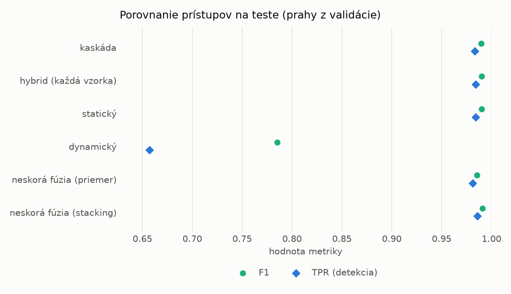
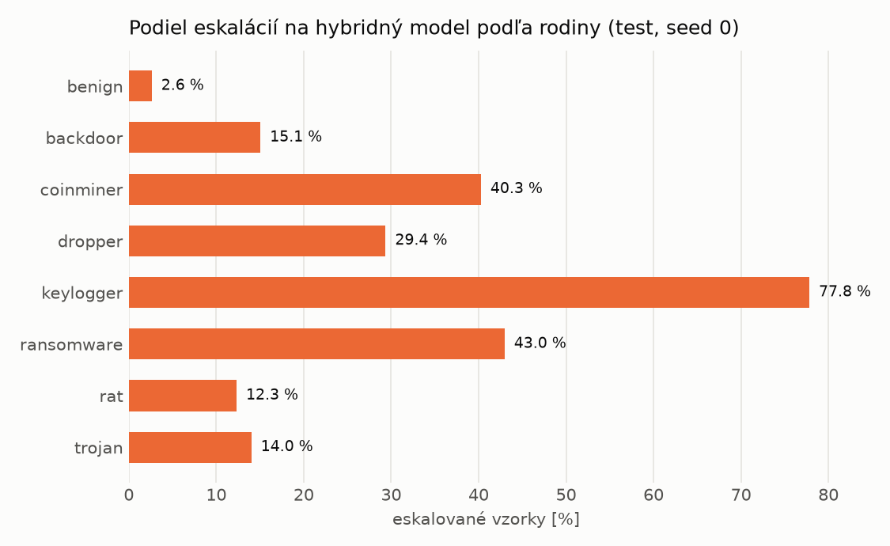

# Kaskáda `baselines` – beh `20261102-213726`

> Generované `src/cascade/evaluate.py` (2026-11-02T21:37:26+01:00). Seedy: [0, 1, 2]; hodnoty = priemer ± sm. odchýlka.
> Všetky prahy sú určené na validácii (FPR ≤ 1 %); test sa na nič nenastavuje.

| rola | beh |
|---|---|
| static | `runs_final/static/lightgbm/20261101-215345` |
| dynamic | `runs_final/dynamic/lightgbm/20261102-003953` |
| hybrid | `runs_final/hybrid/lightgbm/20261102-052826` |

## Test
| prístup | accuracy | balanced_accuracy | precision | recall_tpr | fpr | f1 | mcc |
|---|---|---|---|---|---|---|---|
| kaskáda | 0.9890 ± 0.0009 | 0.9896 ± 0.0009 | 0.9967 ± 0.0001 | 0.9831 ± 0.0018 | 0.0039 ± 0.0001 | 0.9898 ± 0.0009 | 0.9781 ± 0.0019 |
| hybrid (každá vzorka) | 0.9893 ± 0.0018 | 0.9898 ± 0.0017 | 0.9960 ± 0.0001 | 0.9842 ± 0.0036 | 0.0047 ± 0.0002 | 0.9901 ± 0.0017 | 0.9785 ± 0.0037 |
| statický | 0.9893 ± 0.0003 | 0.9897 ± 0.0003 | 0.9959 ± 0.0002 | 0.9843 ± 0.0004 | 0.0048 ± 0.0002 | 0.9900 ± 0.0003 | 0.9785 ± 0.0006 |
| dynamický | 0.8051 ± 0.0016 | 0.8187 ± 0.0012 | 0.9752 ± 0.0055 | 0.6572 ± 0.0069 | 0.0198 ± 0.0046 | 0.7852 ± 0.0032 | 0.6595 ± 0.0004 |
| neskorá fúzia (priemer) | 0.9841 ± 0.0006 | 0.9844 ± 0.0007 | 0.9895 ± 0.0014 | 0.9811 ± 0.0003 | 0.0123 ± 0.0017 | 0.9853 ± 0.0006 | 0.9681 ± 0.0013 |
| neskorá fúzia (stacking) | 0.9900 ± 0.0005 | 0.9904 ± 0.0005 | 0.9958 ± 0.0005 | 0.9857 ± 0.0015 | 0.0049 ± 0.0006 | 0.9907 ± 0.0005 | 0.9799 ± 0.0011 |

## Validácia
| prístup | accuracy | balanced_accuracy | precision | recall_tpr | fpr | f1 | mcc |
|---|---|---|---|---|---|---|---|
| kaskáda | 0.9954 ± 0.0003 | 0.9946 ± 0.0003 | 0.9963 ± 0.0001 | 0.9968 ± 0.0005 | 0.0075 ± 0.0002 | 0.9966 ± 0.0003 | 0.9895 ± 0.0008 |
| hybrid (každá vzorka) | 0.9948 ± 0.0004 | 0.9938 ± 0.0004 | 0.9955 ± 0.0003 | 0.9968 ± 0.0005 | 0.0091 ± 0.0006 | 0.9962 ± 0.0003 | 0.9883 ± 0.0009 |
| statický | 0.9956 ± 0.0001 | 0.9945 ± 0.0001 | 0.9957 ± 0.0001 | 0.9978 ± 0.0000 | 0.0089 ± 0.0002 | 0.9967 ± 0.0001 | 0.9900 ± 0.0002 |
| dynamický | 0.9671 ± 0.0013 | 0.9729 ± 0.0010 | 0.9950 ± 0.0000 | 0.9557 ± 0.0020 | 0.0098 ± 0.0000 | 0.9750 ± 0.0010 | 0.9285 ± 0.0027 |
| neskorá fúzia (priemer) | 0.9942 ± 0.0002 | 0.9933 ± 0.0004 | 0.9954 ± 0.0003 | 0.9960 ± 0.0000 | 0.0094 ± 0.0007 | 0.9957 ± 0.0002 | 0.9869 ± 0.0005 |
| neskorá fúzia (stacking) | 0.9956 ± 0.0001 | 0.9944 ± 0.0003 | 0.9957 ± 0.0003 | 0.9977 ± 0.0001 | 0.0089 ± 0.0006 | 0.9967 ± 0.0001 | 0.9899 ± 0.0003 |

## Správanie kaskády (test, seed 0)
- podiel eskalácií na hybrid: **18.96%** (3288 vzoriek)
- chyby pri zhode študentov (kaskáda ich nemôže opraviť): **129**
  (0.918% zo zhôd; FP 5, FN 124)
- úspešnosť na eskalovaných vzorkách: hybrid 0.9841849148418491, statický 0.9844890510948905,
  dynamický 0.01551094890510949  → prínos hybridu pri nezhode

## Výpočtové nároky (odhad z benchmarkov komponentov)
| meranie | statický | dynamický | hybrid na každej vzorke | neskorá fúzia | kaskáda (odhad) |
|---|---|---|---|---|---|
| CPU čas ms/vz. (dávka) | 0.6786 | 0.4269 | 0.0858 | 1.1055 | 1.1218 |
| CPU čas ms/vz. (1 vz.) | 0.3978 | 0.2396 | 0.0422 | 0.6374 | 0.6455 |
| latencia ms (1 vz., postupne) | 0.3749 | 0.2311 | 0.0413 | 0.6060 | 0.6139 |

