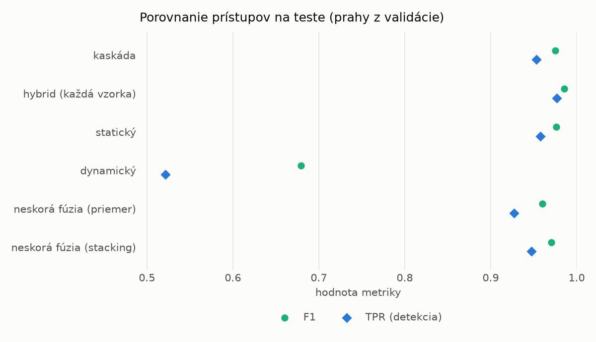
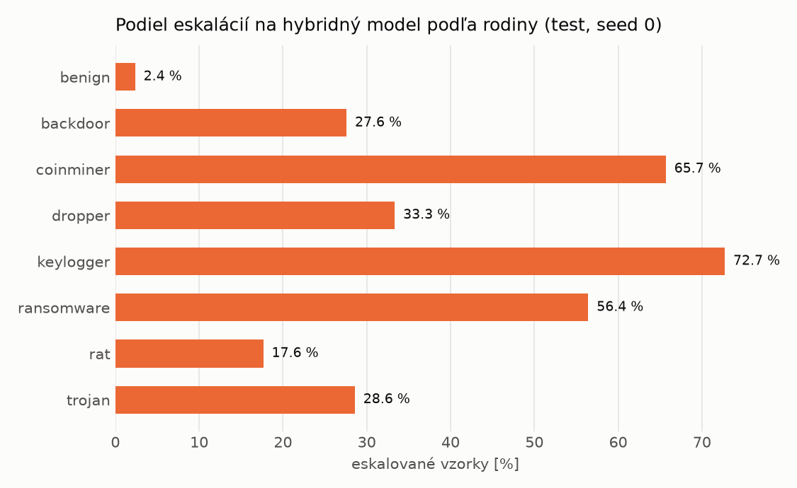

# Kaskáda `heavy` – beh `20261102-213724`

> Generované `src/cascade/evaluate.py` (2026-11-02T21:37:24+01:00). Seedy: [0, 1, 2]; hodnoty = priemer ± sm. odchýlka.
> Všetky prahy sú určené na validácii (FPR ≤ 1 %); test sa na nič nenastavuje.

| rola | beh |
|---|---|
| static | `runs_final/students_static/mlp_kd/20261102-211333` |
| dynamic | `runs_final/students_dynamic/mlp_kd/20261102-212132` |
| hybrid | `runs_final/hybrid/two_branch/20261102-170657` |

## Test
| prístup | accuracy | balanced_accuracy | precision | recall_tpr | fpr | f1 | mcc |
|---|---|---|---|---|---|---|---|
| kaskáda | 0.9735 ± 0.0043 | 0.9753 ± 0.0040 | 0.9976 ± 0.0003 | 0.9534 ± 0.0083 | 0.0027 ± 0.0003 | 0.9750 ± 0.0042 | 0.9479 ± 0.0082 |
| hybrid (každá vzorka) | 0.9847 ± 0.0025 | 0.9854 ± 0.0023 | 0.9950 ± 0.0007 | 0.9767 ± 0.0051 | 0.0058 ± 0.0008 | 0.9857 ± 0.0024 | 0.9694 ± 0.0050 |
| statický | 0.9746 ± 0.0052 | 0.9761 ± 0.0048 | 0.9948 ± 0.0003 | 0.9581 ± 0.0097 | 0.0059 ± 0.0003 | 0.9761 ± 0.0050 | 0.9497 ± 0.0099 |
| dynamický | 0.7327 ± 0.0033 | 0.7522 ± 0.0029 | 0.9731 ± 0.0044 | 0.5214 ± 0.0082 | 0.0171 ± 0.0031 | 0.6790 ± 0.0061 | 0.5535 ± 0.0037 |
| neskorá fúzia (priemer) | 0.9583 ± 0.0023 | 0.9611 ± 0.0021 | 0.9955 ± 0.0002 | 0.9272 ± 0.0042 | 0.0049 ± 0.0002 | 0.9601 ± 0.0023 | 0.9191 ± 0.0043 |
| neskorá fúzia (stacking) | 0.9688 ± 0.0008 | 0.9708 ± 0.0007 | 0.9950 ± 0.0002 | 0.9472 ± 0.0016 | 0.0056 ± 0.0002 | 0.9705 ± 0.0008 | 0.9387 ± 0.0015 |

## Validácia
| prístup | accuracy | balanced_accuracy | precision | recall_tpr | fpr | f1 | mcc |
|---|---|---|---|---|---|---|---|
| kaskáda | 0.9907 ± 0.0002 | 0.9914 ± 0.0002 | 0.9968 ± 0.0002 | 0.9892 ± 0.0004 | 0.0064 ± 0.0005 | 0.9930 ± 0.0002 | 0.9790 ± 0.0005 |
| hybrid (každá vzorka) | 0.9943 ± 0.0003 | 0.9934 ± 0.0002 | 0.9955 ± 0.0001 | 0.9961 ± 0.0005 | 0.0093 ± 0.0002 | 0.9958 ± 0.0002 | 0.9871 ± 0.0006 |
| statický | 0.9889 ± 0.0002 | 0.9893 ± 0.0003 | 0.9954 ± 0.0003 | 0.9881 ± 0.0002 | 0.0094 ± 0.0007 | 0.9917 ± 0.0002 | 0.9750 ± 0.0005 |
| dynamický | 0.9406 ± 0.0113 | 0.9533 ± 0.0085 | 0.9949 ± 0.0002 | 0.9162 ± 0.0168 | 0.0096 ± 0.0002 | 0.9539 ± 0.0091 | 0.8769 ± 0.0215 |
| neskorá fúzia (priemer) | 0.9903 ± 0.0005 | 0.9903 ± 0.0004 | 0.9952 ± 0.0001 | 0.9904 ± 0.0008 | 0.0097 ± 0.0002 | 0.9928 ± 0.0004 | 0.9782 ± 0.0012 |
| neskorá fúzia (stacking) | 0.9903 ± 0.0003 | 0.9903 ± 0.0004 | 0.9953 ± 0.0002 | 0.9902 ± 0.0003 | 0.0096 ± 0.0005 | 0.9927 ± 0.0003 | 0.9780 ± 0.0008 |

## Správanie kaskády (test, seed 0)
- podiel eskalácií na hybrid: **25.42%** (4408 vzoriek)
- chyby pri zhode študentov (kaskáda ich nemôže opraviť): **325**
  (2.513% zo zhôd; FP 5, FN 320)
- úspešnosť na eskalovaných vzorkách: hybrid 0.9707350272232305, statický 0.9832123411978222,
  dynamický 0.01678765880217786  → prínos hybridu pri nezhode

## Výpočtové nároky (odhad z benchmarkov komponentov)
| meranie | statický | dynamický | hybrid na každej vzorke | neskorá fúzia | kaskáda (odhad) |
|---|---|---|---|---|---|
| CPU čas ms/vz. (dávka) | 0.3037 | 0.2956 | 32.4503 | 0.5993 | 8.7934 |
| CPU čas ms/vz. (1 vz.) | 0.1800 | 0.1692 | 5.2031 | 0.3492 | 1.6631 |
| latencia ms (1 vz., postupne) | 0.0961 | 0.0907 | 5.2148 | 0.1868 | 1.5036 |

