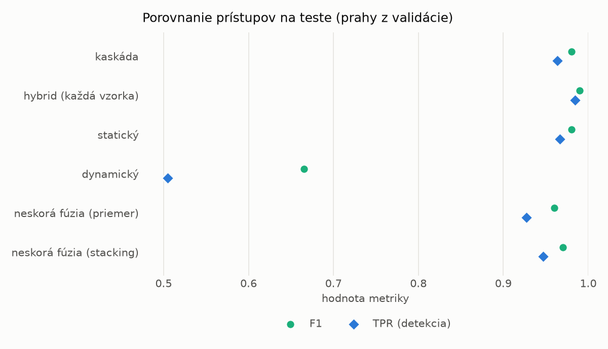
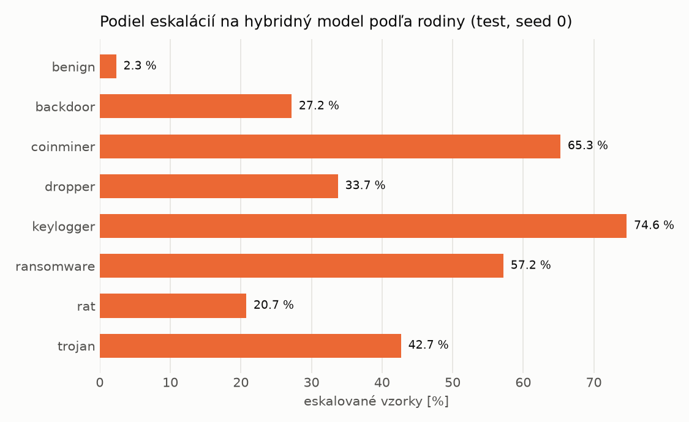

# Kaskáda `modal` – beh `20261102-213722`

> Generované `src/cascade/evaluate.py` (2026-11-02T21:37:22+01:00). Seedy: [0, 1, 2]; hodnoty = priemer ± sm. odchýlka.
> Všetky prahy sú určené na validácii (FPR ≤ 1 %); test sa na nič nenastavuje.

| rola | beh |
|---|---|
| static | `runs_final/students_static/mlp_kd_modal/20261102-211832` |
| dynamic | `runs_final/students_dynamic/mlp_kd_modal/20261102-212954` |
| hybrid | `runs_final/hybrid/lightgbm/20261102-052826` |

## Test
| prístup | accuracy | balanced_accuracy | precision | recall_tpr | fpr | f1 | mcc |
|---|---|---|---|---|---|---|---|
| kaskáda | 0.9791 ± 0.0017 | 0.9805 ± 0.0016 | 0.9978 ± 0.0001 | 0.9635 ± 0.0031 | 0.0025 ± 0.0001 | 0.9804 ± 0.0016 | 0.9587 ± 0.0033 |
| hybrid (každá vzorka) | 0.9893 ± 0.0018 | 0.9898 ± 0.0017 | 0.9960 ± 0.0001 | 0.9842 ± 0.0036 | 0.0047 ± 0.0002 | 0.9901 ± 0.0017 | 0.9785 ± 0.0037 |
| statický | 0.9788 ± 0.0019 | 0.9799 ± 0.0018 | 0.9941 ± 0.0005 | 0.9667 ± 0.0039 | 0.0068 ± 0.0006 | 0.9802 ± 0.0018 | 0.9579 ± 0.0037 |
| dynamický | 0.7245 ± 0.0059 | 0.7446 ± 0.0054 | 0.9744 ± 0.0023 | 0.5050 ± 0.0116 | 0.0157 ± 0.0016 | 0.6652 ± 0.0099 | 0.5423 ± 0.0083 |
| neskorá fúzia (priemer) | 0.9582 ± 0.0074 | 0.9610 ± 0.0067 | 0.9952 ± 0.0010 | 0.9273 ± 0.0141 | 0.0052 ± 0.0011 | 0.9601 ± 0.0074 | 0.9189 ± 0.0135 |
| neskorá fúzia (stacking) | 0.9686 ± 0.0052 | 0.9705 ± 0.0047 | 0.9948 ± 0.0008 | 0.9470 ± 0.0104 | 0.0059 ± 0.0010 | 0.9703 ± 0.0051 | 0.9383 ± 0.0097 |

## Validácia
| prístup | accuracy | balanced_accuracy | precision | recall_tpr | fpr | f1 | mcc |
|---|---|---|---|---|---|---|---|
| kaskáda | 0.9912 ± 0.0007 | 0.9919 ± 0.0005 | 0.9971 ± 0.0001 | 0.9898 ± 0.0010 | 0.0059 ± 0.0002 | 0.9934 ± 0.0005 | 0.9802 ± 0.0015 |
| hybrid (každá vzorka) | 0.9948 ± 0.0004 | 0.9938 ± 0.0004 | 0.9955 ± 0.0003 | 0.9968 ± 0.0005 | 0.0091 ± 0.0006 | 0.9962 ± 0.0003 | 0.9883 ± 0.0009 |
| statický | 0.9887 ± 0.0011 | 0.9891 ± 0.0009 | 0.9952 ± 0.0001 | 0.9880 ± 0.0016 | 0.0097 ± 0.0002 | 0.9916 ± 0.0009 | 0.9746 ± 0.0025 |
| dynamický | 0.9332 ± 0.0005 | 0.9477 ± 0.0004 | 0.9948 ± 0.0001 | 0.9052 ± 0.0007 | 0.0097 ± 0.0002 | 0.9479 ± 0.0004 | 0.8628 ± 0.0009 |
| neskorá fúzia (priemer) | 0.9912 ± 0.0021 | 0.9911 ± 0.0015 | 0.9955 ± 0.0001 | 0.9914 ± 0.0032 | 0.0091 ± 0.0002 | 0.9934 ± 0.0016 | 0.9801 ± 0.0047 |
| neskorá fúzia (stacking) | 0.9912 ± 0.0017 | 0.9910 ± 0.0013 | 0.9954 ± 0.0002 | 0.9915 ± 0.0024 | 0.0094 ± 0.0004 | 0.9934 ± 0.0013 | 0.9801 ± 0.0038 |

## Správanie kaskády (test, seed 0)
- podiel eskalácií na hybrid: **26.64%** (4619 vzoriek)
- chyby pri zhode študentov (kaskáda ich nemôže opraviť): **268**
  (2.107% zo zhôd; FP 5, FN 263)
- úspešnosť na eskalovaných vzorkách: hybrid 0.9835462221260013, statický 0.9857111928988959,
  dynamický 0.014288807101104134  → prínos hybridu pri nezhode

## Výpočtové nároky (odhad z benchmarkov komponentov)
| meranie | statický | dynamický | hybrid na každej vzorke | neskorá fúzia | kaskáda (odhad) |
|---|---|---|---|---|---|
| CPU čas ms/vz. (dávka) | 0.3060 | 0.2965 | 0.0858 | 0.6025 | 0.6250 |
| CPU čas ms/vz. (1 vz.) | 0.1746 | 0.1652 | 0.0422 | 0.3399 | 0.3510 |
| latencia ms (1 vz., postupne) | 0.0946 | 0.0893 | 0.0413 | 0.1839 | 0.1948 |

