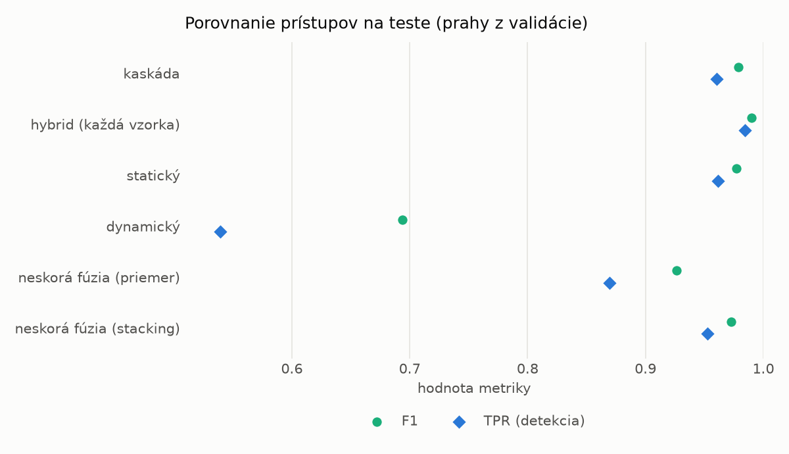
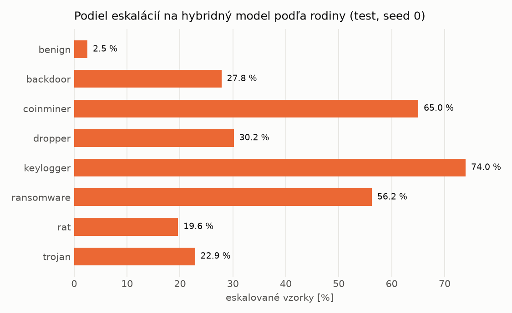

# Kaskáda `nokd` – beh `20261102-213720`

> Generované `src/cascade/evaluate.py` (2026-11-02T21:37:20+01:00). Seedy: [0, 1, 2]; hodnoty = priemer ± sm. odchýlka.
> Všetky prahy sú určené na validácii (FPR ≤ 1 %); test sa na nič nenastavuje.

| rola | beh |
|---|---|
| static | `runs_final/students_static/mlp_nokd/20261102-211710` |
| dynamic | `runs_final/students_dynamic/mlp_nokd/20261102-212647` |
| hybrid | `runs_final/hybrid/lightgbm/20261102-052826` |

## Test
| prístup | accuracy | balanced_accuracy | precision | recall_tpr | fpr | f1 | mcc |
|---|---|---|---|---|---|---|---|
| kaskáda | 0.9773 ± 0.0012 | 0.9789 ± 0.0012 | 0.9976 ± 0.0004 | 0.9605 ± 0.0020 | 0.0027 ± 0.0005 | 0.9787 ± 0.0012 | 0.9553 ± 0.0024 |
| hybrid (každá vzorka) | 0.9893 ± 0.0018 | 0.9898 ± 0.0017 | 0.9960 ± 0.0001 | 0.9842 ± 0.0036 | 0.0047 ± 0.0002 | 0.9901 ± 0.0017 | 0.9785 ± 0.0037 |
| statický | 0.9755 ± 0.0018 | 0.9769 ± 0.0017 | 0.9934 ± 0.0006 | 0.9613 ± 0.0033 | 0.0076 ± 0.0007 | 0.9771 ± 0.0018 | 0.9515 ± 0.0035 |
| dynamický | 0.7421 ± 0.0019 | 0.7607 ± 0.0018 | 0.9731 ± 0.0034 | 0.5391 ± 0.0042 | 0.0177 ± 0.0024 | 0.6938 ± 0.0032 | 0.5668 ± 0.0031 |
| neskorá fúzia (priemer) | 0.9255 ± 0.0283 | 0.9307 ± 0.0259 | 0.9924 ± 0.0025 | 0.8694 ± 0.0549 | 0.0080 ± 0.0032 | 0.9262 ± 0.0296 | 0.8605 ± 0.0499 |
| neskorá fúzia (stacking) | 0.9709 ± 0.0026 | 0.9726 ± 0.0024 | 0.9934 ± 0.0003 | 0.9526 ± 0.0051 | 0.0075 ± 0.0004 | 0.9726 ± 0.0026 | 0.9425 ± 0.0050 |

## Validácia
| prístup | accuracy | balanced_accuracy | precision | recall_tpr | fpr | f1 | mcc |
|---|---|---|---|---|---|---|---|
| kaskáda | 0.9914 ± 0.0005 | 0.9923 ± 0.0005 | 0.9975 ± 0.0003 | 0.9896 ± 0.0006 | 0.0051 ± 0.0006 | 0.9936 ± 0.0004 | 0.9806 ± 0.0011 |
| hybrid (každá vzorka) | 0.9948 ± 0.0004 | 0.9938 ± 0.0004 | 0.9955 ± 0.0003 | 0.9968 ± 0.0005 | 0.0091 ± 0.0006 | 0.9962 ± 0.0003 | 0.9883 ± 0.0009 |
| statický | 0.9893 ± 0.0009 | 0.9897 ± 0.0008 | 0.9956 ± 0.0004 | 0.9885 ± 0.0009 | 0.0090 ± 0.0008 | 0.9920 ± 0.0006 | 0.9759 ± 0.0019 |
| dynamický | 0.9433 ± 0.0131 | 0.9553 ± 0.0098 | 0.9949 ± 0.0002 | 0.9202 ± 0.0194 | 0.0096 ± 0.0002 | 0.9560 ± 0.0105 | 0.8821 ± 0.0251 |
| neskorá fúzia (priemer) | 0.9906 ± 0.0007 | 0.9906 ± 0.0007 | 0.9954 ± 0.0005 | 0.9906 ± 0.0010 | 0.0093 ± 0.0009 | 0.9930 ± 0.0006 | 0.9788 ± 0.0017 |
| neskorá fúzia (stacking) | 0.9922 ± 0.0017 | 0.9917 ± 0.0012 | 0.9952 ± 0.0000 | 0.9932 ± 0.0025 | 0.0098 ± 0.0000 | 0.9942 ± 0.0012 | 0.9823 ± 0.0037 |

## Správanie kaskády (test, seed 0)
- podiel eskalácií na hybrid: **25.26%** (4379 vzoriek)
- chyby pri zhode študentov (kaskáda ich nemôže opraviť): **264**
  (2.037% zo zhôd; FP 6, FN 258)
- úspešnosť na eskalovaných vzorkách: hybrid 0.9744233843343229, statický 0.9689426809773921,
  dynamický 0.0310573190226079  → prínos hybridu pri nezhode

## Výpočtové nároky (odhad z benchmarkov komponentov)
| meranie | statický | dynamický | hybrid na každej vzorke | neskorá fúzia | kaskáda (odhad) |
|---|---|---|---|---|---|
| CPU čas ms/vz. (dávka) | 0.3039 | 0.2957 | 0.0858 | 0.5997 | 0.6210 |
| CPU čas ms/vz. (1 vz.) | 0.1526 | 0.1600 | 0.0422 | 0.3127 | 0.3231 |
| latencia ms (1 vz., postupne) | 0.0944 | 0.0894 | 0.0413 | 0.1838 | 0.1941 |

