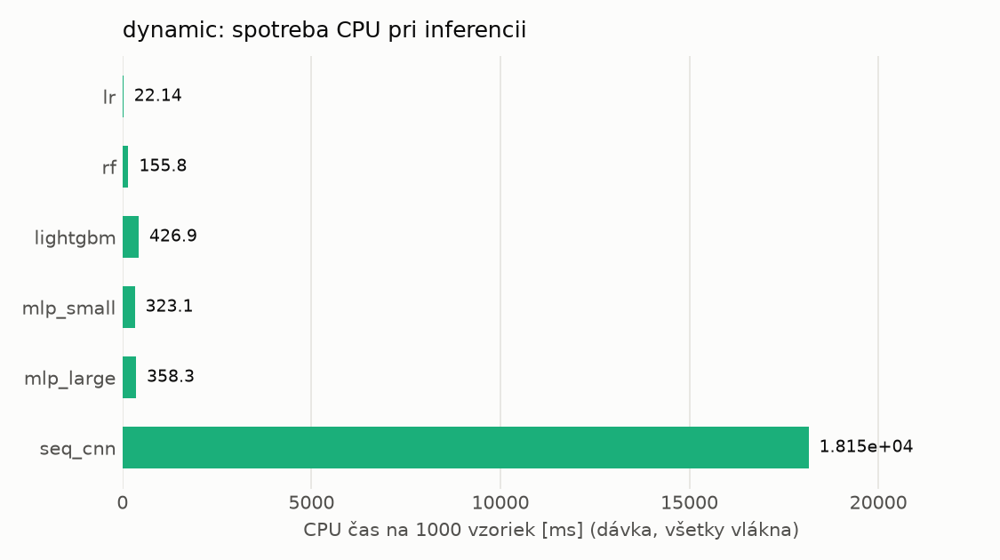
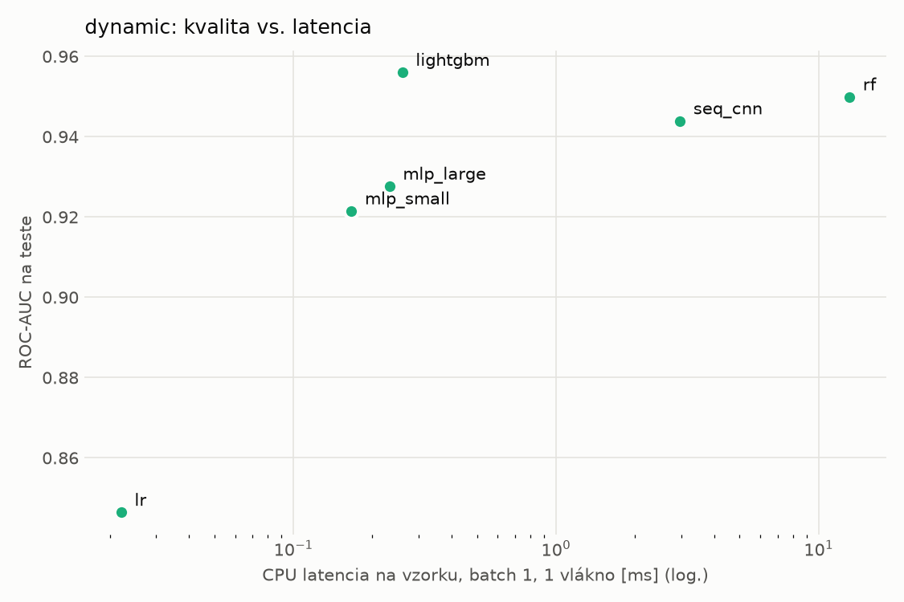
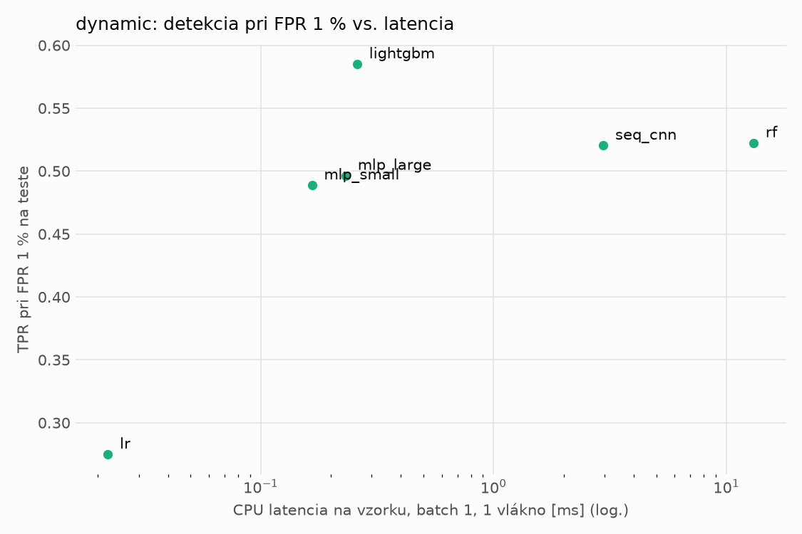
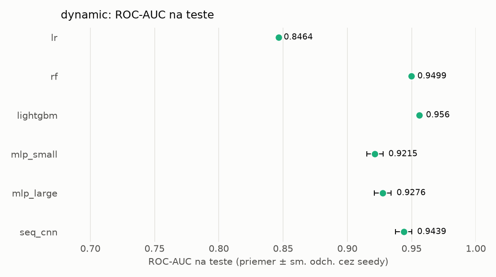
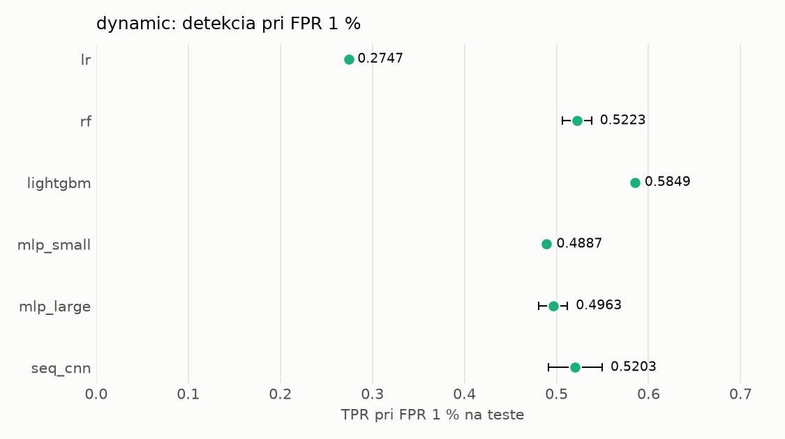

# Porovnanie modelov – dynamic

> Generované `src/evaluation/compare.py` (2026-11-02T04:43:54+01:00); použitý je posledný beh každého modelu.
> Metriky sú priemer cez seedy. \* = pri prahu určenom na validácii (FPR ≤ 1 %).
> CPU ms/vz. = medián latencie jednej vzorky na 1 vlákne vrátane transformácie vstupu (meranie hneď po tréningu,
> orientačné). Oficiálne merania spotreby sú v časti „Spotreba zdrojov pri inferencii“.

## Detekčná kvalita a orientačné časy
| model | ROC-AUC val | ROC-AUC test | TPR@FPR 1 % test | TPR@FPR 0,1 % test | F1 test* | FPR test* | gap train−val | CPU ms/vz. | CPU vz./s | GPU ms/vz. | parametre | MB | tréning s | ladenie min |
|---|---|---|---|---|---|---|---|---|---|---|---|---|---|---|
| [lr](../../dynamic/lr/20261102-002602/README.md) | 0.9941 | 0.8464 ± 0.0000 | 0.2747 | 0.1832 | 0.6282 | 0.0942 | 0.0013 | 0.022 | 333 047 | – | 2 001 | 0.06 | 5.9 | 4.2 |
| [rf](../../dynamic/rf/20261102-003041/README.md) | 0.9969 | 0.9499 ± 0.0005 | 0.5223 | 0.0000 | 0.7229 | 0.0187 | 0.0015 | 13.102 | 90 727 | – | 1 035 832 | 83.32 | 40.6 | 7.0 |
| [lightgbm](../../dynamic/lightgbm/20261102-003953/README.md) | 0.9970 | 0.9560 ± 0.0011 | 0.5849 | 0.3139 | 0.7852 | 0.0198 | 0.0014 | 0.260 | 61 694 | – | 656 057 | 37.27 | 27.4 | 14.6 |
| [mlp_small](../../dynamic/mlp_small/20261102-005611/README.md) | 0.9961 | 0.9215 ± 0.0064 | 0.4887 | 0.2794 | 0.6873 | 0.0137 | 0.0011 | 0.166 | 115 530 | 0.412 | 546 049 | 2.24 | 3.2 | 2.9 |
| [mlp_large](../../dynamic/mlp_large/20261102-005920/README.md) | 0.9959 | 0.9276 ± 0.0065 | 0.4963 | 0.3251 | 0.6858 | 0.0145 | 0.0011 | 0.232 | 99 744 | 0.509 | 1 190 657 | 4.83 | 16.5 | 7.4 |
| [seq_cnn](../../dynamic/seq_cnn/20261102-010741/README.md) | 0.9969 | 0.9439 ± 0.0063 | 0.5203 | 0.3196 | 0.7636 | 0.0238 | 0.0008 | 2.965 | 1 188 | 1.066 | 210 241 | 0.85 | 435.2 | 181.9 |

## Nízka prevalencia malvéru (test, prah z validácie)
| model | TPR | FPR | precision @ 1 % | falošné na 1 skutočný poplach @ 1 % | precision @ 0.1 % | falošné na 1 skutočný poplach @ 0.1 % |
|---|---|---|---|---|---|---|
| lr | 0.4944 | 0.0942 | 0.050 | 18.86 | 0.005 | 190.35 |
| rf | 0.5751 | 0.0187 | 0.237 | 3.22 | 0.030 | 32.45 |
| lightgbm | 0.6572 | 0.0198 | 0.251 | 2.98 | 0.032 | 30.12 |
| mlp_small | 0.5297 | 0.0137 | 0.280 | 2.57 | 0.037 | 25.89 |
| mlp_large | 0.5286 | 0.0145 | 0.269 | 2.71 | 0.035 | 27.37 |
| seq_cnn | 0.6300 | 0.0238 | 0.211 | 3.73 | 0.026 | 37.68 |

Prepočet: TPR a FPR nezávisia od podielu malvéru, preto sa dajú preniesť na nízku prevalenciu (v reálnej prevádzke je malvéru ~1 % alebo menej; v teste 54 %). „Falošné na 1 skutočný poplach“ = koľko neškodných súborov je označených na každý zachytený malvér.

## Spotreba zdrojov pri inferencii (benchmark, testovacia množina)
| model | CPU čas ms/vz. (dávka) | vz./s (dávka) | vyťaženie CPU % | nárast RAM MB | latencia ms (1 vz.) | p95 ms | CPU čas ms/vz. (1 vz.) | GPU vz./s | vyťaženie GPU % | GPU pamäť MB | GPU energia J/1000 vz. | |
|---|---|---|---|---|---|---|---|---|---|---|---|---|
| lr | 0.022 | 48 046 | 4.4 | 417 | 0.022 | 0.024 | 0.022 | – | – | – | – |  |
| rf | 0.156 | 102 257 | 66.4 | 13 | 12.900 | 13.476 | 12.969 | – | – | – | – |  |
| lightgbm | 0.427 | 55 840 | 99.3 | 2 | 0.231 | 0.298 | 0.240 | – | – | – | – |  |
| mlp_small | 0.323 | 35 471 | 47.8 | 295 | 0.158 | 0.197 | 0.271 | 34 091 | 0.0 | 166 | 0.14 | ⚠ |
| mlp_large | 0.358 | 30 844 | 46.0 | 335 | 0.221 | 0.244 | 0.392 | 39 313 | 6.1 | 186 | 0.00 |  |
| seq_cnn | 18.153 | 1 309 | 99.0 | 739 | 2.837 | 3.107 | 2.891 | 10 019 | 98.8 | 825 | 7.50 | ⚠ |

- **Počítač merania:** dcatloch, 16 fyzických / 24 logických jadier, GPU NVIDIA GeForce RTX 4060 Laptop GPU.
- **CPU čas** = koľko času procesora (súčet cez jadrá) spotrebuje jedna vzorka – hlavná miera výpočtovej náročnosti.
- **vyťaženie CPU** = priemerný podiel všetkých logických jadier počítača počas dávkovej inferencie.
- **GPU energia** = energia karty nad úrovňou nečinnosti na 1000 vzoriek (iba modely na GPU).
- ⚠ = počítač bol pred meraním zaťažený; čísla môžu byť skreslené.

## Grafy

