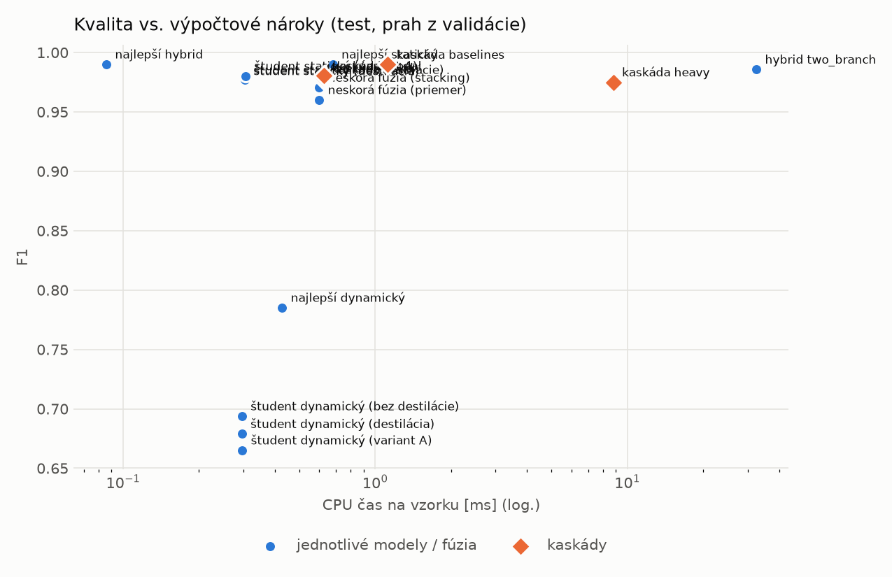

# Záverečné porovnanie – výskumné otázky

> Generované `src/evaluation/final_report.py` (2026-11-02T21:37:27+01:00), výsledky z `runs_final`.
> Test (apríl 2022), prahy z validácie (FPR ≤ 1 %), priemer cez seedy. Nároky = benchmark (CPU čas na vzorku, dávka);
> pri kaskáde odhad statický + dynamický + podiel eskalácií × hybrid. Merania nárokov porovnávať iba z jedného počítača.

Vybrané modely (pravidlo `configs/selection.yaml`): static = `static/lightgbm`, dynamic = `dynamic/lightgbm`, hybrid = `hybrid/lightgbm`

## Všetky prístupy
| prístup | TPR (prah z val.) | FPR (prah z val.) | F1 | TPR@FPR 1 % | TPR@FPR 0,1 % | ROC-AUC | CPU ms/vz. | latencia ms | eskalácie | precision @ 1 % | falošné/1 skutočný @ 1 % | precision @ 0.1 % | falošné/1 skutočný @ 0.1 % |
|---|---|---|---|---|---|---|---|---|---|---|---|---|---|
| najlepší statický | 0.9843 | 0.0048 | 0.9900 | 0.9943 | 0.9699 | 0.9995 | 0.6786 | 0.3749 | – | 0.6731 | 0.4856 | 0.1695 | 4.9000 |
| najlepší dynamický | 0.6572 | 0.0198 | 0.7852 | 0.5849 | 0.3139 | 0.9560 | 0.4269 | 0.2311 | – | 0.2509 | 2.9850 | 0.0321 | 30.1210 |
| najlepší hybrid | 0.9842 | 0.0047 | 0.9901 | 0.9915 | 0.9329 | 0.9994 | 0.0858 | 0.0413 | – | 0.6789 | 0.4730 | 0.1732 | 4.7725 |
| hybrid two_branch | 0.9767 | 0.0058 | 0.9857 | 0.9893 | 0.8173 | 0.9985 | 32.4503 | 5.2148 | – | 0.6283 | 0.5915 | 0.1435 | 5.9689 |
| študent statický (destilácia) | 0.9581 | 0.0059 | 0.9761 | 0.9815 | 0.5483 | 0.9978 | 0.3037 | 0.0961 | – | 0.6205 | 0.6117 | 0.1394 | 6.1722 |
| študent statický (bez destilácie) | 0.9613 | 0.0076 | 0.9771 | 0.9754 | 0.3684 | 0.9973 | 0.3039 | 0.0944 | – | 0.5624 | 0.7783 | 0.1130 | 7.8533 |
| študent statický (variant A) | 0.9667 | 0.0068 | 0.9802 | 0.9765 | 0.7812 | 0.9981 | 0.3060 | 0.0946 | – | 0.5894 | 0.6965 | 0.1246 | 7.0285 |
| študent dynamický (destilácia) | 0.5214 | 0.0171 | 0.6790 | 0.4164 | 0.2898 | 0.8972 | 0.2956 | 0.0907 | – | 0.2352 | 3.2520 | 0.0296 | 32.8156 |
| študent dynamický (bez destilácie) | 0.5391 | 0.0177 | 0.6938 | 0.4484 | 0.3130 | 0.9112 | 0.2957 | 0.0894 | – | 0.2355 | 3.2455 | 0.0296 | 32.7498 |
| študent dynamický (variant A) | 0.5050 | 0.0157 | 0.6652 | 0.4574 | 0.2729 | 0.8918 | 0.2965 | 0.0893 | – | 0.2447 | 3.0864 | 0.0311 | 31.1443 |
| kaskáda main | 0.9579 | 0.0026 | 0.9774 | – | – | – | 0.6209 | 0.1972 | 0.2525 | 0.7853 | 0.2733 | 0.2661 | 2.7583 |
| neskorá fúzia (priemer) | 0.9272 | 0.0049 | 0.9601 | – | – | – | 0.5993 | 0.1868 | – | 0.6560 | 0.5245 | 0.1589 | 5.2923 |
| neskorá fúzia (stacking) | 0.9472 | 0.0056 | 0.9705 | – | – | – | 0.5993 | 0.1868 | – | 0.6297 | 0.5880 | 0.1442 | 5.9334 |
| kaskáda nokd | 0.9605 | 0.0027 | 0.9787 | – | – | – | 0.6210 | 0.1941 | 0.2485 | 0.7831 | 0.2769 | 0.2635 | 2.7946 |
| kaskáda modal | 0.9635 | 0.0025 | 0.9804 | – | – | – | 0.6250 | 0.1948 | 0.2632 | 0.7971 | 0.2545 | 0.2803 | 2.5682 |
| kaskáda heavy | 0.9534 | 0.0027 | 0.9750 | – | – | – | 8.7934 | 1.5036 | 0.2525 | 0.7792 | 0.2834 | 0.2591 | 2.8594 |
| kaskáda baselines | 0.9831 | 0.0039 | 0.9898 | – | – | – | 1.1218 | 0.6139 | 0.1906 | 0.7178 | 0.3932 | 0.2013 | 3.9675 |

## Otázka 1 – najlepší hybrid
Pozri `runs_final/selection/hybrid.md` a `runs/comparison/hybrid/README.md`.

## Otázka 2 – študenti
- **študent statický (destilácia)** vs. **študent statický (bez destilácie)**: F1: 0.9761 vs. 0.9771 (Δ -0.0010); TPR (prah z val.): 0.9581 vs. 0.9613 (Δ -0.0032); FPR (prah z val.): 0.0059 vs. 0.0076 (Δ -0.0016); CPU: 0.3037 vs. 0.3039 ms (1.00×)
- **študent dynamický (destilácia)** vs. **študent dynamický (bez destilácie)**: F1: 0.6790 vs. 0.6938 (Δ -0.0149); TPR (prah z val.): 0.5214 vs. 0.5391 (Δ -0.0177); FPR (prah z val.): 0.0171 vs. 0.0177 (Δ -0.0005); CPU: 0.2956 vs. 0.2957 ms (1.00×)
- **študent statický (destilácia)** vs. **najlepší statický**: F1: 0.9761 vs. 0.9900 (Δ -0.0140); TPR (prah z val.): 0.9581 vs. 0.9843 (Δ -0.0262); FPR (prah z val.): 0.0059 vs. 0.0048 (Δ +0.0011); CPU: 0.3037 vs. 0.6786 ms (0.45×)
- **študent dynamický (destilácia)** vs. **najlepší dynamický**: F1: 0.6790 vs. 0.7852 (Δ -0.1062); TPR (prah z val.): 0.5214 vs. 0.6572 (Δ -0.1358); FPR (prah z val.): 0.0171 vs. 0.0198 (Δ -0.0027); CPU: 0.2956 vs. 0.4269 ms (0.69×)

## Otázka 3 – samostatné prístupy vs. hybrid
- **najlepší statický** vs. **najlepší hybrid**: F1: 0.9900 vs. 0.9901 (Δ -0.0000); TPR (prah z val.): 0.9843 vs. 0.9842 (Δ +0.0001); FPR (prah z val.): 0.0048 vs. 0.0047 (Δ +0.0001); CPU: 0.6786 vs. 0.0858 ms (7.91×)
- **najlepší dynamický** vs. **najlepší hybrid**: F1: 0.7852 vs. 0.9901 (Δ -0.2049); TPR (prah z val.): 0.6572 vs. 0.9842 (Δ -0.3270); FPR (prah z val.): 0.0198 vs. 0.0047 (Δ +0.0151); CPU: 0.4269 vs. 0.0858 ms (4.98×)

## Otázka 4 – kaskáda
(a) vs. hybrid na každej vzorke:
- **kaskáda main** vs. **najlepší hybrid**: F1: 0.9774 vs. 0.9901 (Δ -0.0127); TPR (prah z val.): 0.9579 vs. 0.9842 (Δ -0.0263); FPR (prah z val.): 0.0026 vs. 0.0047 (Δ -0.0021); CPU: 0.6209 vs. 0.0858 ms (7.24×)

(b) vs. samostatné modely:
- **kaskáda main** vs. **najlepší statický**: F1: 0.9774 vs. 0.9900 (Δ -0.0127); TPR (prah z val.): 0.9579 vs. 0.9843 (Δ -0.0264); FPR (prah z val.): 0.0026 vs. 0.0048 (Δ -0.0022); CPU: 0.6209 vs. 0.6786 ms (0.92×)
- **kaskáda main** vs. **najlepší dynamický**: F1: 0.9774 vs. 0.7852 (Δ +0.1922); TPR (prah z val.): 0.9579 vs. 0.6572 (Δ +0.3007); FPR (prah z val.): 0.0026 vs. 0.0198 (Δ -0.0172); CPU: 0.6209 vs. 0.4269 ms (1.45×)

Doplnkovo: **kaskáda main** vs. **kaskáda nokd**: F1: 0.9774 vs. 0.9787 (Δ -0.0013); TPR (prah z val.): 0.9579 vs. 0.9605 (Δ -0.0026); FPR (prah z val.): 0.0026 vs. 0.0027 (Δ -0.0000); CPU: 0.6209 vs. 0.6210 ms (1.00×)
- **kaskáda main** vs. **neskorá fúzia (stacking)**: F1: 0.9774 vs. 0.9705 (Δ +0.0069); TPR (prah z val.): 0.9579 vs. 0.9472 (Δ +0.0107); FPR (prah z val.): 0.0026 vs. 0.0056 (Δ -0.0030); CPU: 0.6209 vs. 0.5993 ms (1.04×)
- **kaskáda heavy** vs. **hybrid two_branch**: F1: 0.9750 vs. 0.9857 (Δ -0.0108); TPR (prah z val.): 0.9534 vs. 0.9767 (Δ -0.0233); FPR (prah z val.): 0.0027 vs. 0.0058 (Δ -0.0031); CPU: 8.7934 vs. 32.4503 ms (0.27×)
