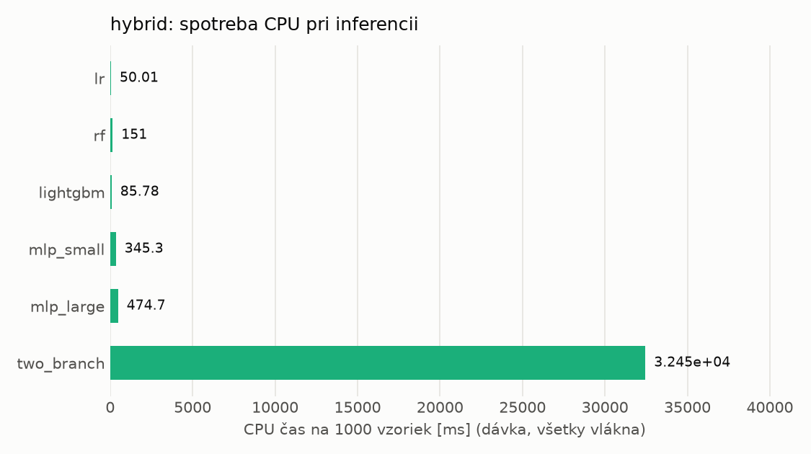
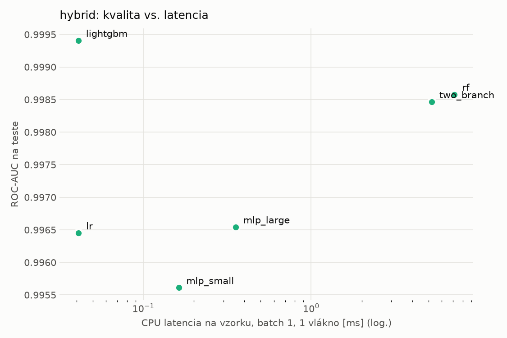
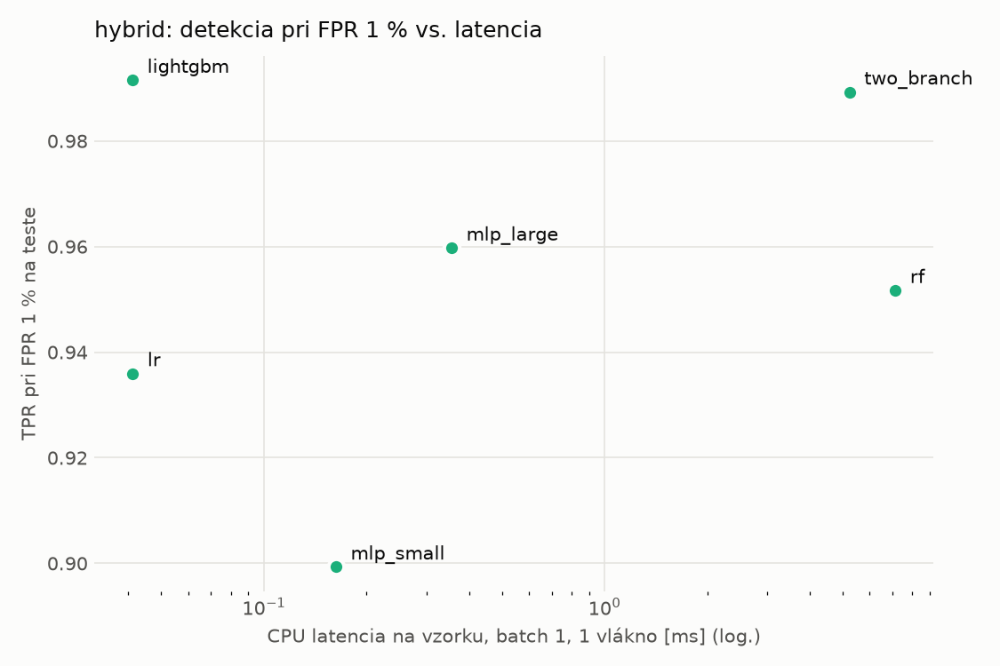
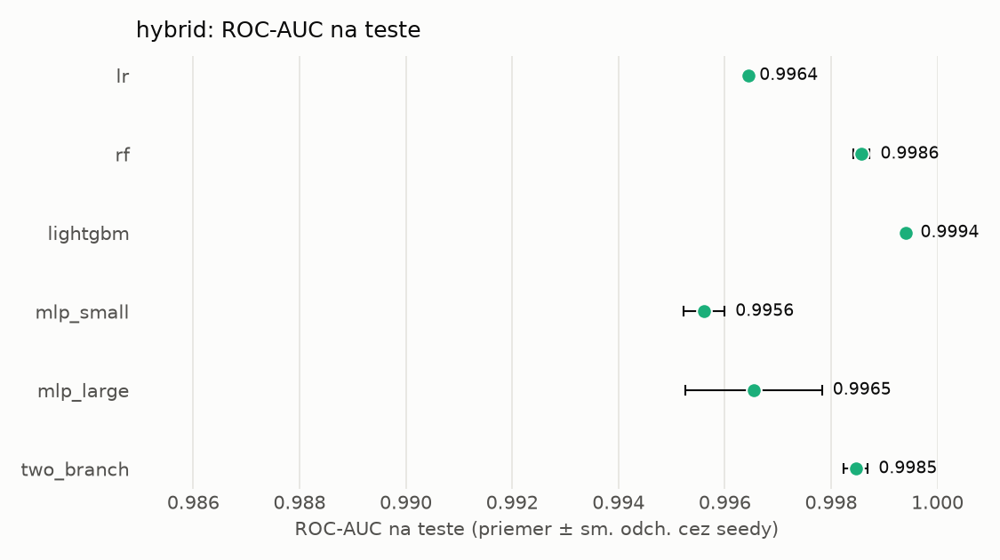
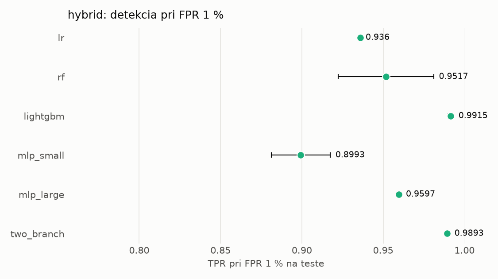

# Porovnanie modelov – hybrid

> Generované `src/evaluation/compare.py` (2026-11-02T20:49:27+01:00); použitý je posledný beh každého modelu.
> Metriky sú priemer cez seedy. \* = pri prahu určenom na validácii (FPR ≤ 1 %).
> CPU ms/vz. = medián latencie jednej vzorky na 1 vlákne vrátane transformácie vstupu (meranie hneď po tréningu,
> orientačné). Oficiálne merania spotreby sú v časti „Spotreba zdrojov pri inferencii“.

## Detekčná kvalita a orientačné časy
| model | ROC-AUC val | ROC-AUC test | TPR@FPR 1 % test | TPR@FPR 0,1 % test | F1 test* | FPR test* | gap train−val | CPU ms/vz. | CPU vz./s | GPU ms/vz. | parametre | MB | tréning s | ladenie min |
|---|---|---|---|---|---|---|---|---|---|---|---|---|---|---|
| [lr](../../hybrid/lr/20261102-044357/README.md) | 0.9989 | 0.9964 ± 0.0000 | 0.9360 | 0.6887 | 0.9545 | 0.0059 | 0.0008 | 0.041 | 147 806 | – | 4 320 | 0.13 | 5.4 | 3.3 |
| [rf](../../hybrid/rf/20261102-044751/README.md) | 0.9998 | 0.9986 ± 0.0002 | 0.9517 | 0.8597 | 0.9697 | 0.0088 | 0.0002 | 7.133 | 94 916 | – | 283 180 | 23.02 | 142.6 | 33.3 |
| [lightgbm](../../hybrid/lightgbm/20261102-052826/README.md) | 0.9998 | 0.9994 ± 0.0001 | 0.9915 | 0.9329 | 0.9901 | 0.0047 | 0.0002 | 0.041 | 306 145 | – | 29 103 | 1.64 | 14.9 | 69.6 |
| [mlp_small](../../hybrid/mlp_small/20261102-063854/README.md) | 0.9993 | 0.9956 ± 0.0004 | 0.8993 | 0.7004 | 0.9338 | 0.0069 | 0.0006 | 0.163 | 46 105 | 0.390 | 138 881 | 0.67 | 4.4 | 2.2 |
| [mlp_large](../../hybrid/mlp_large/20261102-064138/README.md) | 0.9995 | 0.9965 ± 0.0013 | 0.9597 | 0.7915 | 0.9690 | 0.0073 | 0.0004 | 0.356 | 28 672 | 0.525 | 2 386 305 | 9.67 | 4.8 | 3.4 |
| [two_branch](../../hybrid/two_branch/20261102-170657/README.md) | 0.9994 | 0.9985 ± 0.0002 | 0.9893 | 0.8173 | 0.9857 | 0.0058 | 0.0005 | 5.232 | 613 | 1.189 | 1 757 826 | 7.10 | 535.6 | 186.1 |

## Nízka prevalencia malvéru (test, prah z validácie)
| model | TPR | FPR | precision @ 1 % | falošné na 1 skutočný poplach @ 1 % | precision @ 0.1 % | falošné na 1 skutočný poplach @ 0.1 % |
|---|---|---|---|---|---|---|
| lr | 0.9174 | 0.0059 | 0.610 | 0.64 | 0.134 | 6.45 |
| rf | 0.9485 | 0.0088 | 0.521 | 0.92 | 0.097 | 9.29 |
| lightgbm | 0.9842 | 0.0047 | 0.679 | 0.47 | 0.173 | 4.77 |
| mlp_small | 0.8809 | 0.0069 | 0.564 | 0.77 | 0.114 | 7.81 |
| mlp_large | 0.9457 | 0.0073 | 0.567 | 0.76 | 0.115 | 7.72 |
| two_branch | 0.9767 | 0.0058 | 0.628 | 0.59 | 0.143 | 5.97 |

Prepočet: TPR a FPR nezávisia od podielu malvéru, preto sa dajú preniesť na nízku prevalenciu (v reálnej prevádzke je malvéru ~1 % alebo menej; v teste 54 %). „Falošné na 1 skutočný poplach“ = koľko neškodných súborov je označených na každý zachytený malvér.

## Spotreba zdrojov pri inferencii (benchmark, testovacia množina)
| model | CPU čas ms/vz. (dávka) | vz./s (dávka) | vyťaženie CPU % | nárast RAM MB | latencia ms (1 vz.) | p95 ms | CPU čas ms/vz. (1 vz.) | GPU vz./s | vyťaženie GPU % | GPU pamäť MB | GPU energia J/1000 vz. | |
|---|---|---|---|---|---|---|---|---|---|---|---|---|
| lr | 0.050 | 20 608 | 4.3 | 889 | 0.041 | 0.045 | 0.042 | – | – | – | – |  |
| rf | 0.151 | 101 405 | 63.8 | 13 | 7.323 | 7.765 | 7.359 | – | – | – | – |  |
| lightgbm | 0.086 | 221 080 | 79.0 | 3 | 0.041 | 0.049 | 0.042 | – | – | – | – |  |
| mlp_small | 0.345 | 14 356 | 20.7 | 600 | 0.145 | 0.174 | 0.226 | 13 798 | 14.0 | 311 | 0.34 | ⚠ |
| mlp_large | 0.475 | 13 570 | 26.8 | 644 | 0.329 | 0.358 | 0.478 | 15 002 | 6.0 | 352 | 0.95 | ⚠ |
| two_branch | 32.450 | 716 | 96.8 | 931 | 5.215 | 5.532 | 5.203 | 4 415 | 86.0 | 1 463 | 14.87 | ⚠ |

- **Počítač merania:** dcatloch, 16 fyzických / 24 logických jadier, GPU NVIDIA GeForce RTX 4060 Laptop GPU.
- **CPU čas** = koľko času procesora (súčet cez jadrá) spotrebuje jedna vzorka – hlavná miera výpočtovej náročnosti.
- **vyťaženie CPU** = priemerný podiel všetkých logických jadier počítača počas dávkovej inferencie.
- **GPU energia** = energia karty nad úrovňou nečinnosti na 1000 vzoriek (iba modely na GPU).
- ⚠ = počítač bol pred meraním zaťažený; čísla môžu byť skreslené.

## Grafy

