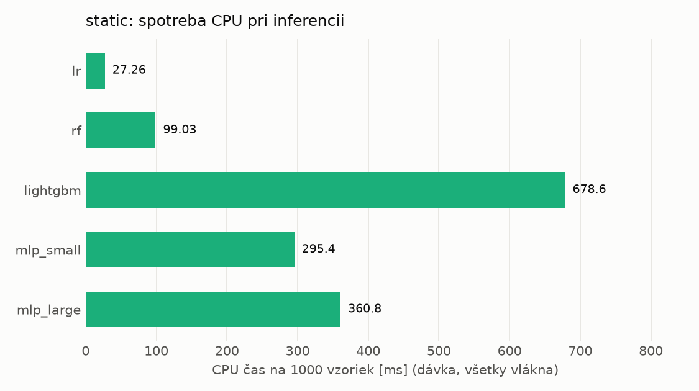
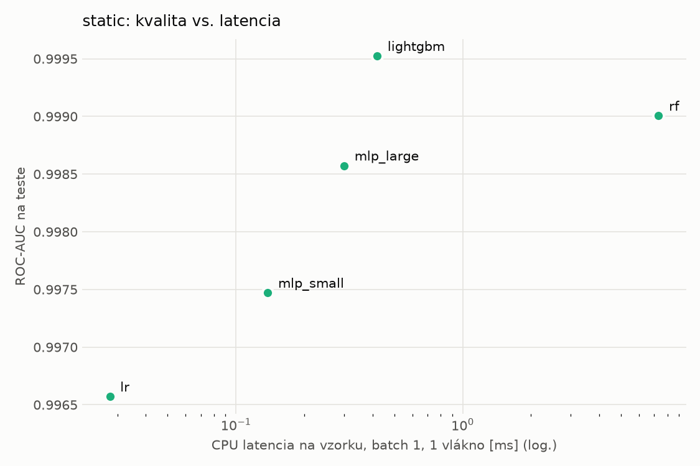
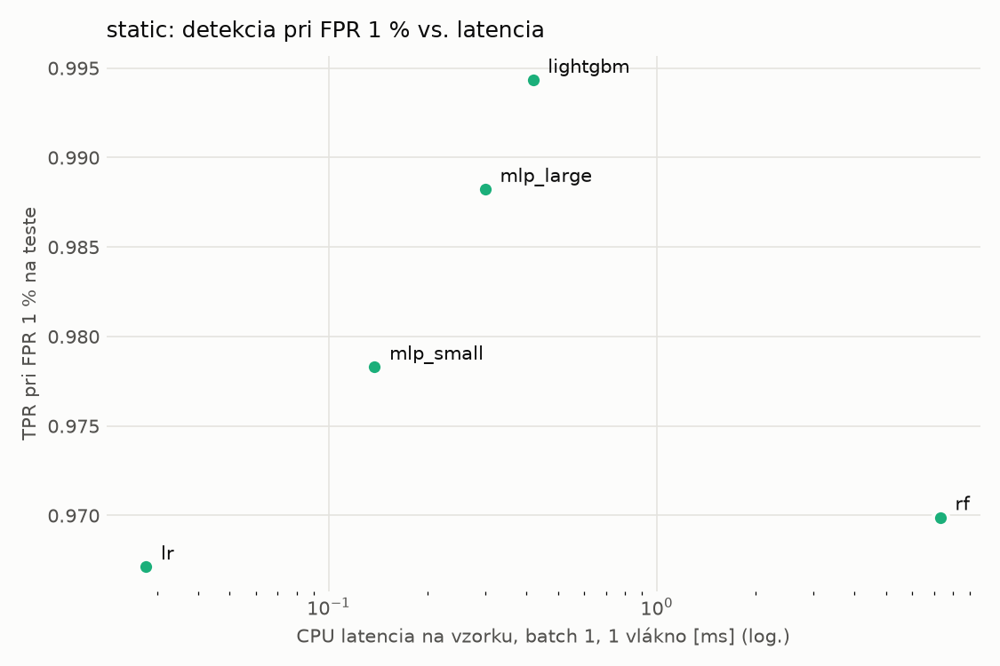
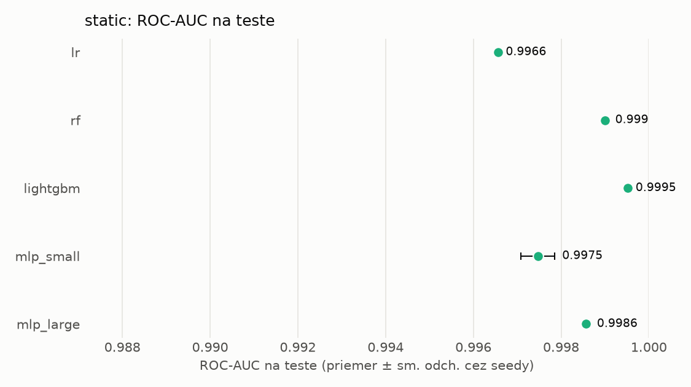
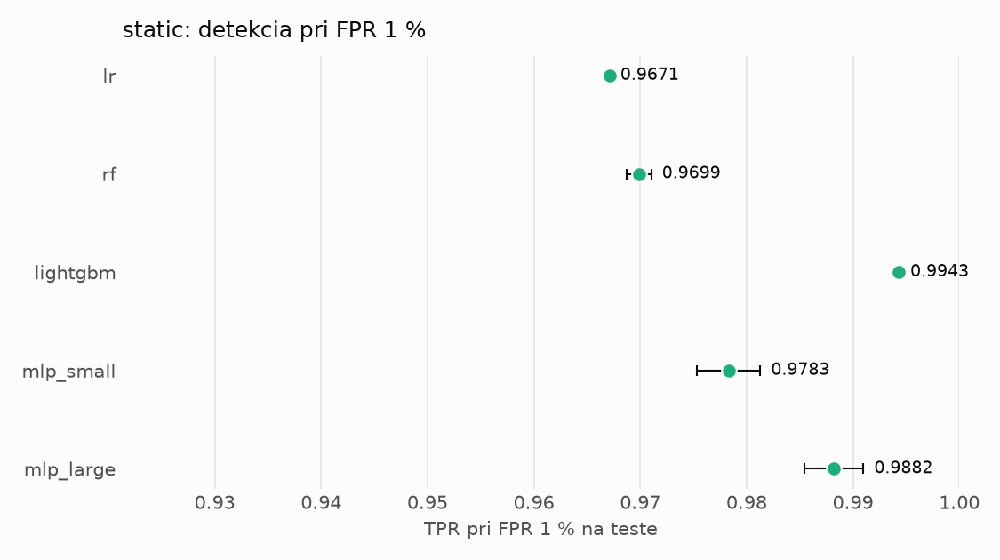

# Porovnanie modelov – static

> Generované `src/evaluation/compare.py` (2026-11-02T00:20:25+01:00); použitý je posledný beh každého modelu.
> Metriky sú priemer cez seedy. \* = pri prahu určenom na validácii (FPR ≤ 1 %).
> CPU ms/vz. = medián latencie jednej vzorky na 1 vlákne vrátane transformácie vstupu (meranie hneď po tréningu,
> orientačné). Oficiálne merania spotreby sú v časti „Spotreba zdrojov pri inferencii“.

## Detekčná kvalita a orientačné časy
| model | ROC-AUC val | ROC-AUC test | TPR@FPR 1 % test | TPR@FPR 0,1 % test | F1 test* | FPR test* | gap train−val | CPU ms/vz. | CPU vz./s | GPU ms/vz. | parametre | MB | tréning s | ladenie min |
|---|---|---|---|---|---|---|---|---|---|---|---|---|---|---|
| [lr](../../static/lr/20261101-213555/README.md) | 0.9986 | 0.9966 ± 0.0000 | 0.9671 | 0.0788 | 0.9700 | 0.0088 | 0.0010 | 0.028 | 276 769 | – | 2 320 | 0.07 | 2.5 | 1.2 |
| [rf](../../static/rf/20261101-213728/README.md) | 0.9998 | 0.9990 ± 0.0001 | 0.9699 | 0.9201 | 0.9780 | 0.0058 | 0.0002 | 7.312 | 139 848 | – | 390 428 | 31.60 | 27.4 | 14.8 |
| [lightgbm](../../static/lightgbm/20261101-215345/README.md) | 0.9998 | 0.9995 ± 0.0000 | 0.9943 | 0.9699 | 0.9900 | 0.0048 | 0.0002 | 0.420 | 31 996 | – | 648 856 | 38.08 | 376.0 | 97.1 |
| [mlp_small](../../static/mlp_small/20261101-235005/README.md) | 0.9990 | 0.9975 ± 0.0004 | 0.9783 | 0.5125 | 0.9807 | 0.0067 | 0.0008 | 0.138 | 108 986 | 0.393 | 74 881 | 0.36 | 3.6 | 2.2 |
| [mlp_large](../../static/mlp_large/20261101-235239/README.md) | 0.9995 | 0.9986 ± 0.0001 | 0.9882 | 0.8693 | 0.9870 | 0.0065 | 0.0003 | 0.300 | 51 652 | 0.558 | 1 364 417 | 5.53 | 6.1 | 3.2 |

## Nízka prevalencia malvéru (test, prah z validácie)
| model | TPR | FPR | precision @ 1 % | falošné na 1 skutočný poplach @ 1 % | precision @ 0.1 % | falošné na 1 skutočný poplach @ 0.1 % |
|---|---|---|---|---|---|---|
| lr | 0.9487 | 0.0088 | 0.521 | 0.92 | 0.097 | 9.28 |
| rf | 0.9616 | 0.0058 | 0.626 | 0.60 | 0.142 | 6.02 |
| lightgbm | 0.9843 | 0.0048 | 0.673 | 0.49 | 0.169 | 4.90 |
| mlp_small | 0.9675 | 0.0067 | 0.594 | 0.68 | 0.127 | 6.89 |
| mlp_large | 0.9797 | 0.0065 | 0.602 | 0.66 | 0.130 | 6.68 |

Prepočet: TPR a FPR nezávisia od podielu malvéru, preto sa dajú preniesť na nízku prevalenciu (v reálnej prevádzke je malvéru ~1 % alebo menej; v teste 54 %). „Falošné na 1 skutočný poplach“ = koľko neškodných súborov je označených na každý zachytený malvér.

## Spotreba zdrojov pri inferencii (benchmark, testovacia množina)
| model | CPU čas ms/vz. (dávka) | vz./s (dávka) | vyťaženie CPU % | nárast RAM MB | latencia ms (1 vz.) | p95 ms | CPU čas ms/vz. (1 vz.) | GPU vz./s | vyťaženie GPU % | GPU pamäť MB | GPU energia J/1000 vz. | |
|---|---|---|---|---|---|---|---|---|---|---|---|---|
| lr | 0.027 | 39 099 | 4.4 | 473 | 0.028 | 0.053 | 0.031 | – | – | – | – |  |
| rf | 0.099 | 133 737 | 55.2 | 15 | 7.149 | 7.576 | 7.172 | – | – | – | – |  |
| lightgbm | 0.679 | 31 305 | 88.5 | 1 | 0.375 | 0.539 | 0.398 | – | – | – | – |  |
| mlp_small | 0.295 | 25 737 | 31.7 | 322 | 0.125 | 0.157 | 0.210 | 27 245 | 13.5 | 172 | 0.15 | ⚠ |
| mlp_large | 0.361 | 24 780 | 37.3 | 378 | 0.300 | 0.331 | 0.496 | 29 491 | 4.1 | 209 | 0.00 | ⚠ |

- **Počítač merania:** dcatloch, 16 fyzických / 24 logických jadier, GPU NVIDIA GeForce RTX 4060 Laptop GPU.
- **CPU čas** = koľko času procesora (súčet cez jadrá) spotrebuje jedna vzorka – hlavná miera výpočtovej náročnosti.
- **vyťaženie CPU** = priemerný podiel všetkých logických jadier počítača počas dávkovej inferencie.
- **GPU energia** = energia karty nad úrovňou nečinnosti na 1000 vzoriek (iba modely na GPU).
- ⚠ = počítač bol pred meraním zaťažený; čísla môžu byť skreslené.

## Grafy

