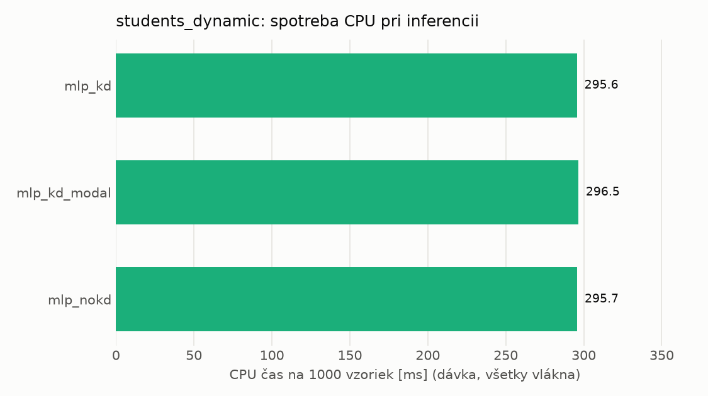
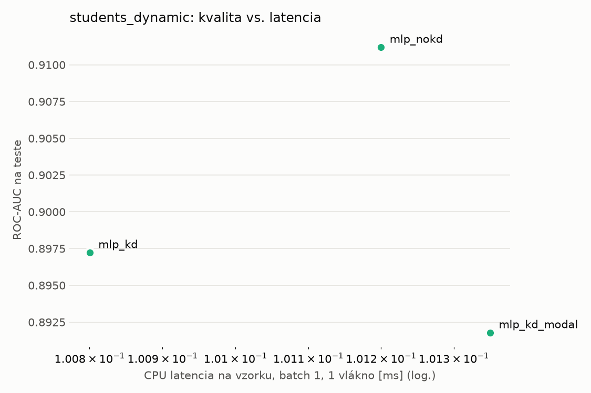
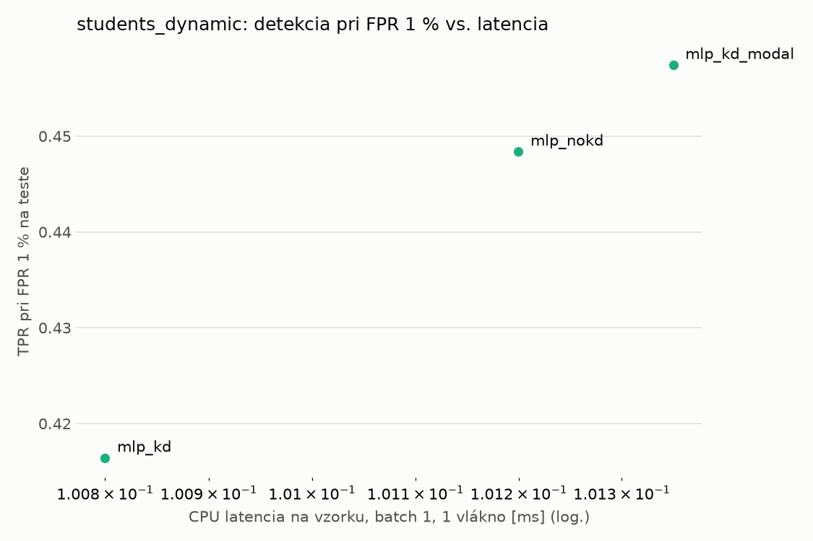
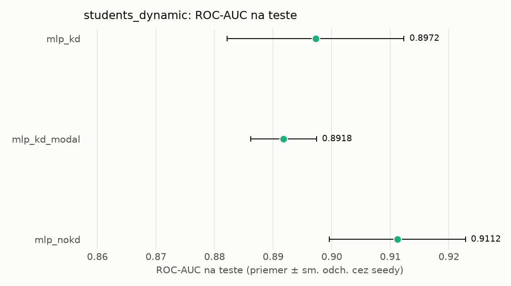
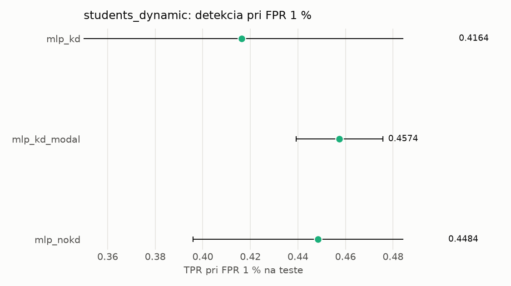

# Porovnanie modelov – students_dynamic

> Generované `src/evaluation/compare.py` (2026-11-03T00:51:21+01:00); použitý je posledný beh každého modelu.
> Metriky sú priemer cez seedy. \* = pri prahu určenom na validácii (FPR ≤ 1 %).
> CPU ms/vz. = medián latencie jednej vzorky na 1 vlákne vrátane transformácie vstupu (meranie hneď po tréningu,
> orientačné). Oficiálne merania spotreby sú v časti „Spotreba zdrojov pri inferencii“.

## Detekčná kvalita a orientačné časy
| model | ROC-AUC val | ROC-AUC test | TPR@FPR 1 % test | TPR@FPR 0,1 % test | F1 test* | FPR test* | gap train−val | CPU ms/vz. | CPU vz./s | GPU ms/vz. | parametre | MB | tréning s | ladenie min |
|---|---|---|---|---|---|---|---|---|---|---|---|---|---|---|
| [mlp_kd](../../students_dynamic/mlp_kd/20261102-212132/README.md) | 0.9960 | 0.8972 ± 0.0151 | 0.4164 | 0.2898 | 0.6790 | 0.0171 | 0.0010 | 0.101 | 139 931 | 0.296 | 64 129 | 0.31 | 8.2 | 4.7 |
| [mlp_kd_modal](../../students_dynamic/mlp_kd_modal/20261102-212954/README.md) | 0.9959 | 0.8918 ± 0.0056 | 0.4574 | 0.2729 | 0.6652 | 0.0157 | 0.0011 | 0.101 | 139 917 | 0.294 | 64 129 | 0.31 | 7.0 | 4.4 |
| [mlp_nokd](../../students_dynamic/mlp_nokd/20261102-212647/README.md) | 0.9960 | 0.9112 ± 0.0116 | 0.4484 | 0.3130 | 0.6938 | 0.0177 | 0.0010 | 0.101 | 97 013 | 0.455 | 64 129 | 0.31 | 5.9 | 2.7 |

## Nízka prevalencia malvéru (test, prah z validácie)
| model | TPR | FPR | precision @ 1 % | falošné na 1 skutočný poplach @ 1 % | precision @ 0.1 % | falošné na 1 skutočný poplach @ 0.1 % |
|---|---|---|---|---|---|---|
| mlp_kd | 0.5214 | 0.0171 | 0.235 | 3.25 | 0.030 | 32.82 |
| mlp_kd_modal | 0.5050 | 0.0157 | 0.245 | 3.09 | 0.031 | 31.14 |
| mlp_nokd | 0.5391 | 0.0177 | 0.236 | 3.25 | 0.030 | 32.75 |

Prepočet: TPR a FPR nezávisia od podielu malvéru, preto sa dajú preniesť na nízku prevalenciu (v reálnej prevádzke je malvéru ~1 % alebo menej; v teste 54 %). „Falošné na 1 skutočný poplach“ = koľko neškodných súborov je označených na každý zachytený malvér.

## Spotreba zdrojov pri inferencii (benchmark, testovacia množina)
| model | CPU čas ms/vz. (dávka) | vz./s (dávka) | vyťaženie CPU % | nárast RAM MB | latencia ms (1 vz.) | p95 ms | CPU čas ms/vz. (1 vz.) | GPU vz./s | vyťaženie GPU % | GPU pamäť MB | GPU energia J/1000 vz. | |
|---|---|---|---|---|---|---|---|---|---|---|---|---|
| mlp_kd | 0.296 | 34 035 | 41.9 | 280 | 0.091 | 0.103 | 0.169 | 40 443 | 2.6 | 150 | 0.33 |  |
| mlp_kd_modal | 0.296 | 35 403 | 43.7 | 280 | 0.089 | 0.104 | 0.165 | 34 527 | 37.0 | 150 | 0.09 | ⚠ |
| mlp_nokd | 0.296 | 36 126 | 44.5 | 280 | 0.089 | 0.103 | 0.160 | 34 308 | 0.0 | 150 | 0.10 | ⚠ |

- **Počítač merania:** dcatloch, 16 fyzických / 24 logických jadier, GPU NVIDIA GeForce RTX 4060 Laptop GPU.
- **CPU čas** = koľko času procesora (súčet cez jadrá) spotrebuje jedna vzorka – hlavná miera výpočtovej náročnosti.
- **vyťaženie CPU** = priemerný podiel všetkých logických jadier počítača počas dávkovej inferencie.
- **GPU energia** = energia karty nad úrovňou nečinnosti na 1000 vzoriek (iba modely na GPU).
- ⚠ = počítač bol pred meraním zaťažený; čísla môžu byť skreslené.

## Grafy

