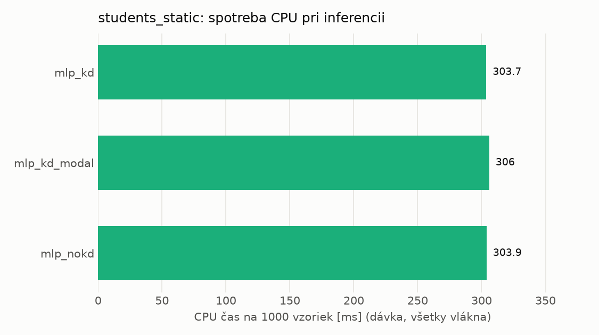
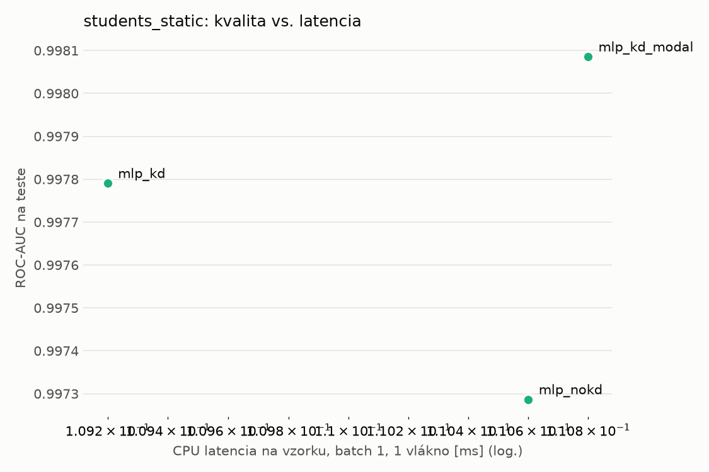
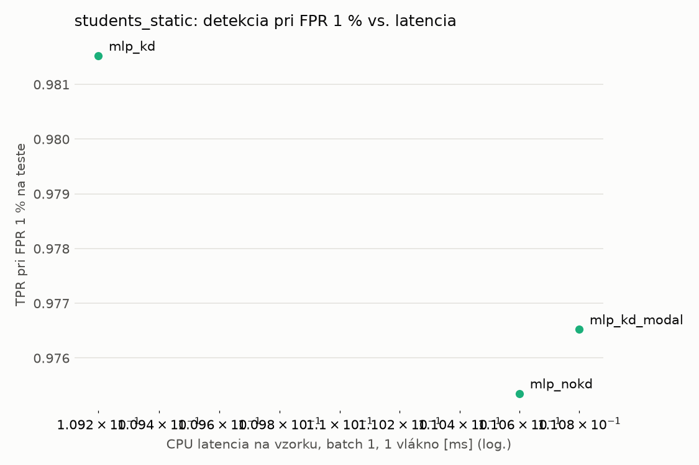
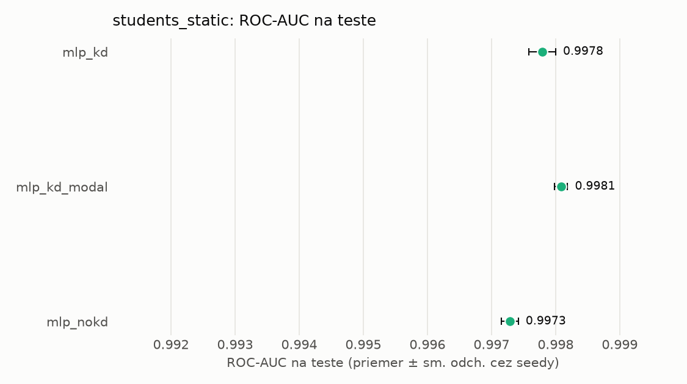
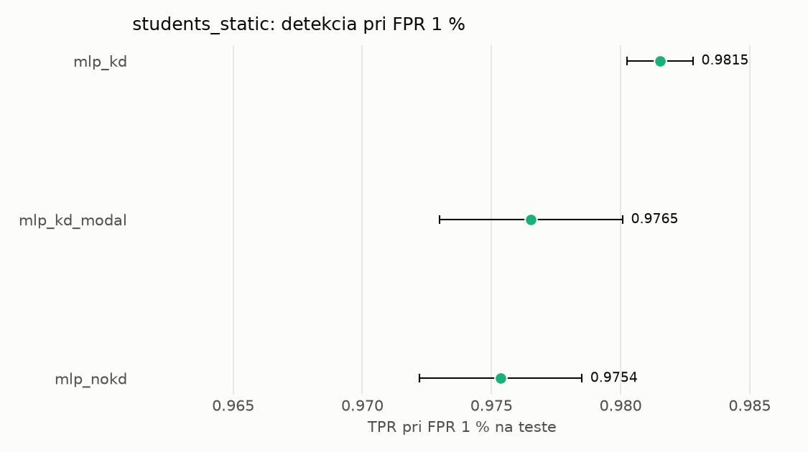

# Porovnanie modelov – students_static

> Generované `src/evaluation/compare.py` (2026-11-03T00:51:16+01:00); použitý je posledný beh každého modelu.
> Metriky sú priemer cez seedy. \* = pri prahu určenom na validácii (FPR ≤ 1 %).
> CPU ms/vz. = medián latencie jednej vzorky na 1 vlákne vrátane transformácie vstupu (meranie hneď po tréningu,
> orientačné). Oficiálne merania spotreby sú v časti „Spotreba zdrojov pri inferencii“.

## Detekčná kvalita a orientačné časy
| model | ROC-AUC val | ROC-AUC test | TPR@FPR 1 % test | TPR@FPR 0,1 % test | F1 test* | FPR test* | gap train−val | CPU ms/vz. | CPU vz./s | GPU ms/vz. | parametre | MB | tréning s | ladenie min |
|---|---|---|---|---|---|---|---|---|---|---|---|---|---|---|
| [mlp_kd](../../students_static/mlp_kd/20261102-211333/README.md) | 0.9991 | 0.9978 ± 0.0002 | 0.9815 | 0.5483 | 0.9761 | 0.0059 | 0.0007 | 0.109 | 72 238 | 0.456 | 74 337 | 0.36 | 8.4 | 3.0 |
| [mlp_kd_modal](../../students_static/mlp_kd_modal/20261102-211832/README.md) | 0.9990 | 0.9981 ± 0.0001 | 0.9765 | 0.7812 | 0.9802 | 0.0068 | 0.0007 | 0.111 | 61 064 | 0.453 | 74 337 | 0.36 | 5.6 | 2.5 |
| [mlp_nokd](../../students_static/mlp_nokd/20261102-211710/README.md) | 0.9990 | 0.9973 ± 0.0001 | 0.9754 | 0.3684 | 0.9771 | 0.0076 | 0.0007 | 0.111 | 61 957 | 0.287 | 74 337 | 0.36 | 2.1 | 1.1 |

## Nízka prevalencia malvéru (test, prah z validácie)
| model | TPR | FPR | precision @ 1 % | falošné na 1 skutočný poplach @ 1 % | precision @ 0.1 % | falošné na 1 skutočný poplach @ 0.1 % |
|---|---|---|---|---|---|---|
| mlp_kd | 0.9581 | 0.0059 | 0.620 | 0.61 | 0.139 | 6.17 |
| mlp_kd_modal | 0.9667 | 0.0068 | 0.589 | 0.70 | 0.125 | 7.03 |
| mlp_nokd | 0.9613 | 0.0076 | 0.562 | 0.78 | 0.113 | 7.85 |

Prepočet: TPR a FPR nezávisia od podielu malvéru, preto sa dajú preniesť na nízku prevalenciu (v reálnej prevádzke je malvéru ~1 % alebo menej; v teste 54 %). „Falošné na 1 skutočný poplach“ = koľko neškodných súborov je označených na každý zachytený malvér.

## Spotreba zdrojov pri inferencii (benchmark, testovacia množina)
| model | CPU čas ms/vz. (dávka) | vz./s (dávka) | vyťaženie CPU % | nárast RAM MB | latencia ms (1 vz.) | p95 ms | CPU čas ms/vz. (1 vz.) | GPU vz./s | vyťaženie GPU % | GPU pamäť MB | GPU energia J/1000 vz. | |
|---|---|---|---|---|---|---|---|---|---|---|---|---|
| mlp_kd | 0.304 | 28 545 | 36.1 | 322 | 0.096 | 0.108 | 0.180 | 31 422 | 4.4 | 172 | 0.47 | ⚠ |
| mlp_kd_modal | 0.306 | 30 078 | 38.3 | 324 | 0.095 | 0.108 | 0.175 | 27 120 | 11.8 | 172 | 0.14 | ⚠ |
| mlp_nokd | 0.304 | 27 459 | 34.8 | 322 | 0.094 | 0.109 | 0.153 | 27 219 | 14.7 | 172 | 0.09 | ⚠ |

- **Počítač merania:** dcatloch, 16 fyzických / 24 logických jadier, GPU NVIDIA GeForce RTX 4060 Laptop GPU.
- **CPU čas** = koľko času procesora (súčet cez jadrá) spotrebuje jedna vzorka – hlavná miera výpočtovej náročnosti.
- **vyťaženie CPU** = priemerný podiel všetkých logických jadier počítača počas dávkovej inferencie.
- **GPU energia** = energia karty nad úrovňou nečinnosti na 1000 vzoriek (iba modely na GPU).
- ⚠ = počítač bol pred meraním zaťažený; čísla môžu byť skreslené.

## Grafy

