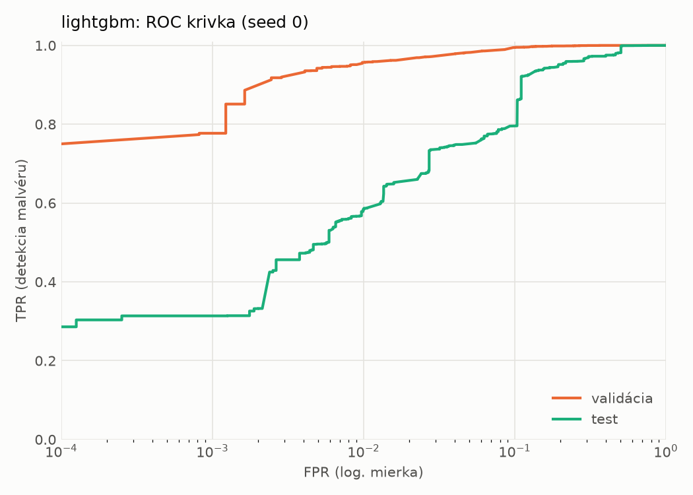
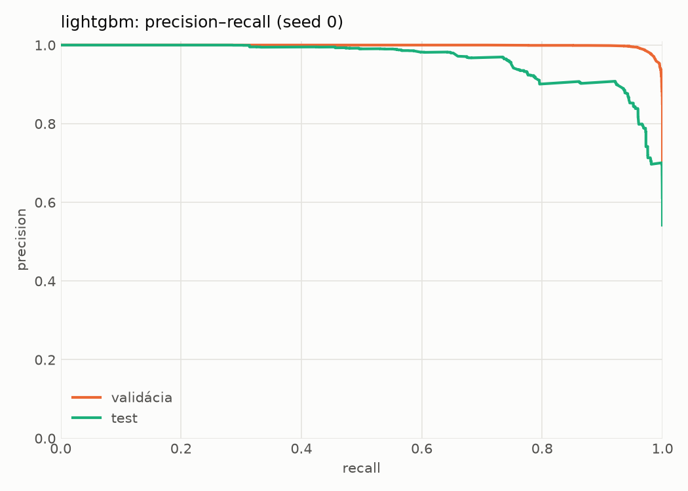
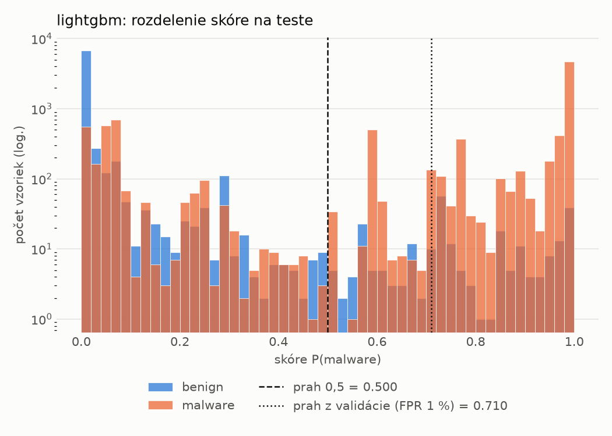
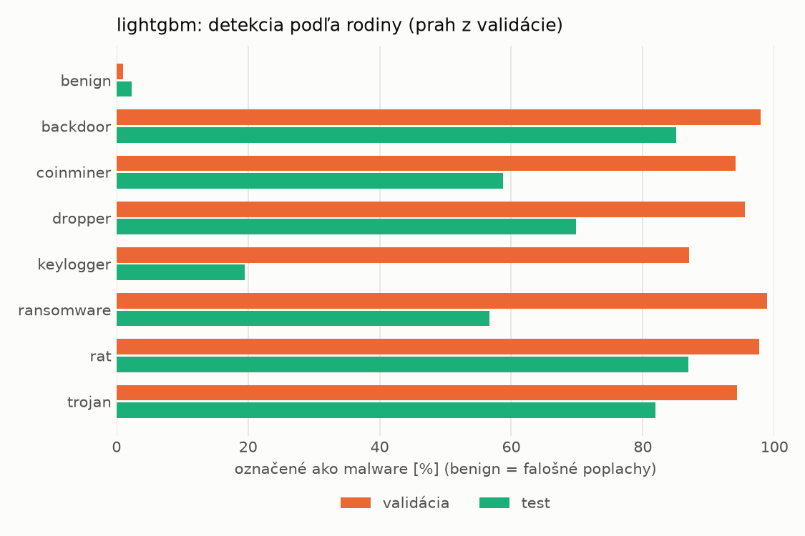
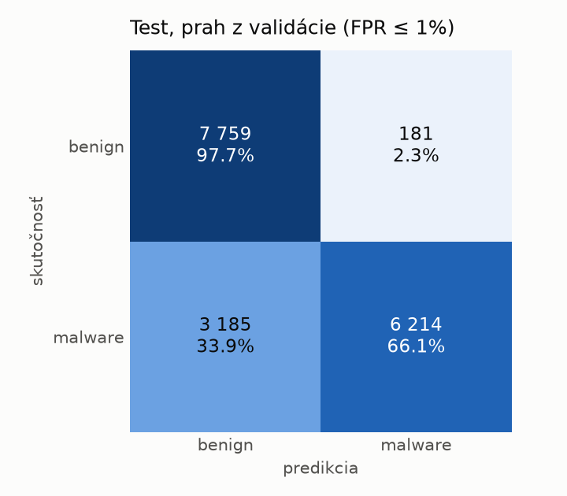
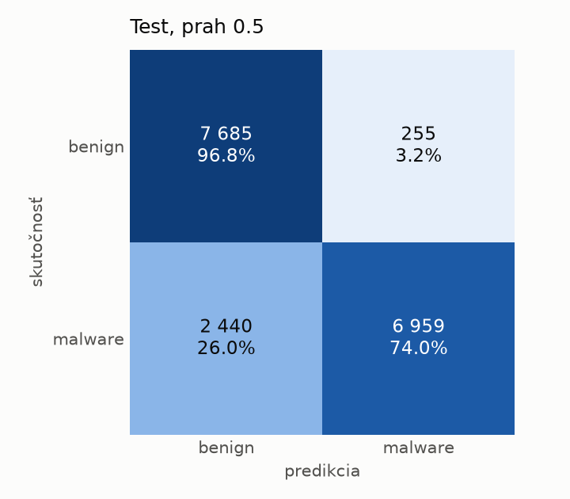
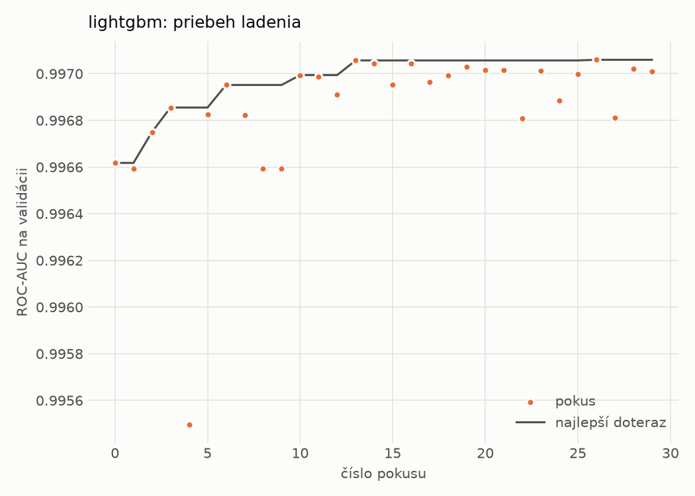
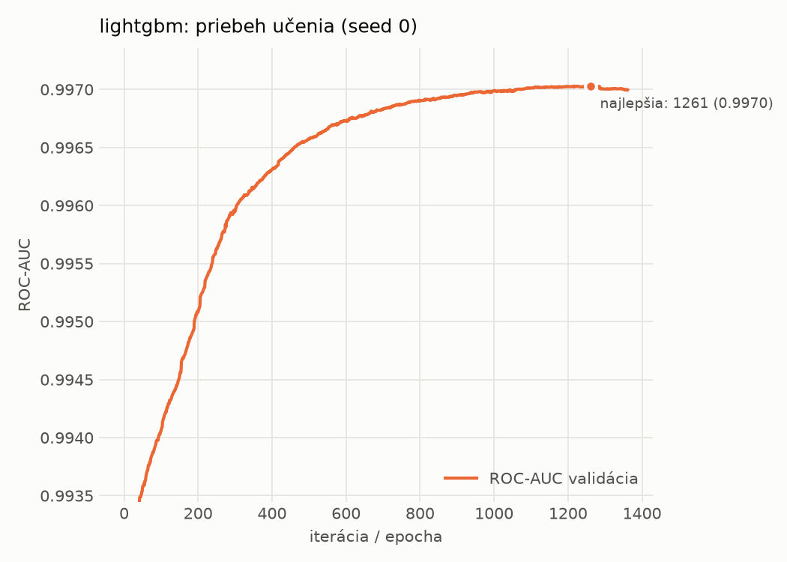

# dynamic/lightgbm – beh `20261102-003953`

> Automaticky generované (`src/training/run_tabular.py`). Konfigurácia: `config.yaml`, protokol: `protocol.yaml`.

- **Model:** `lightgbm` – LightGBM, gradient boosting stromov s early stopping na validácii (pôvodné hodnoty príznakov)
- **Ladenie:** 30 dokončených pokusov (Optuna TPE), cieľ ROC-AUC na validácii, 14.6 min
- **Finálne modely:** seedy [0, 1, 2]; hodnoty sú priemer ± smerodajná odchýlka cez seedy
- **Najlepšie hyperparametre:** `{"num_boost_round": 5000, "early_stopping_rounds": 100, "learning_rate": 0.012600391102852807, "num_leaves": 261, "min_child_samples": 12, "feature_fraction": 0.7323605840883831, "bagging_fraction": 0.7241803281580393, "lambda_l1": 9.843384499248837e-06, "lambda_l2": 0.7301583949167907}`

## Detekčná kvalita (bez prahu)
| metrika | train (podvzorka) | validácia | test |
|---|---|---|---|
| ROC-AUC | 0.9984 ± 0.0000 | 0.9970 ± 0.0000 | 0.9560 ± 0.0011 |
| PR-AUC | 0.9991 ± 0.0000 | 0.9985 ± 0.0000 | 0.9638 ± 0.0006 |
| TPR pri FPR 1 % | 0.9621 ± 0.0000 | 0.9557 ± 0.0020 | 0.5849 ± 0.0017 |
| TPR pri FPR 0,1 % | 0.9155 ± 0.0009 | 0.7816 ± 0.0039 | 0.3139 ± 0.0002 |
| log loss | 0.0526 ± 0.0003 | 0.0674 ± 0.0002 | 0.5388 ± 0.0066 |
| Brier skóre | 0.0169 ± 0.0001 | 0.0201 ± 0.0000 | 0.1411 ± 0.0014 |

Rozdiel ROC-AUC train − validácia: **0.0014** (veľký rozdiel = preučenie).

## Pri prahu z validácie (FPR ≤ 1% na validácii)
| metrika | train (podvzorka) | validácia | test |
|---|---|---|---|
| accuracy | 0.9686 ± 0.0020 | 0.9671 ± 0.0013 | 0.8051 ± 0.0016 |
| balanced accuracy | 0.9755 ± 0.0013 | 0.9729 ± 0.0010 | 0.8187 ± 0.0012 |
| precision | 0.9981 ± 0.0003 | 0.9950 ± 0.0000 | 0.9752 ± 0.0055 |
| recall (TPR) | 0.9547 ± 0.0032 | 0.9557 ± 0.0020 | 0.6572 ± 0.0069 |
| FPR | 0.0036 ± 0.0005 | 0.0098 ± 0.0000 | 0.0198 ± 0.0046 |
| F1 | 0.9759 ± 0.0015 | 0.9750 ± 0.0010 | 0.7852 ± 0.0032 |
| MCC | 0.9327 ± 0.0039 | 0.9285 ± 0.0027 | 0.6595 ± 0.0004 |

## Pri pevnom prahu 0.5
| metrika | train (podvzorka) | validácia | test |
|---|---|---|---|
| accuracy | 0.9718 ± 0.0000 | 0.9692 ± 0.0001 | 0.8442 ± 0.0008 |
| balanced accuracy | 0.9767 ± 0.0000 | 0.9729 ± 0.0001 | 0.8538 ± 0.0007 |
| precision | 0.9955 ± 0.0000 | 0.9918 ± 0.0001 | 0.9647 ± 0.0005 |
| recall (TPR) | 0.9621 ± 0.0000 | 0.9621 ± 0.0000 | 0.7397 ± 0.0012 |
| FPR | 0.0087 ± 0.0000 | 0.0162 ± 0.0002 | 0.0320 ± 0.0004 |
| F1 | 0.9785 ± 0.0000 | 0.9767 ± 0.0001 | 0.8374 ± 0.0009 |
| MCC | 0.9387 ± 0.0000 | 0.9322 ± 0.0002 | 0.7154 ± 0.0014 |

## Výpočtové nároky (seed 0, testovacia množina)
| meranie | hodnota |
|---|---|
| tréning finálneho modelu | 27.4 s (priemer cez seedy) |
| ladenie spolu | 873 s |
| počet parametrov / uzlov | 656 057 |
| veľkosť modelu na disku | 37.27 MB |
| CPU latencia modelu (batch 1, 1 vlákno) | 0.260 ms (p95 0.337) |
| CPU priepustnosť (24 vlákien) | 61 694 vzoriek/s |

## Grafy
| | |
|---|---|
|  |  |
|  |  |
|  |  |
|  |  |

## Súbory
`metrics.json` (všetky metriky po seedoch vrátane rodín), `timing.json`, `hpo_trials.csv`,
`predictions/<časť>_seed<N>.parquet` (sha256, family, label, score), `model/seed_<N>/`, `log.txt`.
