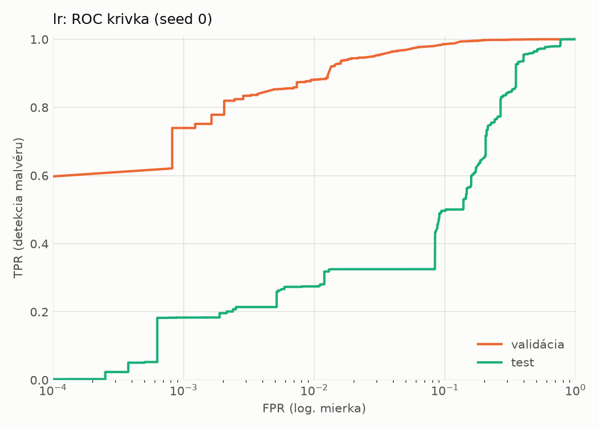
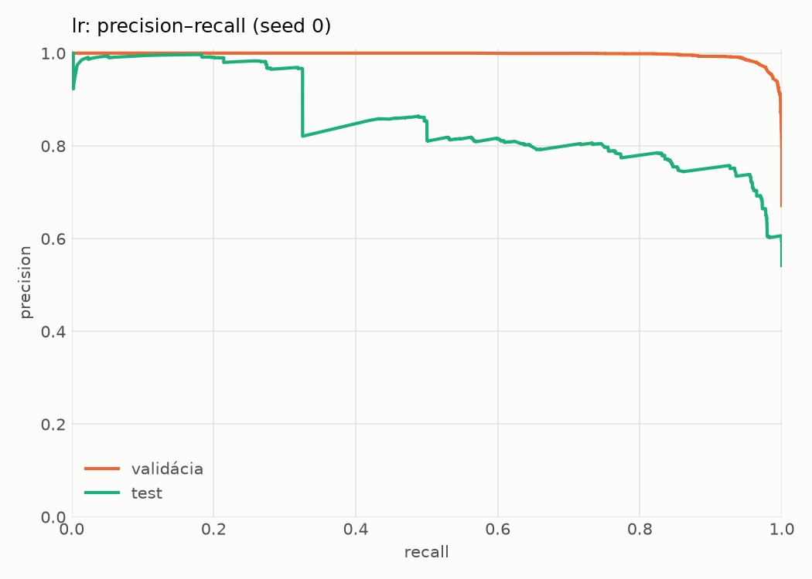
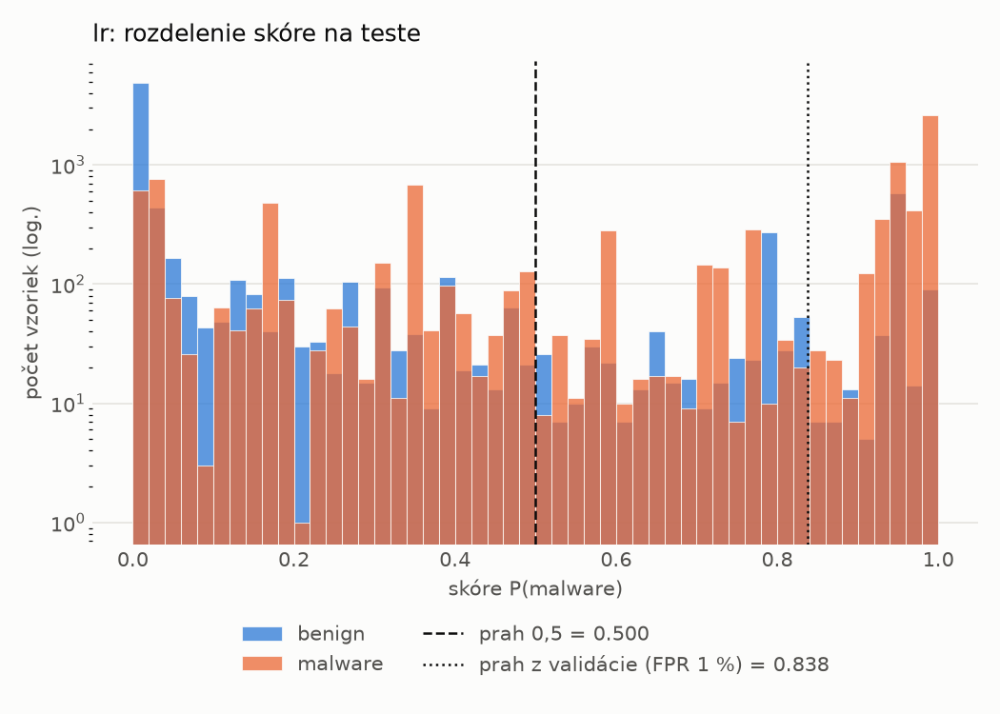
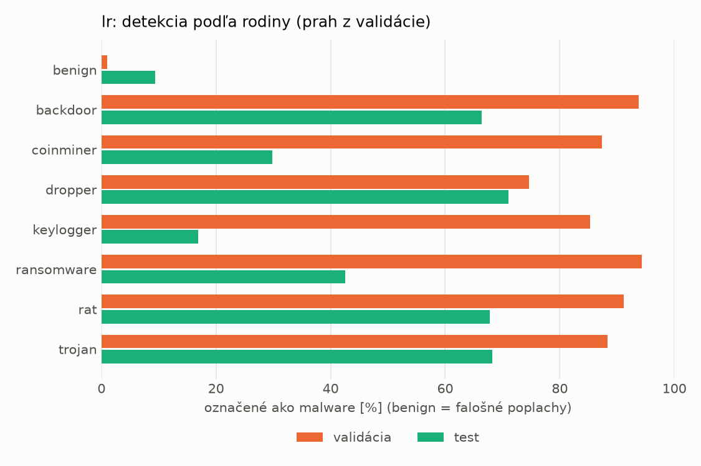
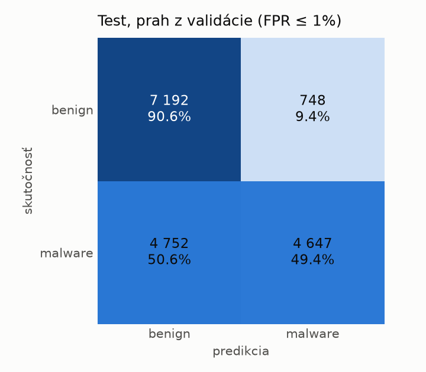
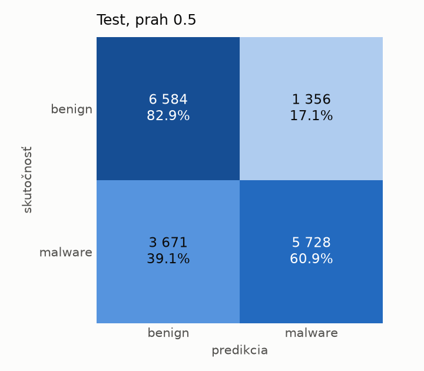
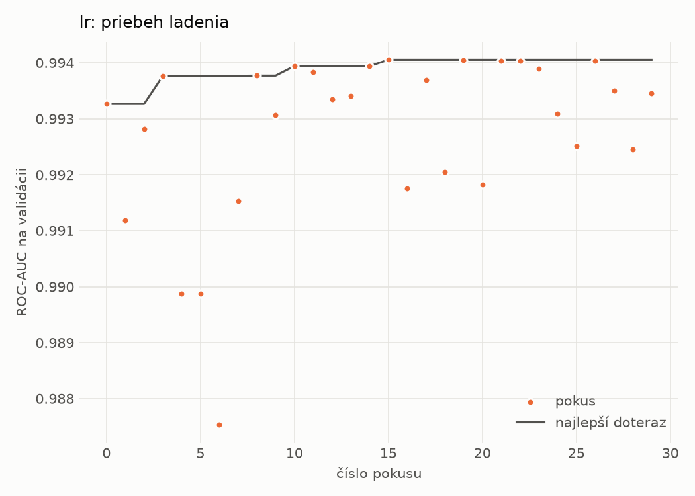

# dynamic/lr – beh `20261102-002602`

> Automaticky generované (`src/training/run_tabular.py`). Konfigurácia: `config.yaml`, protokol: `protocol.yaml`.

- **Model:** `logreg` – logistická regresia s L2 regularizáciou (vstup signed log1p + štandardizácia)
- **Ladenie:** 30 dokončených pokusov (Optuna TPE), cieľ ROC-AUC na validácii, 4.2 min
- **Finálne modely:** seedy [0, 1, 2]; hodnoty sú priemer ± smerodajná odchýlka cez seedy
- **Najlepšie hyperparametre:** `{"max_iter": 2000, "C": 0.04224422279858655}`

## Detekčná kvalita (bez prahu)
| metrika | train (podvzorka) | validácia | test |
|---|---|---|---|
| ROC-AUC | 0.9954 ± 0.0000 | 0.9941 ± 0.0000 | 0.8464 ± 0.0000 |
| PR-AUC | 0.9977 ± 0.0000 | 0.9970 ± 0.0000 | 0.8598 ± 0.0000 |
| TPR pri FPR 1 % | 0.9195 ± 0.0000 | 0.8814 ± 0.0000 | 0.2747 ± 0.0000 |
| TPR pri FPR 0,1 % | 0.8482 ± 0.0000 | 0.7396 ± 0.0000 | 0.1832 ± 0.0000 |
| log loss | 0.0897 ± 0.0000 | 0.0983 ± 0.0000 | 0.8072 ± 0.0000 |
| Brier skóre | 0.0275 ± 0.0000 | 0.0289 ± 0.0000 | 0.2159 ± 0.0000 |

Rozdiel ROC-AUC train − validácia: **0.0013** (veľký rozdiel = preučenie).

## Pri prahu z validácie (FPR ≤ 1% na validácii)
| metrika | train (podvzorka) | validácia | test |
|---|---|---|---|
| accuracy | 0.9166 ± 0.0000 | 0.9172 ± 0.0000 | 0.6828 ± 0.0000 |
| balanced accuracy | 0.9367 ± 0.0000 | 0.9358 ± 0.0000 | 0.7001 ± 0.0000 |
| precision | 0.9983 ± 0.0000 | 0.9946 ± 0.0000 | 0.8614 ± 0.0000 |
| recall (TPR) | 0.8764 ± 0.0000 | 0.8814 ± 0.0000 | 0.4944 ± 0.0000 |
| FPR | 0.0030 ± 0.0000 | 0.0098 ± 0.0000 | 0.0942 ± 0.0000 |
| F1 | 0.9334 ± 0.0000 | 0.9346 ± 0.0000 | 0.6282 ± 0.0000 |
| MCC | 0.8357 ± 0.0000 | 0.8341 ± 0.0000 | 0.4307 ± 0.0000 |

## Pri pevnom prahu 0.5
| metrika | train (podvzorka) | validácia | test |
|---|---|---|---|
| accuracy | 0.9576 ± 0.0000 | 0.9588 ± 0.0000 | 0.7101 ± 0.0000 |
| balanced accuracy | 0.9605 ± 0.0000 | 0.9615 ± 0.0000 | 0.7193 ± 0.0000 |
| precision | 0.9842 ± 0.0000 | 0.9845 ± 0.0000 | 0.8086 ± 0.0000 |
| recall (TPR) | 0.9517 ± 0.0000 | 0.9537 ± 0.0000 | 0.6094 ± 0.0000 |
| FPR | 0.0306 ± 0.0000 | 0.0307 ± 0.0000 | 0.1708 ± 0.0000 |
| F1 | 0.9677 ± 0.0000 | 0.9688 ± 0.0000 | 0.6950 ± 0.0000 |
| MCC | 0.9072 ± 0.0000 | 0.9091 ± 0.0000 | 0.4446 ± 0.0000 |

## Výpočtové nároky (seed 0, testovacia množina)
| meranie | hodnota |
|---|---|
| tréning finálneho modelu | 5.9 s (priemer cez seedy) |
| ladenie spolu | 254 s |
| počet parametrov / uzlov | 2 001 |
| veľkosť modelu na disku | 0.06 MB |
| transformácia vstupu – latencia (1 vlákno) | 0.017 ms |
| transformácia vstupu – priepustnosť | 55 411 vzoriek/s |
| CPU latencia modelu (batch 1, 1 vlákno) | 0.005 ms (p95 0.006) |
| CPU priepustnosť (24 vlákien) | 333 047 vzoriek/s |

## Grafy
| | |
|---|---|
|  |  |
|  |  |
|  |  |
|  |  |

## Súbory
`metrics.json` (všetky metriky po seedoch vrátane rodín), `timing.json`, `hpo_trials.csv`,
`predictions/<časť>_seed<N>.parquet` (sha256, family, label, score), `model/seed_<N>/`, `log.txt`.
