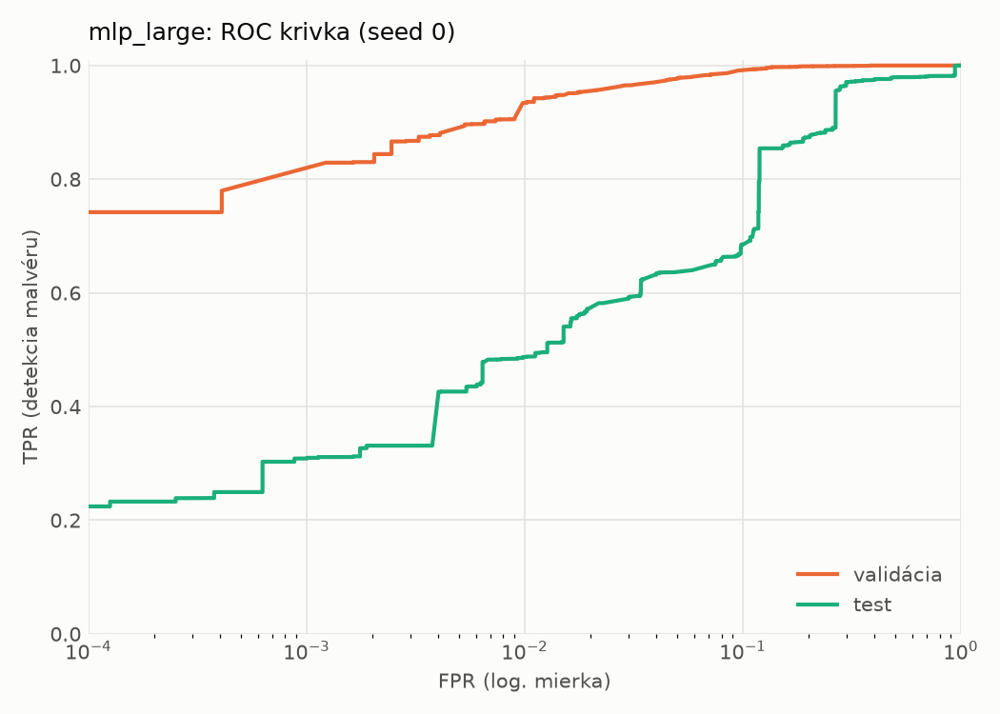
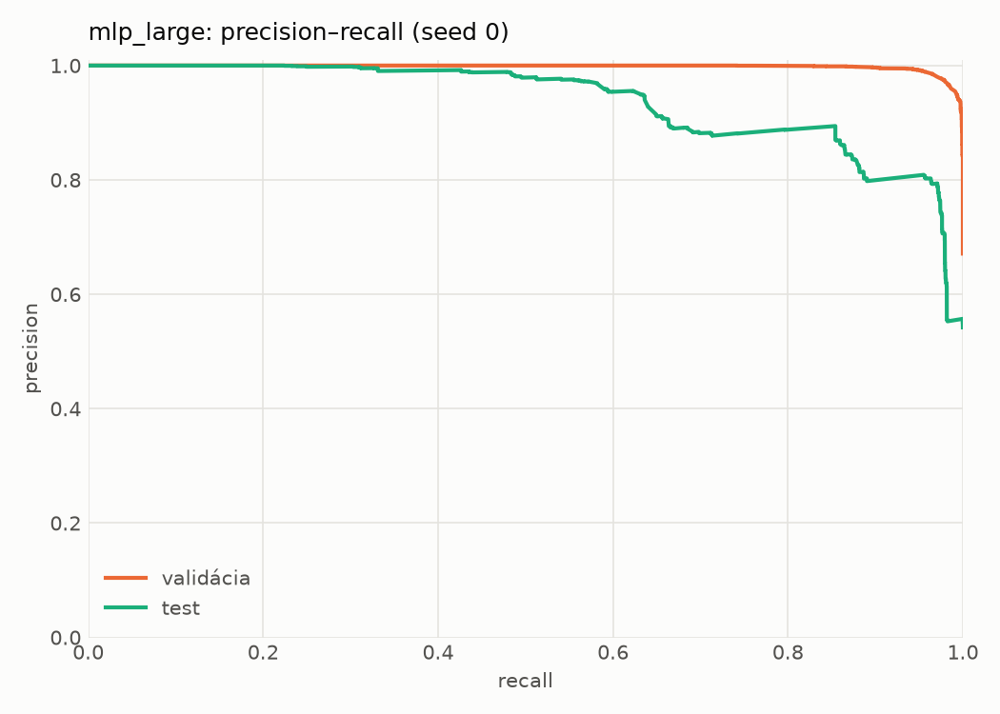
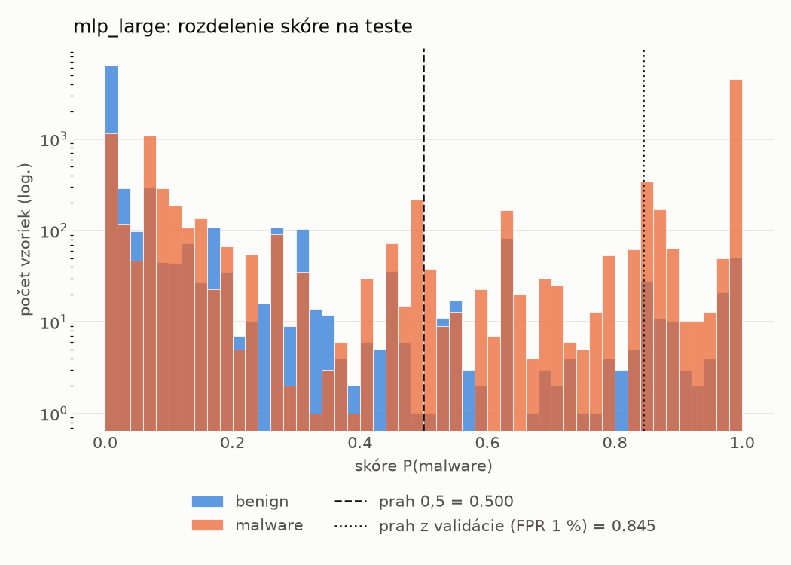
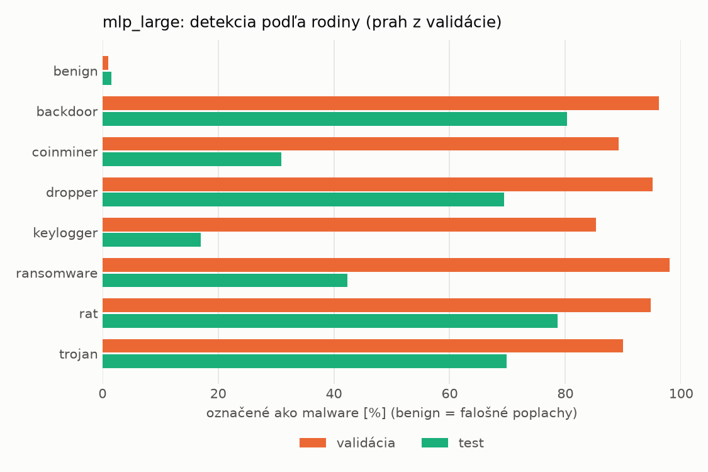
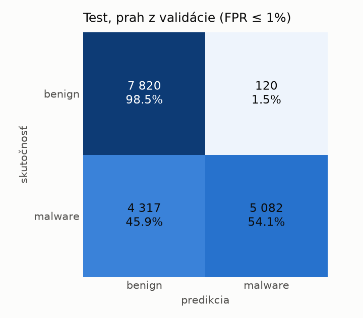
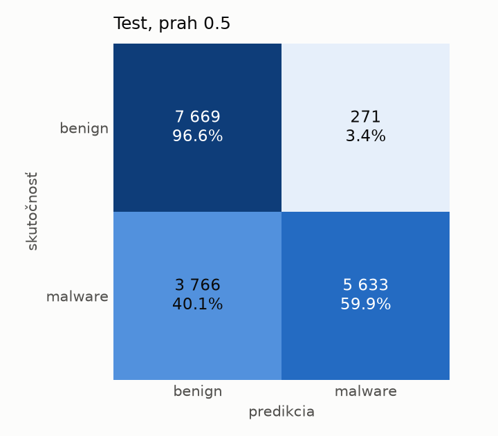
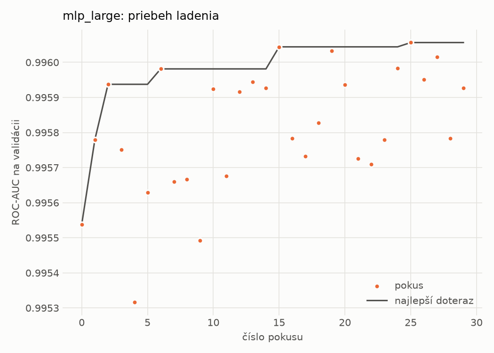
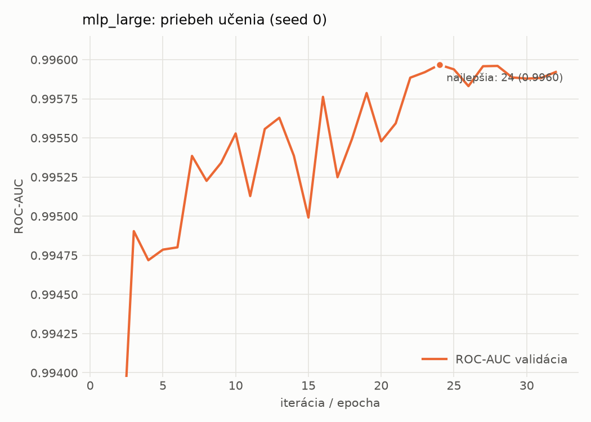

# dynamic/mlp_large – beh `20261102-005920`

> Automaticky generované (`src/training/run_tabular.py`). Konfigurácia: `config.yaml`, protokol: `protocol.yaml`.

- **Model:** `mlp` – veľká neurónová sieť (3–5 skrytých vrstiev, 512–2048 neurónov), kandidát na učiteľa
- **Ladenie:** 30 dokončených pokusov (Optuna TPE), cieľ ROC-AUC na validácii, 7.4 min
- **Finálne modely:** seedy [0, 1, 2]; hodnoty sú priemer ± smerodajná odchýlka cez seedy
- **Najlepšie hyperparametre:** `{"max_epochs": 100, "patience": 8, "hidden_layers": 3, "hidden_width": 512, "width_decay": 0.5, "dropout": 0.3735687797102123, "lr": 0.00020669709962675654, "weight_decay": 1.4747439017290252e-05, "batch_size": 256}`

## Detekčná kvalita (bez prahu)
| metrika | train (podvzorka) | validácia | test |
|---|---|---|---|
| ROC-AUC | 0.9970 ± 0.0001 | 0.9959 ± 0.0001 | 0.9276 ± 0.0065 |
| PR-AUC | 0.9984 ± 0.0000 | 0.9979 ± 0.0000 | 0.9433 ± 0.0054 |
| TPR pri FPR 1 % | 0.9317 ± 0.0023 | 0.9246 ± 0.0163 | 0.4963 ± 0.0156 |
| TPR pri FPR 0,1 % | 0.8957 ± 0.0007 | 0.7766 ± 0.0043 | 0.3251 ± 0.0377 |
| log loss | 0.0685 ± 0.0011 | 0.0820 ± 0.0007 | 0.7428 ± 0.0943 |
| Brier skóre | 0.0221 ± 0.0004 | 0.0240 ± 0.0003 | 0.1837 ± 0.0125 |

Rozdiel ROC-AUC train − validácia: **0.0011** (veľký rozdiel = preučenie).

## Pri prahu z validácie (FPR ≤ 1% na validácii)
| metrika | train (podvzorka) | validácia | test |
|---|---|---|---|
| accuracy | 0.9457 ± 0.0091 | 0.9461 ± 0.0110 | 0.7378 ± 0.0143 |
| balanced accuracy | 0.9573 ± 0.0064 | 0.9574 ± 0.0082 | 0.7571 ± 0.0131 |
| precision | 0.9959 ± 0.0009 | 0.9948 ± 0.0001 | 0.9774 ± 0.0004 |
| recall (TPR) | 0.9224 ± 0.0144 | 0.9246 ± 0.0163 | 0.5286 ± 0.0271 |
| FPR | 0.0077 ± 0.0018 | 0.0098 ± 0.0000 | 0.0145 ± 0.0009 |
| F1 | 0.9577 ± 0.0074 | 0.9584 ± 0.0089 | 0.6858 ± 0.0230 |
| MCC | 0.8874 ± 0.0167 | 0.8873 ± 0.0208 | 0.5627 ± 0.0202 |

## Pri pevnom prahu 0.5
| metrika | train (podvzorka) | validácia | test |
|---|---|---|---|
| accuracy | 0.9646 ± 0.0005 | 0.9636 ± 0.0003 | 0.7713 ± 0.0040 |
| balanced accuracy | 0.9684 ± 0.0005 | 0.9674 ± 0.0003 | 0.7866 ± 0.0037 |
| precision | 0.9896 ± 0.0004 | 0.9891 ± 0.0004 | 0.9577 ± 0.0061 |
| recall (TPR) | 0.9570 ± 0.0005 | 0.9563 ± 0.0006 | 0.6048 ± 0.0085 |
| FPR | 0.0202 ± 0.0007 | 0.0216 ± 0.0009 | 0.0317 ± 0.0050 |
| F1 | 0.9730 ± 0.0004 | 0.9724 ± 0.0002 | 0.7413 ± 0.0058 |
| MCC | 0.9227 ± 0.0010 | 0.9201 ± 0.0006 | 0.6018 ± 0.0066 |

## Výpočtové nároky (seed 0, testovacia množina)
| meranie | hodnota |
|---|---|
| tréning finálneho modelu | 16.5 s (priemer cez seedy) |
| ladenie spolu | 442 s |
| počet parametrov / uzlov | 1 190 657 |
| veľkosť modelu na disku | 4.83 MB |
| transformácia vstupu – latencia (1 vlákno) | 0.034 ms |
| transformácia vstupu – priepustnosť | 51 966 vzoriek/s |
| CPU latencia modelu (batch 1, 1 vlákno) | 0.198 ms (p95 0.227) |
| CPU priepustnosť (24 vlákien) | 99 744 vzoriek/s |
| GPU latencia (batch 1) | 0.509 ms (p95 0.557) |
| GPU priepustnosť | 92 726 vzoriek/s |
| GPU špičková pamäť | 1387 MB |

## Grafy
| | |
|---|---|
|  |  |
|  |  |
|  |  |
|  |  |

## Súbory
`metrics.json` (všetky metriky po seedoch vrátane rodín), `timing.json`, `hpo_trials.csv`,
`predictions/<časť>_seed<N>.parquet` (sha256, family, label, score), `model/seed_<N>/`, `log.txt`.
