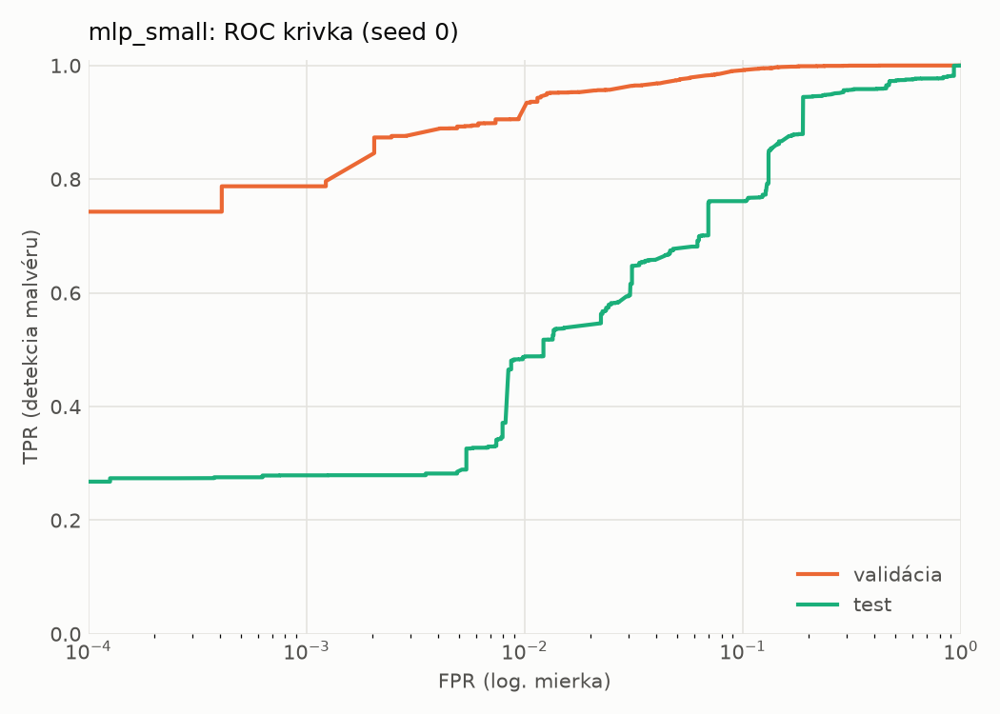
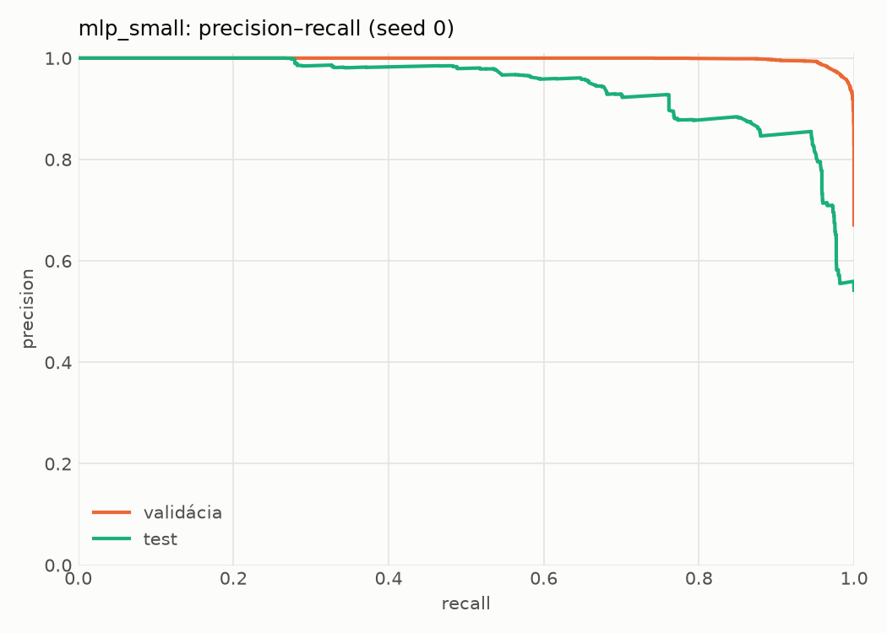
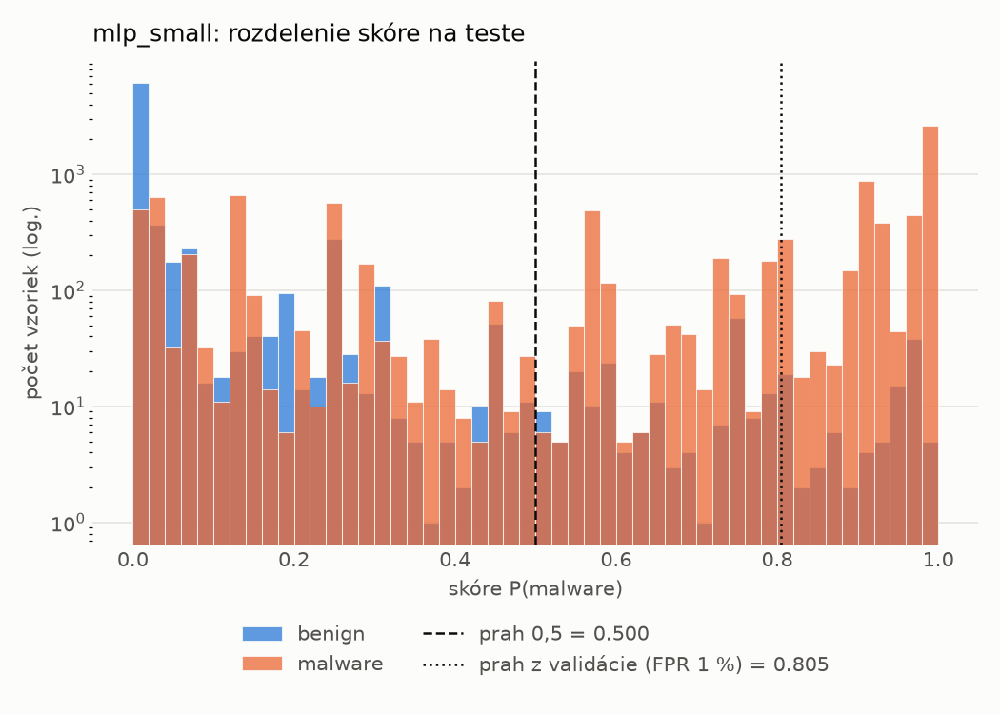
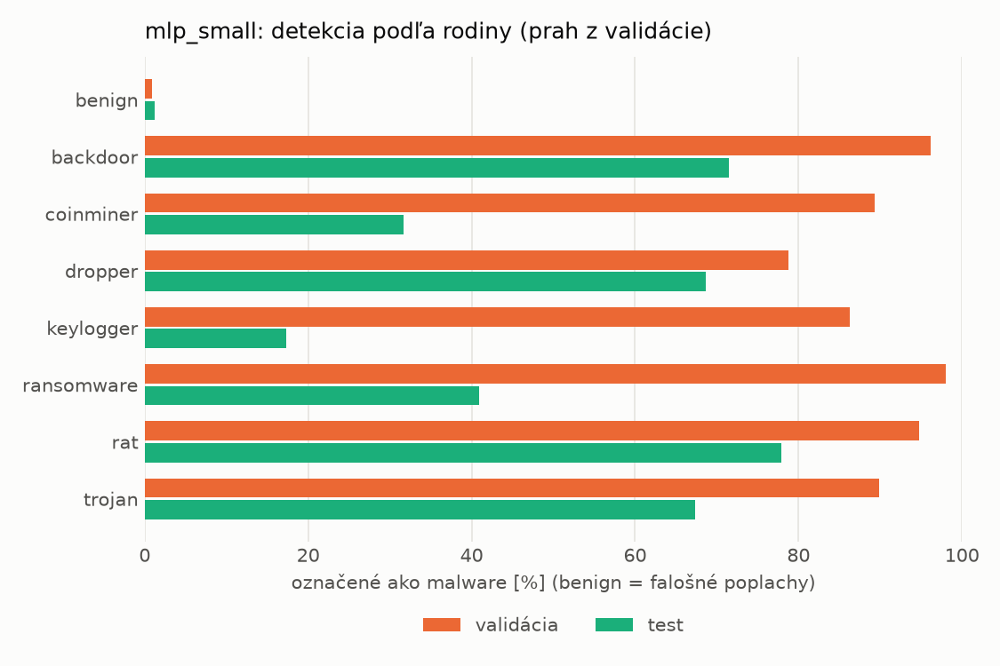
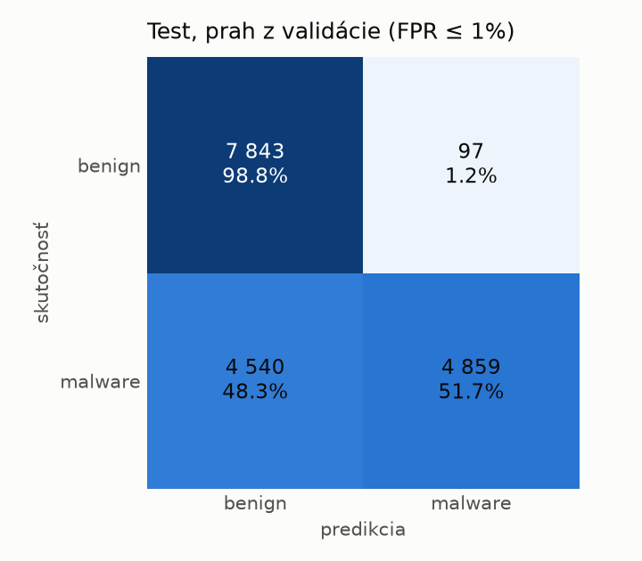
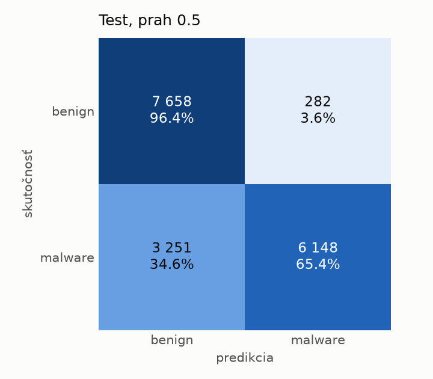
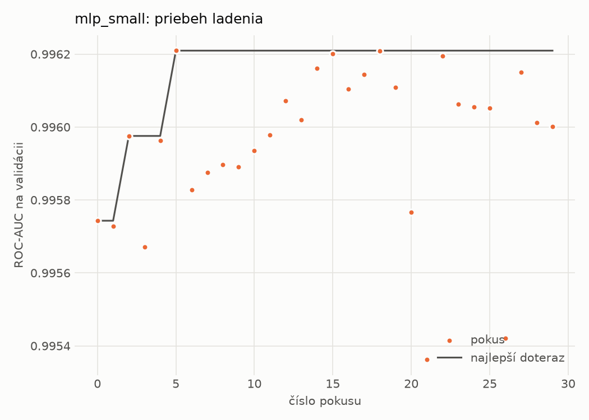
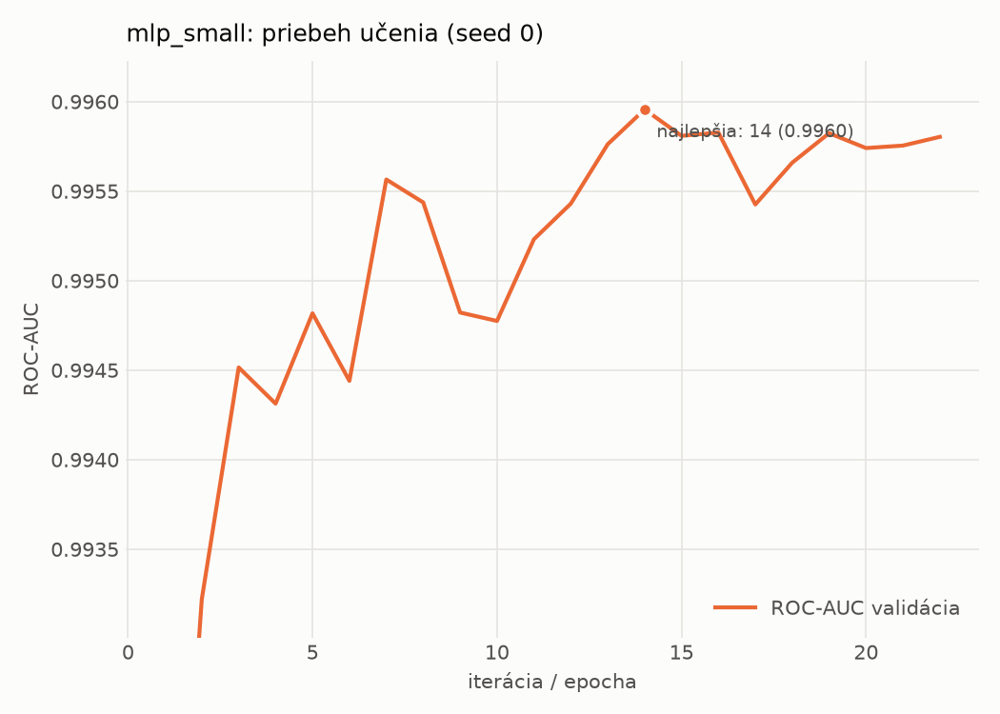

# dynamic/mlp_small – beh `20261102-005611`

> Automaticky generované (`src/training/run_tabular.py`). Konfigurácia: `config.yaml`, protokol: `protocol.yaml`.

- **Model:** `mlp` – malá neurónová sieť (1–2 skryté vrstvy), kandidát na ľahkého študenta
- **Ladenie:** 30 dokončených pokusov (Optuna TPE), cieľ ROC-AUC na validácii, 2.9 min
- **Finálne modely:** seedy [0, 1, 2]; hodnoty sú priemer ± smerodajná odchýlka cez seedy
- **Najlepšie hyperparametre:** `{"width_decay": 0.5, "max_epochs": 100, "patience": 8, "hidden_layers": 2, "hidden_width": 256, "dropout": 0.194338644844741, "lr": 0.0002516607127550297, "weight_decay": 0.0020651425578959264, "batch_size": 1024}`

## Detekčná kvalita (bez prahu)
| metrika | train (podvzorka) | validácia | test |
|---|---|---|---|
| ROC-AUC | 0.9972 ± 0.0002 | 0.9961 ± 0.0002 | 0.9215 ± 0.0064 |
| PR-AUC | 0.9985 ± 0.0001 | 0.9980 ± 0.0001 | 0.9386 ± 0.0050 |
| TPR pri FPR 1 % | 0.9369 ± 0.0031 | 0.9278 ± 0.0172 | 0.4887 ± 0.0022 |
| TPR pri FPR 0,1 % | 0.8966 ± 0.0021 | 0.7852 ± 0.0342 | 0.2794 ± 0.0015 |
| log loss | 0.0674 ± 0.0023 | 0.0798 ± 0.0012 | 0.7043 ± 0.0739 |
| Brier skóre | 0.0215 ± 0.0006 | 0.0236 ± 0.0006 | 0.1737 ± 0.0100 |

Rozdiel ROC-AUC train − validácia: **0.0011** (veľký rozdiel = preučenie).

## Pri prahu z validácie (FPR ≤ 1% na validácii)
| metrika | train (podvzorka) | validácia | test |
|---|---|---|---|
| accuracy | 0.9480 ± 0.0104 | 0.9483 ± 0.0115 | 0.7388 ± 0.0067 |
| balanced accuracy | 0.9589 ± 0.0075 | 0.9590 ± 0.0085 | 0.7580 ± 0.0061 |
| precision | 0.9955 ± 0.0006 | 0.9949 ± 0.0000 | 0.9786 ± 0.0016 |
| recall (TPR) | 0.9261 ± 0.0162 | 0.9278 ± 0.0172 | 0.5297 ± 0.0135 |
| FPR | 0.0083 ± 0.0012 | 0.0097 ± 0.0002 | 0.0137 ± 0.0014 |
| F1 | 0.9595 ± 0.0085 | 0.9601 ± 0.0093 | 0.6873 ± 0.0110 |
| MCC | 0.8917 ± 0.0195 | 0.8916 ± 0.0218 | 0.5646 ± 0.0089 |

## Pri pevnom prahu 0.5
| metrika | train (podvzorka) | validácia | test |
|---|---|---|---|
| accuracy | 0.9659 ± 0.0011 | 0.9647 ± 0.0011 | 0.7816 ± 0.0128 |
| balanced accuracy | 0.9693 ± 0.0012 | 0.9680 ± 0.0011 | 0.7958 ± 0.0118 |
| precision | 0.9894 ± 0.0008 | 0.9888 ± 0.0006 | 0.9539 ± 0.0023 |
| recall (TPR) | 0.9592 ± 0.0009 | 0.9582 ± 0.0012 | 0.6274 ± 0.0232 |
| FPR | 0.0205 ± 0.0015 | 0.0221 ± 0.0011 | 0.0359 ± 0.0009 |
| F1 | 0.9741 ± 0.0008 | 0.9733 ± 0.0009 | 0.7568 ± 0.0174 |
| MCC | 0.9254 ± 0.0024 | 0.9222 ± 0.0025 | 0.6154 ± 0.0199 |

## Výpočtové nároky (seed 0, testovacia množina)
| meranie | hodnota |
|---|---|
| tréning finálneho modelu | 3.2 s (priemer cez seedy) |
| ladenie spolu | 172 s |
| počet parametrov / uzlov | 546 049 |
| veľkosť modelu na disku | 2.24 MB |
| transformácia vstupu – latencia (1 vlákno) | 0.034 ms |
| transformácia vstupu – priepustnosť | 47 579 vzoriek/s |
| CPU latencia modelu (batch 1, 1 vlákno) | 0.133 ms (p95 0.148) |
| CPU priepustnosť (24 vlákien) | 115 530 vzoriek/s |
| GPU latencia (batch 1) | 0.412 ms (p95 0.443) |
| GPU priepustnosť | 131 112 vzoriek/s |
| GPU špičková pamäť | 771 MB |

## Grafy
| | |
|---|---|
|  |  |
|  |  |
|  |  |
|  |  |

## Súbory
`metrics.json` (všetky metriky po seedoch vrátane rodín), `timing.json`, `hpo_trials.csv`,
`predictions/<časť>_seed<N>.parquet` (sha256, family, label, score), `model/seed_<N>/`, `log.txt`.
