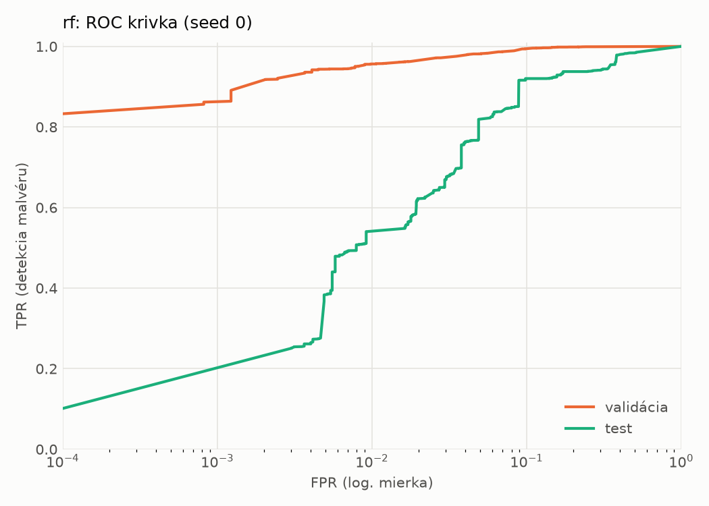
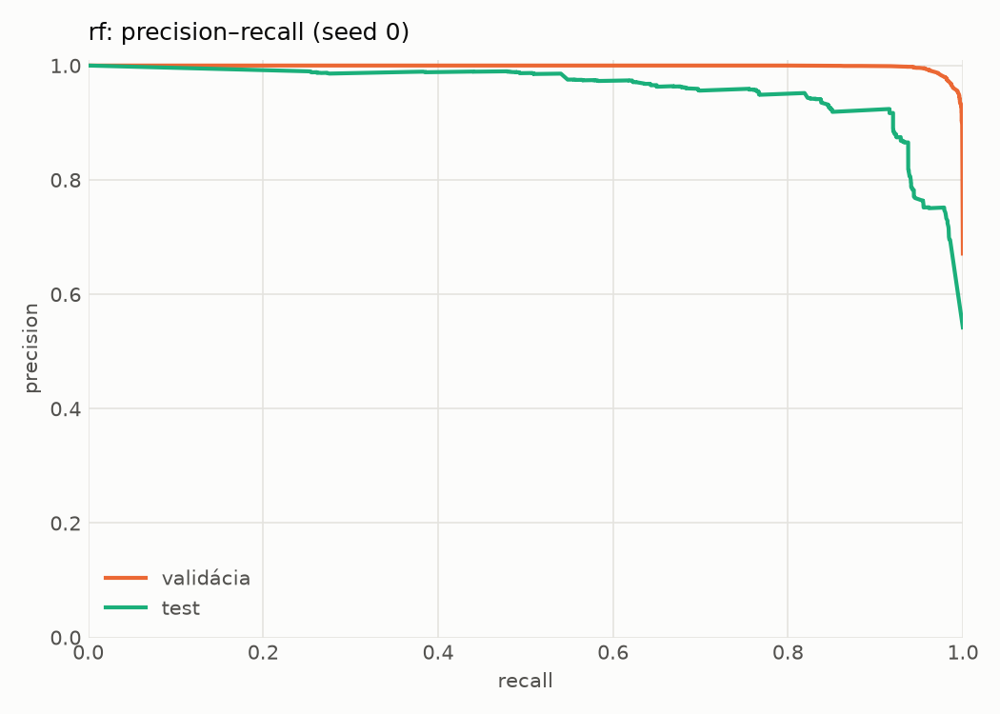
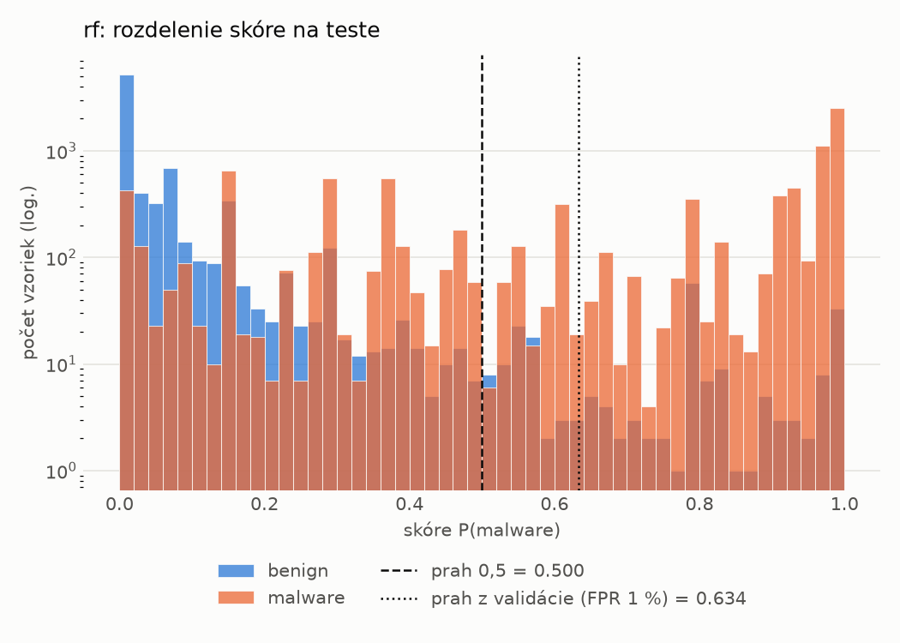
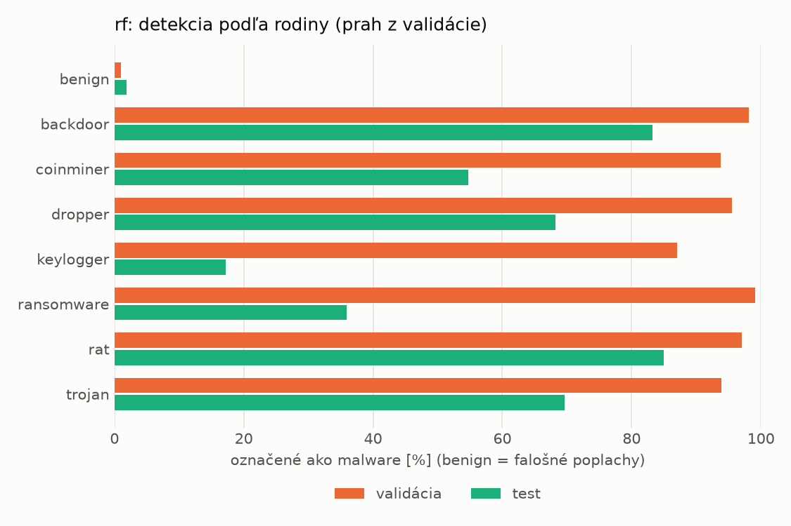
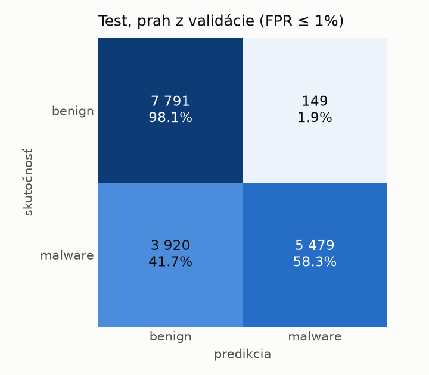
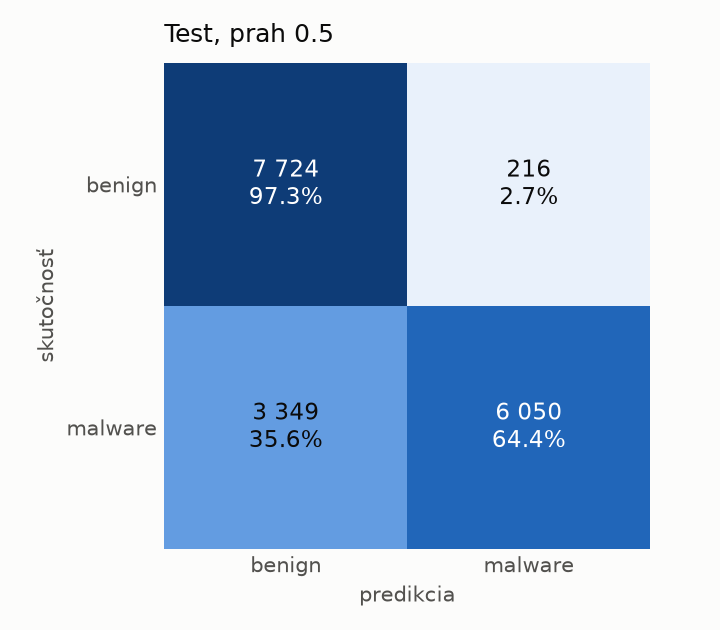
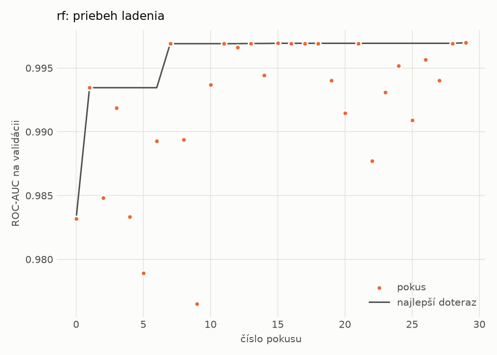

# dynamic/rf – beh `20261102-003041`

> Automaticky generované (`src/training/run_tabular.py`). Konfigurácia: `config.yaml`, protokol: `protocol.yaml`.

- **Model:** `random_forest` – Random Forest (pôvodné hodnoty príznakov)
- **Ladenie:** 30 dokončených pokusov (Optuna TPE), cieľ ROC-AUC na validácii, 7.0 min
- **Finálne modely:** seedy [0, 1, 2]; hodnoty sú priemer ± smerodajná odchýlka cez seedy
- **Najlepšie hyperparametre:** `{"n_estimators": 450, "max_depth": null, "min_samples_leaf": 1, "max_features": 0.05}`

## Detekčná kvalita (bez prahu)
| metrika | train (podvzorka) | validácia | test |
|---|---|---|---|
| ROC-AUC | 0.9984 ± 0.0000 | 0.9969 ± 0.0001 | 0.9499 ± 0.0005 |
| PR-AUC | 0.9991 ± 0.0000 | 0.9984 ± 0.0000 | 0.9565 ± 0.0005 |
| TPR pri FPR 1 % | 0.9626 ± 0.0002 | 0.9563 ± 0.0003 | 0.5223 ± 0.0158 |
| TPR pri FPR 0,1 % | 0.9156 ± 0.0011 | 0.8706 ± 0.0146 | 0.0000 ± 0.0000 |
| log loss | 0.0526 ± 0.0000 | 0.0702 ± 0.0010 | 0.5402 ± 0.0103 |
| Brier skóre | 0.0170 ± 0.0000 | 0.0200 ± 0.0000 | 0.1359 ± 0.0014 |

Rozdiel ROC-AUC train − validácia: **0.0015** (veľký rozdiel = preučenie).

## Pri prahu z validácie (FPR ≤ 1% na validácii)
| metrika | train (podvzorka) | validácia | test |
|---|---|---|---|
| accuracy | 0.9690 ± 0.0003 | 0.9675 ± 0.0002 | 0.7611 ± 0.0038 |
| balanced accuracy | 0.9758 ± 0.0002 | 0.9733 ± 0.0001 | 0.7782 ± 0.0035 |
| precision | 0.9979 ± 0.0001 | 0.9951 ± 0.0001 | 0.9733 ± 0.0002 |
| recall (TPR) | 0.9556 ± 0.0005 | 0.9563 ± 0.0003 | 0.5751 ± 0.0071 |
| FPR | 0.0040 ± 0.0002 | 0.0097 ± 0.0002 | 0.0187 ± 0.0001 |
| F1 | 0.9763 ± 0.0002 | 0.9753 ± 0.0001 | 0.7229 ± 0.0056 |
| MCC | 0.9336 ± 0.0006 | 0.9293 ± 0.0003 | 0.5941 ± 0.0056 |

## Pri pevnom prahu 0.5
| metrika | train (podvzorka) | validácia | test |
|---|---|---|---|
| accuracy | 0.9723 ± 0.0002 | 0.9693 ± 0.0001 | 0.7954 ± 0.0010 |
| balanced accuracy | 0.9772 ± 0.0002 | 0.9728 ± 0.0001 | 0.8091 ± 0.0009 |
| precision | 0.9958 ± 0.0001 | 0.9916 ± 0.0001 | 0.9654 ± 0.0001 |
| recall (TPR) | 0.9626 ± 0.0002 | 0.9623 ± 0.0001 | 0.6456 ± 0.0019 |
| FPR | 0.0082 ± 0.0002 | 0.0167 ± 0.0002 | 0.0274 ± 0.0002 |
| F1 | 0.9789 ± 0.0001 | 0.9768 ± 0.0001 | 0.7738 ± 0.0013 |
| MCC | 0.9398 ± 0.0004 | 0.9323 ± 0.0002 | 0.6407 ± 0.0014 |

## Výpočtové nároky (seed 0, testovacia množina)
| meranie | hodnota |
|---|---|
| tréning finálneho modelu | 40.6 s (priemer cez seedy) |
| ladenie spolu | 420 s |
| počet parametrov / uzlov | 1 035 832 |
| veľkosť modelu na disku | 83.32 MB |
| CPU latencia modelu (batch 1, 1 vlákno) | 13.102 ms (p95 13.411) |
| CPU priepustnosť (24 vlákien) | 90 727 vzoriek/s |

## Grafy
| | |
|---|---|
|  |  |
|  |  |
|  |  |
|  |  |

## Súbory
`metrics.json` (všetky metriky po seedoch vrátane rodín), `timing.json`, `hpo_trials.csv`,
`predictions/<časť>_seed<N>.parquet` (sha256, family, label, score), `model/seed_<N>/`, `log.txt`.
