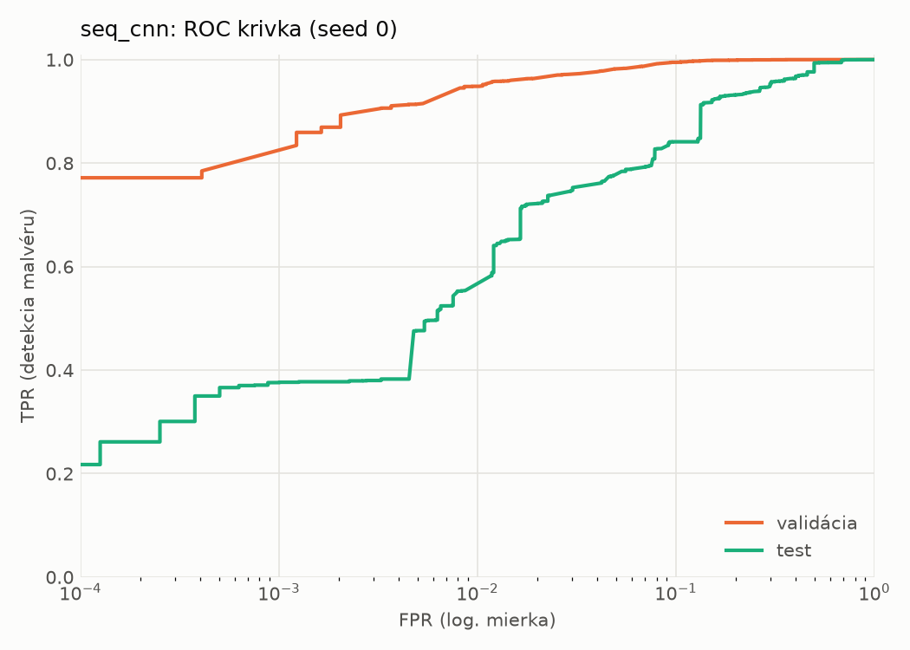
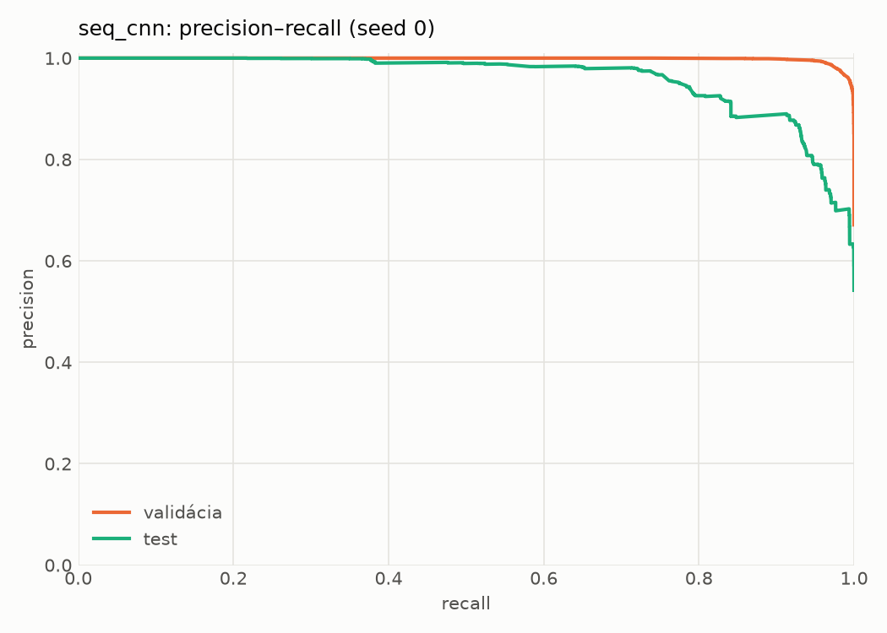
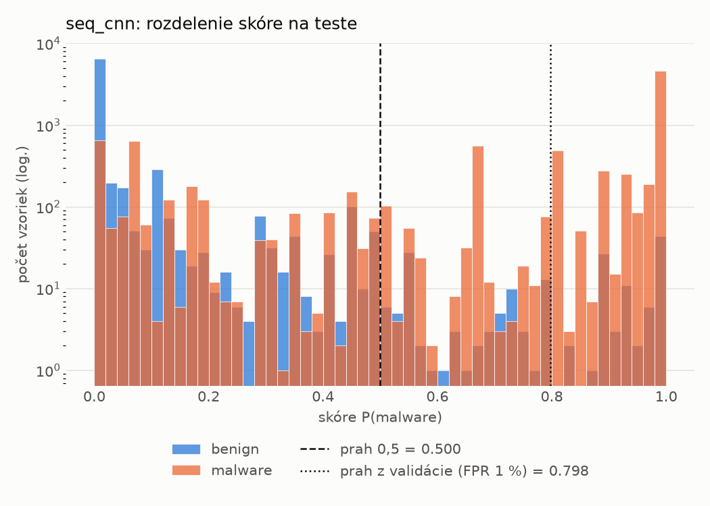
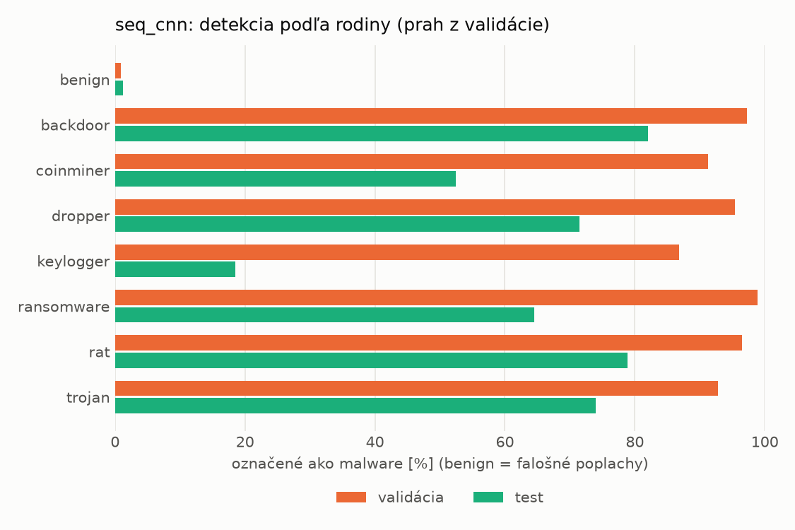
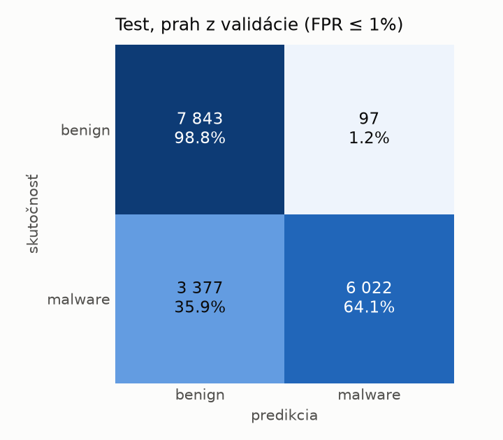
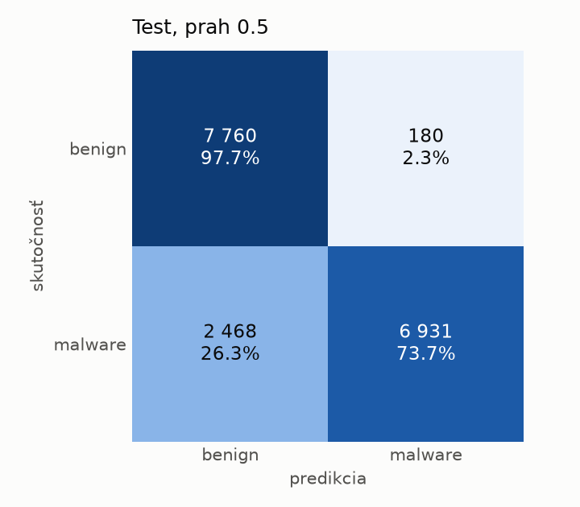
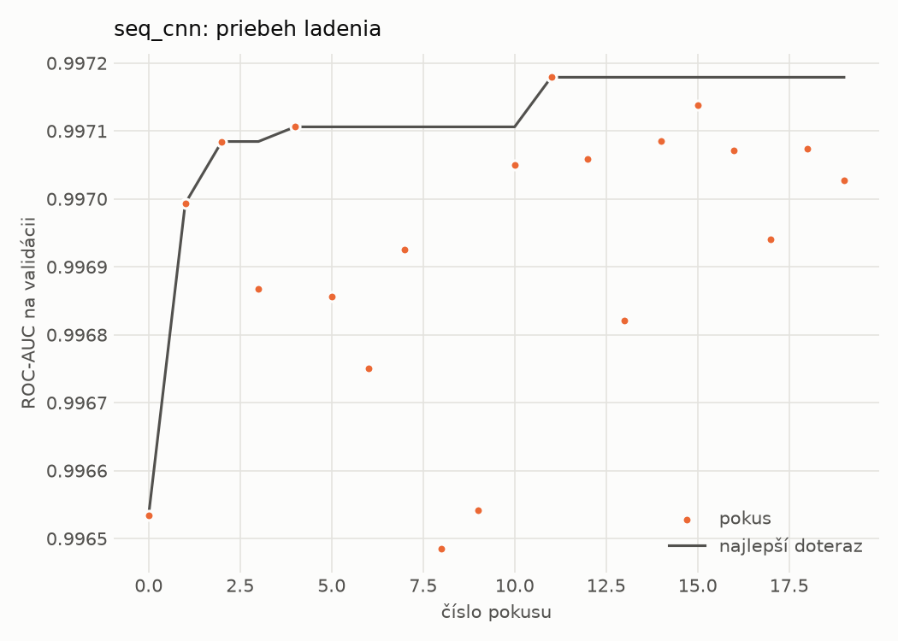
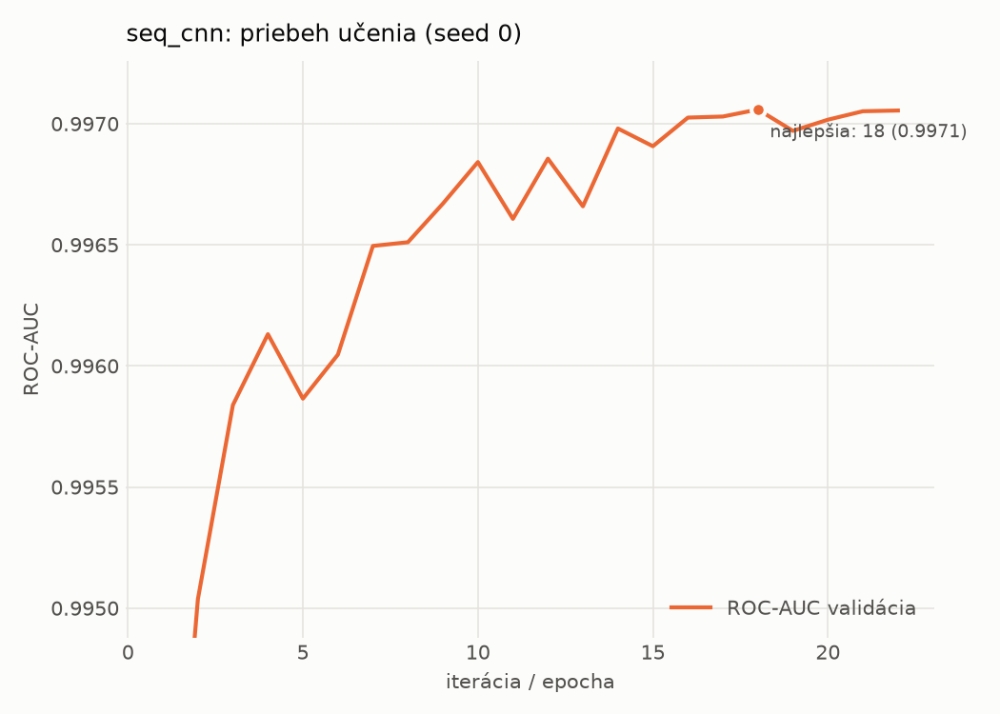

# dynamic_seq/seq_cnn – beh `20261102-010741`

> Automaticky generované (`src/training/run_tabular.py`). Konfigurácia: `config.yaml`, protokol: `protocol.yaml`.

- **Model:** `seq_cnn` – embedding API + paralelné 1D konvolúcie + maximum cez postupnosť
- **Ladenie:** 20 dokončených pokusov (Optuna TPE), cieľ ROC-AUC na validácii, 181.9 min
- **Finálne modely:** seedy [0, 1, 2]; hodnoty sú priemer ± smerodajná odchýlka cez seedy
- **Najlepšie hyperparametre:** `{"max_epochs": 30, "patience": 4, "emb_dim": 64, "channels": 128, "kernels": "2-4-8", "hidden": 64, "dropout": 0.19665662644598886, "lr": 0.0005755683530429188, "weight_decay": 0.0005400591881097476, "batch_size": 128}`

## Detekčná kvalita (bez prahu)
| metrika | train (podvzorka) | validácia | test |
|---|---|---|---|
| ROC-AUC | 0.9977 ± 0.0001 | 0.9969 ± 0.0001 | 0.9439 ± 0.0063 |
| PR-AUC | 0.9988 ± 0.0001 | 0.9984 ± 0.0001 | 0.9544 ± 0.0074 |
| TPR pri FPR 1 % | 0.9480 ± 0.0034 | 0.9491 ± 0.0006 | 0.5203 ± 0.0293 |
| TPR pri FPR 0,1 % | 0.9072 ± 0.0043 | 0.8099 ± 0.0276 | 0.3196 ± 0.0486 |
| log loss | 0.0610 ± 0.0025 | 0.0704 ± 0.0011 | 0.5515 ± 0.0216 |
| Brier skóre | 0.0196 ± 0.0008 | 0.0210 ± 0.0005 | 0.1341 ± 0.0063 |

Rozdiel ROC-AUC train − validácia: **0.0008** (veľký rozdiel = preučenie).

## Pri prahu z validácie (FPR ≤ 1% na validácii)
| metrika | train (podvzorka) | validácia | test |
|---|---|---|---|
| accuracy | 0.9607 ± 0.0008 | 0.9627 ± 0.0003 | 0.7885 ± 0.0098 |
| balanced accuracy | 0.9684 ± 0.0007 | 0.9697 ± 0.0002 | 0.8031 ± 0.0101 |
| precision | 0.9954 ± 0.0005 | 0.9950 ± 0.0001 | 0.9697 ± 0.0243 |
| recall (TPR) | 0.9455 ± 0.0012 | 0.9491 ± 0.0006 | 0.6300 ± 0.0147 |
| FPR | 0.0088 ± 0.0009 | 0.0097 ± 0.0002 | 0.0238 ± 0.0199 |
| F1 | 0.9698 ± 0.0006 | 0.9715 ± 0.0002 | 0.7636 ± 0.0110 |
| MCC | 0.9163 ± 0.0017 | 0.9195 ± 0.0006 | 0.6325 ± 0.0229 |

## Pri pevnom prahu 0.5
| metrika | train (podvzorka) | validácia | test |
|---|---|---|---|
| accuracy | 0.9681 ± 0.0020 | 0.9683 ± 0.0010 | 0.8334 ± 0.0140 |
| balanced accuracy | 0.9719 ± 0.0016 | 0.9717 ± 0.0007 | 0.8434 ± 0.0145 |
| precision | 0.9913 ± 0.0003 | 0.9907 ± 0.0000 | 0.9582 ± 0.0229 |
| recall (TPR) | 0.9607 ± 0.0027 | 0.9617 ± 0.0014 | 0.7244 ± 0.0113 |
| FPR | 0.0169 ± 0.0005 | 0.0184 ± 0.0000 | 0.0376 ± 0.0213 |
| F1 | 0.9757 ± 0.0015 | 0.9760 ± 0.0007 | 0.8250 ± 0.0140 |
| MCC | 0.9304 ± 0.0041 | 0.9301 ± 0.0020 | 0.6959 ± 0.0305 |

## Výpočtové nároky (seed 0, testovacia množina)
| meranie | hodnota |
|---|---|
| tréning finálneho modelu | 435.2 s (priemer cez seedy) |
| ladenie spolu | 10916 s |
| počet parametrov / uzlov | 210 241 |
| veľkosť modelu na disku | 0.85 MB |
| CPU latencia modelu (batch 1, 1 vlákno) | 2.965 ms (p95 3.205) |
| CPU priepustnosť (24 vlákien) | 1 188 vzoriek/s |
| GPU latencia (batch 1) | 1.066 ms (p95 1.807) |
| GPU priepustnosť | 9 307 vzoriek/s |
| GPU špičková pamäť | 2023 MB |

## Grafy
| | |
|---|---|
|  |  |
|  |  |
|  |  |
|  |  |

## Súbory
`metrics.json` (všetky metriky po seedoch vrátane rodín), `timing.json`, `hpo_trials.csv`,
`predictions/<časť>_seed<N>.parquet` (sha256, family, label, score), `model/seed_<N>/`, `log.txt`.
