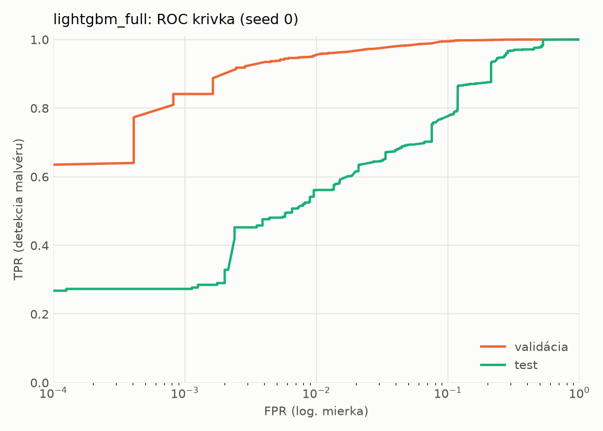
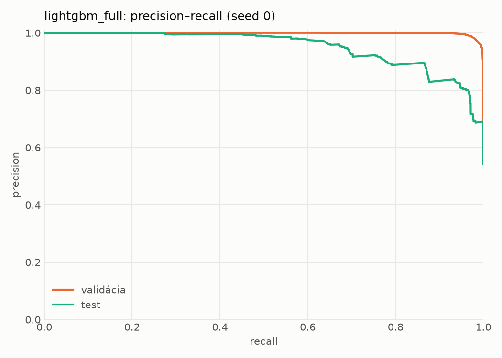
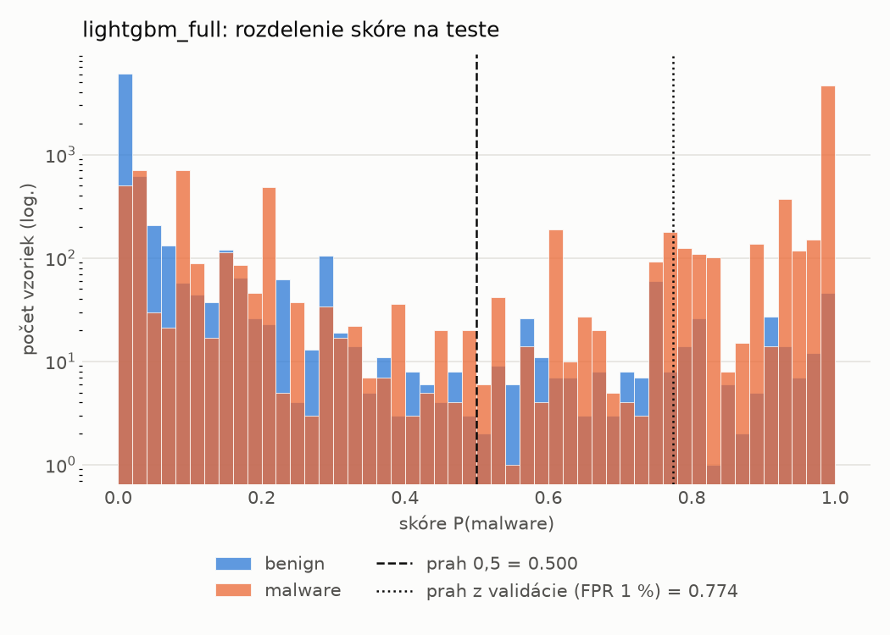
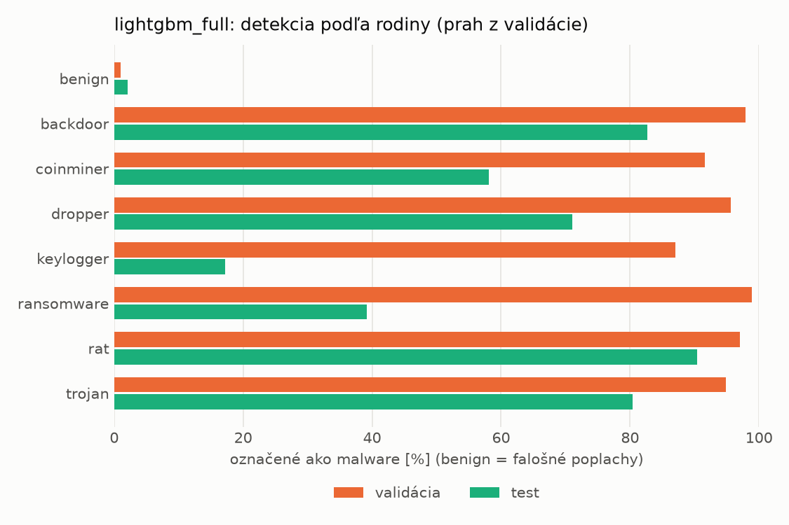
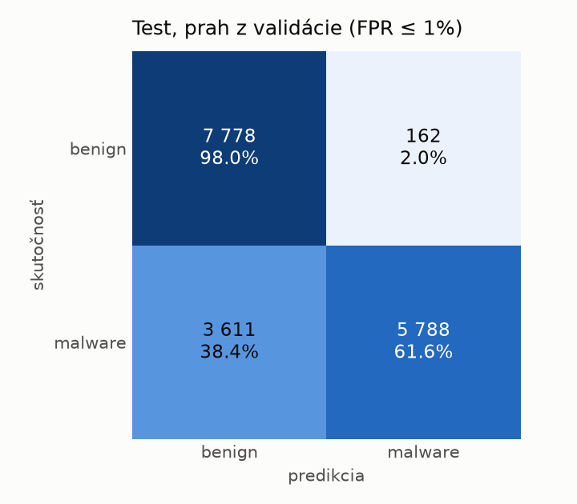
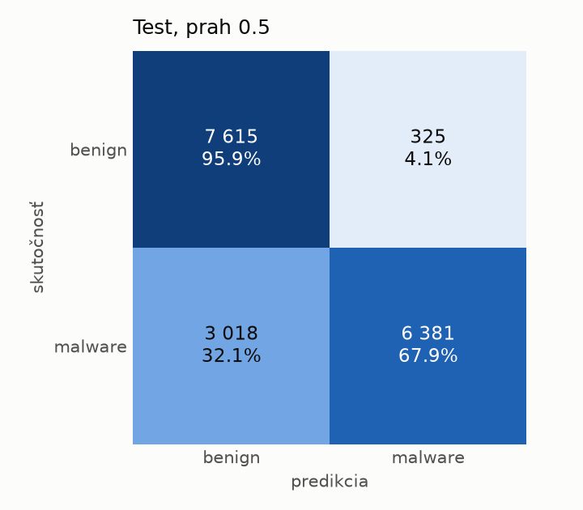
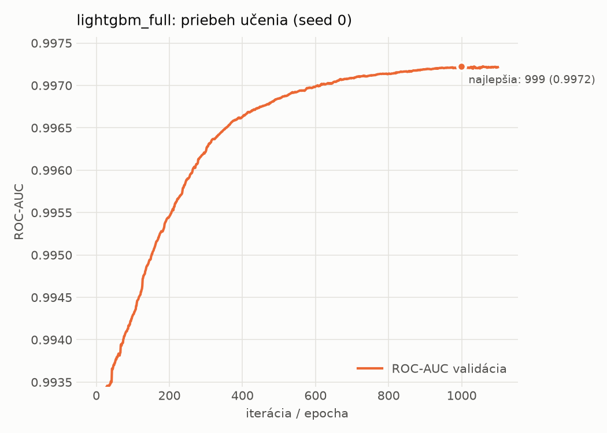

# dynamic_full/lightgbm_full – beh `20261102-043313`

> Automaticky generované (`src/training/run_tabular.py`). Konfigurácia: `config.yaml`, protokol: `protocol.yaml`.

- **Model:** `lightgbm` – lightgbm s udalosťami a súhrnnými počtami (kontrola artefaktu emulátora)
- **Ladenie:** bez ladenia – hyperparametre prevzaté z `runs_final/dynamic/lightgbm/20261102-003953`
- **Finálne modely:** seedy [0, 1, 2]; hodnoty sú priemer ± smerodajná odchýlka cez seedy
- **Najlepšie hyperparametre:** `{"num_boost_round": 5000, "early_stopping_rounds": 100, "learning_rate": 0.012600391102852807, "num_leaves": 261, "min_child_samples": 12, "feature_fraction": 0.7323605840883831, "bagging_fraction": 0.7241803281580393, "lambda_l1": 9.843384499248837e-06, "lambda_l2": 0.7301583949167907}`

## Detekčná kvalita (bez prahu)
| metrika | train (podvzorka) | validácia | test |
|---|---|---|---|
| ROC-AUC | 0.9986 ± 0.0000 | 0.9972 ± 0.0000 | 0.9415 ± 0.0014 |
| PR-AUC | 0.9992 ± 0.0000 | 0.9986 ± 0.0000 | 0.9521 ± 0.0010 |
| TPR pri FPR 1 % | 0.9637 ± 0.0003 | 0.9547 ± 0.0003 | 0.5523 ± 0.0164 |
| TPR pri FPR 0,1 % | 0.9196 ± 0.0005 | 0.8400 ± 0.0014 | 0.3055 ± 0.0549 |
| log loss | 0.0493 ± 0.0004 | 0.0656 ± 0.0001 | 0.5852 ± 0.0099 |
| Brier skóre | 0.0159 ± 0.0001 | 0.0196 ± 0.0000 | 0.1602 ± 0.0009 |

Rozdiel ROC-AUC train − validácia: **0.0014** (veľký rozdiel = preučenie).

## Pri prahu z validácie (FPR ≤ 1% na validácii)
| metrika | train (podvzorka) | validácia | test |
|---|---|---|---|
| accuracy | 0.9677 ± 0.0002 | 0.9664 ± 0.0002 | 0.7815 ± 0.0058 |
| balanced accuracy | 0.9750 ± 0.0002 | 0.9724 ± 0.0002 | 0.7967 ± 0.0051 |
| precision | 0.9984 ± 0.0000 | 0.9950 ± 0.0000 | 0.9705 ± 0.0043 |
| recall (TPR) | 0.9530 ± 0.0003 | 0.9547 ± 0.0003 | 0.6156 ± 0.0135 |
| FPR | 0.0030 ± 0.0000 | 0.0098 ± 0.0000 | 0.0222 ± 0.0038 |
| F1 | 0.9752 ± 0.0002 | 0.9744 ± 0.0002 | 0.7533 ± 0.0090 |
| MCC | 0.9309 ± 0.0004 | 0.9271 ± 0.0004 | 0.6225 ± 0.0070 |

## Pri pevnom prahu 0.5
| metrika | train (podvzorka) | validácia | test |
|---|---|---|---|
| accuracy | 0.9729 ± 0.0002 | 0.9699 ± 0.0002 | 0.8065 ± 0.0006 |
| balanced accuracy | 0.9776 ± 0.0001 | 0.9732 ± 0.0003 | 0.8184 ± 0.0005 |
| precision | 0.9957 ± 0.0000 | 0.9914 ± 0.0002 | 0.9516 ± 0.0007 |
| recall (TPR) | 0.9636 ± 0.0003 | 0.9636 ± 0.0001 | 0.6776 ± 0.0012 |
| FPR | 0.0084 ± 0.0000 | 0.0171 ± 0.0005 | 0.0408 ± 0.0006 |
| F1 | 0.9793 ± 0.0001 | 0.9773 ± 0.0002 | 0.7915 ± 0.0008 |
| MCC | 0.9411 ± 0.0004 | 0.9337 ± 0.0005 | 0.6517 ± 0.0009 |

## Výpočtové nároky (seed 0, testovacia množina)
| meranie | hodnota |
|---|---|
| tréning finálneho modelu | 22.6 s (priemer cez seedy) |
| ladenie spolu | 0 s |
| počet parametrov / uzlov | 519 793 |
| veľkosť modelu na disku | 29.39 MB |
| CPU latencia modelu (batch 1, 1 vlákno) | 0.213 ms (p95 0.247) |
| CPU priepustnosť (24 vlákien) | 67 346 vzoriek/s |

## Grafy
| | |
|---|---|
|  |  |
|  |  |
|  |  |
|  |  |

## Súbory
`metrics.json` (všetky metriky po seedoch vrátane rodín), `timing.json`, `hpo_trials.csv`,
`predictions/<časť>_seed<N>.parquet` (sha256, family, label, score), `model/seed_<N>/`, `log.txt`.
