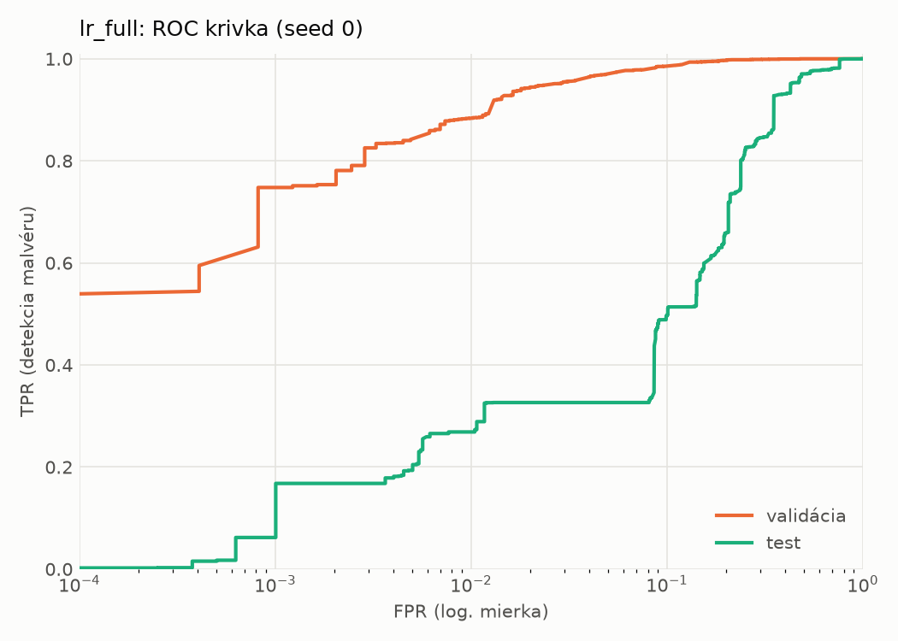
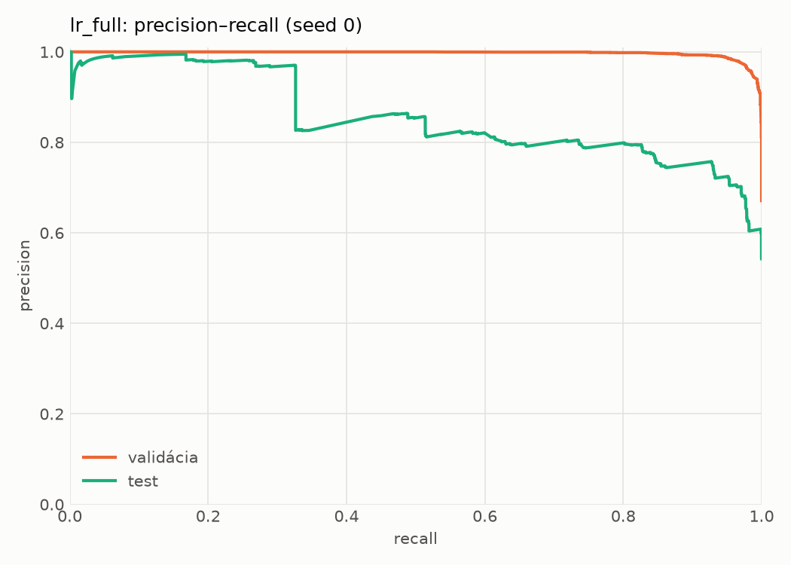
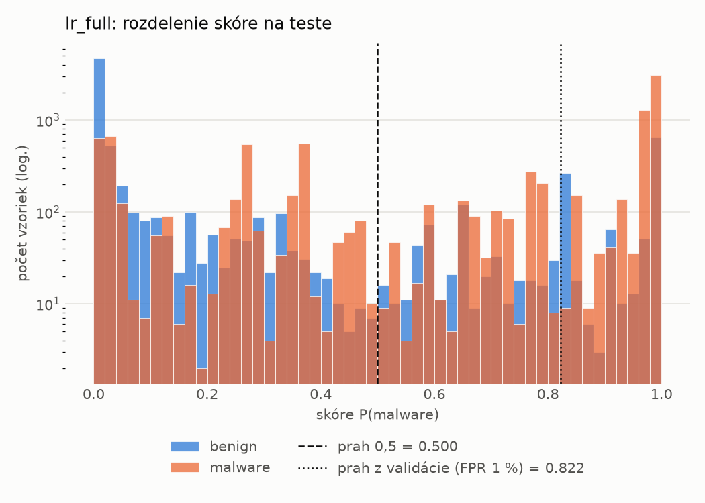
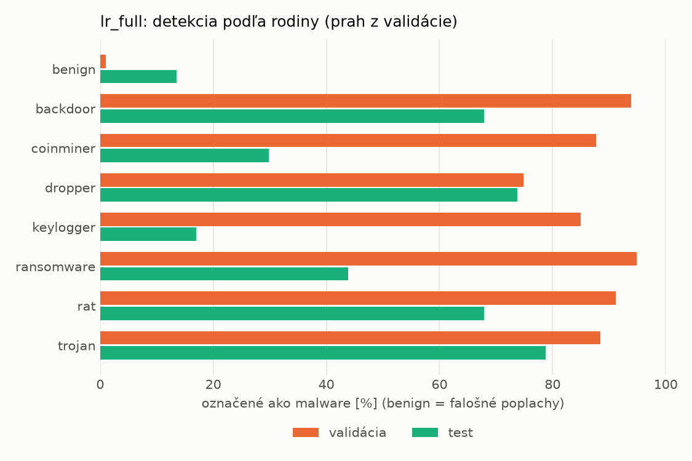
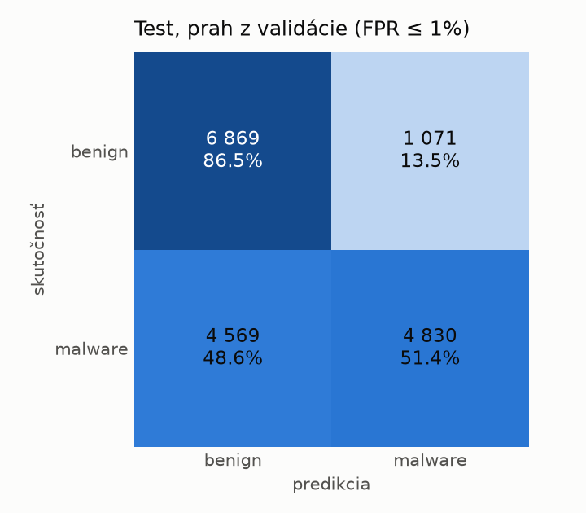
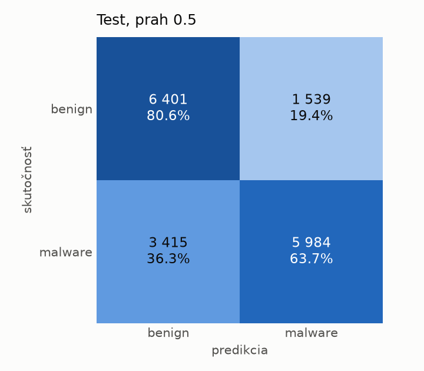

# dynamic_full/lr_full – beh `20261102-043439`

> Automaticky generované (`src/training/run_tabular.py`). Konfigurácia: `config.yaml`, protokol: `protocol.yaml`.

- **Model:** `logreg` – lr s udalosťami a súhrnnými počtami (kontrola artefaktu emulátora)
- **Ladenie:** bez ladenia – hyperparametre prevzaté z `runs_final/dynamic/lr/20261102-002602`
- **Finálne modely:** seedy [0, 1, 2]; hodnoty sú priemer ± smerodajná odchýlka cez seedy
- **Najlepšie hyperparametre:** `{"max_iter": 2000, "C": 0.04224422279858655}`

## Detekčná kvalita (bez prahu)
| metrika | train (podvzorka) | validácia | test |
|---|---|---|---|
| ROC-AUC | 0.9955 ± 0.0000 | 0.9941 ± 0.0000 | 0.8475 ± 0.0000 |
| PR-AUC | 0.9977 ± 0.0000 | 0.9970 ± 0.0000 | 0.8594 ± 0.0000 |
| TPR pri FPR 1 % | 0.9199 ± 0.0000 | 0.8836 ± 0.0000 | 0.2688 ± 0.0000 |
| TPR pri FPR 0,1 % | 0.8563 ± 0.0000 | 0.7478 ± 0.0000 | 0.0619 ± 0.0000 |
| log loss | 0.0889 ± 0.0000 | 0.0978 ± 0.0000 | 0.8135 ± 0.0000 |
| Brier skóre | 0.0272 ± 0.0000 | 0.0287 ± 0.0000 | 0.2111 ± 0.0000 |

Rozdiel ROC-AUC train − validácia: **0.0014** (veľký rozdiel = preučenie).

## Pri prahu z validácie (FPR ≤ 1% na validácii)
| metrika | train (podvzorka) | validácia | test |
|---|---|---|---|
| accuracy | 0.9184 ± 0.0000 | 0.9187 ± 0.0000 | 0.6747 ± 0.0000 |
| balanced accuracy | 0.9381 ± 0.0000 | 0.9369 ± 0.0000 | 0.6895 ± 0.0000 |
| precision | 0.9985 ± 0.0000 | 0.9946 ± 0.0000 | 0.8185 ± 0.0000 |
| recall (TPR) | 0.8790 ± 0.0000 | 0.8836 ± 0.0000 | 0.5139 ± 0.0000 |
| FPR | 0.0027 ± 0.0000 | 0.0098 ± 0.0000 | 0.1349 ± 0.0000 |
| F1 | 0.9349 ± 0.0000 | 0.9358 ± 0.0000 | 0.6314 ± 0.0000 |
| MCC | 0.8389 ± 0.0000 | 0.8367 ± 0.0000 | 0.3985 ± 0.0000 |

## Pri pevnom prahu 0.5
| metrika | train (podvzorka) | validácia | test |
|---|---|---|---|
| accuracy | 0.9586 ± 0.0000 | 0.9599 ± 0.0000 | 0.7143 ± 0.0000 |
| balanced accuracy | 0.9615 ± 0.0000 | 0.9622 ± 0.0000 | 0.7214 ± 0.0000 |
| precision | 0.9847 ± 0.0000 | 0.9843 ± 0.0000 | 0.7954 ± 0.0000 |
| recall (TPR) | 0.9528 ± 0.0000 | 0.9555 ± 0.0000 | 0.6367 ± 0.0000 |
| FPR | 0.0297 ± 0.0000 | 0.0311 ± 0.0000 | 0.1938 ± 0.0000 |
| F1 | 0.9684 ± 0.0000 | 0.9697 ± 0.0000 | 0.7072 ± 0.0000 |
| MCC | 0.9094 ± 0.0000 | 0.9113 ± 0.0000 | 0.4452 ± 0.0000 |

## Výpočtové nároky (seed 0, testovacia množina)
| meranie | hodnota |
|---|---|
| tréning finálneho modelu | 4.8 s (priemer cez seedy) |
| ladenie spolu | 0 s |
| počet parametrov / uzlov | 2 025 |
| veľkosť modelu na disku | 0.06 MB |
| transformácia vstupu – latencia (1 vlákno) | 0.017 ms |
| transformácia vstupu – priepustnosť | 53 998 vzoriek/s |
| CPU latencia modelu (batch 1, 1 vlákno) | 0.005 ms (p95 0.006) |
| CPU priepustnosť (24 vlákien) | 316 047 vzoriek/s |

## Grafy
| | |
|---|---|
|  |  |
|  |  |
|  |  |
|  |  |

## Súbory
`metrics.json` (všetky metriky po seedoch vrátane rodín), `timing.json`, `hpo_trials.csv`,
`predictions/<časť>_seed<N>.parquet` (sha256, family, label, score), `model/seed_<N>/`, `log.txt`.
