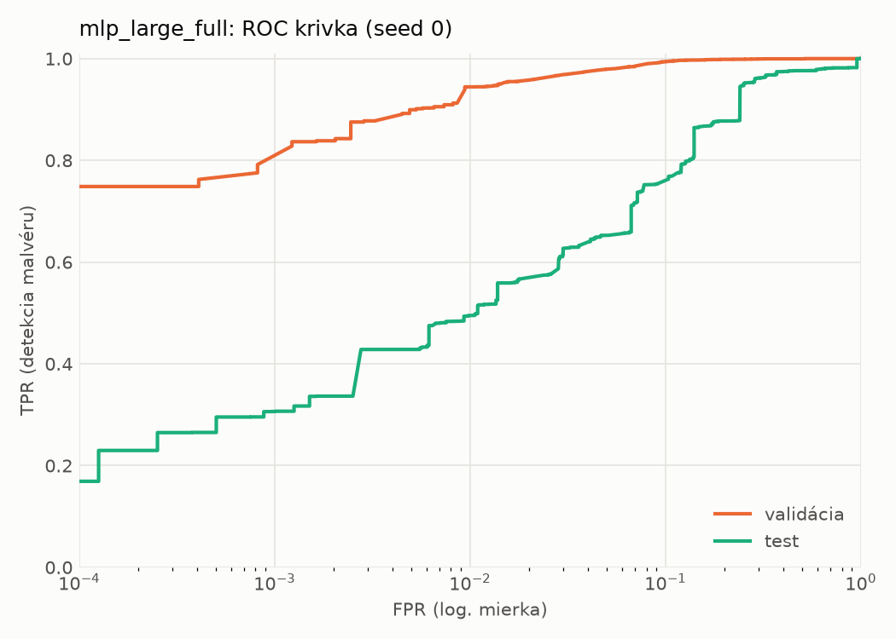
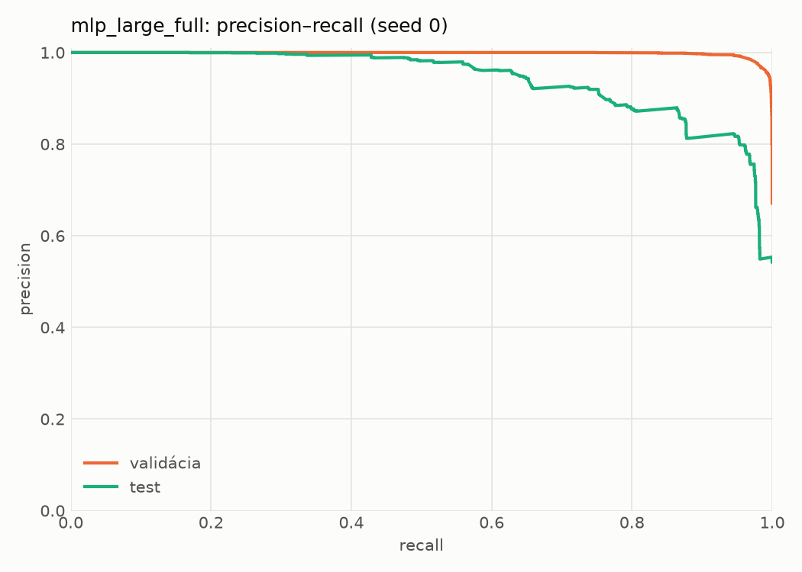
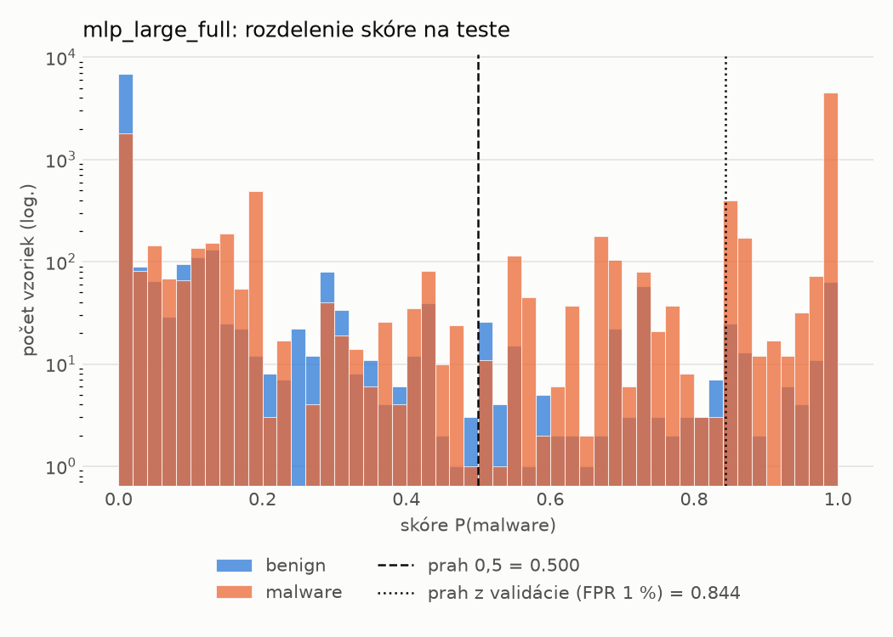
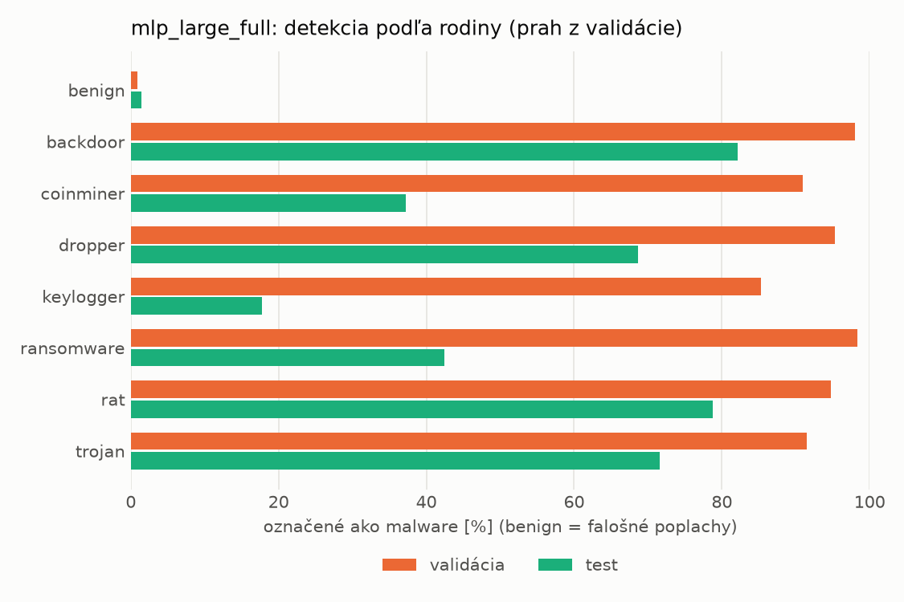
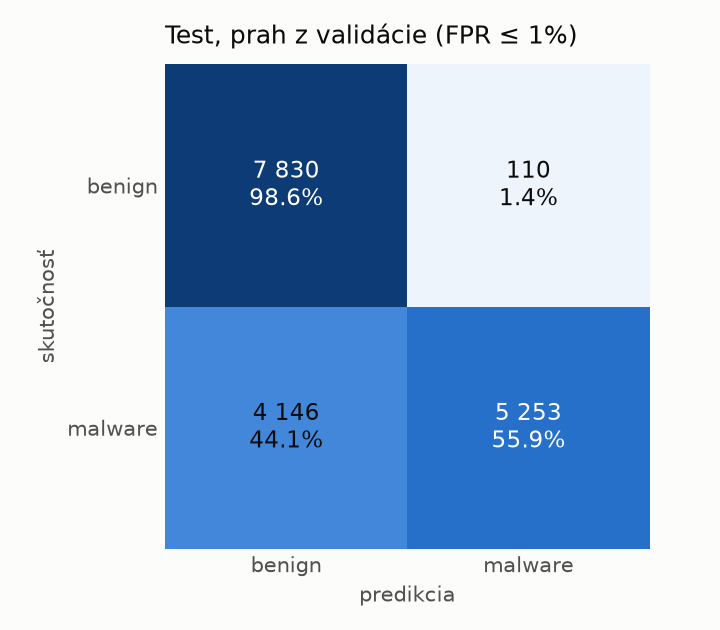
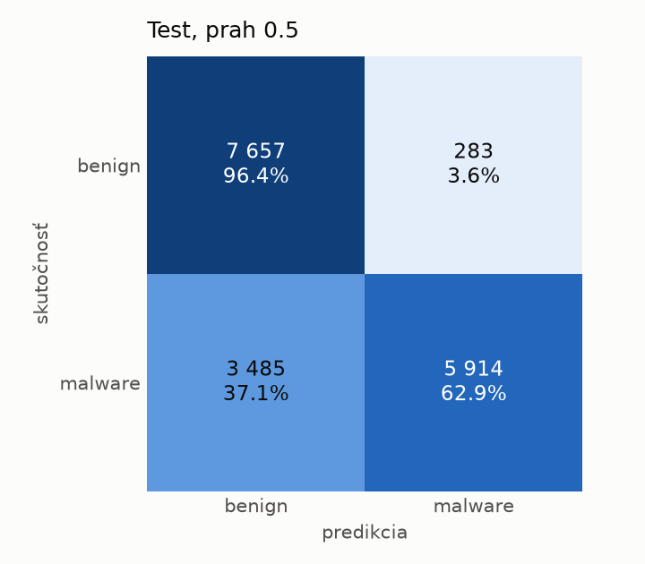
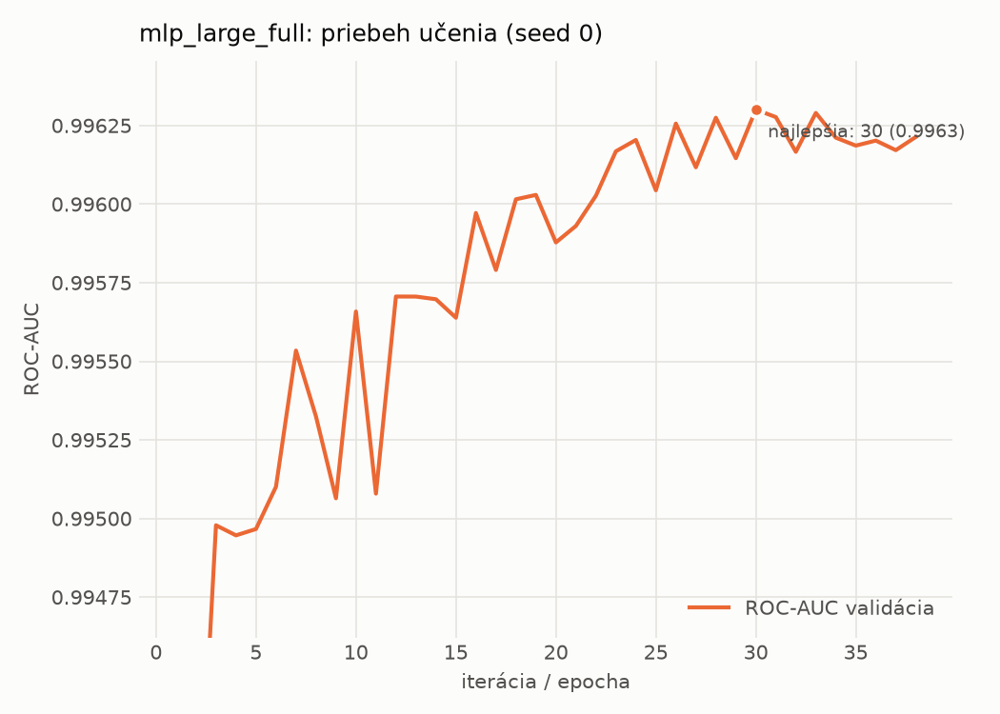

# dynamic_full/mlp_large_full – beh `20261102-043500`

> Automaticky generované (`src/training/run_tabular.py`). Konfigurácia: `config.yaml`, protokol: `protocol.yaml`.

- **Model:** `mlp` – mlp_large s udalosťami a súhrnnými počtami (kontrola artefaktu emulátora)
- **Ladenie:** bez ladenia – hyperparametre prevzaté z `runs_final/dynamic/mlp_large/20261102-005920`
- **Finálne modely:** seedy [0, 1, 2]; hodnoty sú priemer ± smerodajná odchýlka cez seedy
- **Najlepšie hyperparametre:** `{"max_epochs": 100, "patience": 8, "hidden_layers": 3, "hidden_width": 512, "width_decay": 0.5, "dropout": 0.3735687797102123, "lr": 0.00020669709962675654, "weight_decay": 1.4747439017290252e-05, "batch_size": 256}`

## Detekčná kvalita (bez prahu)
| metrika | train (podvzorka) | validácia | test |
|---|---|---|---|
| ROC-AUC | 0.9969 ± 0.0005 | 0.9961 ± 0.0002 | 0.9319 ± 0.0064 |
| PR-AUC | 0.9984 ± 0.0002 | 0.9981 ± 0.0001 | 0.9471 ± 0.0049 |
| TPR pri FPR 1 % | 0.9347 ± 0.0041 | 0.9378 ± 0.0058 | 0.4957 ± 0.0075 |
| TPR pri FPR 0,1 % | 0.8958 ± 0.0054 | 0.8027 ± 0.0287 | 0.3674 ± 0.0603 |
| log loss | 0.0687 ± 0.0060 | 0.0797 ± 0.0019 | 0.6731 ± 0.1473 |
| Brier skóre | 0.0221 ± 0.0017 | 0.0232 ± 0.0009 | 0.1649 ± 0.0188 |

Rozdiel ROC-AUC train − validácia: **0.0008** (veľký rozdiel = preučenie).

## Pri prahu z validácie (FPR ≤ 1% na validácii)
| metrika | train (podvzorka) | validácia | test |
|---|---|---|---|
| accuracy | 0.9535 ± 0.0030 | 0.9551 ± 0.0040 | 0.7607 ± 0.0058 |
| balanced accuracy | 0.9631 ± 0.0024 | 0.9641 ± 0.0030 | 0.7777 ± 0.0050 |
| precision | 0.9956 ± 0.0005 | 0.9950 ± 0.0002 | 0.9722 ± 0.0063 |
| recall (TPR) | 0.9343 ± 0.0042 | 0.9378 ± 0.0058 | 0.5750 ± 0.0144 |
| FPR | 0.0082 ± 0.0010 | 0.0097 ± 0.0002 | 0.0195 ± 0.0049 |
| F1 | 0.9640 ± 0.0024 | 0.9655 ± 0.0032 | 0.7225 ± 0.0099 |
| MCC | 0.9021 ± 0.0060 | 0.9045 ± 0.0079 | 0.5930 ± 0.0061 |

## Pri pevnom prahu 0.5
| metrika | train (podvzorka) | validácia | test |
|---|---|---|---|
| accuracy | 0.9654 ± 0.0005 | 0.9655 ± 0.0001 | 0.7917 ± 0.0124 |
| balanced accuracy | 0.9681 ± 0.0019 | 0.9680 ± 0.0018 | 0.8050 ± 0.0114 |
| precision | 0.9878 ± 0.0031 | 0.9876 ± 0.0032 | 0.9538 ± 0.0014 |
| recall (TPR) | 0.9600 ± 0.0025 | 0.9607 ± 0.0031 | 0.6471 ± 0.0235 |
| FPR | 0.0237 ± 0.0062 | 0.0247 ± 0.0066 | 0.0371 ± 0.0013 |
| F1 | 0.9737 ± 0.0003 | 0.9740 ± 0.0001 | 0.7709 ± 0.0168 |
| MCC | 0.9241 ± 0.0016 | 0.9238 ± 0.0009 | 0.6303 ± 0.0188 |

## Výpočtové nároky (seed 0, testovacia množina)
| meranie | hodnota |
|---|---|
| tréning finálneho modelu | 17.0 s (priemer cez seedy) |
| ladenie spolu | 0 s |
| počet parametrov / uzlov | 1 202 945 |
| veľkosť modelu na disku | 4.88 MB |
| transformácia vstupu – latencia (1 vlákno) | 0.034 ms |
| transformácia vstupu – priepustnosť | 53 328 vzoriek/s |
| CPU latencia modelu (batch 1, 1 vlákno) | 0.196 ms (p95 0.238) |
| CPU priepustnosť (24 vlákien) | 70 929 vzoriek/s |
| GPU latencia (batch 1) | 0.427 ms (p95 0.921) |
| GPU priepustnosť | 91 678 vzoriek/s |
| GPU špičková pamäť | 803 MB |

## Grafy
| | |
|---|---|
|  |  |
|  |  |
|  |  |
|  |  |

## Súbory
`metrics.json` (všetky metriky po seedoch vrátane rodín), `timing.json`, `hpo_trials.csv`,
`predictions/<časť>_seed<N>.parquet` (sha256, family, label, score), `model/seed_<N>/`, `log.txt`.
