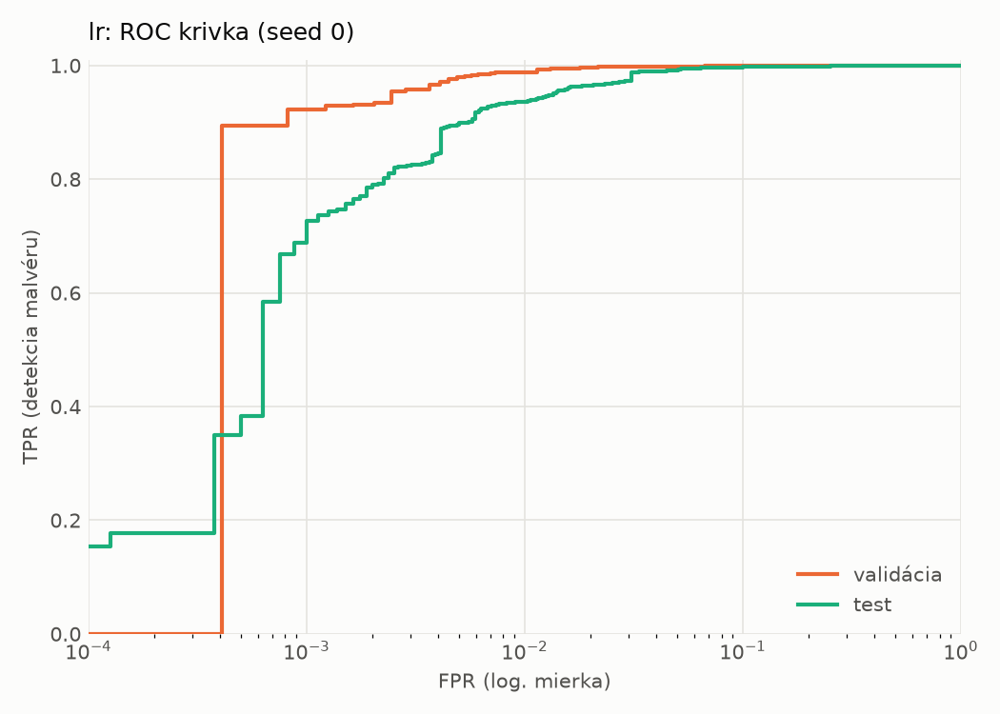
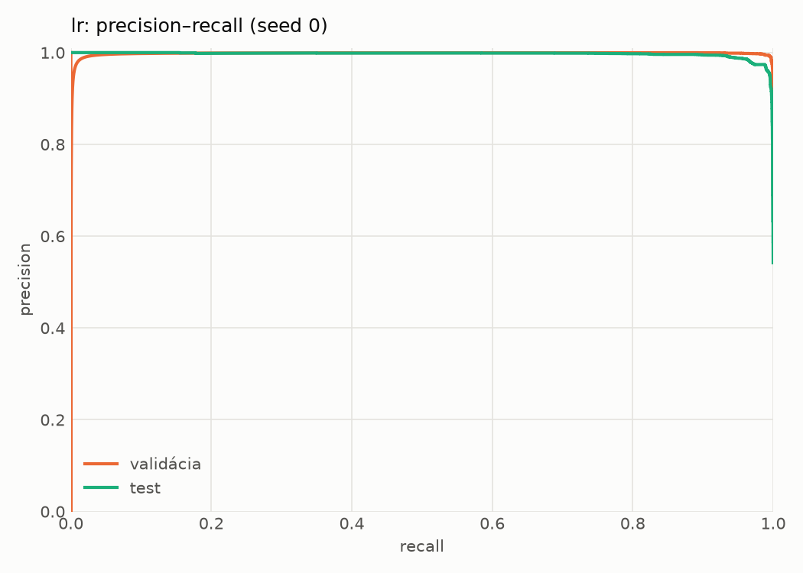
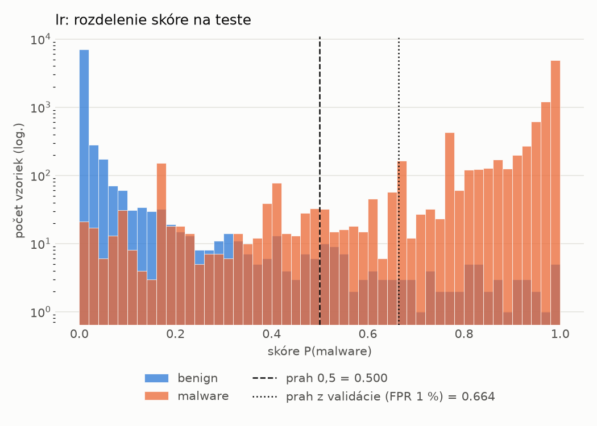
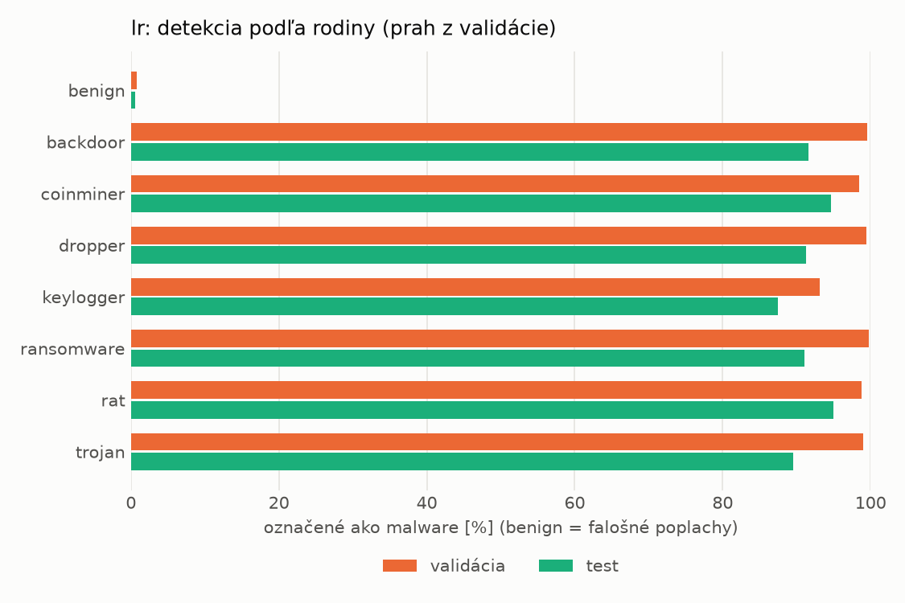
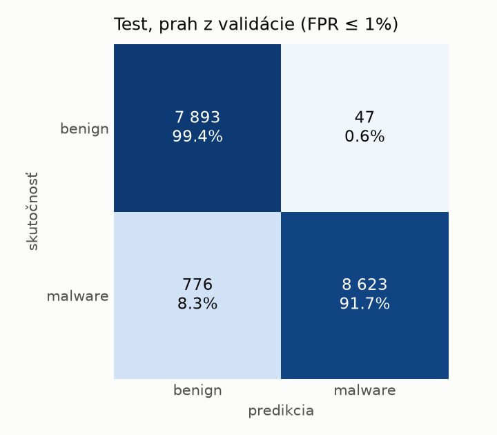
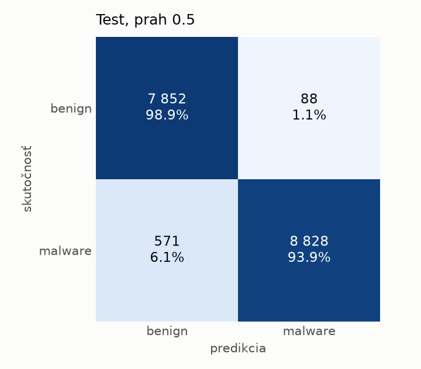
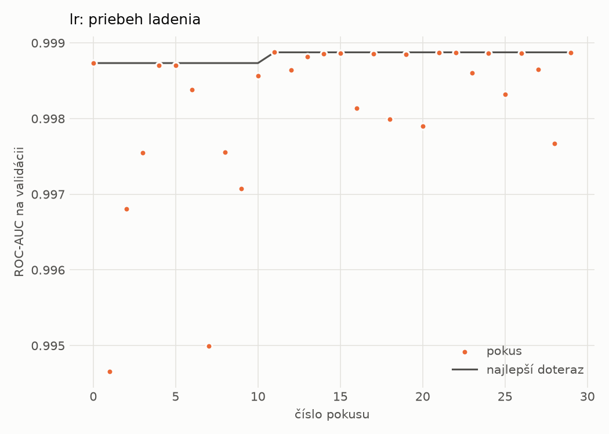

# hybrid/lr – beh `20261102-044357`

> Automaticky generované (`src/training/run_tabular.py`). Konfigurácia: `config.yaml`, protokol: `protocol.yaml`.

- **Model:** `logreg` – logistická regresia s L2 regularizáciou (vstup signed log1p + štandardizácia)
- **Ladenie:** 30 dokončených pokusov (Optuna TPE), cieľ ROC-AUC na validácii, 3.3 min
- **Finálne modely:** seedy [0, 1, 2]; hodnoty sú priemer ± smerodajná odchýlka cez seedy
- **Najlepšie hyperparametre:** `{"max_iter": 2000, "C": 0.0028355883180749405}`

## Detekčná kvalita (bez prahu)
| metrika | train (podvzorka) | validácia | test |
|---|---|---|---|
| ROC-AUC | 0.9997 ± 0.0000 | 0.9989 ± 0.0000 | 0.9964 ± 0.0000 |
| PR-AUC | 0.9999 ± 0.0000 | 0.9981 ± 0.0000 | 0.9968 ± 0.0000 |
| TPR pri FPR 1 % | 0.9972 ± 0.0000 | 0.9880 ± 0.0000 | 0.9360 ± 0.0000 |
| TPR pri FPR 0,1 % | 0.9408 ± 0.0000 | 0.9226 ± 0.0000 | 0.6887 ± 0.0000 |
| log loss | 0.0239 ± 0.0000 | 0.0328 ± 0.0000 | 0.1019 ± 0.0000 |
| Brier skóre | 0.0053 ± 0.0000 | 0.0074 ± 0.0000 | 0.0284 ± 0.0000 |

Rozdiel ROC-AUC train − validácia: **0.0008** (veľký rozdiel = preučenie).

## Pri prahu z validácie (FPR ≤ 1% na validácii)
| metrika | train (podvzorka) | validácia | test |
|---|---|---|---|
| accuracy | 0.9914 ± 0.0000 | 0.9892 ± 0.0000 | 0.9525 ± 0.0000 |
| balanced accuracy | 0.9927 ± 0.0000 | 0.9899 ± 0.0000 | 0.9558 ± 0.0000 |
| precision | 0.9982 ± 0.0000 | 0.9960 ± 0.0000 | 0.9946 ± 0.0000 |
| recall (TPR) | 0.9889 ± 0.0000 | 0.9880 ± 0.0000 | 0.9174 ± 0.0000 |
| FPR | 0.0036 ± 0.0000 | 0.0082 ± 0.0000 | 0.0059 ± 0.0000 |
| F1 | 0.9935 ± 0.0000 | 0.9919 ± 0.0000 | 0.9545 ± 0.0000 |
| MCC | 0.9808 ± 0.0000 | 0.9758 ± 0.0000 | 0.9083 ± 0.0000 |

## Pri pevnom prahu 0.5
| metrika | train (podvzorka) | validácia | test |
|---|---|---|---|
| accuracy | 0.9944 ± 0.0000 | 0.9915 ± 0.0000 | 0.9620 ± 0.0000 |
| balanced accuracy | 0.9938 ± 0.0000 | 0.9904 ± 0.0000 | 0.9641 ± 0.0000 |
| precision | 0.9961 ± 0.0000 | 0.9938 ± 0.0000 | 0.9901 ± 0.0000 |
| recall (TPR) | 0.9955 ± 0.0000 | 0.9936 ± 0.0000 | 0.9392 ± 0.0000 |
| FPR | 0.0078 ± 0.0000 | 0.0127 ± 0.0000 | 0.0111 ± 0.0000 |
| F1 | 0.9958 ± 0.0000 | 0.9937 ± 0.0000 | 0.9640 ± 0.0000 |
| MCC | 0.9874 ± 0.0000 | 0.9808 ± 0.0000 | 0.9252 ± 0.0000 |

## Výpočtové nároky (seed 0, testovacia množina)
| meranie | hodnota |
|---|---|
| tréning finálneho modelu | 5.4 s (priemer cez seedy) |
| ladenie spolu | 200 s |
| počet parametrov / uzlov | 4 320 |
| veľkosť modelu na disku | 0.13 MB |
| transformácia vstupu – latencia (1 vlákno) | 0.034 ms |
| transformácia vstupu – priepustnosť | 22 887 vzoriek/s |
| CPU latencia modelu (batch 1, 1 vlákno) | 0.008 ms (p95 0.008) |
| CPU priepustnosť (24 vlákien) | 147 806 vzoriek/s |

## Grafy
| | |
|---|---|
|  |  |
|  |  |
|  |  |
|  |  |

## Súbory
`metrics.json` (všetky metriky po seedoch vrátane rodín), `timing.json`, `hpo_trials.csv`,
`predictions/<časť>_seed<N>.parquet` (sha256, family, label, score), `model/seed_<N>/`, `log.txt`.
