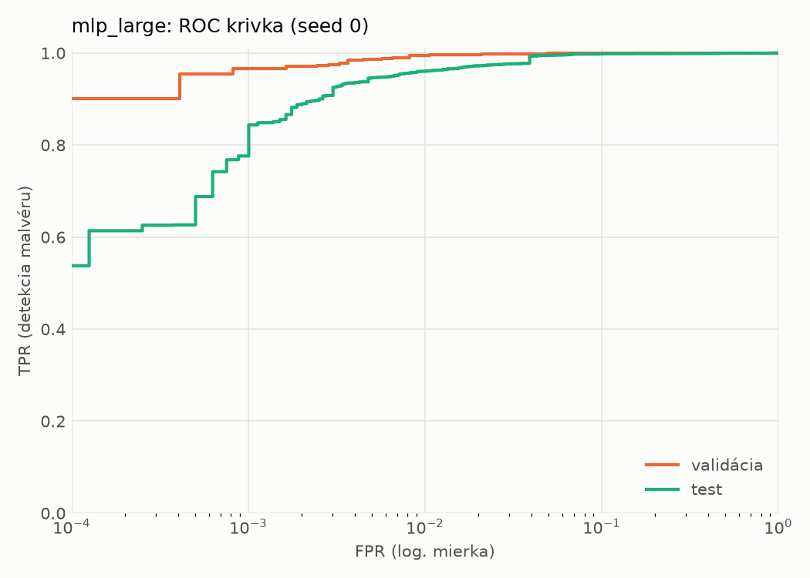
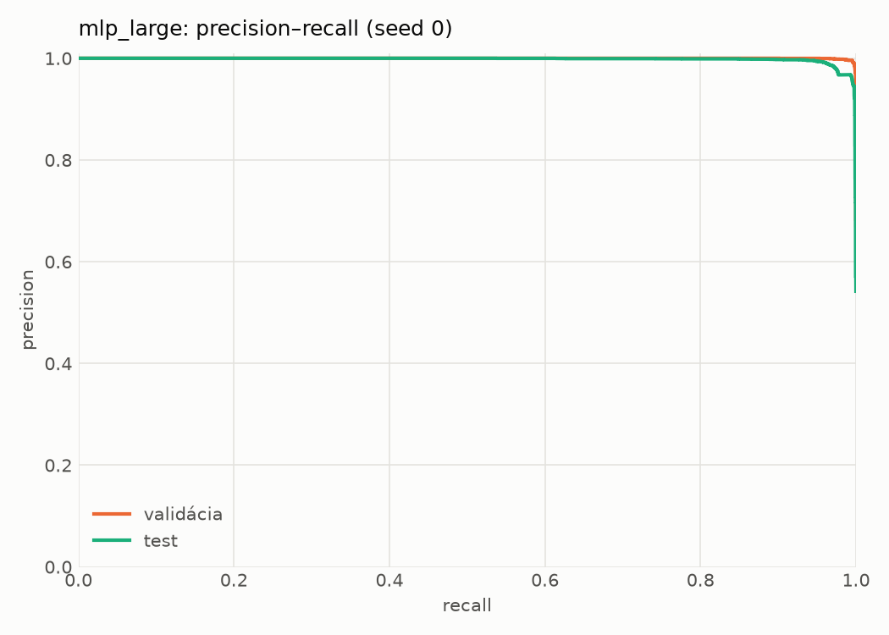
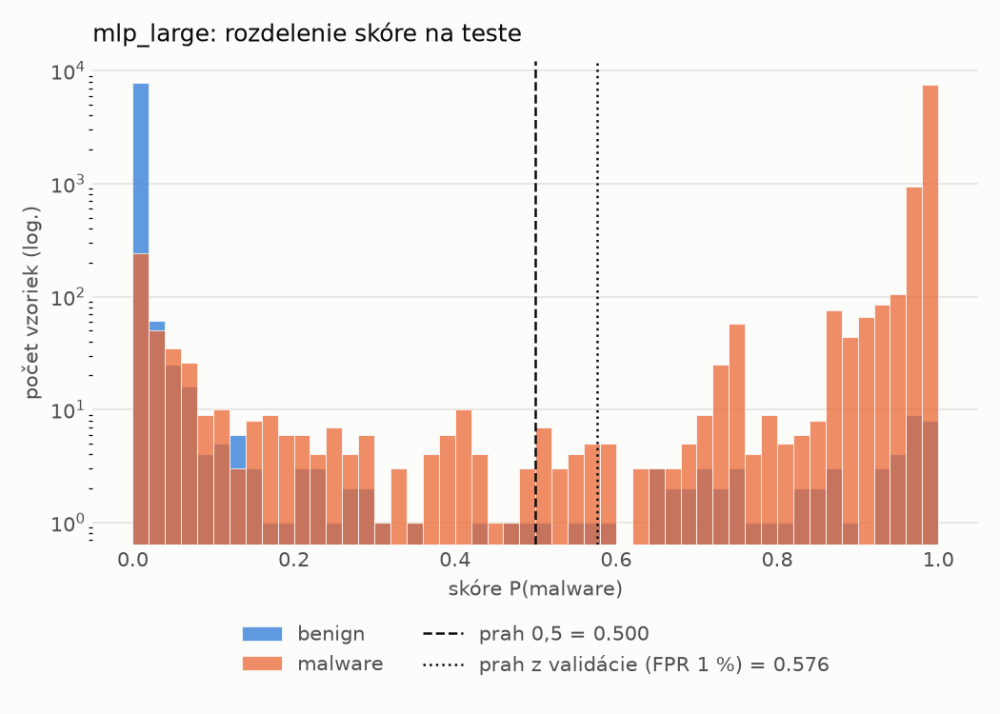
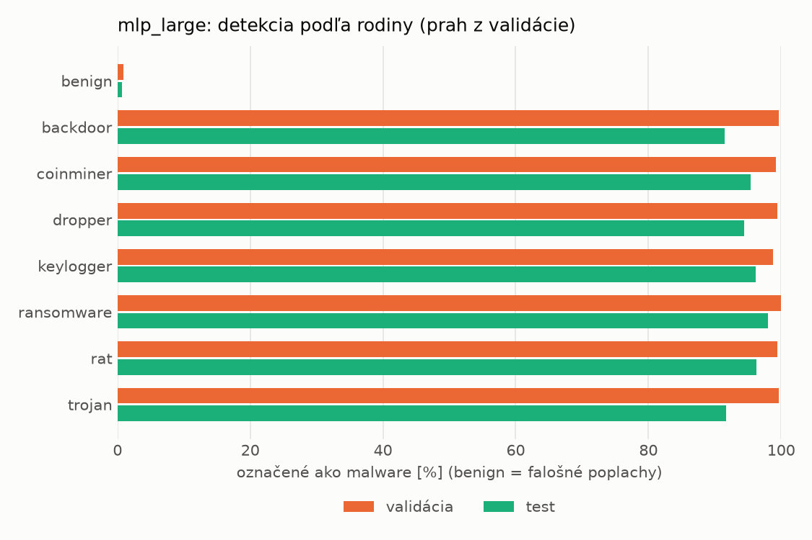
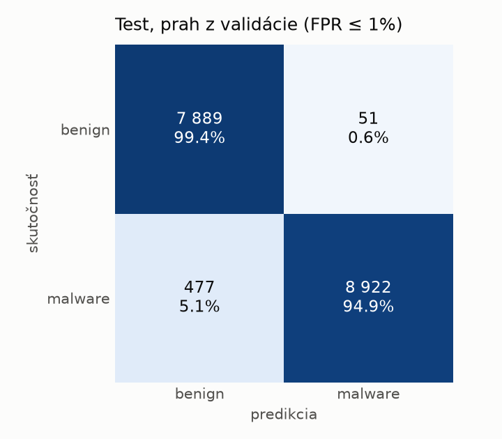
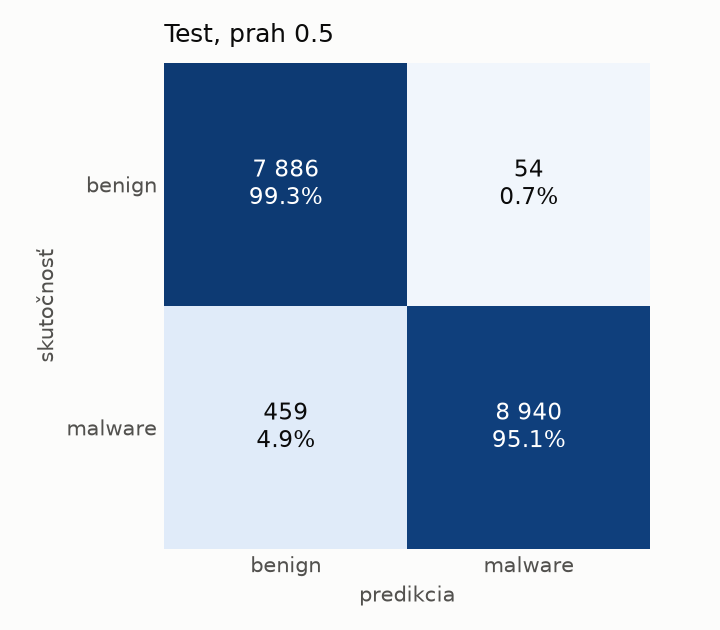
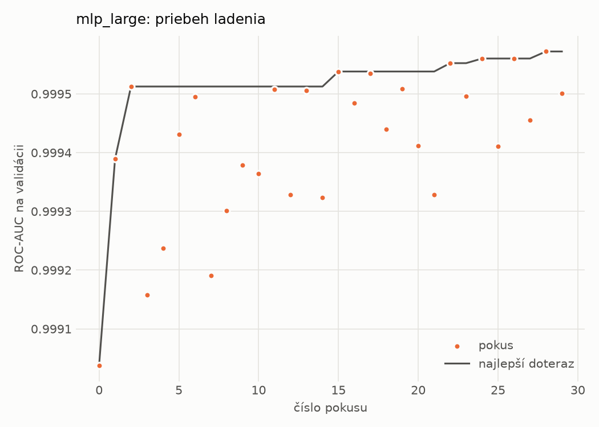
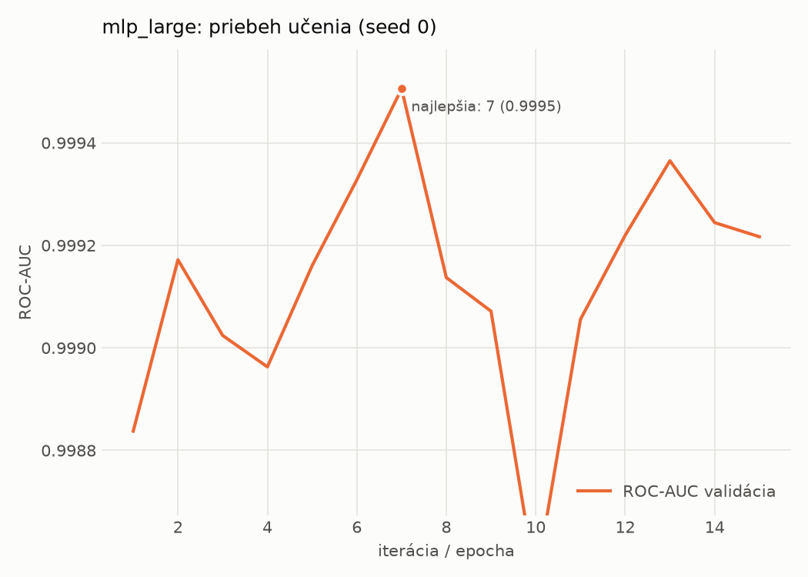

# hybrid/mlp_large – beh `20261102-064138`

> Automaticky generované (`src/training/run_tabular.py`). Konfigurácia: `config.yaml`, protokol: `protocol.yaml`.

- **Model:** `mlp` – veľká neurónová sieť (3–5 skrytých vrstiev, 512–2048 neurónov), kandidát na učiteľa
- **Ladenie:** 30 dokončených pokusov (Optuna TPE), cieľ ROC-AUC na validácii, 3.4 min
- **Finálne modely:** seedy [0, 1, 2]; hodnoty sú priemer ± smerodajná odchýlka cez seedy
- **Najlepšie hyperparametre:** `{"max_epochs": 100, "patience": 8, "hidden_layers": 4, "hidden_width": 512, "width_decay": 0.5, "dropout": 0.1951820260605614, "lr": 0.000176468680848935, "weight_decay": 1.209699321025492e-05, "batch_size": 512}`

## Detekčná kvalita (bez prahu)
| metrika | train (podvzorka) | validácia | test |
|---|---|---|---|
| ROC-AUC | 0.9999 ± 0.0000 | 0.9995 ± 0.0000 | 0.9965 ± 0.0013 |
| PR-AUC | 0.9999 ± 0.0000 | 0.9998 ± 0.0000 | 0.9974 ± 0.0009 |
| TPR pri FPR 1 % | 0.9991 ± 0.0001 | 0.9957 ± 0.0005 | 0.9597 ± 0.0010 |
| TPR pri FPR 0,1 % | 0.9847 ± 0.0032 | 0.9602 ± 0.0107 | 0.7915 ± 0.0148 |
| log loss | 0.0246 ± 0.0106 | 0.0347 ± 0.0071 | 0.1364 ± 0.0197 |
| Brier skóre | 0.0032 ± 0.0010 | 0.0057 ± 0.0002 | 0.0341 ± 0.0078 |

Rozdiel ROC-AUC train − validácia: **0.0004** (veľký rozdiel = preučenie).

## Pri prahu z validácie (FPR ≤ 1% na validácii)
| metrika | train (podvzorka) | validácia | test |
|---|---|---|---|
| accuracy | 0.9969 ± 0.0007 | 0.9941 ± 0.0005 | 0.9672 ± 0.0063 |
| balanced accuracy | 0.9963 ± 0.0008 | 0.9933 ± 0.0005 | 0.9692 ± 0.0058 |
| precision | 0.9972 ± 0.0005 | 0.9955 ± 0.0002 | 0.9935 ± 0.0007 |
| recall (TPR) | 0.9982 ± 0.0007 | 0.9957 ± 0.0005 | 0.9457 ± 0.0116 |
| FPR | 0.0056 ± 0.0011 | 0.0091 ± 0.0005 | 0.0073 ± 0.0008 |
| F1 | 0.9977 ± 0.0005 | 0.9956 ± 0.0003 | 0.9690 ± 0.0062 |
| MCC | 0.9930 ± 0.0016 | 0.9866 ± 0.0011 | 0.9356 ± 0.0120 |

## Pri pevnom prahu 0.5
| metrika | train (podvzorka) | validácia | test |
|---|---|---|---|
| accuracy | 0.9968 ± 0.0007 | 0.9941 ± 0.0006 | 0.9563 ± 0.0216 |
| balanced accuracy | 0.9963 ± 0.0006 | 0.9936 ± 0.0010 | 0.9592 ± 0.0200 |
| precision | 0.9974 ± 0.0003 | 0.9961 ± 0.0011 | 0.9943 ± 0.0007 |
| recall (TPR) | 0.9978 ± 0.0008 | 0.9952 ± 0.0004 | 0.9246 ± 0.0398 |
| FPR | 0.0052 ± 0.0006 | 0.0081 ± 0.0023 | 0.0062 ± 0.0007 |
| F1 | 0.9976 ± 0.0005 | 0.9956 ± 0.0004 | 0.9579 ± 0.0218 |
| MCC | 0.9927 ± 0.0015 | 0.9867 ± 0.0014 | 0.9157 ± 0.0397 |

## Výpočtové nároky (seed 0, testovacia množina)
| meranie | hodnota |
|---|---|
| tréning finálneho modelu | 4.8 s (priemer cez seedy) |
| ladenie spolu | 202 s |
| počet parametrov / uzlov | 2 386 305 |
| veľkosť modelu na disku | 9.67 MB |
| transformácia vstupu – latencia (1 vlákno) | 0.062 ms |
| transformácia vstupu – priepustnosť | 23 255 vzoriek/s |
| CPU latencia modelu (batch 1, 1 vlákno) | 0.293 ms (p95 0.334) |
| CPU priepustnosť (24 vlákien) | 28 672 vzoriek/s |
| GPU latencia (batch 1) | 0.525 ms (p95 1.089) |
| GPU priepustnosť | 35 418 vzoriek/s |
| GPU špičková pamäť | 2937 MB |

## Grafy
| | |
|---|---|
|  |  |
|  |  |
|  |  |
|  |  |

## Súbory
`metrics.json` (všetky metriky po seedoch vrátane rodín), `timing.json`, `hpo_trials.csv`,
`predictions/<časť>_seed<N>.parquet` (sha256, family, label, score), `model/seed_<N>/`, `log.txt`.
