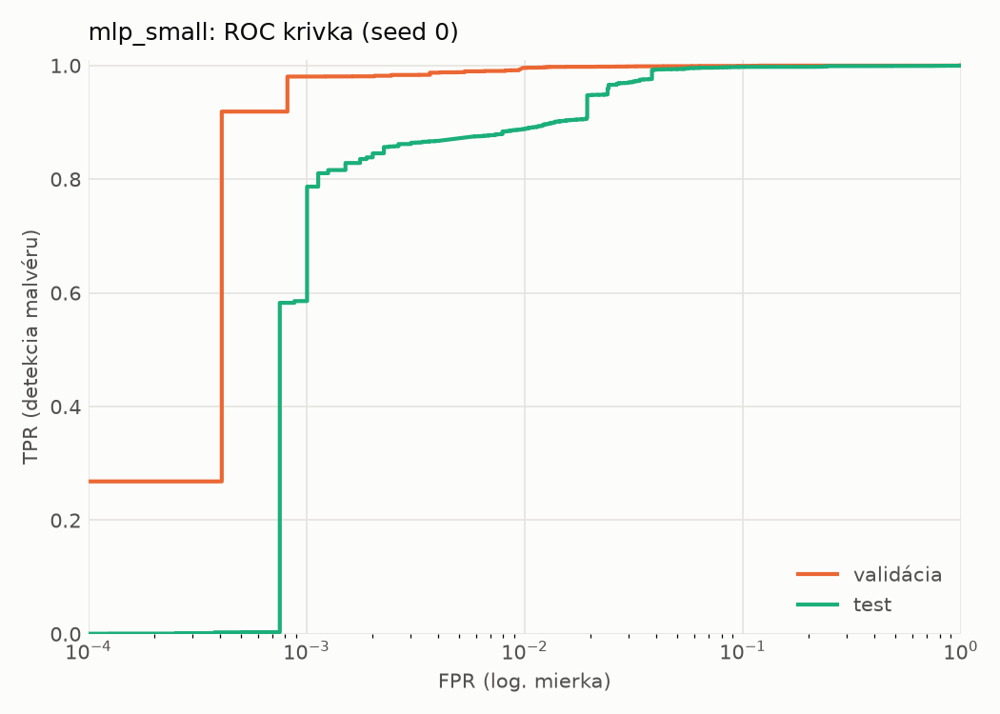
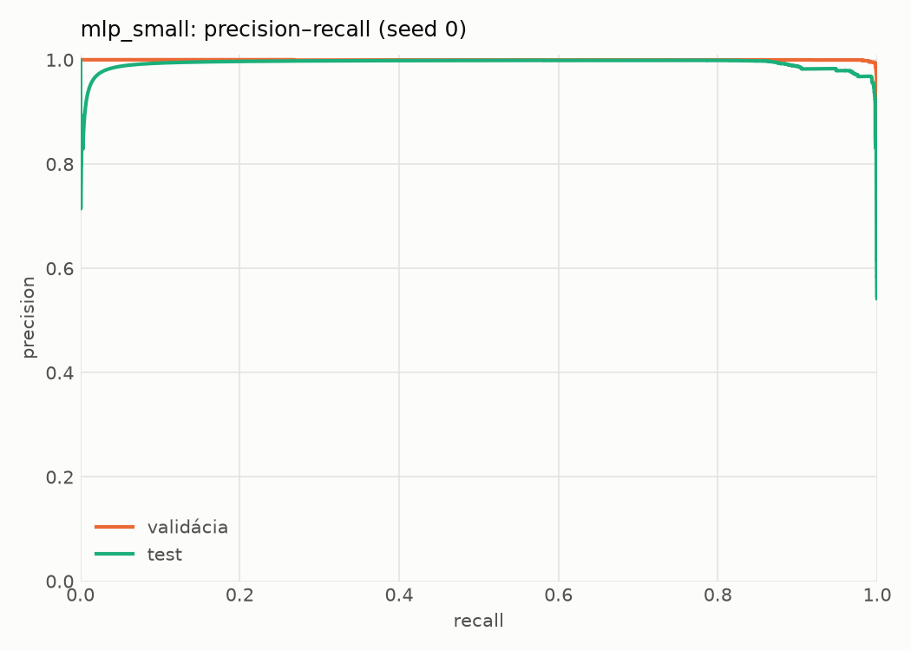
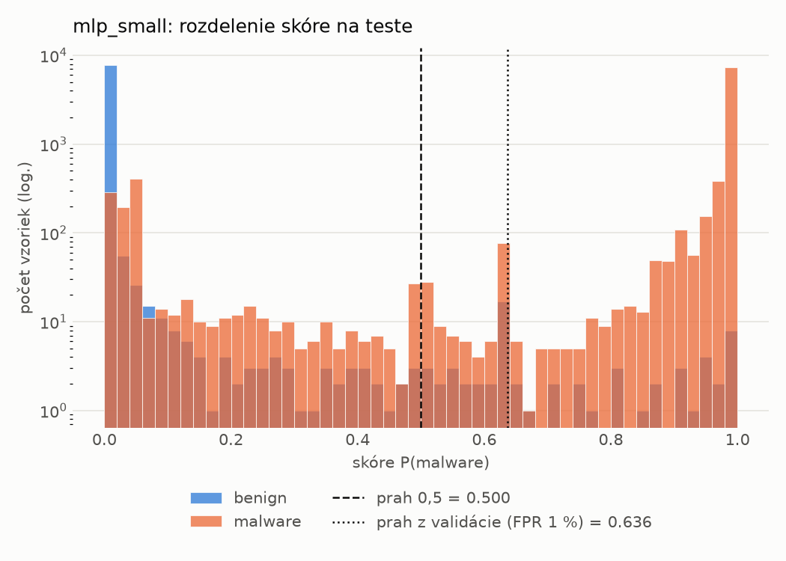
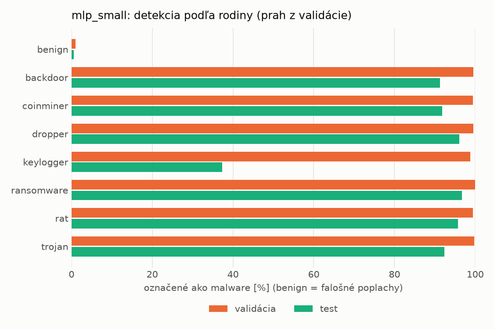
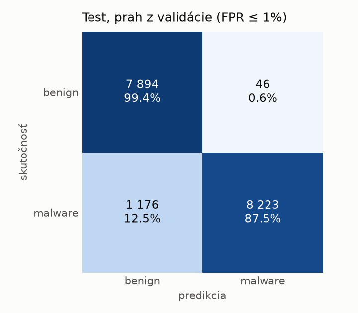
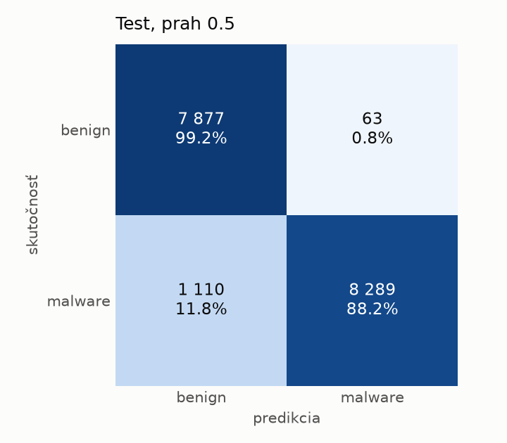
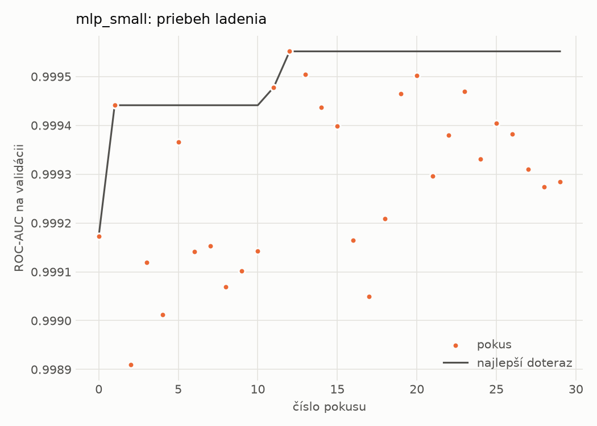
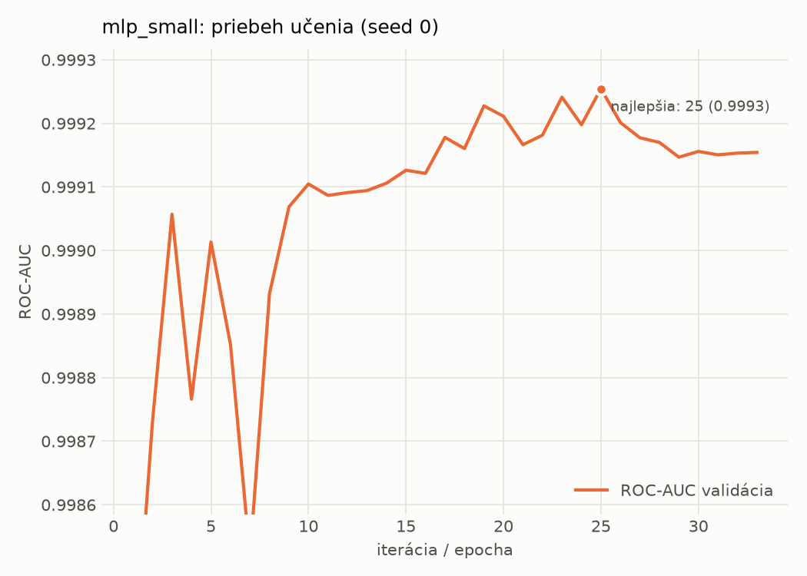

# hybrid/mlp_small – beh `20261102-063854`

> Automaticky generované (`src/training/run_tabular.py`). Konfigurácia: `config.yaml`, protokol: `protocol.yaml`.

- **Model:** `mlp` – malá neurónová sieť (1–2 skryté vrstvy), kandidát na ľahkého študenta
- **Ladenie:** 30 dokončených pokusov (Optuna TPE), cieľ ROC-AUC na validácii, 2.2 min
- **Finálne modely:** seedy [0, 1, 2]; hodnoty sú priemer ± smerodajná odchýlka cez seedy
- **Najlepšie hyperparametre:** `{"width_decay": 0.5, "max_epochs": 100, "patience": 8, "hidden_layers": 2, "hidden_width": 32, "dropout": 0.16874195706419903, "lr": 0.0006143857735366936, "weight_decay": 0.007079811471617702, "batch_size": 512}`

## Detekčná kvalita (bez prahu)
| metrika | train (podvzorka) | validácia | test |
|---|---|---|---|
| ROC-AUC | 0.9999 ± 0.0000 | 0.9993 ± 0.0002 | 0.9956 ± 0.0004 |
| PR-AUC | 1.0000 ± 0.0000 | 0.9992 ± 0.0009 | 0.9950 ± 0.0020 |
| TPR pri FPR 1 % | 0.9992 ± 0.0004 | 0.9955 ± 0.0006 | 0.8993 ± 0.0181 |
| TPR pri FPR 0,1 % | 0.9883 ± 0.0040 | 0.9684 ± 0.0115 | 0.7004 ± 0.1170 |
| log loss | 0.0133 ± 0.0033 | 0.0239 ± 0.0009 | 0.1799 ± 0.0421 |
| Brier skóre | 0.0025 ± 0.0004 | 0.0053 ± 0.0002 | 0.0513 ± 0.0094 |

Rozdiel ROC-AUC train − validácia: **0.0006** (veľký rozdiel = preučenie).

## Pri prahu z validácie (FPR ≤ 1% na validácii)
| metrika | train (podvzorka) | validácia | test |
|---|---|---|---|
| accuracy | 0.9969 ± 0.0002 | 0.9939 ± 0.0005 | 0.9323 ± 0.0024 |
| balanced accuracy | 0.9964 ± 0.0002 | 0.9930 ± 0.0005 | 0.9370 ± 0.0021 |
| precision | 0.9975 ± 0.0000 | 0.9953 ± 0.0002 | 0.9934 ± 0.0011 |
| recall (TPR) | 0.9980 ± 0.0003 | 0.9955 ± 0.0006 | 0.8809 ± 0.0053 |
| FPR | 0.0051 ± 0.0000 | 0.0096 ± 0.0005 | 0.0069 ± 0.0012 |
| F1 | 0.9977 ± 0.0002 | 0.9954 ± 0.0004 | 0.9338 ± 0.0026 |
| MCC | 0.9931 ± 0.0005 | 0.9861 ± 0.0012 | 0.8716 ± 0.0040 |

## Pri pevnom prahu 0.5
| metrika | train (podvzorka) | validácia | test |
|---|---|---|---|
| accuracy | 0.9970 ± 0.0002 | 0.9940 ± 0.0003 | 0.9338 ± 0.0013 |
| balanced accuracy | 0.9965 ± 0.0001 | 0.9929 ± 0.0006 | 0.9384 ± 0.0012 |
| precision | 0.9975 ± 0.0000 | 0.9949 ± 0.0007 | 0.9923 ± 0.0002 |
| recall (TPR) | 0.9981 ± 0.0003 | 0.9961 ± 0.0002 | 0.8848 ± 0.0026 |
| FPR | 0.0051 ± 0.0000 | 0.0104 ± 0.0014 | 0.0081 ± 0.0002 |
| F1 | 0.9978 ± 0.0002 | 0.9955 ± 0.0003 | 0.9355 ± 0.0014 |
| MCC | 0.9932 ± 0.0004 | 0.9864 ± 0.0008 | 0.8741 ± 0.0024 |

## Výpočtové nároky (seed 0, testovacia množina)
| meranie | hodnota |
|---|---|
| tréning finálneho modelu | 4.4 s (priemer cez seedy) |
| ladenie spolu | 133 s |
| počet parametrov / uzlov | 138 881 |
| veľkosť modelu na disku | 0.67 MB |
| transformácia vstupu – latencia (1 vlákno) | 0.063 ms |
| transformácia vstupu – priepustnosť | 22 980 vzoriek/s |
| CPU latencia modelu (batch 1, 1 vlákno) | 0.100 ms (p95 0.114) |
| CPU priepustnosť (24 vlákien) | 46 105 vzoriek/s |
| GPU latencia (batch 1) | 0.390 ms (p95 0.452) |
| GPU priepustnosť | 31 100 vzoriek/s |
| GPU špičková pamäť | 1604 MB |

## Grafy
| | |
|---|---|
|  |  |
|  |  |
|  |  |
|  |  |

## Súbory
`metrics.json` (všetky metriky po seedoch vrátane rodín), `timing.json`, `hpo_trials.csv`,
`predictions/<časť>_seed<N>.parquet` (sha256, family, label, score), `model/seed_<N>/`, `log.txt`.
