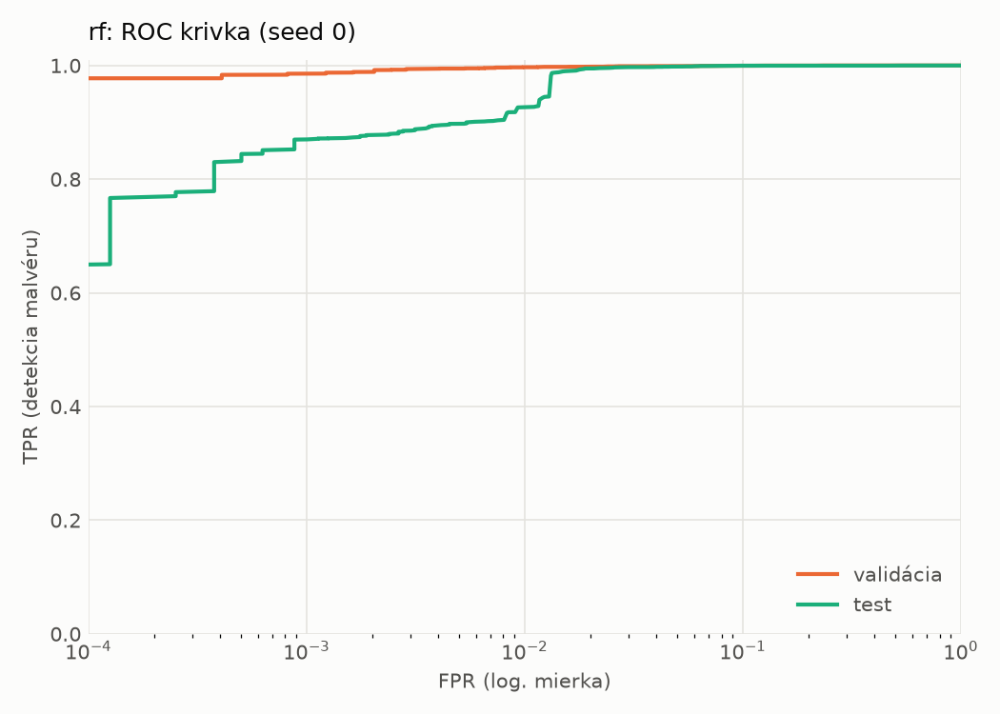
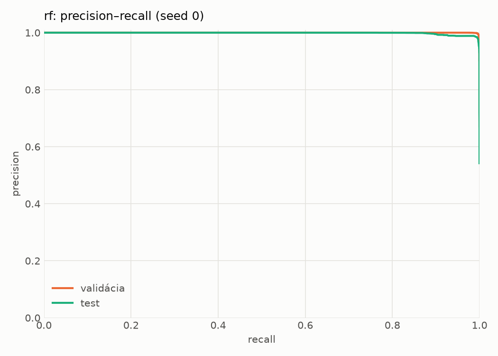
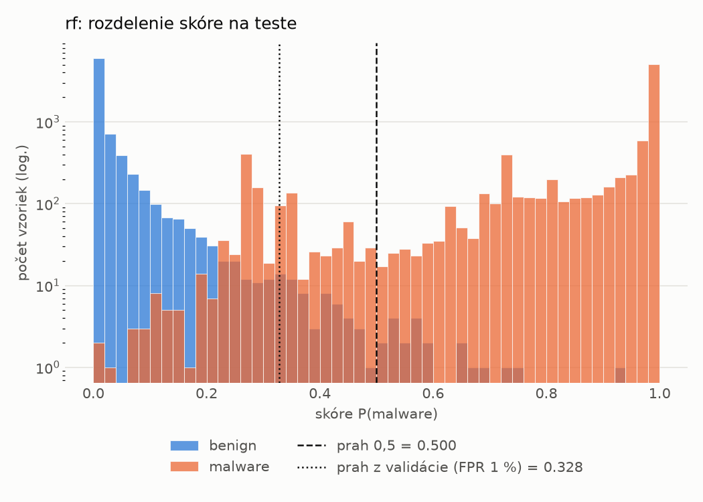
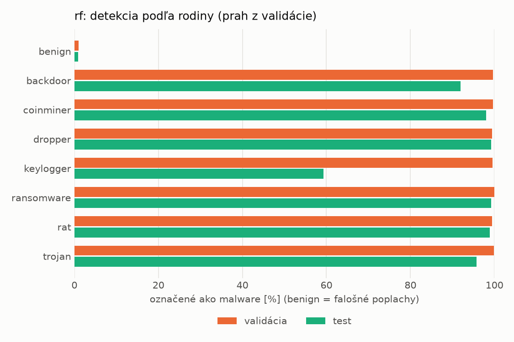
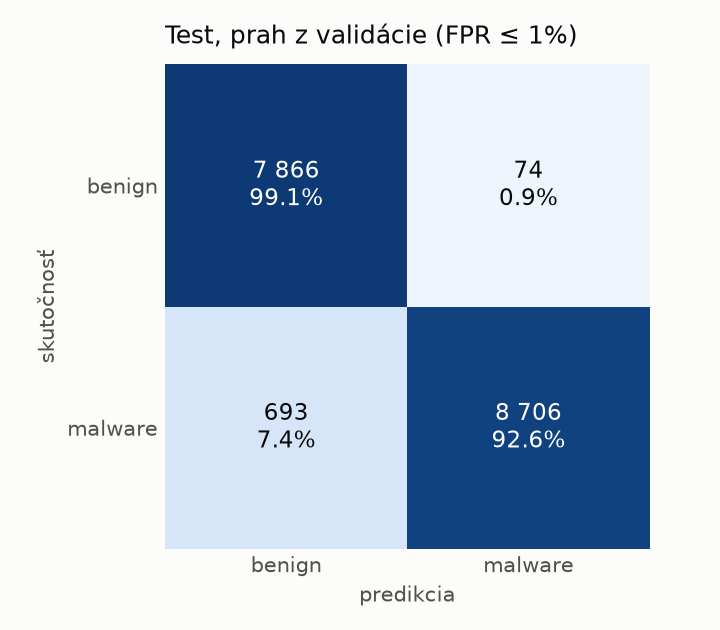
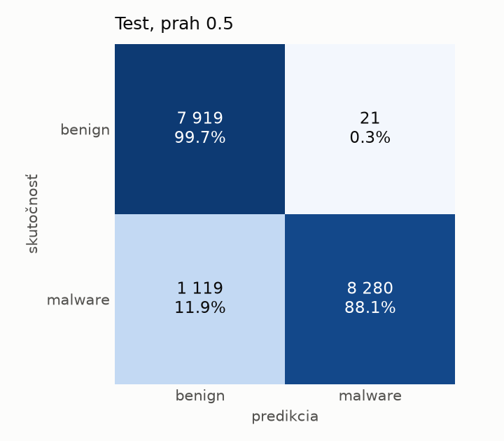
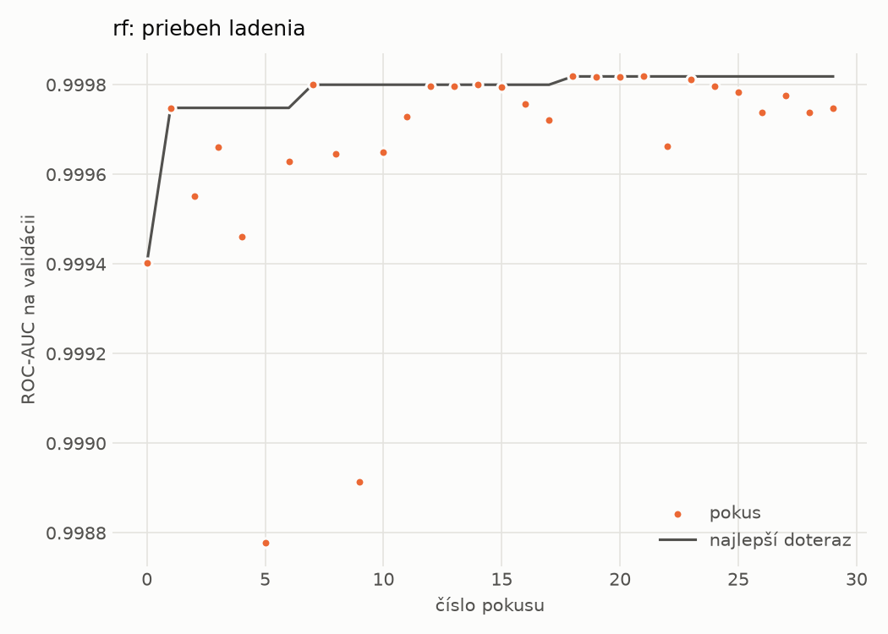

# hybrid/rf – beh `20261102-044751`

> Automaticky generované (`src/training/run_tabular.py`). Konfigurácia: `config.yaml`, protokol: `protocol.yaml`.

- **Model:** `random_forest` – Random Forest (pôvodné hodnoty príznakov)
- **Ladenie:** 30 dokončených pokusov (Optuna TPE), cieľ ROC-AUC na validácii, 33.3 min
- **Finálne modely:** seedy [0, 1, 2]; hodnoty sú priemer ± smerodajná odchýlka cez seedy
- **Najlepšie hyperparametre:** `{"n_estimators": 250, "max_depth": null, "min_samples_leaf": 1, "max_features": 0.05}`

## Detekčná kvalita (bez prahu)
| metrika | train (podvzorka) | validácia | test |
|---|---|---|---|
| ROC-AUC | 1.0000 ± 0.0000 | 0.9998 ± 0.0000 | 0.9986 ± 0.0002 |
| PR-AUC | 1.0000 ± 0.0000 | 0.9999 ± 0.0000 | 0.9988 ± 0.0001 |
| TPR pri FPR 1 % | 1.0000 ± 0.0000 | 0.9971 ± 0.0001 | 0.9517 ± 0.0293 |
| TPR pri FPR 0,1 % | 1.0000 ± 0.0000 | 0.9868 ± 0.0011 | 0.8597 ± 0.0087 |
| log loss | 0.0060 ± 0.0001 | 0.0197 ± 0.0002 | 0.1252 ± 0.0038 |
| Brier skóre | 0.0008 ± 0.0000 | 0.0046 ± 0.0001 | 0.0394 ± 0.0016 |

Rozdiel ROC-AUC train − validácia: **0.0002** (veľký rozdiel = preučenie).

## Pri prahu z validácie (FPR ≤ 1% na validácii)
| metrika | train (podvzorka) | validácia | test |
|---|---|---|---|
| accuracy | 1.0000 ± 0.0000 | 0.9948 ± 0.0001 | 0.9680 ± 0.0143 |
| balanced accuracy | 1.0000 ± 0.0000 | 0.9936 ± 0.0001 | 0.9698 ± 0.0132 |
| precision | 1.0000 ± 0.0000 | 0.9952 ± 0.0000 | 0.9922 ± 0.0007 |
| recall (TPR) | 1.0000 ± 0.0000 | 0.9971 ± 0.0001 | 0.9485 ± 0.0258 |
| FPR | 0.0000 ± 0.0000 | 0.0098 ± 0.0000 | 0.0088 ± 0.0006 |
| F1 | 1.0000 ± 0.0000 | 0.9962 ± 0.0001 | 0.9697 ± 0.0138 |
| MCC | 1.0000 ± 0.0000 | 0.9883 ± 0.0002 | 0.9372 ± 0.0274 |

## Pri pevnom prahu 0.5
| metrika | train (podvzorka) | validácia | test |
|---|---|---|---|
| accuracy | 1.0000 ± 0.0000 | 0.9947 ± 0.0002 | 0.9343 ± 0.0005 |
| balanced accuracy | 1.0000 ± 0.0000 | 0.9950 ± 0.0002 | 0.9392 ± 0.0005 |
| precision | 1.0000 ± 0.0000 | 0.9979 ± 0.0001 | 0.9975 ± 0.0001 |
| recall (TPR) | 1.0000 ± 0.0000 | 0.9943 ± 0.0003 | 0.8809 ± 0.0011 |
| FPR | 0.0000 ± 0.0000 | 0.0044 ± 0.0002 | 0.0026 ± 0.0001 |
| F1 | 1.0000 ± 0.0000 | 0.9961 ± 0.0002 | 0.9356 ± 0.0006 |
| MCC | 1.0000 ± 0.0000 | 0.9881 ± 0.0005 | 0.8760 ± 0.0010 |

## Výpočtové nároky (seed 0, testovacia množina)
| meranie | hodnota |
|---|---|
| tréning finálneho modelu | 142.6 s (priemer cez seedy) |
| ladenie spolu | 1999 s |
| počet parametrov / uzlov | 283 180 |
| veľkosť modelu na disku | 23.02 MB |
| CPU latencia modelu (batch 1, 1 vlákno) | 7.133 ms (p95 7.543) |
| CPU priepustnosť (24 vlákien) | 94 916 vzoriek/s |

## Grafy
| | |
|---|---|
|  |  |
|  |  |
|  |  |
|  |  |

## Súbory
`metrics.json` (všetky metriky po seedoch vrátane rodín), `timing.json`, `hpo_trials.csv`,
`predictions/<časť>_seed<N>.parquet` (sha256, family, label, score), `model/seed_<N>/`, `log.txt`.
