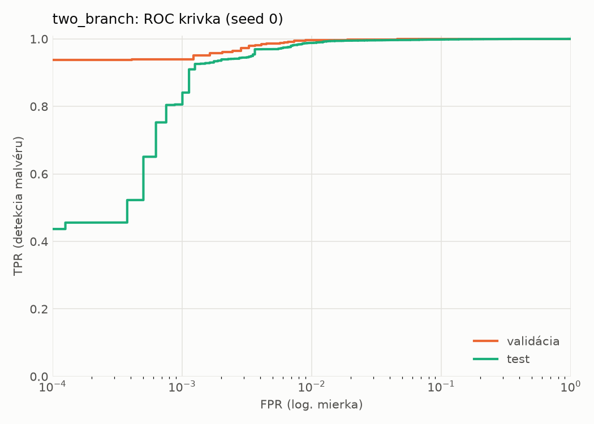
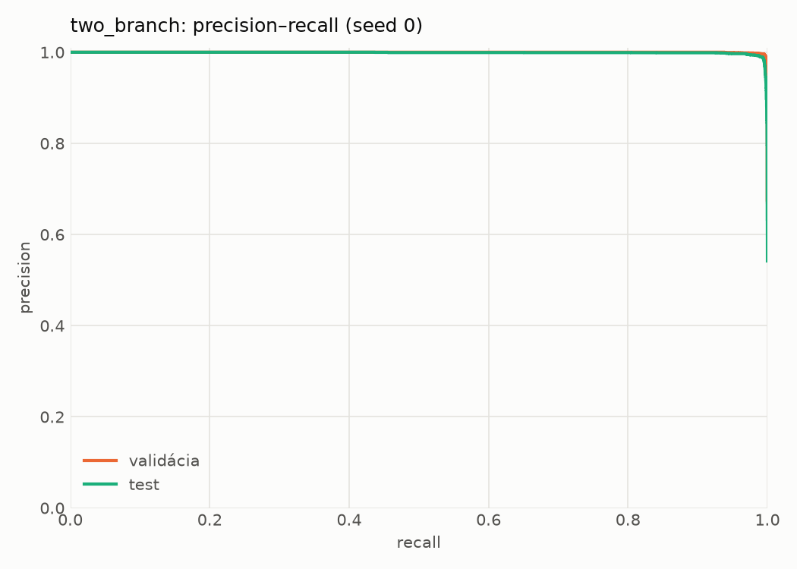
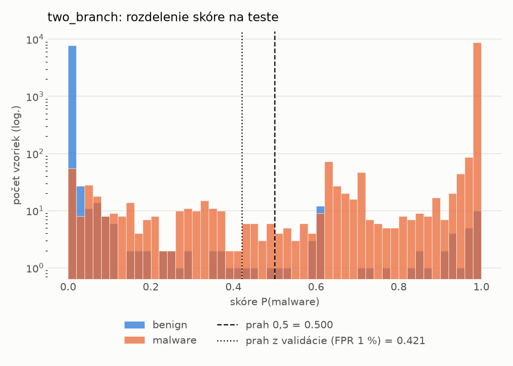
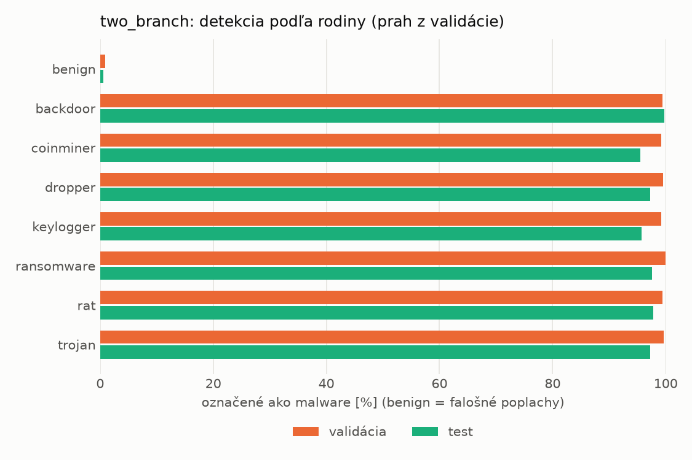
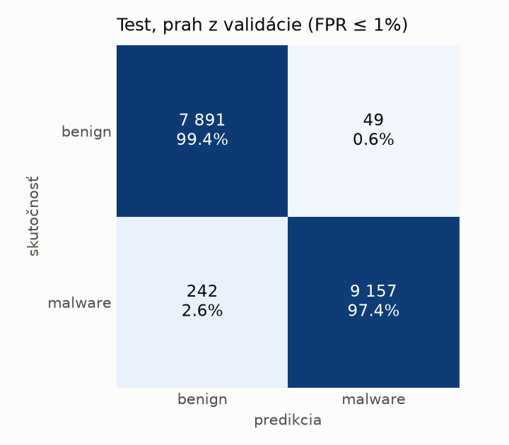
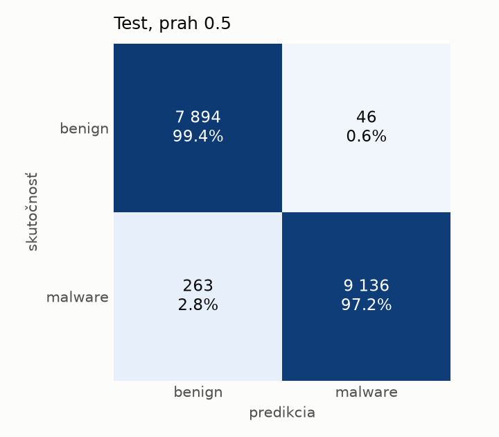
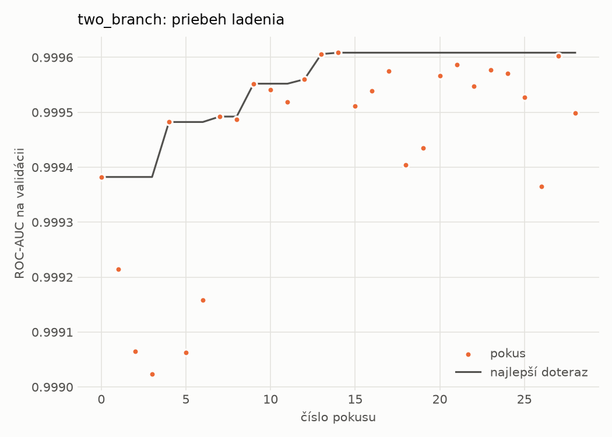
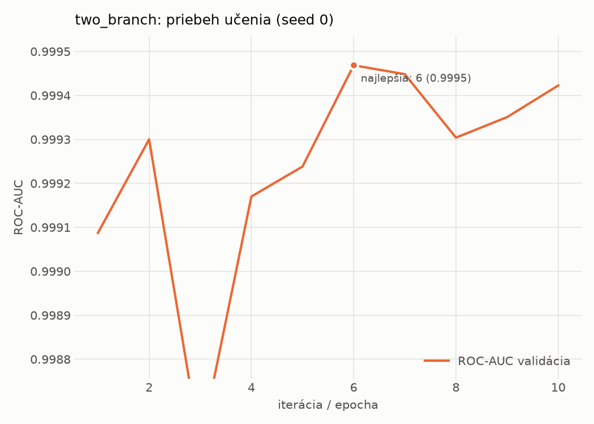

# hybrid_seq/two_branch – beh `20261102-170657`

> Automaticky generované (`src/training/run_tabular.py`). Konfigurácia: `config.yaml`, protokol: `protocol.yaml`.

- **Model:** `two_branch` – statická MLP vetva + sekvenčná CNN vetva nad API volaniami, spojené v spoločnej hlave
- **Ladenie:** 29 dokončených pokusov (Optuna TPE), cieľ ROC-AUC na validácii, 186.1 min
- **Finálne modely:** seedy [0, 1, 2]; hodnoty sú priemer ± smerodajná odchýlka cez seedy
- **Najlepšie hyperparametre:** `{"n_static": 2381, "width_decay": 0.5, "max_epochs": 30, "patience": 4, "static_layers": 3, "static_width": 256, "emb_dim": 64, "channels": 256, "kernels": "2-4-8", "hidden": 512, "dropout": 0.32477392485404594, "lr": 0.0006728393356648638, "weight_decay": 0.0003230215070317658, "batch_size": 256}`

## Detekčná kvalita (bez prahu)
| metrika | train (podvzorka) | validácia | test |
|---|---|---|---|
| ROC-AUC | 0.9999 ± 0.0000 | 0.9994 ± 0.0001 | 0.9985 ± 0.0002 |
| PR-AUC | 1.0000 ± 0.0000 | 0.9998 ± 0.0000 | 0.9986 ± 0.0003 |
| TPR pri FPR 1 % | 0.9995 ± 0.0001 | 0.9961 ± 0.0005 | 0.9893 ± 0.0013 |
| TPR pri FPR 0,1 % | 0.9890 ± 0.0029 | 0.9539 ± 0.0153 | 0.8173 ± 0.0539 |
| log loss | 0.0089 ± 0.0010 | 0.0260 ± 0.0019 | 0.0555 ± 0.0070 |
| Brier skóre | 0.0023 ± 0.0002 | 0.0052 ± 0.0002 | 0.0123 ± 0.0026 |

Rozdiel ROC-AUC train − validácia: **0.0005** (veľký rozdiel = preučenie).

## Pri prahu z validácie (FPR ≤ 1% na validácii)
| metrika | train (podvzorka) | validácia | test |
|---|---|---|---|
| accuracy | 0.9970 ± 0.0002 | 0.9943 ± 0.0003 | 0.9847 ± 0.0025 |
| balanced accuracy | 0.9965 ± 0.0001 | 0.9934 ± 0.0002 | 0.9854 ± 0.0023 |
| precision | 0.9974 ± 0.0001 | 0.9955 ± 0.0001 | 0.9950 ± 0.0007 |
| recall (TPR) | 0.9982 ± 0.0002 | 0.9961 ± 0.0005 | 0.9767 ± 0.0051 |
| FPR | 0.0052 ± 0.0002 | 0.0093 ± 0.0002 | 0.0058 ± 0.0008 |
| F1 | 0.9978 ± 0.0001 | 0.9958 ± 0.0002 | 0.9857 ± 0.0024 |
| MCC | 0.9933 ± 0.0003 | 0.9871 ± 0.0006 | 0.9694 ± 0.0050 |

## Pri pevnom prahu 0.5
| metrika | train (podvzorka) | validácia | test |
|---|---|---|---|
| accuracy | 0.9972 ± 0.0005 | 0.9940 ± 0.0002 | 0.9848 ± 0.0034 |
| balanced accuracy | 0.9965 ± 0.0003 | 0.9930 ± 0.0003 | 0.9855 ± 0.0030 |
| precision | 0.9973 ± 0.0002 | 0.9952 ± 0.0007 | 0.9948 ± 0.0010 |
| recall (TPR) | 0.9985 ± 0.0008 | 0.9959 ± 0.0009 | 0.9770 ± 0.0071 |
| FPR | 0.0055 ± 0.0003 | 0.0098 ± 0.0015 | 0.0060 ± 0.0012 |
| F1 | 0.9979 ± 0.0003 | 0.9956 ± 0.0001 | 0.9858 ± 0.0032 |
| MCC | 0.9936 ± 0.0010 | 0.9865 ± 0.0003 | 0.9696 ± 0.0066 |

## Výpočtové nároky (seed 0, testovacia množina)
| meranie | hodnota |
|---|---|
| tréning finálneho modelu | 535.6 s (priemer cez seedy) |
| ladenie spolu | 11163 s |
| počet parametrov / uzlov | 1 757 826 |
| veľkosť modelu na disku | 7.10 MB |
| CPU latencia modelu (batch 1, 1 vlákno) | 5.232 ms (p95 5.993) |
| CPU priepustnosť (24 vlákien) | 613 vzoriek/s |
| GPU latencia (batch 1) | 1.189 ms (p95 3.026) |
| GPU priepustnosť | 4 392 vzoriek/s |
| GPU špičková pamäť | 1477 MB |

## Grafy
| | |
|---|---|
|  |  |
|  |  |
|  |  |
|  |  |

## Súbory
`metrics.json` (všetky metriky po seedoch vrátane rodín), `timing.json`, `hpo_trials.csv`,
`predictions/<časť>_seed<N>.parquet` (sha256, family, label, score), `model/seed_<N>/`, `log.txt`.
