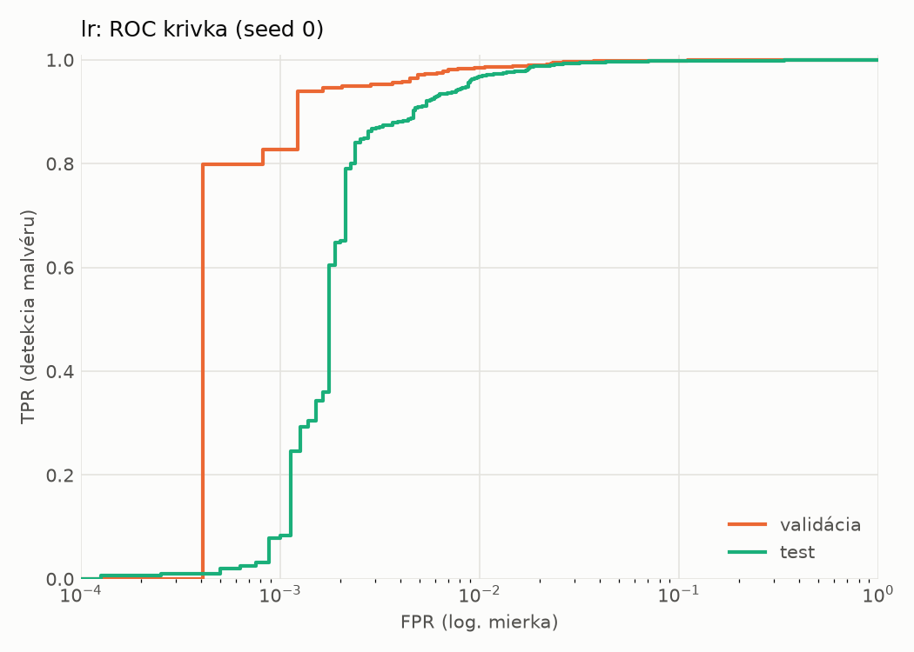
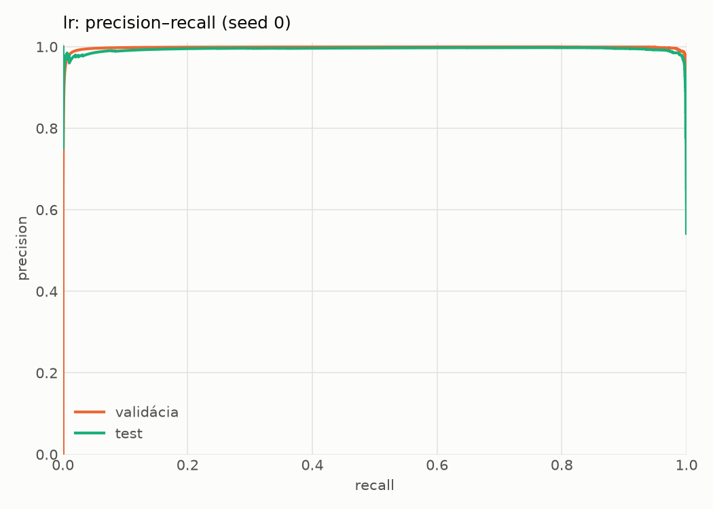
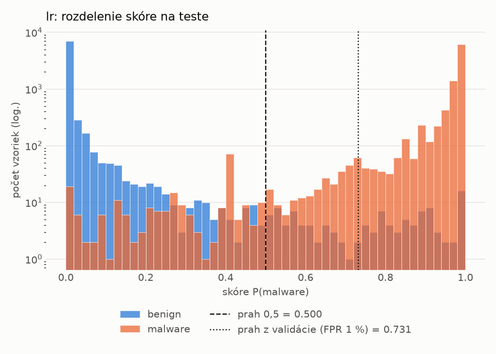
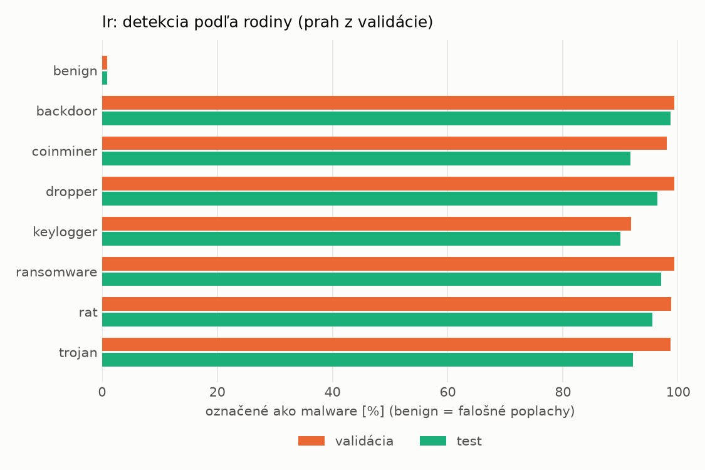
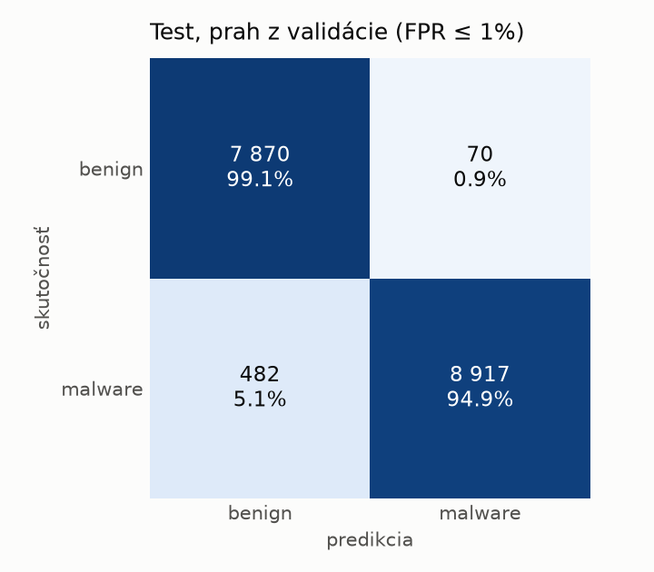
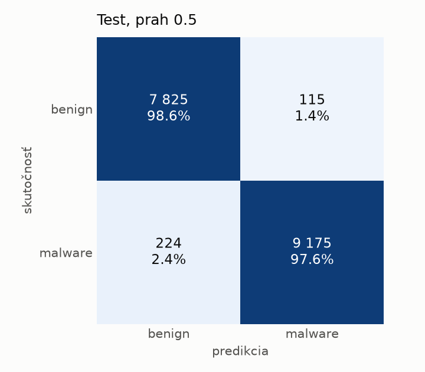
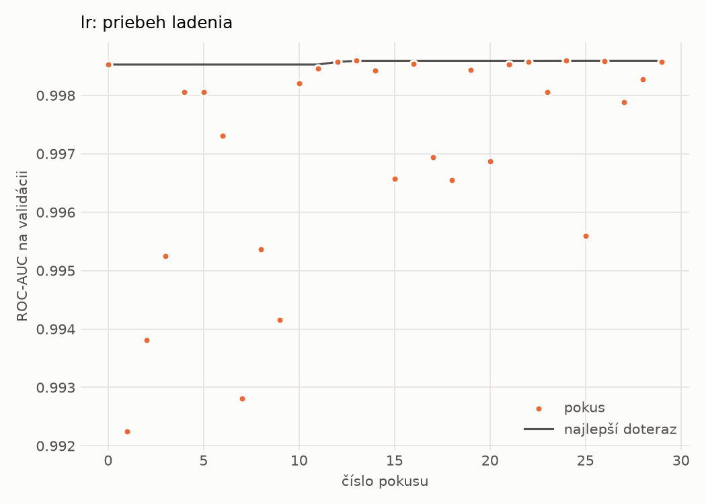

# static/lr – beh `20261101-213555`

> Automaticky generované (`src/training/run_tabular.py`). Konfigurácia: `config.yaml`, protokol: `protocol.yaml`.

- **Model:** `logreg` – logistická regresia s L2 regularizáciou (vstup signed log1p + štandardizácia)
- **Ladenie:** 30 dokončených pokusov (Optuna TPE), cieľ ROC-AUC na validácii, 1.2 min
- **Finálne modely:** seedy [0, 1, 2]; hodnoty sú priemer ± smerodajná odchýlka cez seedy
- **Najlepšie hyperparametre:** `{"max_iter": 2000, "C": 0.00515917154582608}`

## Detekčná kvalita (bez prahu)
| metrika | train (podvzorka) | validácia | test |
|---|---|---|---|
| ROC-AUC | 0.9996 ± 0.0000 | 0.9986 ± 0.0000 | 0.9966 ± 0.0000 |
| PR-AUC | 0.9998 ± 0.0000 | 0.9980 ± 0.0000 | 0.9939 ± 0.0000 |
| TPR pri FPR 1 % | 0.9909 ± 0.0000 | 0.9839 ± 0.0000 | 0.9671 ± 0.0000 |
| TPR pri FPR 0,1 % | 0.9373 ± 0.0000 | 0.8270 ± 0.0000 | 0.0788 ± 0.0000 |
| log loss | 0.0289 ± 0.0000 | 0.0399 ± 0.0000 | 0.0651 ± 0.0000 |
| Brier skóre | 0.0066 ± 0.0000 | 0.0094 ± 0.0000 | 0.0150 ± 0.0000 |

Rozdiel ROC-AUC train − validácia: **0.0010** (veľký rozdiel = preučenie).

## Pri prahu z validácie (FPR ≤ 1% na validácii)
| metrika | train (podvzorka) | validácia | test |
|---|---|---|---|
| accuracy | 0.9878 ± 0.0000 | 0.9861 ± 0.0000 | 0.9682 ± 0.0000 |
| balanced accuracy | 0.9898 ± 0.0000 | 0.9873 ± 0.0000 | 0.9700 ± 0.0000 |
| precision | 0.9979 ± 0.0000 | 0.9953 ± 0.0000 | 0.9922 ± 0.0000 |
| recall (TPR) | 0.9838 ± 0.0000 | 0.9839 ± 0.0000 | 0.9487 ± 0.0000 |
| FPR | 0.0042 ± 0.0000 | 0.0094 ± 0.0000 | 0.0088 ± 0.0000 |
| F1 | 0.9908 ± 0.0000 | 0.9896 ± 0.0000 | 0.9700 ± 0.0000 |
| MCC | 0.9730 ± 0.0000 | 0.9689 ± 0.0000 | 0.9372 ± 0.0000 |

## Pri pevnom prahu 0.5
| metrika | train (podvzorka) | validácia | test |
|---|---|---|---|
| accuracy | 0.9910 ± 0.0000 | 0.9868 ± 0.0000 | 0.9804 ± 0.0000 |
| balanced accuracy | 0.9913 ± 0.0000 | 0.9851 ± 0.0000 | 0.9808 ± 0.0000 |
| precision | 0.9961 ± 0.0000 | 0.9902 ± 0.0000 | 0.9876 ± 0.0000 |
| recall (TPR) | 0.9904 ± 0.0000 | 0.9902 ± 0.0000 | 0.9762 ± 0.0000 |
| FPR | 0.0078 ± 0.0000 | 0.0201 ± 0.0000 | 0.0145 ± 0.0000 |
| F1 | 0.9932 ± 0.0000 | 0.9902 ± 0.0000 | 0.9819 ± 0.0000 |
| MCC | 0.9798 ± 0.0000 | 0.9701 ± 0.0000 | 0.9607 ± 0.0000 |

## Výpočtové nároky (seed 0, testovacia množina)
| meranie | hodnota |
|---|---|
| tréning finálneho modelu | 2.5 s (priemer cez seedy) |
| ladenie spolu | 75 s |
| počet parametrov / uzlov | 2 320 |
| veľkosť modelu na disku | 0.07 MB |
| transformácia vstupu – latencia (1 vlákno) | 0.022 ms |
| transformácia vstupu – priepustnosť | 43 717 vzoriek/s |
| CPU latencia modelu (batch 1, 1 vlákno) | 0.006 ms (p95 0.006) |
| CPU priepustnosť (24 vlákien) | 276 769 vzoriek/s |

## Grafy
| | |
|---|---|
|  |  |
|  |  |
|  |  |
|  |  |

## Súbory
`metrics.json` (všetky metriky po seedoch vrátane rodín), `timing.json`, `hpo_trials.csv`,
`predictions/<časť>_seed<N>.parquet` (sha256, family, label, score), `model/seed_<N>/`, `log.txt`.
