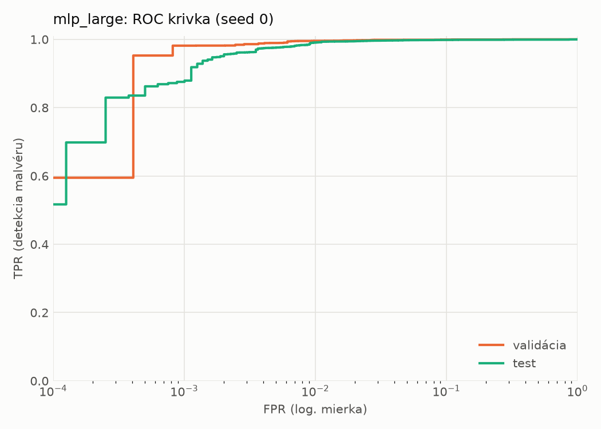
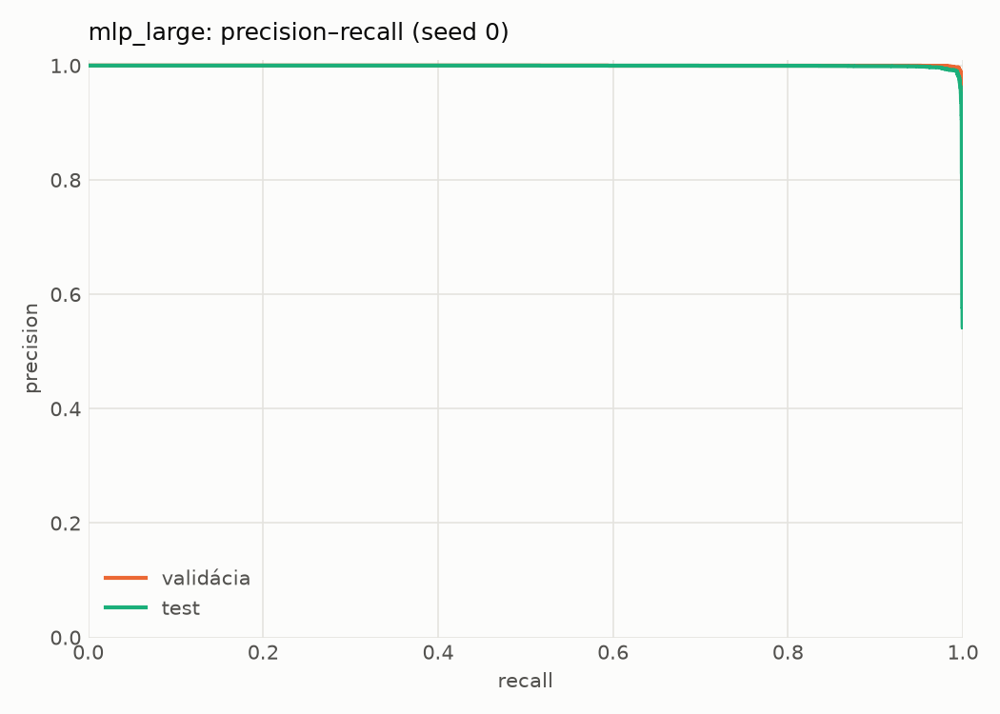
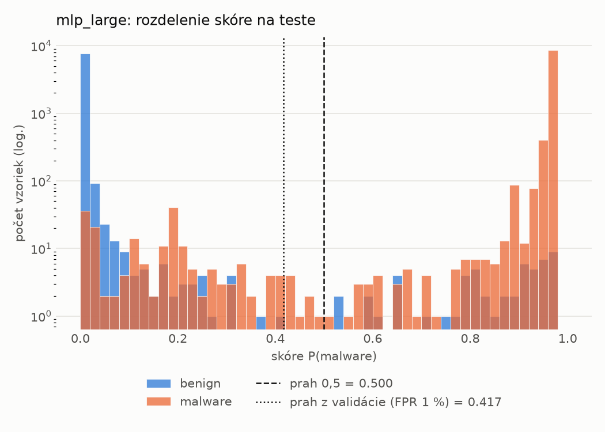
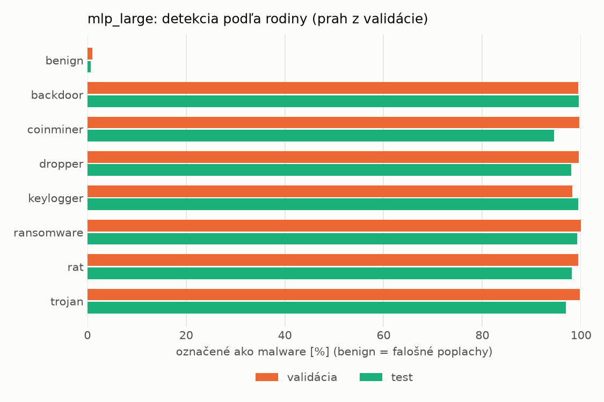
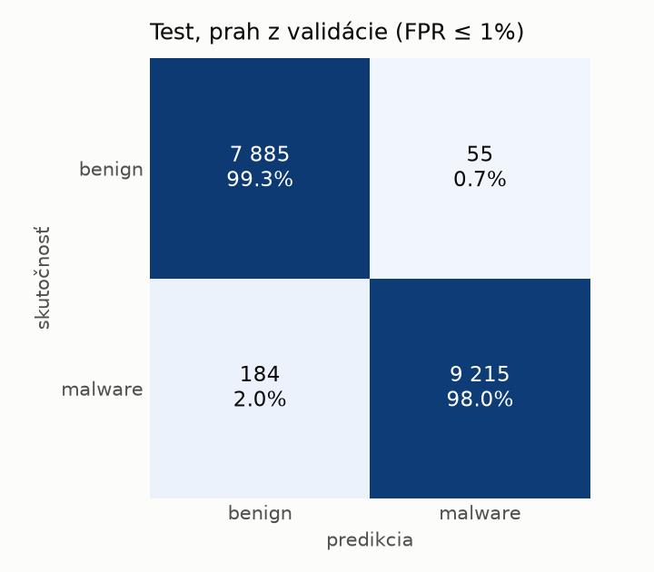
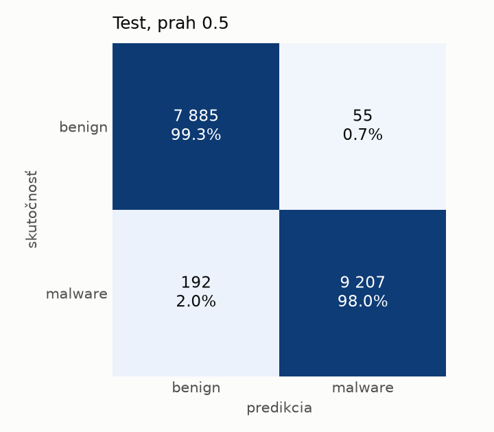
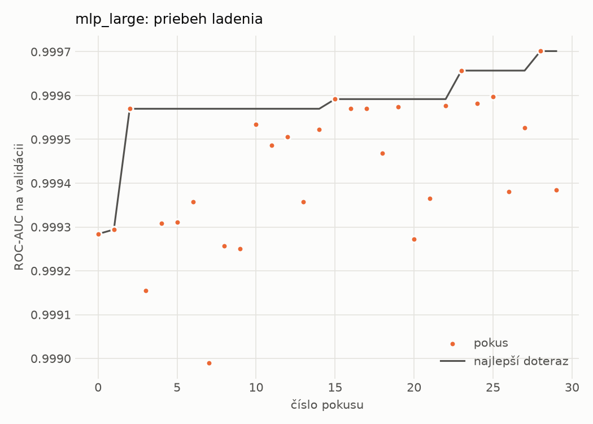
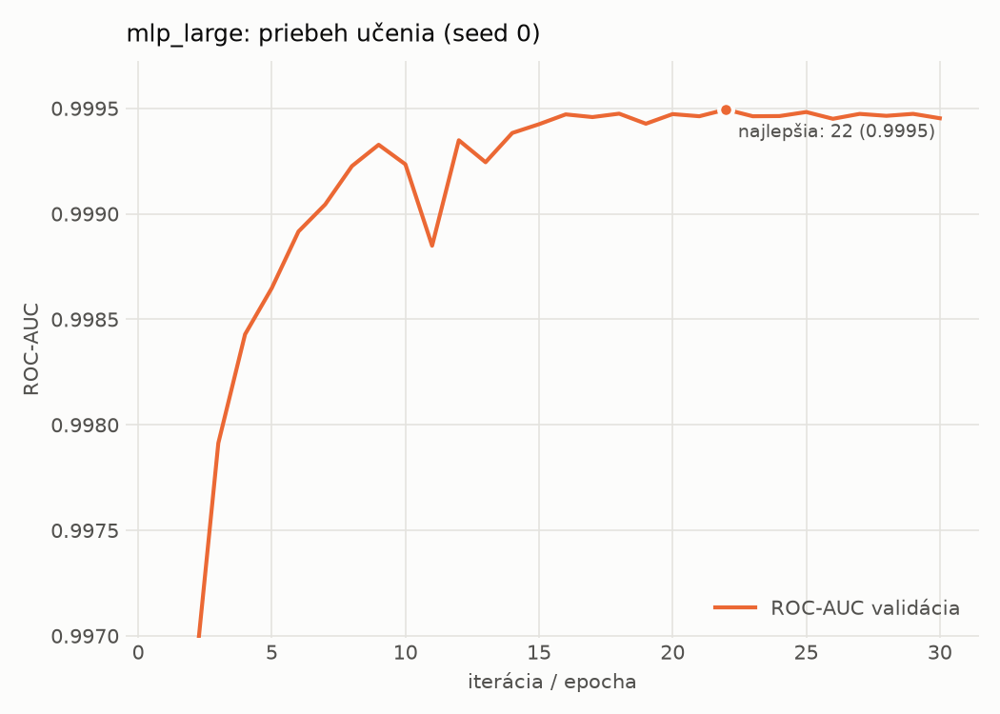

# static/mlp_large – beh `20261101-235239`

> Automaticky generované (`src/training/run_tabular.py`). Konfigurácia: `config.yaml`, protokol: `protocol.yaml`.

- **Model:** `mlp` – veľká neurónová sieť (3–5 skrytých vrstiev, 512–2048 neurónov), kandidát na učiteľa
- **Ladenie:** 30 dokončených pokusov (Optuna TPE), cieľ ROC-AUC na validácii, 3.2 min
- **Finálne modely:** seedy [0, 1, 2]; hodnoty sú priemer ± smerodajná odchýlka cez seedy
- **Najlepšie hyperparametre:** `{"max_epochs": 100, "patience": 8, "hidden_layers": 5, "hidden_width": 512, "width_decay": 0.5, "dropout": 0.4556986332296347, "lr": 0.00015070674125138616, "weight_decay": 0.0036646034219705954, "batch_size": 1024}`

## Detekčná kvalita (bez prahu)
| metrika | train (podvzorka) | validácia | test |
|---|---|---|---|
| ROC-AUC | 0.9998 ± 0.0000 | 0.9995 ± 0.0001 | 0.9986 ± 0.0001 |
| PR-AUC | 0.9999 ± 0.0000 | 0.9998 ± 0.0000 | 0.9989 ± 0.0000 |
| TPR pri FPR 1 % | 0.9994 ± 0.0001 | 0.9954 ± 0.0003 | 0.9882 ± 0.0028 |
| TPR pri FPR 0,1 % | 0.9889 ± 0.0033 | 0.9773 ± 0.0063 | 0.8693 ± 0.0084 |
| log loss | 0.0338 ± 0.0055 | 0.0461 ± 0.0044 | 0.0611 ± 0.0025 |
| Brier skóre | 0.0030 ± 0.0005 | 0.0063 ± 0.0004 | 0.0120 ± 0.0004 |

Rozdiel ROC-AUC train − validácia: **0.0003** (veľký rozdiel = preučenie).

## Pri prahu z validácie (FPR ≤ 1% na validácii)
| metrika | train (podvzorka) | validácia | test |
|---|---|---|---|
| accuracy | 0.9973 ± 0.0004 | 0.9938 ± 0.0001 | 0.9860 ± 0.0010 |
| balanced accuracy | 0.9967 ± 0.0004 | 0.9929 ± 0.0001 | 0.9866 ± 0.0009 |
| precision | 0.9975 ± 0.0002 | 0.9953 ± 0.0002 | 0.9944 ± 0.0004 |
| recall (TPR) | 0.9985 ± 0.0005 | 0.9954 ± 0.0003 | 0.9797 ± 0.0022 |
| FPR | 0.0050 ± 0.0003 | 0.0096 ± 0.0005 | 0.0065 ± 0.0005 |
| F1 | 0.9980 ± 0.0003 | 0.9954 ± 0.0001 | 0.9870 ± 0.0009 |
| MCC | 0.9939 ± 0.0010 | 0.9859 ± 0.0002 | 0.9719 ± 0.0020 |

## Pri pevnom prahu 0.5
| metrika | train (podvzorka) | validácia | test |
|---|---|---|---|
| accuracy | 0.9973 ± 0.0003 | 0.9938 ± 0.0002 | 0.9857 ± 0.0006 |
| balanced accuracy | 0.9968 ± 0.0005 | 0.9932 ± 0.0004 | 0.9864 ± 0.0006 |
| precision | 0.9978 ± 0.0004 | 0.9957 ± 0.0004 | 0.9949 ± 0.0010 |
| recall (TPR) | 0.9982 ± 0.0002 | 0.9951 ± 0.0001 | 0.9787 ± 0.0010 |
| FPR | 0.0045 ± 0.0009 | 0.0087 ± 0.0009 | 0.0059 ± 0.0012 |
| F1 | 0.9980 ± 0.0002 | 0.9954 ± 0.0002 | 0.9867 ± 0.0006 |
| MCC | 0.9938 ± 0.0007 | 0.9860 ± 0.0005 | 0.9714 ± 0.0013 |

## Výpočtové nároky (seed 0, testovacia množina)
| meranie | hodnota |
|---|---|
| tréning finálneho modelu | 6.1 s (priemer cez seedy) |
| ladenie spolu | 190 s |
| počet parametrov / uzlov | 1 364 417 |
| veľkosť modelu na disku | 5.53 MB |
| transformácia vstupu – latencia (1 vlákno) | 0.041 ms |
| transformácia vstupu – priepustnosť | 41 712 vzoriek/s |
| CPU latencia modelu (batch 1, 1 vlákno) | 0.259 ms (p95 0.284) |
| CPU priepustnosť (24 vlákien) | 51 652 vzoriek/s |
| GPU latencia (batch 1) | 0.558 ms (p95 1.307) |
| GPU priepustnosť | 83 758 vzoriek/s |
| GPU špičková pamäť | 1603 MB |

## Grafy
| | |
|---|---|
|  |  |
|  |  |
|  |  |
|  |  |

## Súbory
`metrics.json` (všetky metriky po seedoch vrátane rodín), `timing.json`, `hpo_trials.csv`,
`predictions/<časť>_seed<N>.parquet` (sha256, family, label, score), `model/seed_<N>/`, `log.txt`.
