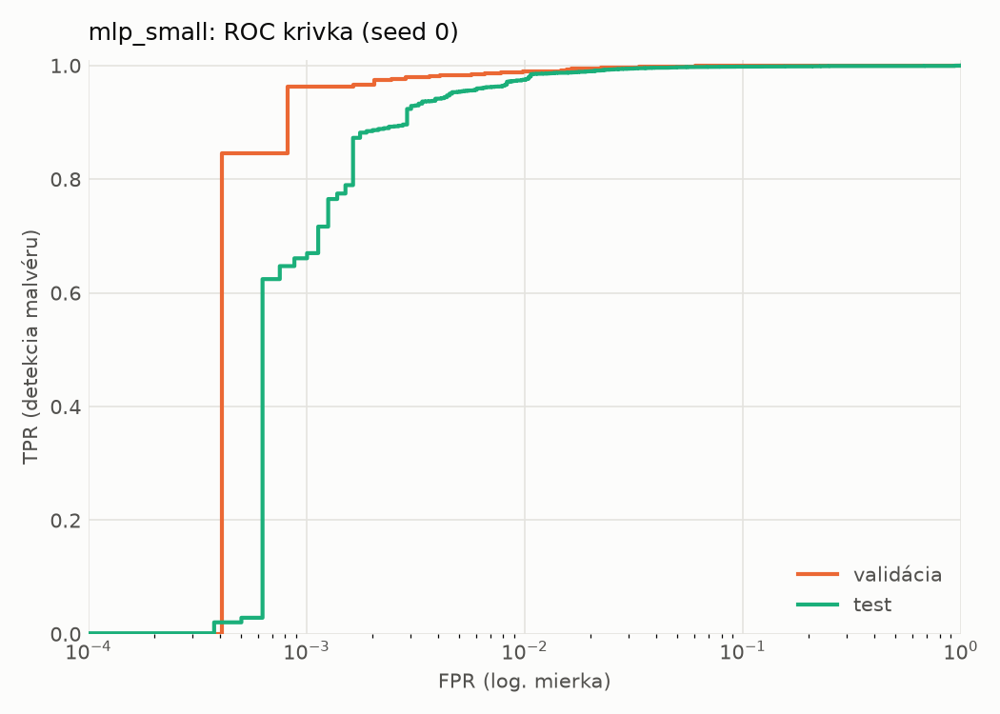
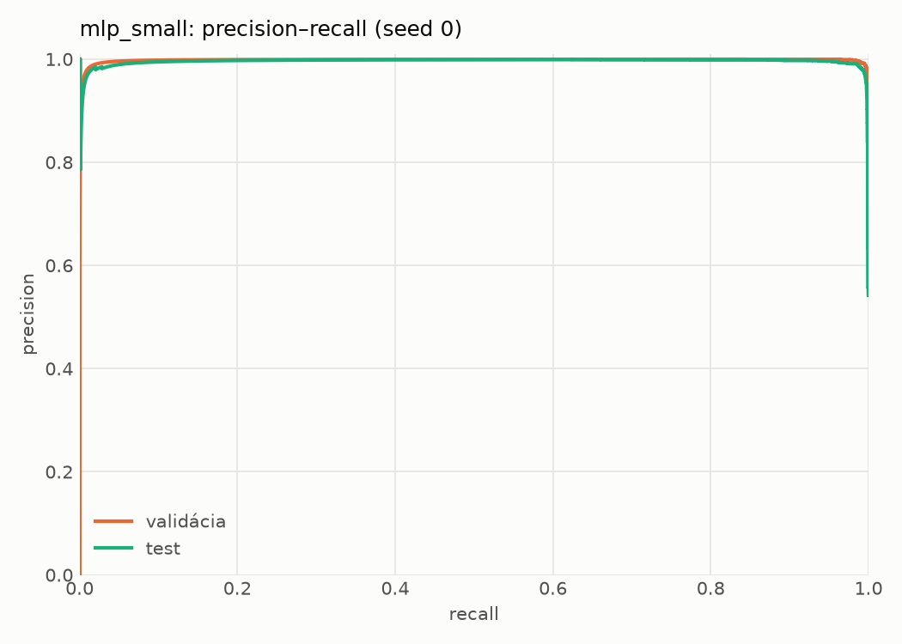
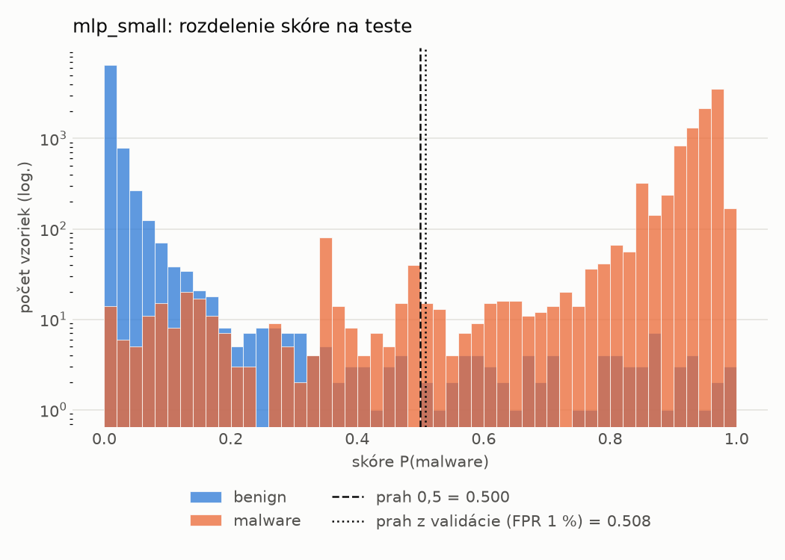
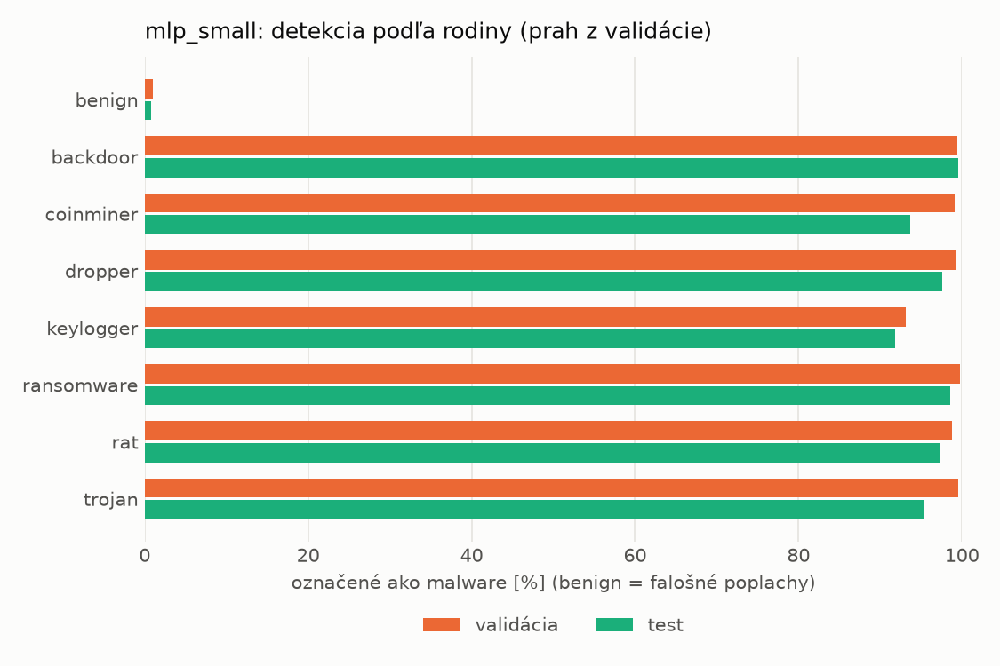
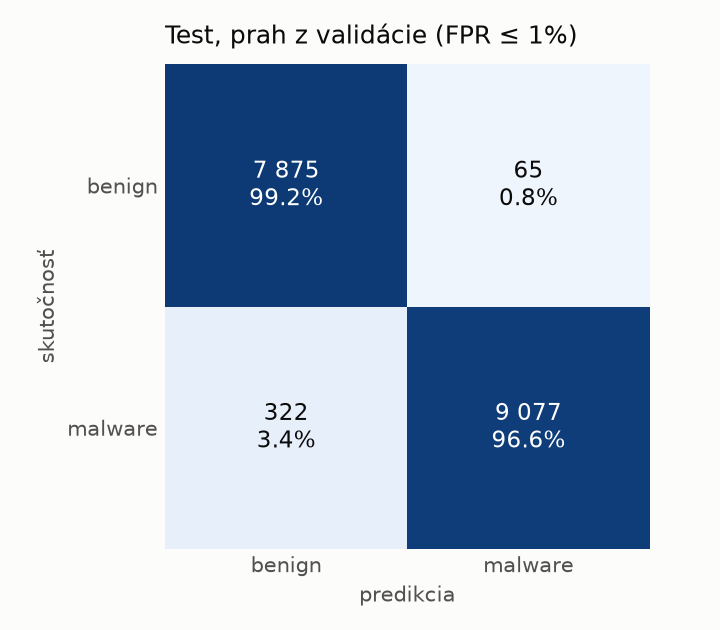
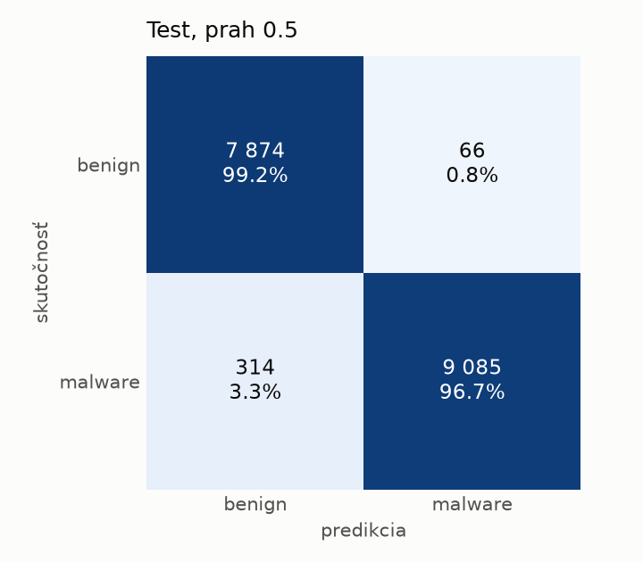
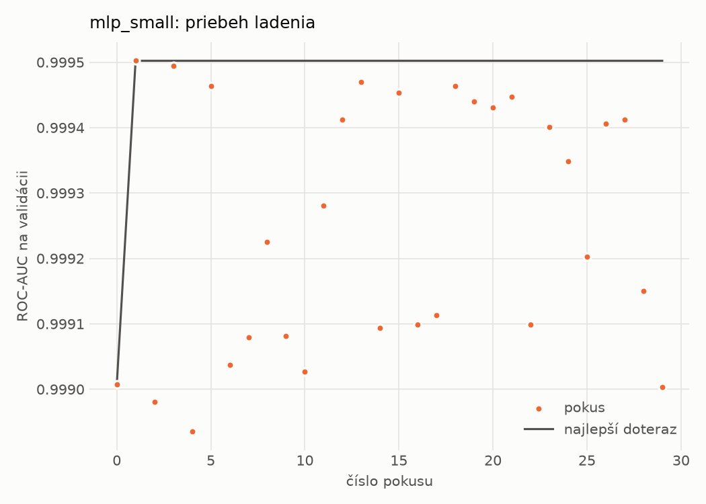
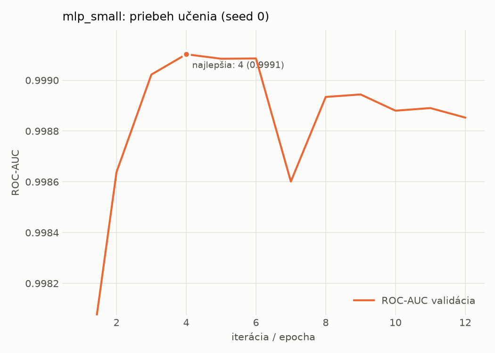

# static/mlp_small – beh `20261101-235005`

> Automaticky generované (`src/training/run_tabular.py`). Konfigurácia: `config.yaml`, protokol: `protocol.yaml`.

- **Model:** `mlp` – malá neurónová sieť (1–2 skryté vrstvy), kandidát na ľahkého študenta
- **Ladenie:** 30 dokončených pokusov (Optuna TPE), cieľ ROC-AUC na validácii, 2.2 min
- **Finálne modely:** seedy [0, 1, 2]; hodnoty sú priemer ± smerodajná odchýlka cez seedy
- **Najlepšie hyperparametre:** `{"width_decay": 0.5, "max_epochs": 100, "patience": 8, "hidden_layers": 2, "hidden_width": 32, "dropout": 0.15212112147976886, "lr": 0.0005958389350068958, "weight_decay": 5.34293726127978e-05, "batch_size": 512}`

## Detekčná kvalita (bez prahu)
| metrika | train (podvzorka) | validácia | test |
|---|---|---|---|
| ROC-AUC | 0.9998 ± 0.0001 | 0.9990 ± 0.0003 | 0.9975 ± 0.0004 |
| PR-AUC | 0.9999 ± 0.0000 | 0.9982 ± 0.0015 | 0.9957 ± 0.0022 |
| TPR pri FPR 1 % | 0.9983 ± 0.0011 | 0.9911 ± 0.0028 | 0.9783 ± 0.0030 |
| TPR pri FPR 0,1 % | 0.9815 ± 0.0074 | 0.9607 ± 0.0175 | 0.5125 ± 0.4393 |
| log loss | 0.0347 ± 0.0185 | 0.0452 ± 0.0157 | 0.0658 ± 0.0155 |
| Brier skóre | 0.0046 ± 0.0021 | 0.0076 ± 0.0015 | 0.0139 ± 0.0022 |

Rozdiel ROC-AUC train − validácia: **0.0008** (veľký rozdiel = preučenie).

## Pri prahu z validácie (FPR ≤ 1% na validácii)
| metrika | train (podvzorka) | validácia | test |
|---|---|---|---|
| accuracy | 0.9941 ± 0.0031 | 0.9910 ± 0.0020 | 0.9793 ± 0.0039 |
| balanced accuracy | 0.9949 ± 0.0024 | 0.9910 ± 0.0015 | 0.9804 ± 0.0036 |
| precision | 0.9985 ± 0.0005 | 0.9955 ± 0.0003 | 0.9942 ± 0.0012 |
| recall (TPR) | 0.9927 ± 0.0046 | 0.9911 ± 0.0028 | 0.9675 ± 0.0070 |
| FPR | 0.0030 ± 0.0009 | 0.0091 ± 0.0006 | 0.0067 ± 0.0013 |
| F1 | 0.9956 ± 0.0023 | 0.9933 ± 0.0015 | 0.9807 ± 0.0037 |
| MCC | 0.9869 ± 0.0069 | 0.9797 ± 0.0044 | 0.9589 ± 0.0075 |

## Pri pevnom prahu 0.5
| metrika | train (podvzorka) | validácia | test |
|---|---|---|---|
| accuracy | 0.9950 ± 0.0023 | 0.9914 ± 0.0017 | 0.9820 ± 0.0036 |
| balanced accuracy | 0.9948 ± 0.0015 | 0.9907 ± 0.0013 | 0.9827 ± 0.0032 |
| precision | 0.9972 ± 0.0008 | 0.9944 ± 0.0011 | 0.9923 ± 0.0005 |
| recall (TPR) | 0.9952 ± 0.0040 | 0.9928 ± 0.0030 | 0.9745 ± 0.0071 |
| FPR | 0.0055 ± 0.0017 | 0.0113 ± 0.0023 | 0.0090 ± 0.0006 |
| F1 | 0.9962 ± 0.0018 | 0.9936 ± 0.0013 | 0.9833 ± 0.0034 |
| MCC | 0.9887 ± 0.0052 | 0.9806 ± 0.0038 | 0.9641 ± 0.0070 |

## Výpočtové nároky (seed 0, testovacia množina)
| meranie | hodnota |
|---|---|
| tréning finálneho modelu | 3.6 s (priemer cez seedy) |
| ladenie spolu | 132 s |
| počet parametrov / uzlov | 74 881 |
| veľkosť modelu na disku | 0.36 MB |
| transformácia vstupu – latencia (1 vlákno) | 0.041 ms |
| transformácia vstupu – priepustnosť | 39 403 vzoriek/s |
| CPU latencia modelu (batch 1, 1 vlákno) | 0.097 ms (p95 0.108) |
| CPU priepustnosť (24 vlákien) | 108 986 vzoriek/s |
| GPU latencia (batch 1) | 0.393 ms (p95 0.440) |
| GPU priepustnosť | 80 972 vzoriek/s |
| GPU špičková pamäť | 871 MB |

## Grafy
| | |
|---|---|
|  |  |
|  |  |
|  |  |
|  |  |

## Súbory
`metrics.json` (všetky metriky po seedoch vrátane rodín), `timing.json`, `hpo_trials.csv`,
`predictions/<časť>_seed<N>.parquet` (sha256, family, label, score), `model/seed_<N>/`, `log.txt`.
