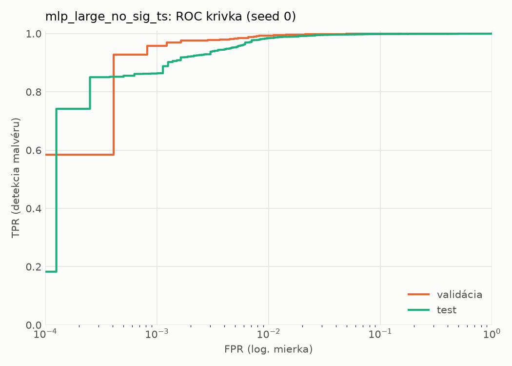
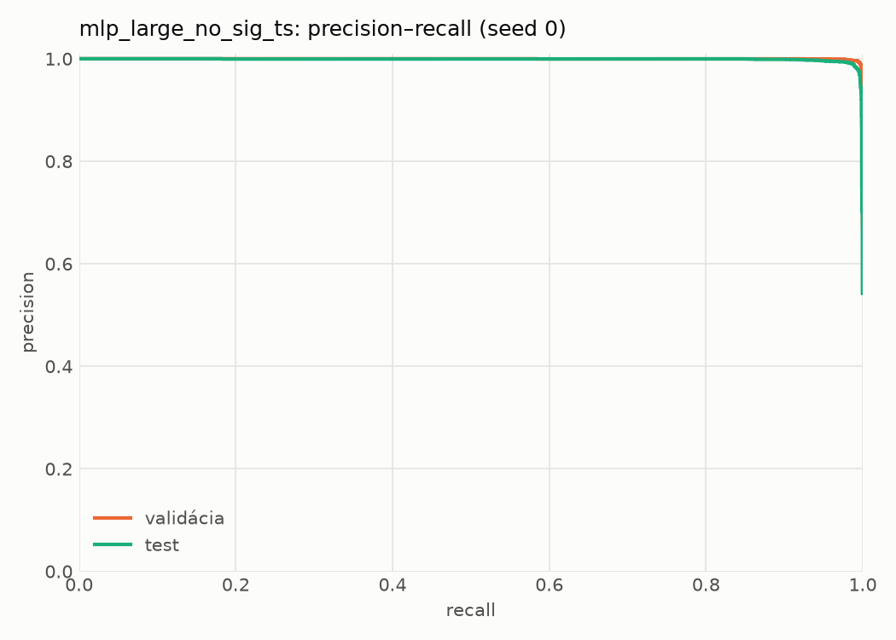
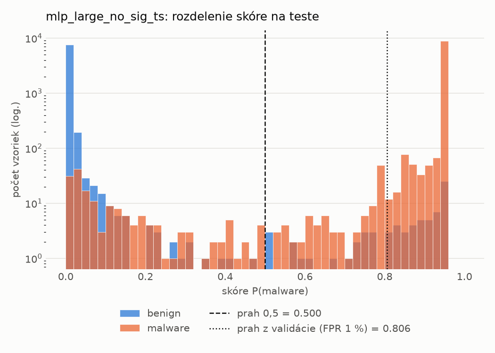
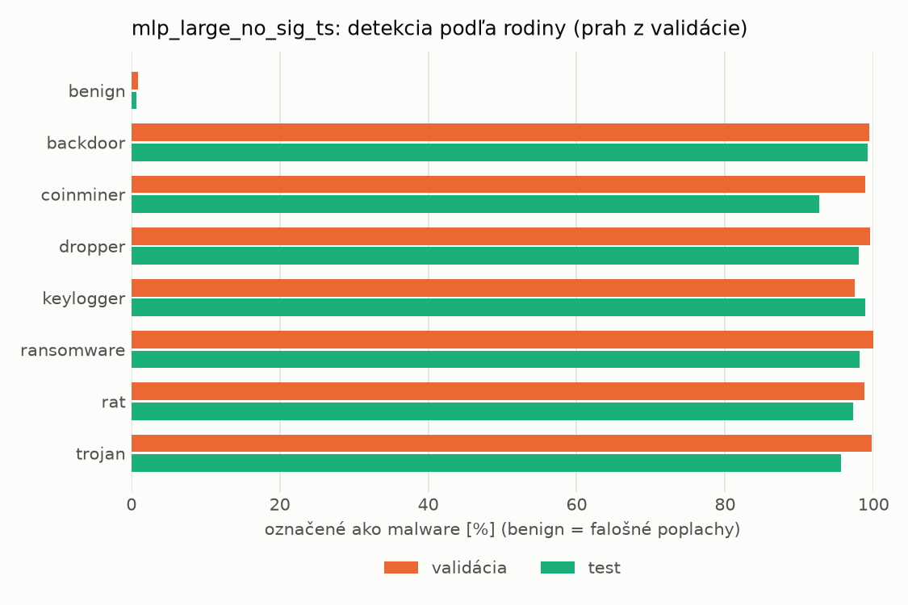
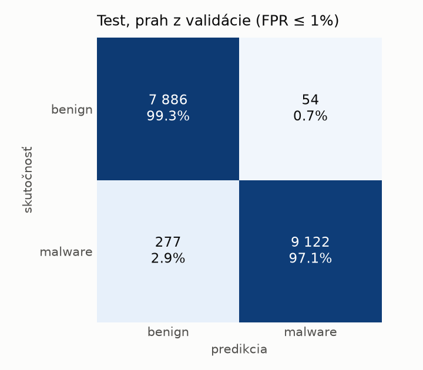
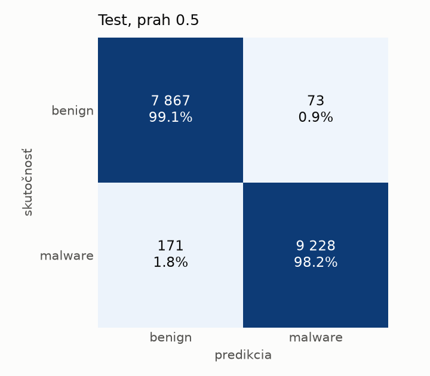
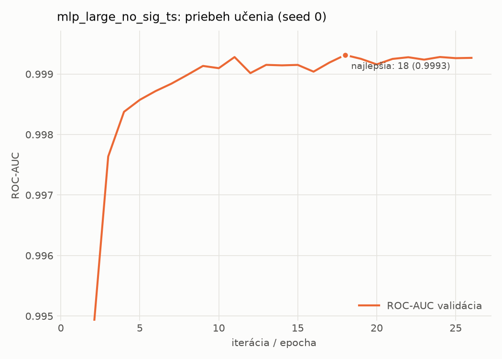

# static/mlp_large_no_sig_ts – beh `20261102-001955`

> Automaticky generované (`src/training/run_tabular.py`). Konfigurácia: `config.yaml`, protokol: `protocol.yaml`.

- **Model:** `mlp` – mlp_large bez príznakov podpisu a času zostavenia
- **Ladenie:** bez ladenia – hyperparametre prevzaté z `runs_final/static/mlp_large/20261101-235239`
- **Finálne modely:** seedy [0, 1, 2]; hodnoty sú priemer ± smerodajná odchýlka cez seedy
- **Najlepšie hyperparametre:** `{"max_epochs": 100, "patience": 8, "hidden_layers": 5, "hidden_width": 512, "width_decay": 0.5, "dropout": 0.4556986332296347, "lr": 0.00015070674125138616, "weight_decay": 0.0036646034219705954, "batch_size": 1024}`
- **Vynechané príznaky:** `general_has_signature`, `datadir_CERTIFICATE_TABLE_size`, `datadir_CERTIFICATE_TABLE_virtual_address`, `header_coff_timestamp`

## Detekčná kvalita (bez prahu)
| metrika | train (podvzorka) | validácia | test |
|---|---|---|---|
| ROC-AUC | 0.9998 ± 0.0000 | 0.9994 ± 0.0001 | 0.9984 ± 0.0001 |
| PR-AUC | 0.9999 ± 0.0000 | 0.9997 ± 0.0000 | 0.9987 ± 0.0001 |
| TPR pri FPR 1 % | 0.9989 ± 0.0006 | 0.9930 ± 0.0009 | 0.9791 ± 0.0066 |
| TPR pri FPR 0,1 % | 0.9833 ± 0.0031 | 0.9420 ± 0.0133 | 0.8627 ± 0.0090 |
| log loss | 0.0467 ± 0.0070 | 0.0592 ± 0.0062 | 0.0757 ± 0.0062 |
| Brier skóre | 0.0047 ± 0.0011 | 0.0084 ± 0.0007 | 0.0149 ± 0.0018 |

Rozdiel ROC-AUC train − validácia: **0.0005** (veľký rozdiel = preučenie).

## Pri prahu z validácie (FPR ≤ 1% na validácii)
| metrika | train (podvzorka) | validácia | test |
|---|---|---|---|
| accuracy | 0.9962 ± 0.0008 | 0.9922 ± 0.0007 | 0.9787 ± 0.0025 |
| balanced accuracy | 0.9962 ± 0.0008 | 0.9918 ± 0.0007 | 0.9799 ± 0.0023 |
| precision | 0.9981 ± 0.0005 | 0.9954 ± 0.0003 | 0.9942 ± 0.0001 |
| recall (TPR) | 0.9962 ± 0.0008 | 0.9930 ± 0.0009 | 0.9664 ± 0.0048 |
| FPR | 0.0037 ± 0.0009 | 0.0093 ± 0.0006 | 0.0066 ± 0.0002 |
| F1 | 0.9972 ± 0.0006 | 0.9942 ± 0.0006 | 0.9801 ± 0.0024 |
| MCC | 0.9915 ± 0.0018 | 0.9824 ± 0.0017 | 0.9577 ± 0.0049 |

## Pri pevnom prahu 0.5
| metrika | train (podvzorka) | validácia | test |
|---|---|---|---|
| accuracy | 0.9964 ± 0.0009 | 0.9921 ± 0.0003 | 0.9826 ± 0.0035 |
| balanced accuracy | 0.9959 ± 0.0010 | 0.9912 ± 0.0003 | 0.9833 ± 0.0032 |
| precision | 0.9973 ± 0.0007 | 0.9943 ± 0.0001 | 0.9925 ± 0.0008 |
| recall (TPR) | 0.9973 ± 0.0009 | 0.9939 ± 0.0004 | 0.9752 ± 0.0064 |
| FPR | 0.0054 ± 0.0013 | 0.0116 ± 0.0002 | 0.0087 ± 0.0010 |
| F1 | 0.9973 ± 0.0007 | 0.9941 ± 0.0003 | 0.9838 ± 0.0033 |
| MCC | 0.9919 ± 0.0020 | 0.9821 ± 0.0008 | 0.9652 ± 0.0069 |

## Výpočtové nároky (seed 0, testovacia množina)
| meranie | hodnota |
|---|---|
| tréning finálneho modelu | 5.9 s (priemer cez seedy) |
| ladenie spolu | 0 s |
| počet parametrov / uzlov | 1 362 369 |
| veľkosť modelu na disku | 5.53 MB |
| transformácia vstupu – latencia (1 vlákno) | 0.021 ms |
| transformácia vstupu – priepustnosť | 45 661 vzoriek/s |
| CPU latencia modelu (batch 1, 1 vlákno) | 0.257 ms (p95 0.284) |
| CPU priepustnosť (24 vlákien) | 81 627 vzoriek/s |
| GPU latencia (batch 1) | 0.583 ms (p95 0.870) |
| GPU priepustnosť | 78 200 vzoriek/s |
| GPU špičková pamäť | 911 MB |

## Grafy
| | |
|---|---|
|  |  |
|  |  |
|  |  |
|  |  |

## Súbory
`metrics.json` (všetky metriky po seedoch vrátane rodín), `timing.json`, `hpo_trials.csv`,
`predictions/<časť>_seed<N>.parquet` (sha256, family, label, score), `model/seed_<N>/`, `log.txt`.
