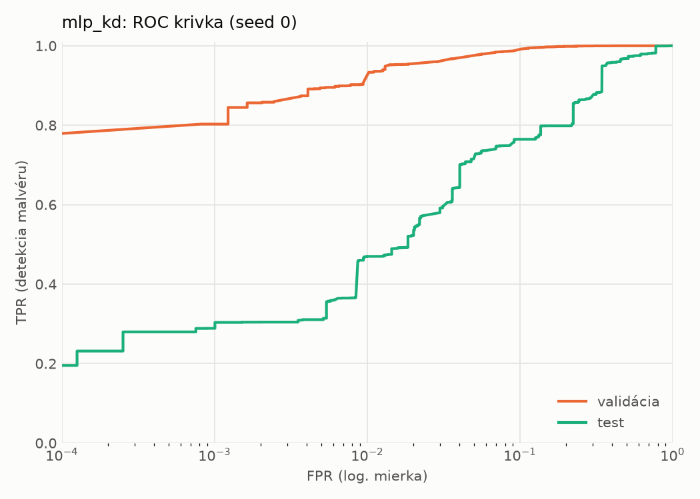
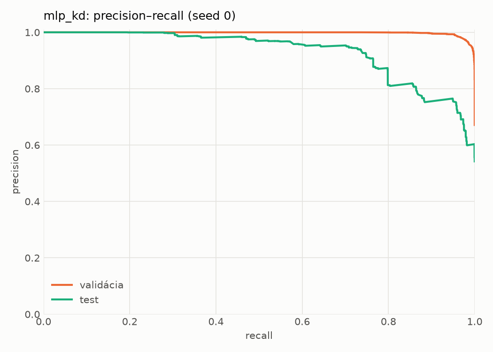
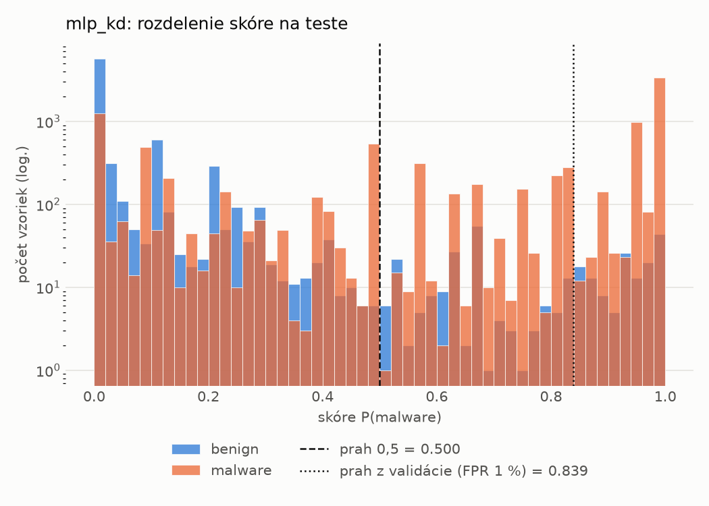
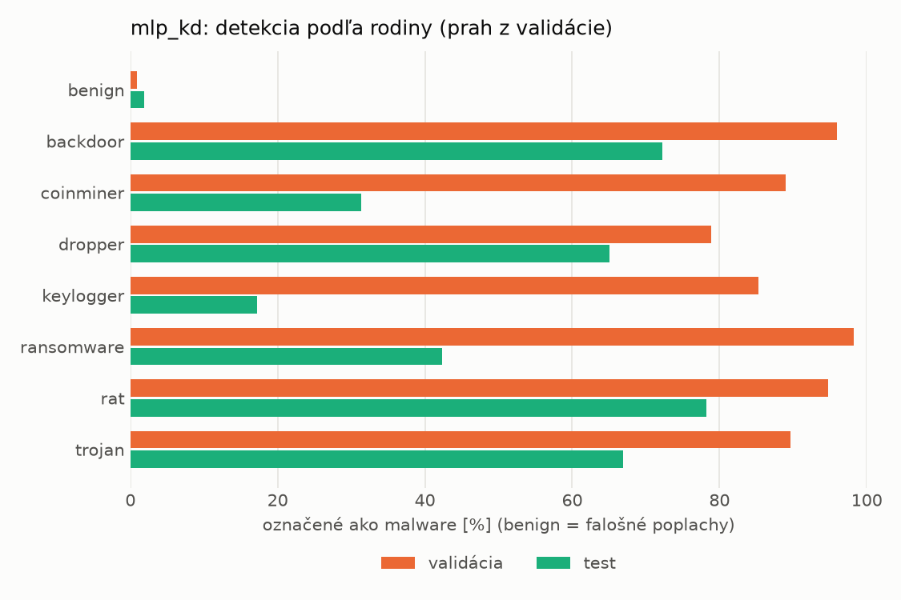
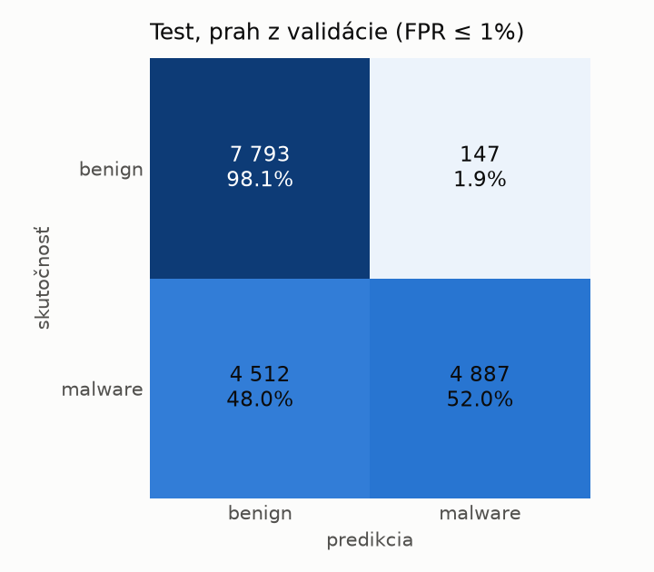
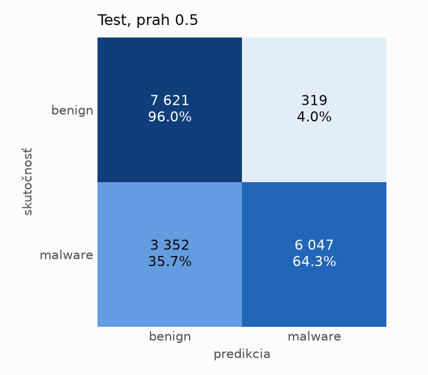
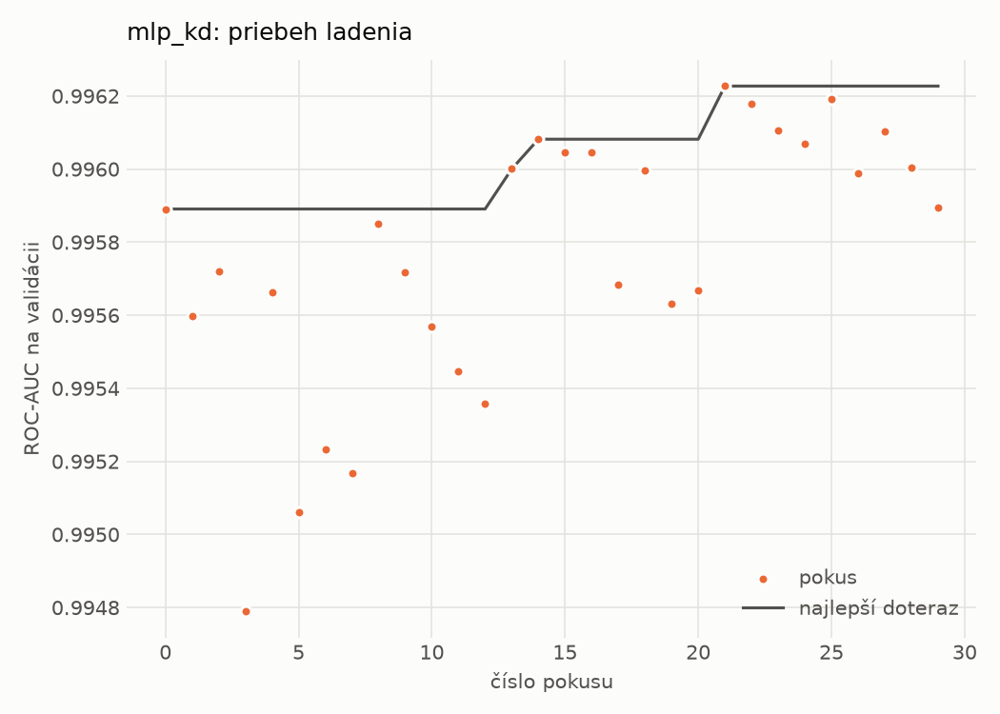
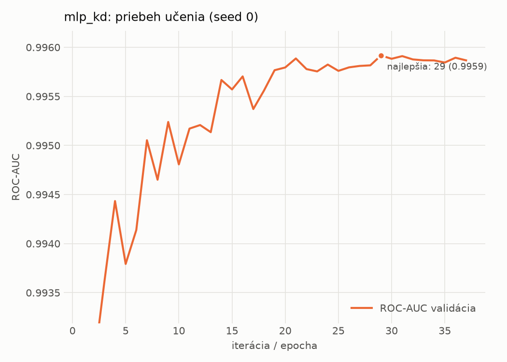

# dynamic/mlp_kd – beh `20261102-212132`

> Automaticky generované (`src/training/run_tabular.py`). Konfigurácia: `config.yaml`, protokol: `protocol.yaml`.

- **Model:** `mlp` – študent – malé MLP učené destiláciou z hybridného učiteľa
- **Ladenie:** 30 dokončených pokusov (Optuna TPE), cieľ ROC-AUC na validácii, 4.7 min
- **Finálne modely:** seedy [0, 1, 2]; hodnoty sú priemer ± smerodajná odchýlka cez seedy
- **Najlepšie hyperparametre:** `{"hidden_layers": 1, "max_epochs": 100, "patience": 8, "hidden_width": 32, "dropout": 0.14978534481914754, "lr": 0.0015794492400712224, "weight_decay": 1.2553588001973222e-06, "batch_size": 512, "kd_alpha": 0.7118939371172979, "kd_temperature": 1.298431487079528}`

## Detekčná kvalita (bez prahu)
| metrika | train (podvzorka) | validácia | test |
|---|---|---|---|
| ROC-AUC | 0.9970 ± 0.0001 | 0.9960 ± 0.0001 | 0.8972 ± 0.0151 |
| PR-AUC | 0.9984 ± 0.0000 | 0.9980 ± 0.0001 | 0.9206 ± 0.0144 |
| TPR pri FPR 1 % | 0.9344 ± 0.0016 | 0.9162 ± 0.0168 | 0.4164 ± 0.0889 |
| TPR pri FPR 0,1 % | 0.8925 ± 0.0014 | 0.8105 ± 0.0201 | 0.2898 ± 0.0010 |
| log loss | 0.0690 ± 0.0004 | 0.0811 ± 0.0014 | 0.8036 ± 0.0867 |
| Brier skóre | 0.0220 ± 0.0002 | 0.0240 ± 0.0002 | 0.1816 ± 0.0216 |

Rozdiel ROC-AUC train − validácia: **0.0010** (veľký rozdiel = preučenie).

## Pri prahu z validácie (FPR ≤ 1% na validácii)
| metrika | train (podvzorka) | validácia | test |
|---|---|---|---|
| accuracy | 0.9409 ± 0.0095 | 0.9406 ± 0.0113 | 0.7327 ± 0.0033 |
| balanced accuracy | 0.9539 ± 0.0067 | 0.9533 ± 0.0085 | 0.7522 ± 0.0029 |
| precision | 0.9960 ± 0.0007 | 0.9949 ± 0.0002 | 0.9731 ± 0.0044 |
| recall (TPR) | 0.9150 ± 0.0149 | 0.9162 ± 0.0168 | 0.5214 ± 0.0082 |
| FPR | 0.0073 ± 0.0015 | 0.0096 ± 0.0002 | 0.0171 ± 0.0031 |
| F1 | 0.9538 ± 0.0077 | 0.9539 ± 0.0091 | 0.6790 ± 0.0061 |
| MCC | 0.8785 ± 0.0175 | 0.8769 ± 0.0215 | 0.5535 ± 0.0037 |

## Pri pevnom prahu 0.5
| metrika | train (podvzorka) | validácia | test |
|---|---|---|---|
| accuracy | 0.9660 ± 0.0001 | 0.9636 ± 0.0001 | 0.7689 ± 0.0202 |
| balanced accuracy | 0.9693 ± 0.0002 | 0.9660 ± 0.0006 | 0.7821 ± 0.0199 |
| precision | 0.9892 ± 0.0005 | 0.9864 ± 0.0010 | 0.9237 ± 0.0234 |
| recall (TPR) | 0.9596 ± 0.0006 | 0.9590 ± 0.0009 | 0.6252 ± 0.0240 |
| FPR | 0.0210 ± 0.0011 | 0.0270 ± 0.0020 | 0.0611 ± 0.0183 |
| F1 | 0.9741 ± 0.0001 | 0.9725 ± 0.0000 | 0.7456 ± 0.0238 |
| MCC | 0.9256 ± 0.0001 | 0.9195 ± 0.0003 | 0.5832 ± 0.0397 |

## Výpočtové nároky (seed 0, testovacia množina)
| meranie | hodnota |
|---|---|
| tréning finálneho modelu | 8.2 s (priemer cez seedy) |
| ladenie spolu | 283 s |
| počet parametrov / uzlov | 64 129 |
| veľkosť modelu na disku | 0.31 MB |
| transformácia vstupu – latencia (1 vlákno) | 0.034 ms |
| transformácia vstupu – priepustnosť | 55 457 vzoriek/s |
| CPU latencia modelu (batch 1, 1 vlákno) | 0.067 ms (p95 0.087) |
| CPU priepustnosť (24 vlákien) | 139 931 vzoriek/s |
| GPU latencia (batch 1) | 0.296 ms (p95 0.467) |
| GPU priepustnosť | 100 690 vzoriek/s |
| GPU špičková pamäť | 753 MB |

## Grafy
| | |
|---|---|
|  |  |
|  |  |
|  |  |
|  |  |

## Súbory
`metrics.json` (všetky metriky po seedoch vrátane rodín), `timing.json`, `hpo_trials.csv`,
`predictions/<časť>_seed<N>.parquet` (sha256, family, label, score), `model/seed_<N>/`, `log.txt`.
