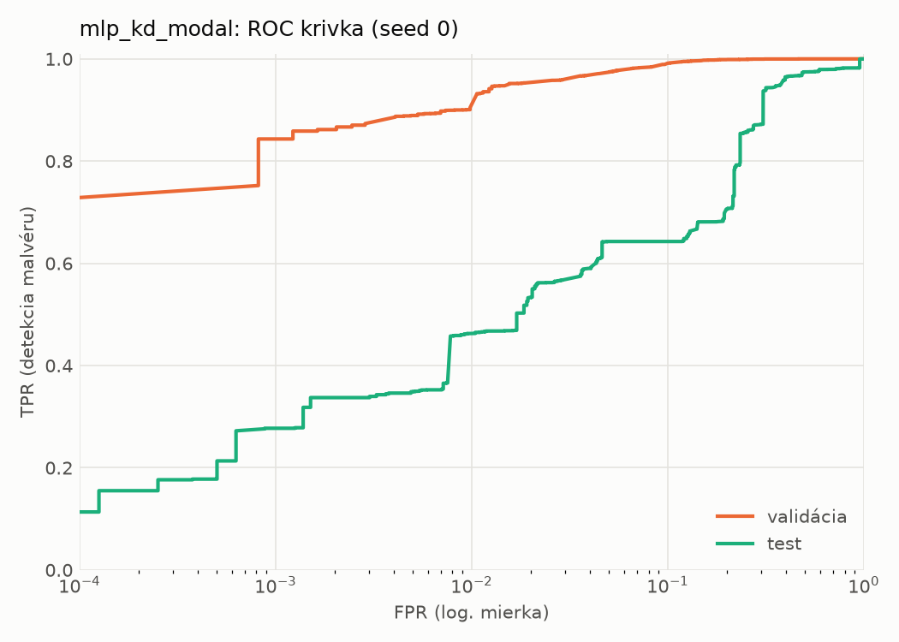
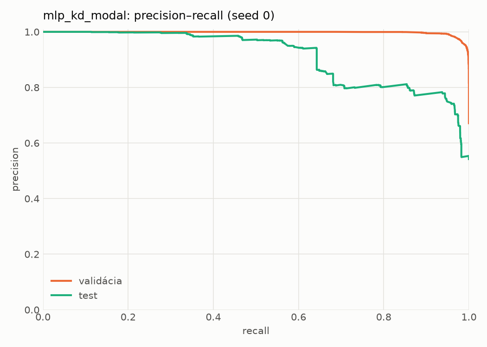
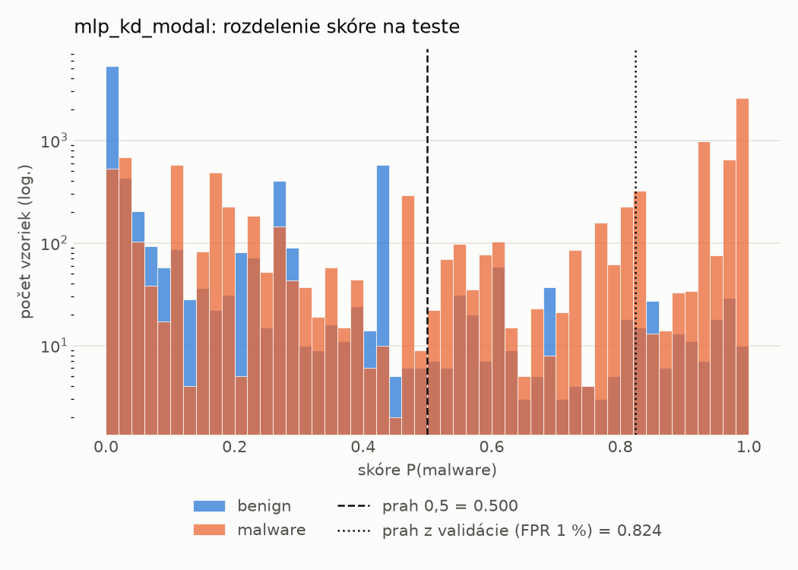
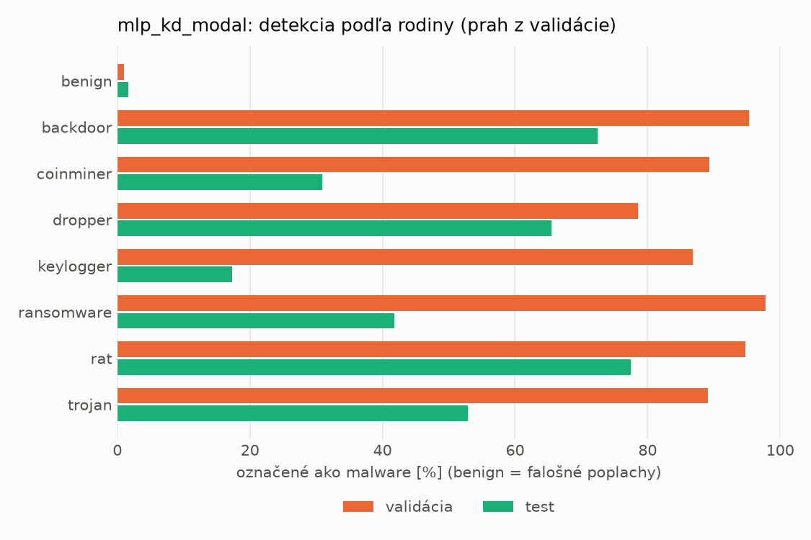
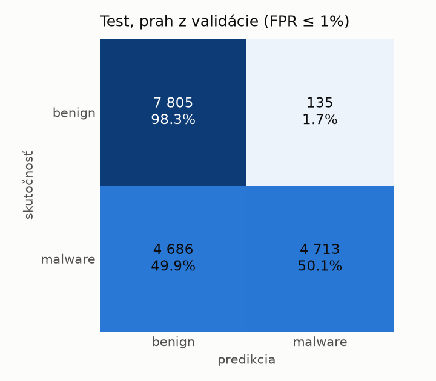
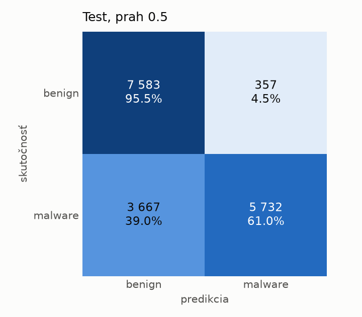
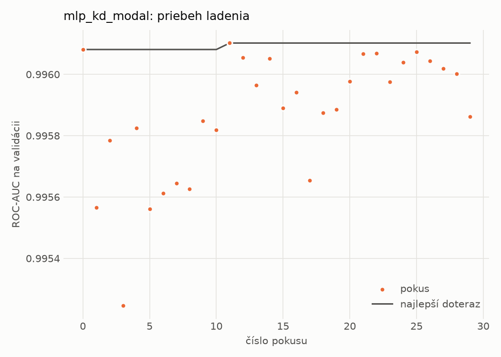
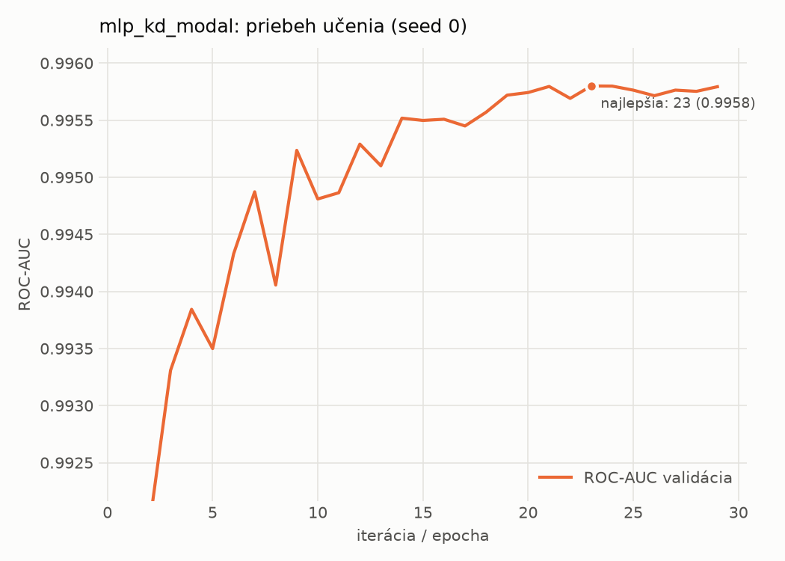

# dynamic/mlp_kd_modal – beh `20261102-212954`

> Automaticky generované (`src/training/run_tabular.py`). Konfigurácia: `config.yaml`, protokol: `protocol.yaml`.

- **Model:** `mlp` – študent – malé MLP učené destiláciou z učiteľa rovnakej modality (variant A)
- **Ladenie:** 30 dokončených pokusov (Optuna TPE), cieľ ROC-AUC na validácii, 4.4 min
- **Finálne modely:** seedy [0, 1, 2]; hodnoty sú priemer ± smerodajná odchýlka cez seedy
- **Najlepšie hyperparametre:** `{"hidden_layers": 1, "max_epochs": 100, "patience": 8, "hidden_width": 32, "dropout": 0.14040860994340293, "lr": 0.00037778352941027736, "weight_decay": 1.149514965975221e-06, "batch_size": 512, "kd_alpha": 0.8818461482523741, "kd_temperature": 1.583698009756735}`

## Detekčná kvalita (bez prahu)
| metrika | train (podvzorka) | validácia | test |
|---|---|---|---|
| ROC-AUC | 0.9970 ± 0.0002 | 0.9959 ± 0.0001 | 0.8918 ± 0.0056 |
| PR-AUC | 0.9984 ± 0.0001 | 0.9979 ± 0.0000 | 0.9155 ± 0.0053 |
| TPR pri FPR 1 % | 0.9332 ± 0.0012 | 0.9052 ± 0.0007 | 0.4574 ± 0.0182 |
| TPR pri FPR 0,1 % | 0.8896 ± 0.0037 | 0.8351 ± 0.0102 | 0.2729 ± 0.0051 |
| log loss | 0.0700 ± 0.0018 | 0.0800 ± 0.0004 | 0.7115 ± 0.0208 |
| Brier skóre | 0.0221 ± 0.0005 | 0.0240 ± 0.0003 | 0.1855 ± 0.0015 |

Rozdiel ROC-AUC train − validácia: **0.0011** (veľký rozdiel = preučenie).

## Pri prahu z validácie (FPR ≤ 1% na validácii)
| metrika | train (podvzorka) | validácia | test |
|---|---|---|---|
| accuracy | 0.9332 ± 0.0002 | 0.9332 ± 0.0005 | 0.7245 ± 0.0059 |
| balanced accuracy | 0.9483 ± 0.0002 | 0.9477 ± 0.0004 | 0.7446 ± 0.0054 |
| precision | 0.9964 ± 0.0000 | 0.9948 ± 0.0001 | 0.9744 ± 0.0023 |
| recall (TPR) | 0.9032 ± 0.0003 | 0.9052 ± 0.0007 | 0.5050 ± 0.0116 |
| FPR | 0.0066 ± 0.0000 | 0.0097 ± 0.0002 | 0.0157 ± 0.0016 |
| F1 | 0.9475 ± 0.0002 | 0.9479 ± 0.0004 | 0.6652 ± 0.0099 |
| MCC | 0.8643 ± 0.0004 | 0.8628 ± 0.0009 | 0.5423 ± 0.0083 |

## Pri pevnom prahu 0.5
| metrika | train (podvzorka) | validácia | test |
|---|---|---|---|
| accuracy | 0.9665 ± 0.0012 | 0.9646 ± 0.0011 | 0.7609 ± 0.0079 |
| balanced accuracy | 0.9692 ± 0.0005 | 0.9667 ± 0.0011 | 0.7754 ± 0.0085 |
| precision | 0.9884 ± 0.0027 | 0.9862 ± 0.0034 | 0.9312 ± 0.0195 |
| recall (TPR) | 0.9610 ± 0.0044 | 0.9607 ± 0.0050 | 0.6038 ± 0.0060 |
| FPR | 0.0226 ± 0.0054 | 0.0274 ± 0.0071 | 0.0531 ± 0.0163 |
| F1 | 0.9745 ± 0.0010 | 0.9733 ± 0.0009 | 0.7325 ± 0.0074 |
| MCC | 0.9264 ± 0.0020 | 0.9217 ± 0.0018 | 0.5748 ± 0.0199 |

## Výpočtové nároky (seed 0, testovacia množina)
| meranie | hodnota |
|---|---|
| tréning finálneho modelu | 7.0 s (priemer cez seedy) |
| ladenie spolu | 264 s |
| počet parametrov / uzlov | 64 129 |
| veľkosť modelu na disku | 0.31 MB |
| transformácia vstupu – latencia (1 vlákno) | 0.034 ms |
| transformácia vstupu – priepustnosť | 51 859 vzoriek/s |
| CPU latencia modelu (batch 1, 1 vlákno) | 0.067 ms (p95 0.074) |
| CPU priepustnosť (24 vlákien) | 139 917 vzoriek/s |
| GPU latencia (batch 1) | 0.294 ms (p95 0.331) |
| GPU priepustnosť | 102 288 vzoriek/s |
| GPU špičková pamäť | 753 MB |

## Grafy
| | |
|---|---|
|  |  |
|  |  |
|  |  |
|  |  |

## Súbory
`metrics.json` (všetky metriky po seedoch vrátane rodín), `timing.json`, `hpo_trials.csv`,
`predictions/<časť>_seed<N>.parquet` (sha256, family, label, score), `model/seed_<N>/`, `log.txt`.
