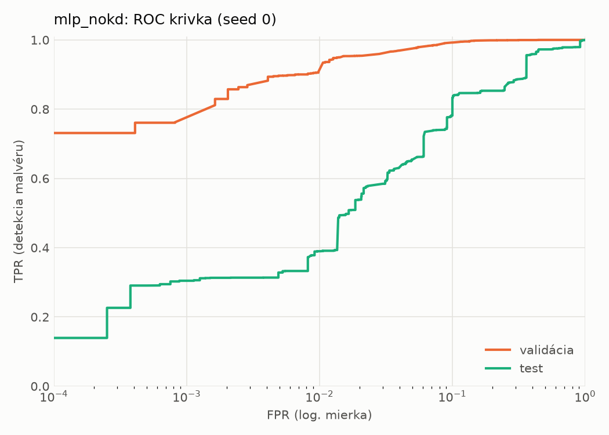
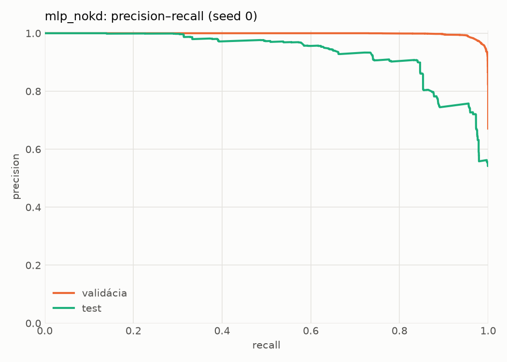
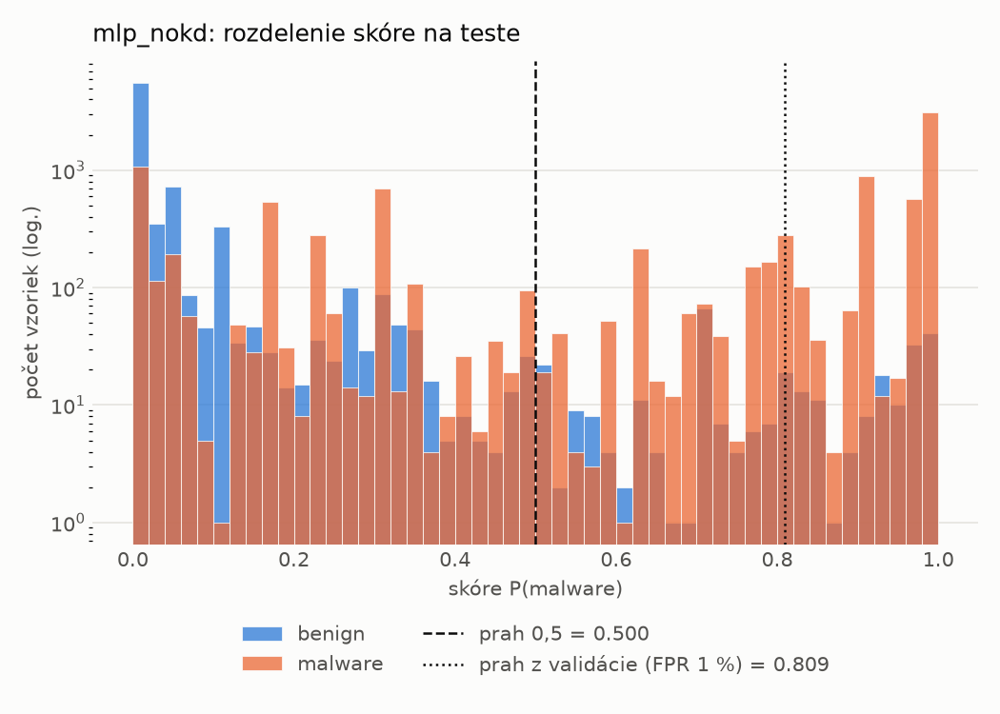
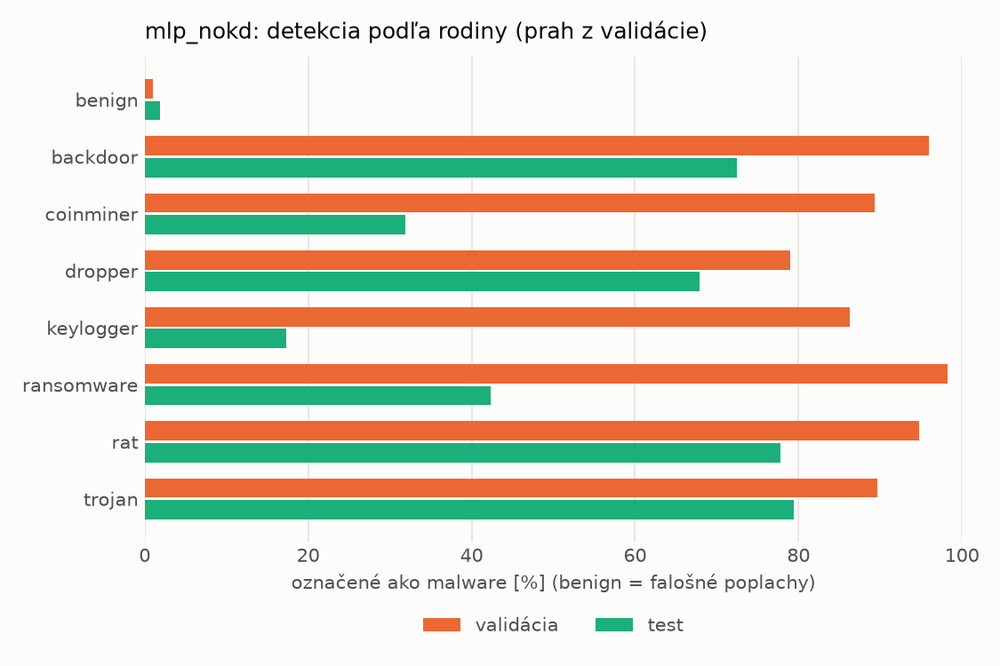
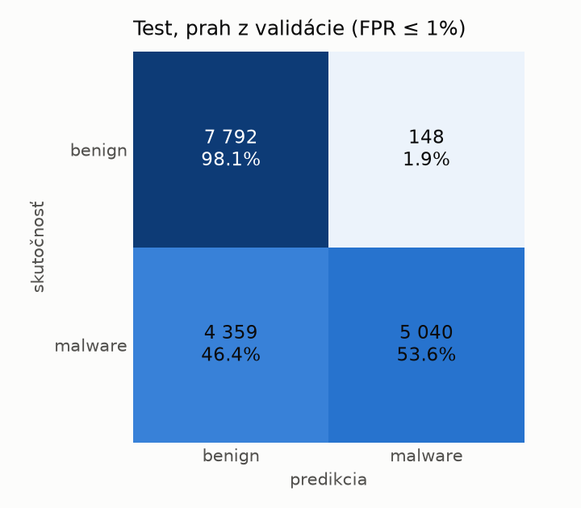
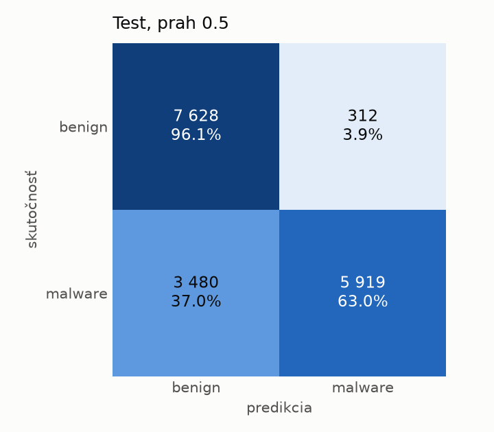
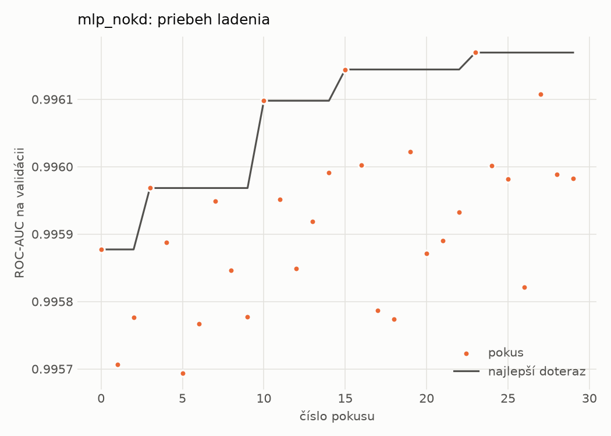
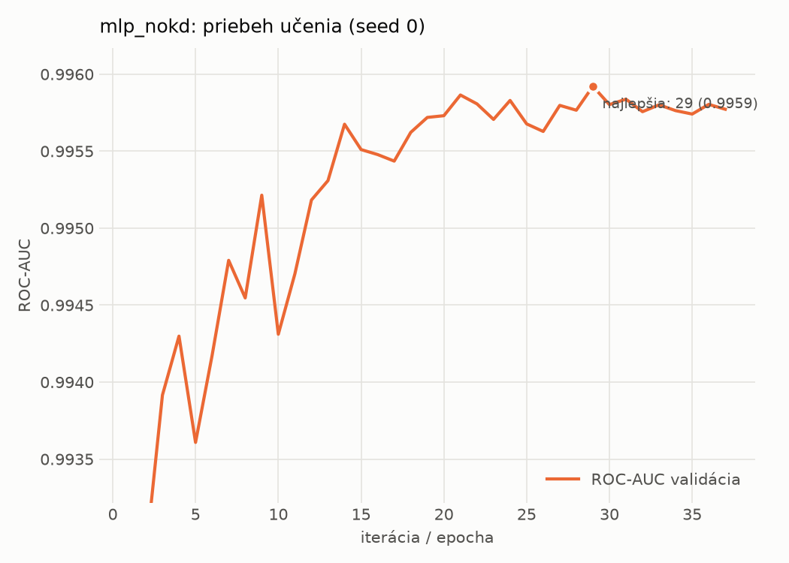

# dynamic/mlp_nokd – beh `20261102-212647`

> Automaticky generované (`src/training/run_tabular.py`). Konfigurácia: `config.yaml`, protokol: `protocol.yaml`.

- **Model:** `mlp` – kontrola – rovnaké malé MLP bez destilácie (iba skutočné označenia)
- **Ladenie:** 30 dokončených pokusov (Optuna TPE), cieľ ROC-AUC na validácii, 2.7 min
- **Finálne modely:** seedy [0, 1, 2]; hodnoty sú priemer ± smerodajná odchýlka cez seedy
- **Najlepšie hyperparametre:** `{"hidden_layers": 1, "max_epochs": 100, "patience": 8, "hidden_width": 32, "dropout": 0.27854460554056926, "lr": 0.002048574130711367, "weight_decay": 5.911733622585913e-06, "batch_size": 512}`

## Detekčná kvalita (bez prahu)
| metrika | train (podvzorka) | validácia | test |
|---|---|---|---|
| ROC-AUC | 0.9970 ± 0.0001 | 0.9960 ± 0.0000 | 0.9112 ± 0.0116 |
| PR-AUC | 0.9984 ± 0.0001 | 0.9980 ± 0.0000 | 0.9324 ± 0.0089 |
| TPR pri FPR 1 % | 0.9343 ± 0.0023 | 0.9202 ± 0.0194 | 0.4484 ± 0.0525 |
| TPR pri FPR 0,1 % | 0.8927 ± 0.0013 | 0.7766 ± 0.0152 | 0.3130 ± 0.0205 |
| log loss | 0.0693 ± 0.0012 | 0.0819 ± 0.0010 | 0.7528 ± 0.0330 |
| Brier skóre | 0.0223 ± 0.0005 | 0.0239 ± 0.0002 | 0.1680 ± 0.0162 |

Rozdiel ROC-AUC train − validácia: **0.0010** (veľký rozdiel = preučenie).

## Pri prahu z validácie (FPR ≤ 1% na validácii)
| metrika | train (podvzorka) | validácia | test |
|---|---|---|---|
| accuracy | 0.9424 ± 0.0105 | 0.9433 ± 0.0131 | 0.7421 ± 0.0019 |
| balanced accuracy | 0.9547 ± 0.0074 | 0.9553 ± 0.0098 | 0.7607 ± 0.0018 |
| precision | 0.9955 ± 0.0011 | 0.9949 ± 0.0002 | 0.9731 ± 0.0034 |
| recall (TPR) | 0.9179 ± 0.0168 | 0.9202 ± 0.0194 | 0.5391 ± 0.0042 |
| FPR | 0.0084 ± 0.0022 | 0.0096 ± 0.0002 | 0.0177 ± 0.0024 |
| F1 | 0.9550 ± 0.0086 | 0.9560 ± 0.0105 | 0.6938 ± 0.0032 |
| MCC | 0.8812 ± 0.0196 | 0.8821 ± 0.0251 | 0.5668 ± 0.0031 |

## Pri pevnom prahu 0.5
| metrika | train (podvzorka) | validácia | test |
|---|---|---|---|
| accuracy | 0.9667 ± 0.0025 | 0.9652 ± 0.0009 | 0.7889 ± 0.0235 |
| balanced accuracy | 0.9691 ± 0.0013 | 0.9670 ± 0.0008 | 0.8024 ± 0.0218 |
| precision | 0.9877 ± 0.0013 | 0.9860 ± 0.0027 | 0.9528 ± 0.0045 |
| recall (TPR) | 0.9621 ± 0.0051 | 0.9618 ± 0.0041 | 0.6422 ± 0.0424 |
| FPR | 0.0239 ± 0.0028 | 0.0278 ± 0.0057 | 0.0375 ± 0.0018 |
| F1 | 0.9747 ± 0.0020 | 0.9738 ± 0.0007 | 0.7668 ± 0.0314 |
| MCC | 0.9268 ± 0.0051 | 0.9228 ± 0.0013 | 0.6259 ± 0.0371 |

## Výpočtové nároky (seed 0, testovacia množina)
| meranie | hodnota |
|---|---|
| tréning finálneho modelu | 5.9 s (priemer cez seedy) |
| ladenie spolu | 161 s |
| počet parametrov / uzlov | 64 129 |
| veľkosť modelu na disku | 0.31 MB |
| transformácia vstupu – latencia (1 vlákno) | 0.034 ms |
| transformácia vstupu – priepustnosť | 49 208 vzoriek/s |
| CPU latencia modelu (batch 1, 1 vlákno) | 0.067 ms (p95 0.076) |
| CPU priepustnosť (24 vlákien) | 97 013 vzoriek/s |
| GPU latencia (batch 1) | 0.455 ms (p95 0.488) |
| GPU priepustnosť | 101 085 vzoriek/s |
| GPU špičková pamäť | 1347 MB |

## Grafy
| | |
|---|---|
|  |  |
|  |  |
|  |  |
|  |  |

## Súbory
`metrics.json` (všetky metriky po seedoch vrátane rodín), `timing.json`, `hpo_trials.csv`,
`predictions/<časť>_seed<N>.parquet` (sha256, family, label, score), `model/seed_<N>/`, `log.txt`.
