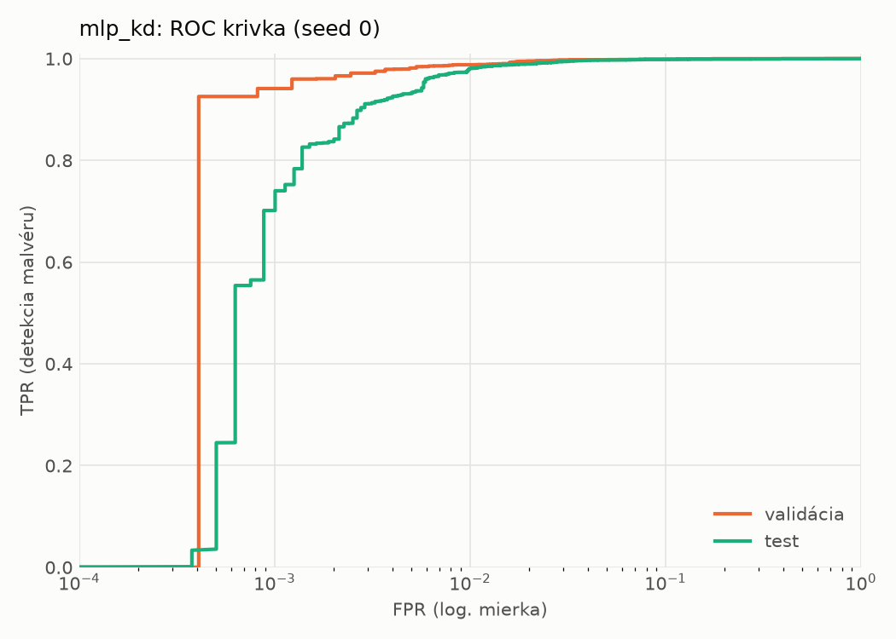
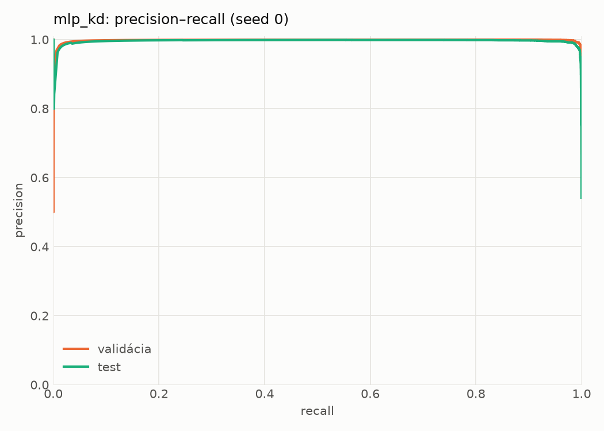
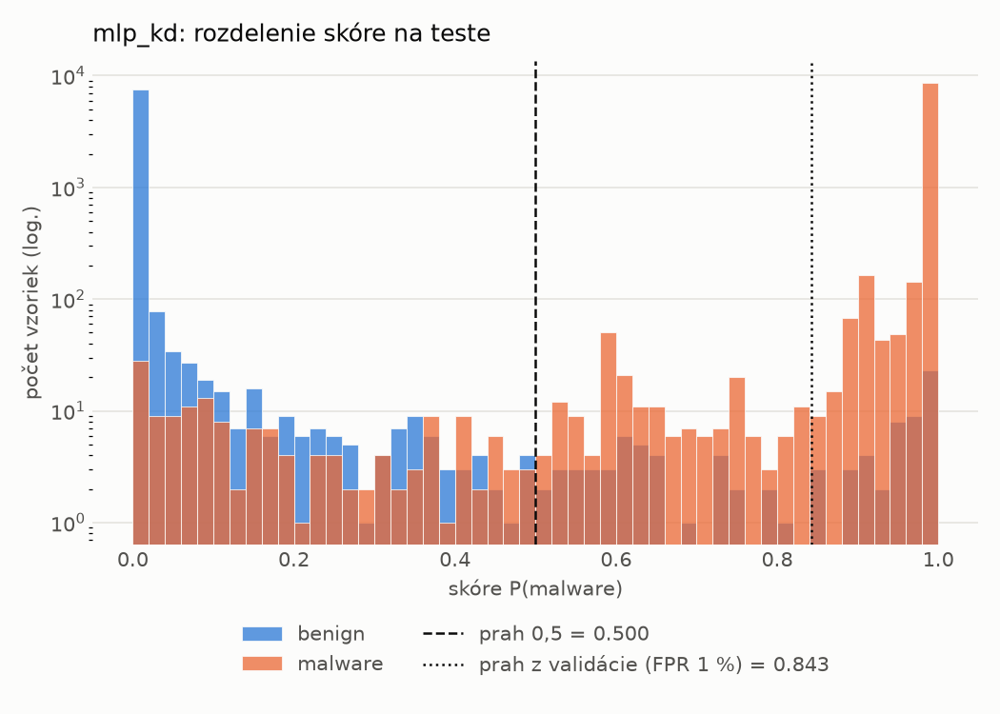
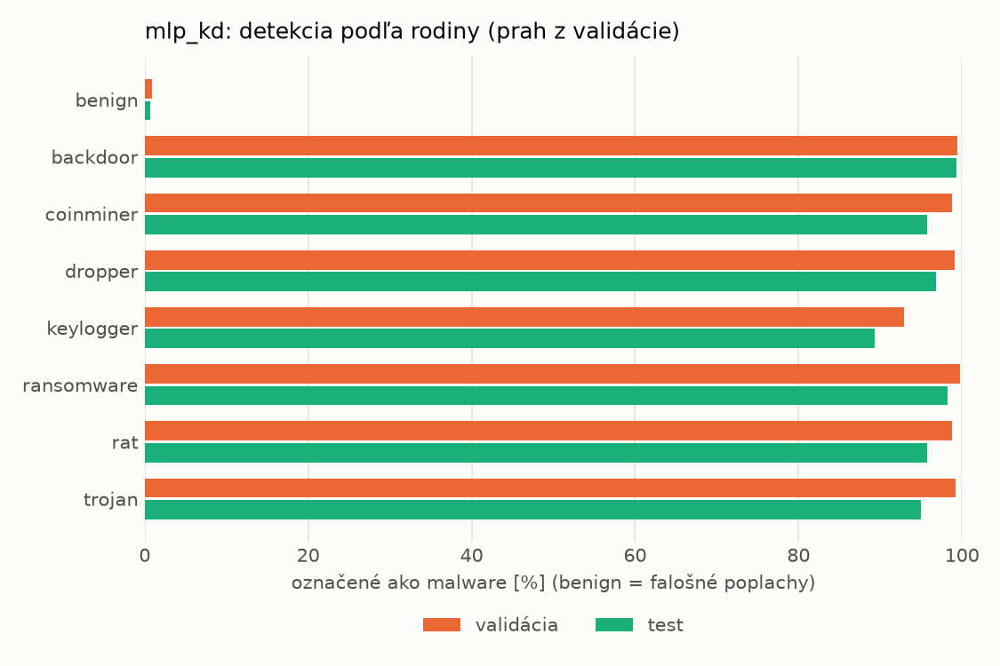
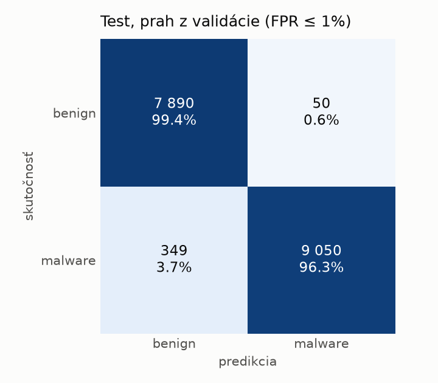
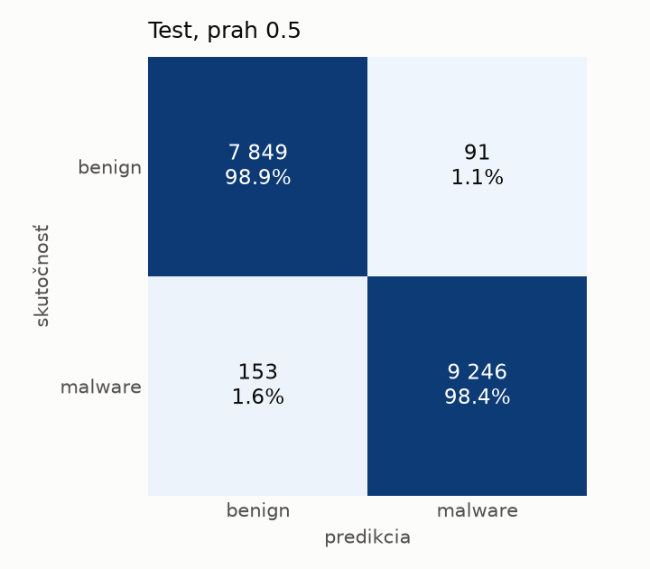
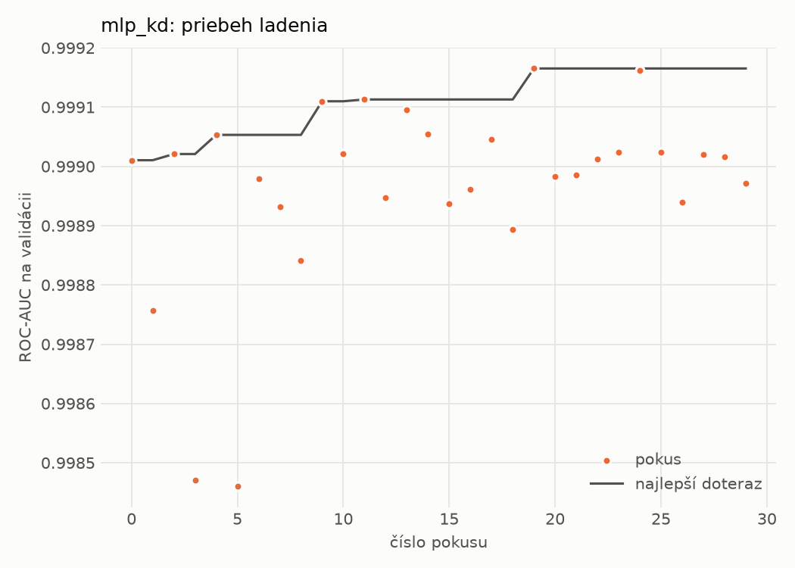
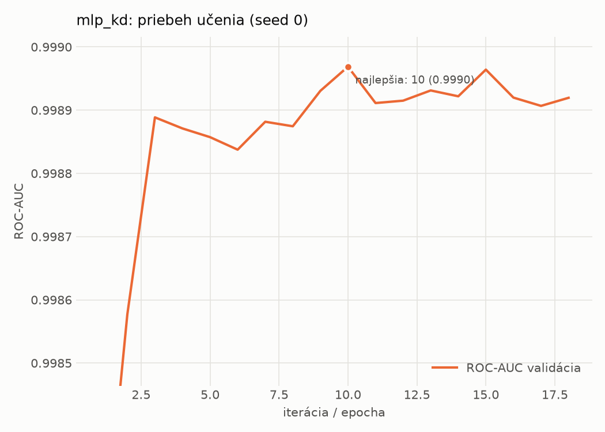

# static/mlp_kd – beh `20261102-211333`

> Automaticky generované (`src/training/run_tabular.py`). Konfigurácia: `config.yaml`, protokol: `protocol.yaml`.

- **Model:** `mlp` – študent – malé MLP učené destiláciou z hybridného učiteľa
- **Ladenie:** 30 dokončených pokusov (Optuna TPE), cieľ ROC-AUC na validácii, 3.0 min
- **Finálne modely:** seedy [0, 1, 2]; hodnoty sú priemer ± smerodajná odchýlka cez seedy
- **Najlepšie hyperparametre:** `{"hidden_layers": 1, "max_epochs": 100, "patience": 8, "hidden_width": 32, "dropout": 0.0997633477545663, "lr": 0.0015427581570995174, "weight_decay": 0.00017559733451057006, "batch_size": 256, "kd_alpha": 0.604033962068706, "kd_temperature": 6.472658522077935}`

## Detekčná kvalita (bez prahu)
| metrika | train (podvzorka) | validácia | test |
|---|---|---|---|
| ROC-AUC | 0.9998 ± 0.0000 | 0.9991 ± 0.0001 | 0.9978 ± 0.0002 |
| PR-AUC | 0.9999 ± 0.0000 | 0.9987 ± 0.0008 | 0.9964 ± 0.0000 |
| TPR pri FPR 1 % | 0.9974 ± 0.0007 | 0.9881 ± 0.0002 | 0.9815 ± 0.0013 |
| TPR pri FPR 0,1 % | 0.9673 ± 0.0021 | 0.9378 ± 0.0034 | 0.5483 ± 0.1367 |
| log loss | 0.0166 ± 0.0010 | 0.0326 ± 0.0009 | 0.0542 ± 0.0027 |
| Brier skóre | 0.0043 ± 0.0002 | 0.0078 ± 0.0002 | 0.0127 ± 0.0006 |

Rozdiel ROC-AUC train − validácia: **0.0007** (veľký rozdiel = preučenie).

## Pri prahu z validácie (FPR ≤ 1% na validácii)
| metrika | train (podvzorka) | validácia | test |
|---|---|---|---|
| accuracy | 0.9913 ± 0.0006 | 0.9889 ± 0.0002 | 0.9746 ± 0.0052 |
| balanced accuracy | 0.9929 ± 0.0005 | 0.9893 ± 0.0003 | 0.9761 ± 0.0048 |
| precision | 0.9987 ± 0.0002 | 0.9954 ± 0.0003 | 0.9948 ± 0.0003 |
| recall (TPR) | 0.9883 ± 0.0008 | 0.9881 ± 0.0002 | 0.9581 ± 0.0097 |
| FPR | 0.0026 ± 0.0003 | 0.0094 ± 0.0007 | 0.0059 ± 0.0003 |
| F1 | 0.9935 ± 0.0004 | 0.9917 ± 0.0002 | 0.9761 ± 0.0050 |
| MCC | 0.9807 ± 0.0013 | 0.9750 ± 0.0005 | 0.9497 ± 0.0099 |

## Pri pevnom prahu 0.5
| metrika | train (podvzorka) | validácia | test |
|---|---|---|---|
| accuracy | 0.9948 ± 0.0001 | 0.9902 ± 0.0001 | 0.9854 ± 0.0004 |
| balanced accuracy | 0.9947 ± 0.0005 | 0.9886 ± 0.0005 | 0.9858 ± 0.0003 |
| precision | 0.9971 ± 0.0009 | 0.9921 ± 0.0008 | 0.9913 ± 0.0011 |
| recall (TPR) | 0.9952 ± 0.0008 | 0.9934 ± 0.0007 | 0.9817 ± 0.0018 |
| FPR | 0.0058 ± 0.0017 | 0.0162 ± 0.0017 | 0.0102 ± 0.0013 |
| F1 | 0.9961 ± 0.0000 | 0.9927 ± 0.0001 | 0.9865 ± 0.0004 |
| MCC | 0.9884 ± 0.0001 | 0.9778 ± 0.0002 | 0.9707 ± 0.0009 |

## Výpočtové nároky (seed 0, testovacia množina)
| meranie | hodnota |
|---|---|
| tréning finálneho modelu | 8.4 s (priemer cez seedy) |
| ladenie spolu | 183 s |
| počet parametrov / uzlov | 74 337 |
| veľkosť modelu na disku | 0.36 MB |
| transformácia vstupu – latencia (1 vlákno) | 0.041 ms |
| transformácia vstupu – priepustnosť | 43 748 vzoriek/s |
| CPU latencia modelu (batch 1, 1 vlákno) | 0.068 ms (p95 0.079) |
| CPU priepustnosť (24 vlákien) | 72 238 vzoriek/s |
| GPU latencia (batch 1) | 0.456 ms (p95 0.491) |
| GPU priepustnosť | 80 910 vzoriek/s |
| GPU špičková pamäť | 871 MB |

## Grafy
| | |
|---|---|
|  |  |
|  |  |
|  |  |
|  |  |

## Súbory
`metrics.json` (všetky metriky po seedoch vrátane rodín), `timing.json`, `hpo_trials.csv`,
`predictions/<časť>_seed<N>.parquet` (sha256, family, label, score), `model/seed_<N>/`, `log.txt`.
