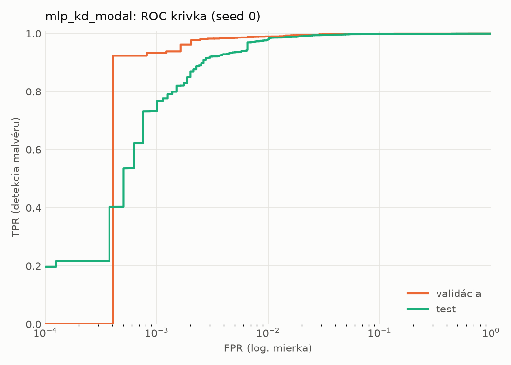
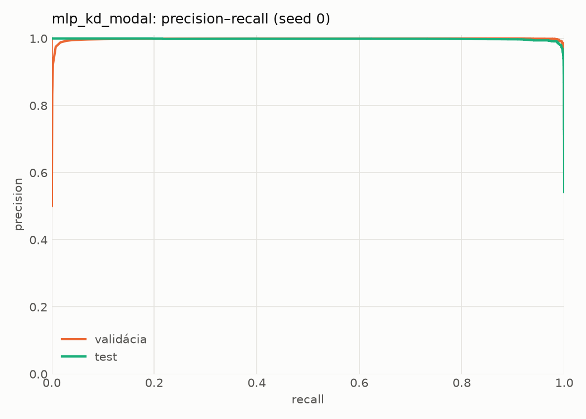
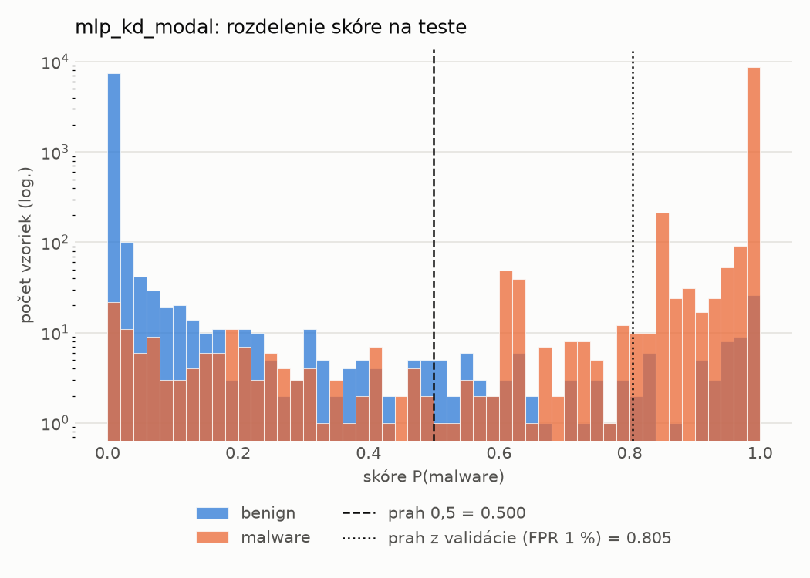
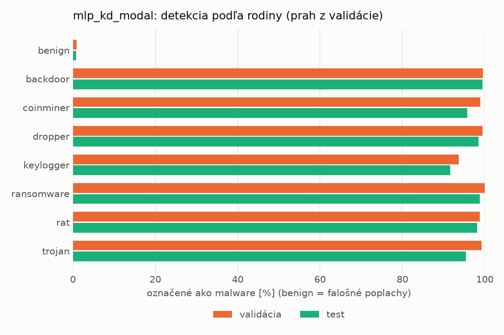
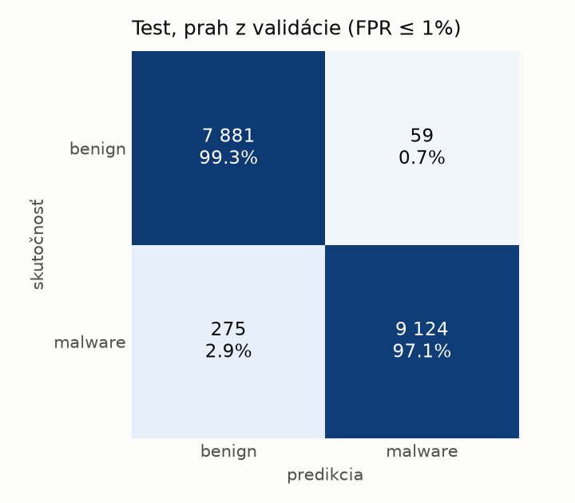
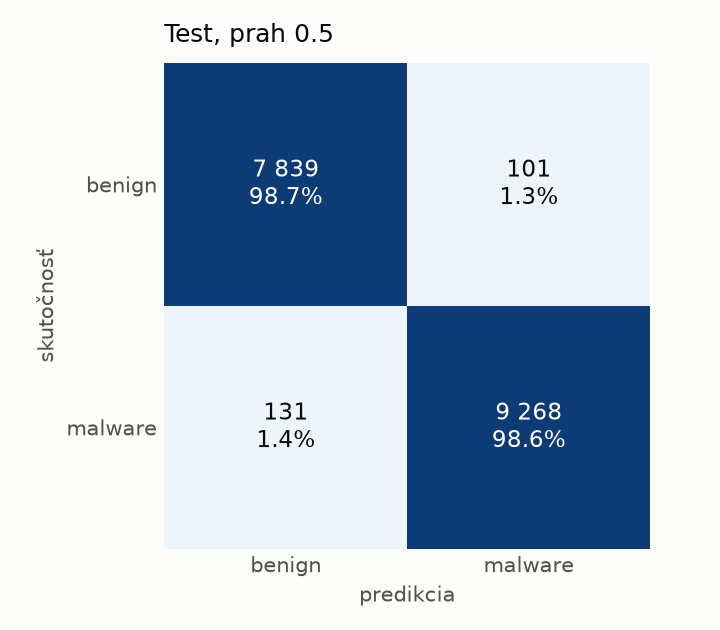
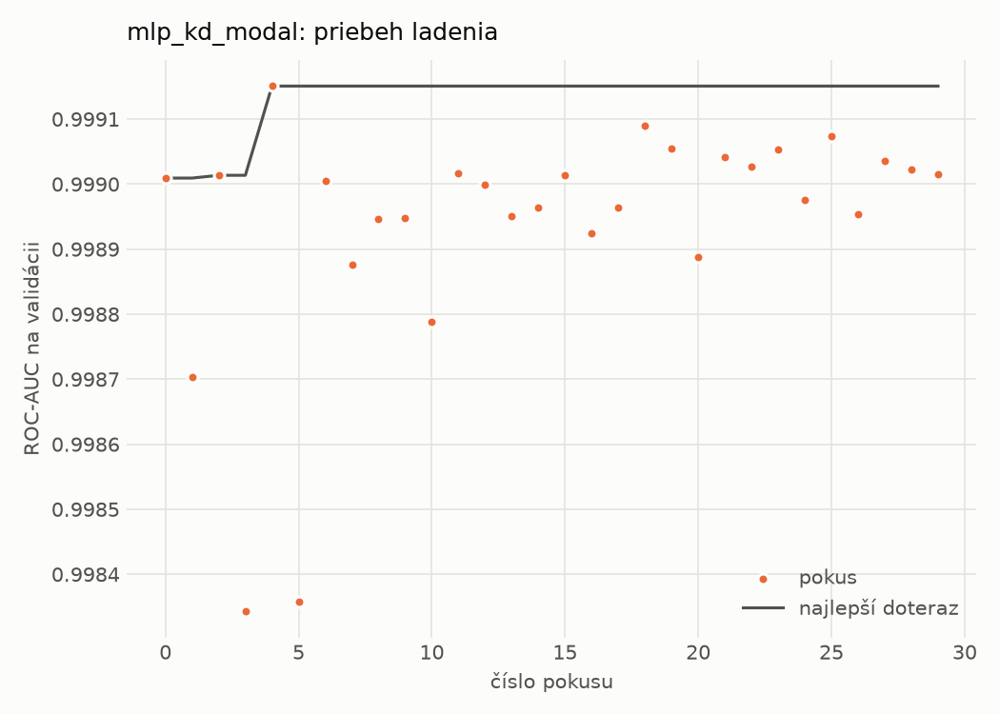
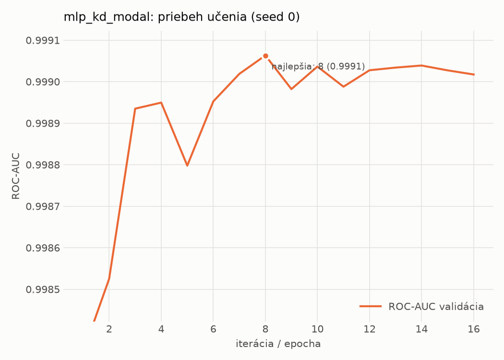

# static/mlp_kd_modal – beh `20261102-211832`

> Automaticky generované (`src/training/run_tabular.py`). Konfigurácia: `config.yaml`, protokol: `protocol.yaml`.

- **Model:** `mlp` – študent – malé MLP učené destiláciou z učiteľa rovnakej modality (variant A)
- **Ladenie:** 30 dokončených pokusov (Optuna TPE), cieľ ROC-AUC na validácii, 2.5 min
- **Finálne modely:** seedy [0, 1, 2]; hodnoty sú priemer ± smerodajná odchýlka cez seedy
- **Najlepšie hyperparametre:** `{"hidden_layers": 1, "max_epochs": 100, "patience": 8, "hidden_width": 32, "dropout": 0.15602040635334324, "lr": 0.00105640764164036, "weight_decay": 3.5856126103453987e-06, "batch_size": 256, "kd_alpha": 0.815861880342119, "kd_temperature": 5.185299851677596}`

## Detekčná kvalita (bez prahu)
| metrika | train (podvzorka) | validácia | test |
|---|---|---|---|
| ROC-AUC | 0.9997 ± 0.0001 | 0.9990 ± 0.0001 | 0.9981 ± 0.0001 |
| PR-AUC | 0.9999 ± 0.0001 | 0.9984 ± 0.0001 | 0.9971 ± 0.0010 |
| TPR pri FPR 1 % | 0.9964 ± 0.0015 | 0.9880 ± 0.0016 | 0.9765 ± 0.0035 |
| TPR pri FPR 0,1 % | 0.9579 ± 0.0205 | 0.9220 ± 0.0139 | 0.7812 ± 0.0430 |
| log loss | 0.0188 ± 0.0038 | 0.0324 ± 0.0018 | 0.0534 ± 0.0045 |
| Brier skóre | 0.0047 ± 0.0009 | 0.0078 ± 0.0003 | 0.0126 ± 0.0011 |

Rozdiel ROC-AUC train − validácia: **0.0007** (veľký rozdiel = preučenie).

## Pri prahu z validácie (FPR ≤ 1% na validácii)
| metrika | train (podvzorka) | validácia | test |
|---|---|---|---|
| accuracy | 0.9910 ± 0.0012 | 0.9887 ± 0.0011 | 0.9788 ± 0.0019 |
| balanced accuracy | 0.9925 ± 0.0010 | 0.9891 ± 0.0009 | 0.9799 ± 0.0018 |
| precision | 0.9985 ± 0.0004 | 0.9952 ± 0.0001 | 0.9941 ± 0.0005 |
| recall (TPR) | 0.9879 ± 0.0014 | 0.9880 ± 0.0016 | 0.9667 ± 0.0039 |
| FPR | 0.0029 ± 0.0007 | 0.0097 ± 0.0002 | 0.0068 ± 0.0006 |
| F1 | 0.9932 ± 0.0009 | 0.9916 ± 0.0009 | 0.9802 ± 0.0018 |
| MCC | 0.9799 ± 0.0026 | 0.9746 ± 0.0025 | 0.9579 ± 0.0037 |

## Pri pevnom prahu 0.5
| metrika | train (podvzorka) | validácia | test |
|---|---|---|---|
| accuracy | 0.9942 ± 0.0011 | 0.9902 ± 0.0005 | 0.9853 ± 0.0012 |
| balanced accuracy | 0.9935 ± 0.0013 | 0.9884 ± 0.0010 | 0.9855 ± 0.0010 |
| precision | 0.9958 ± 0.0010 | 0.9917 ± 0.0013 | 0.9900 ± 0.0013 |
| recall (TPR) | 0.9956 ± 0.0011 | 0.9938 ± 0.0009 | 0.9828 ± 0.0031 |
| FPR | 0.0085 ± 0.0020 | 0.0171 ± 0.0027 | 0.0118 ± 0.0016 |
| F1 | 0.9957 ± 0.0008 | 0.9927 ± 0.0004 | 0.9863 ± 0.0011 |
| MCC | 0.9870 ± 0.0025 | 0.9778 ± 0.0012 | 0.9704 ± 0.0023 |

## Výpočtové nároky (seed 0, testovacia množina)
| meranie | hodnota |
|---|---|
| tréning finálneho modelu | 5.6 s (priemer cez seedy) |
| ladenie spolu | 149 s |
| počet parametrov / uzlov | 74 337 |
| veľkosť modelu na disku | 0.36 MB |
| transformácia vstupu – latencia (1 vlákno) | 0.042 ms |
| transformácia vstupu – priepustnosť | 40 055 vzoriek/s |
| CPU latencia modelu (batch 1, 1 vlákno) | 0.069 ms (p95 0.078) |
| CPU priepustnosť (24 vlákien) | 61 064 vzoriek/s |
| GPU latencia (batch 1) | 0.453 ms (p95 0.478) |
| GPU priepustnosť | 80 447 vzoriek/s |
| GPU špičková pamäť | 871 MB |

## Grafy
| | |
|---|---|
|  |  |
|  |  |
|  |  |
|  |  |

## Súbory
`metrics.json` (všetky metriky po seedoch vrátane rodín), `timing.json`, `hpo_trials.csv`,
`predictions/<časť>_seed<N>.parquet` (sha256, family, label, score), `model/seed_<N>/`, `log.txt`.
