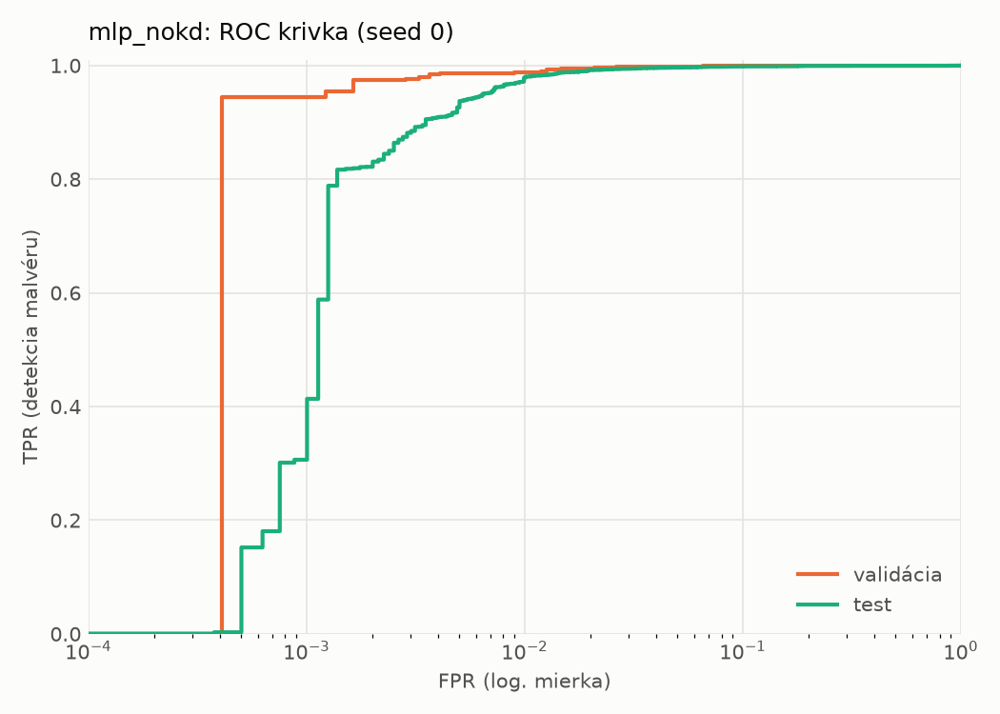
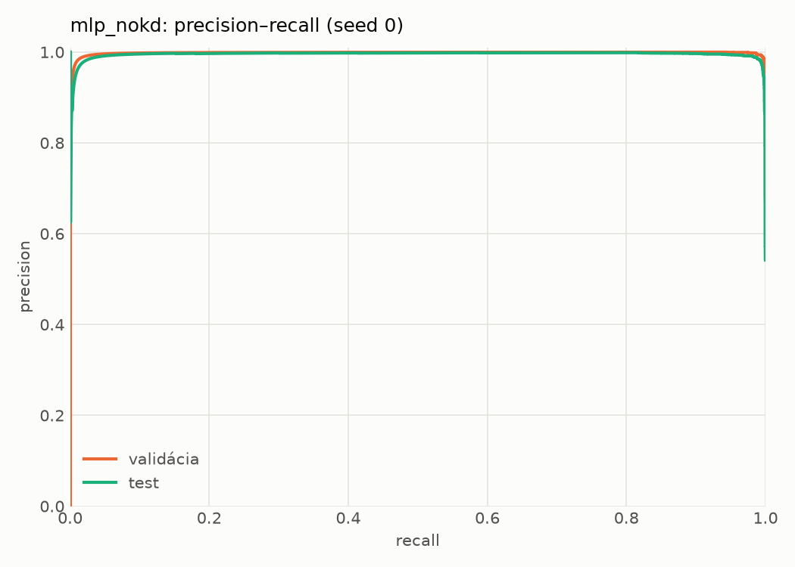
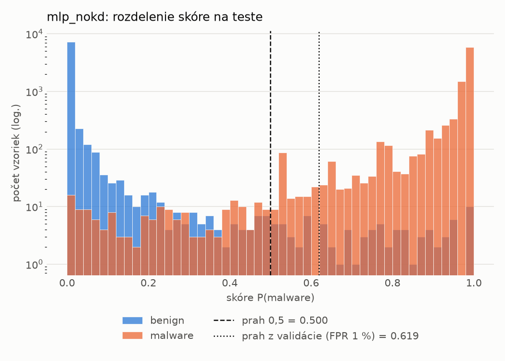
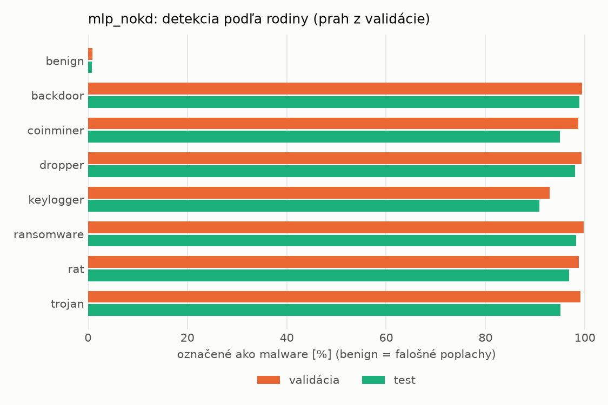
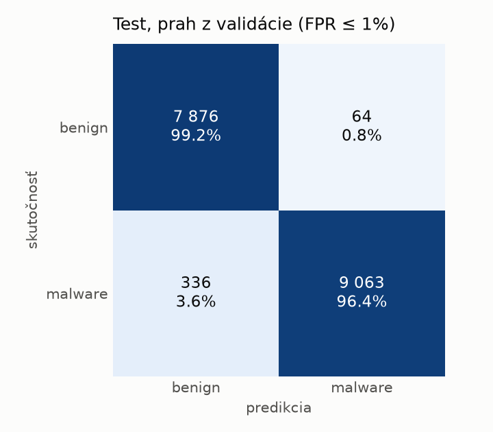
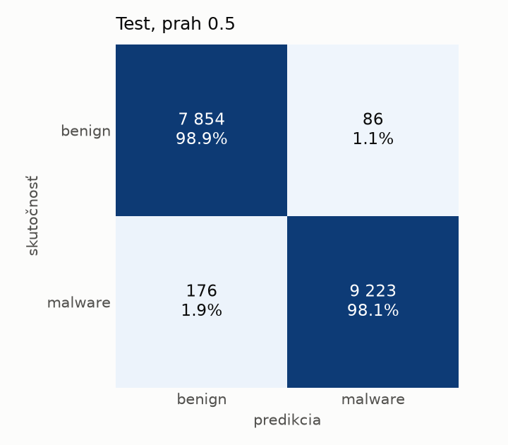
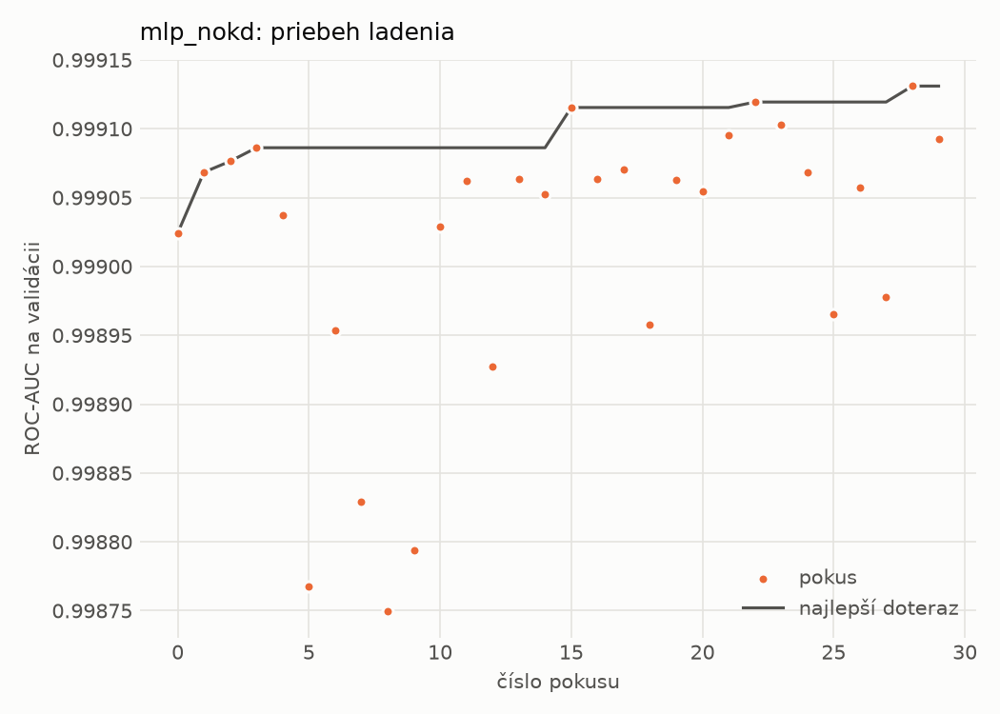
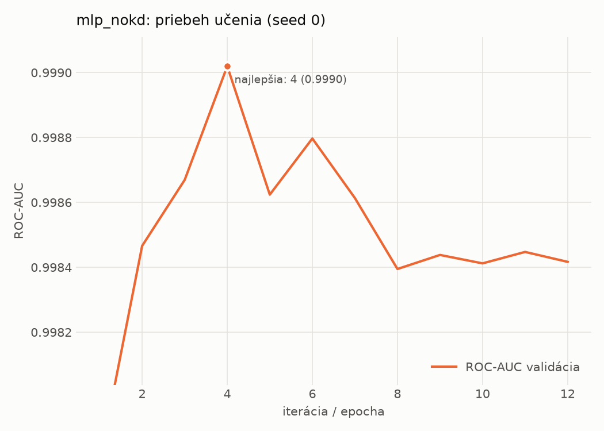

# static/mlp_nokd – beh `20261102-211710`

> Automaticky generované (`src/training/run_tabular.py`). Konfigurácia: `config.yaml`, protokol: `protocol.yaml`.

- **Model:** `mlp` – kontrola – rovnaké malé MLP bez destilácie (iba skutočné označenia)
- **Ladenie:** 30 dokončených pokusov (Optuna TPE), cieľ ROC-AUC na validácii, 1.1 min
- **Finálne modely:** seedy [0, 1, 2]; hodnoty sú priemer ± smerodajná odchýlka cez seedy
- **Najlepšie hyperparametre:** `{"hidden_layers": 1, "max_epochs": 100, "patience": 8, "hidden_width": 32, "dropout": 0.137657909519708, "lr": 0.0007042503153050794, "weight_decay": 1.207246112223234e-05, "batch_size": 512}`

## Detekčná kvalita (bez prahu)
| metrika | train (podvzorka) | validácia | test |
|---|---|---|---|
| ROC-AUC | 0.9998 ± 0.0001 | 0.9990 ± 0.0002 | 0.9973 ± 0.0001 |
| PR-AUC | 0.9999 ± 0.0001 | 0.9981 ± 0.0001 | 0.9950 ± 0.0009 |
| TPR pri FPR 1 % | 0.9968 ± 0.0015 | 0.9885 ± 0.0009 | 0.9754 ± 0.0031 |
| TPR pri FPR 0,1 % | 0.9685 ± 0.0067 | 0.9373 ± 0.0297 | 0.3684 ± 0.3860 |
| log loss | 0.0261 ± 0.0074 | 0.0357 ± 0.0067 | 0.0619 ± 0.0043 |
| Brier skóre | 0.0050 ± 0.0011 | 0.0075 ± 0.0009 | 0.0144 ± 0.0006 |

Rozdiel ROC-AUC train − validácia: **0.0007** (veľký rozdiel = preučenie).

## Pri prahu z validácie (FPR ≤ 1% na validácii)
| metrika | train (podvzorka) | validácia | test |
|---|---|---|---|
| accuracy | 0.9916 ± 0.0011 | 0.9893 ± 0.0009 | 0.9755 ± 0.0018 |
| balanced accuracy | 0.9930 ± 0.0009 | 0.9897 ± 0.0008 | 0.9769 ± 0.0017 |
| precision | 0.9987 ± 0.0002 | 0.9956 ± 0.0004 | 0.9934 ± 0.0006 |
| recall (TPR) | 0.9887 ± 0.0017 | 0.9885 ± 0.0009 | 0.9613 ± 0.0033 |
| FPR | 0.0026 ± 0.0003 | 0.0090 ± 0.0008 | 0.0076 ± 0.0007 |
| F1 | 0.9936 ± 0.0009 | 0.9920 ± 0.0006 | 0.9771 ± 0.0018 |
| MCC | 0.9812 ± 0.0025 | 0.9759 ± 0.0019 | 0.9515 ± 0.0035 |

## Pri pevnom prahu 0.5
| metrika | train (podvzorka) | validácia | test |
|---|---|---|---|
| accuracy | 0.9945 ± 0.0012 | 0.9906 ± 0.0016 | 0.9837 ± 0.0015 |
| balanced accuracy | 0.9939 ± 0.0015 | 0.9892 ± 0.0025 | 0.9841 ± 0.0013 |
| precision | 0.9961 ± 0.0012 | 0.9927 ± 0.0026 | 0.9903 ± 0.0015 |
| recall (TPR) | 0.9957 ± 0.0009 | 0.9932 ± 0.0004 | 0.9795 ± 0.0036 |
| FPR | 0.0078 ± 0.0023 | 0.0149 ± 0.0053 | 0.0114 ± 0.0018 |
| F1 | 0.9959 ± 0.0009 | 0.9930 ± 0.0012 | 0.9849 ± 0.0014 |
| MCC | 0.9877 ± 0.0027 | 0.9786 ± 0.0036 | 0.9672 ± 0.0029 |

## Výpočtové nároky (seed 0, testovacia množina)
| meranie | hodnota |
|---|---|
| tréning finálneho modelu | 2.1 s (priemer cez seedy) |
| ladenie spolu | 66 s |
| počet parametrov / uzlov | 74 337 |
| veľkosť modelu na disku | 0.36 MB |
| transformácia vstupu – latencia (1 vlákno) | 0.042 ms |
| transformácia vstupu – priepustnosť | 40 863 vzoriek/s |
| CPU latencia modelu (batch 1, 1 vlákno) | 0.069 ms (p95 0.082) |
| CPU priepustnosť (24 vlákien) | 61 957 vzoriek/s |
| GPU latencia (batch 1) | 0.287 ms (p95 0.323) |
| GPU priepustnosť | 79 741 vzoriek/s |
| GPU špičková pamäť | 1561 MB |

## Grafy
| | |
|---|---|
|  |  |
|  |  |
|  |  |
|  |  |

## Súbory
`metrics.json` (všetky metriky po seedoch vrátane rodín), `timing.json`, `hpo_trials.csv`,
`predictions/<časť>_seed<N>.parquet` (sha256, family, label, score), `model/seed_<N>/`, `log.txt`.
