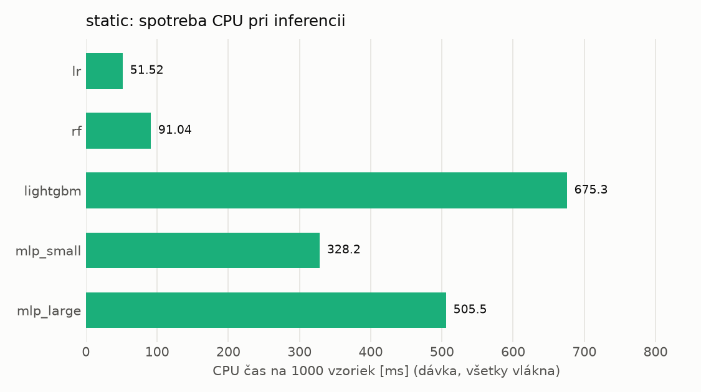
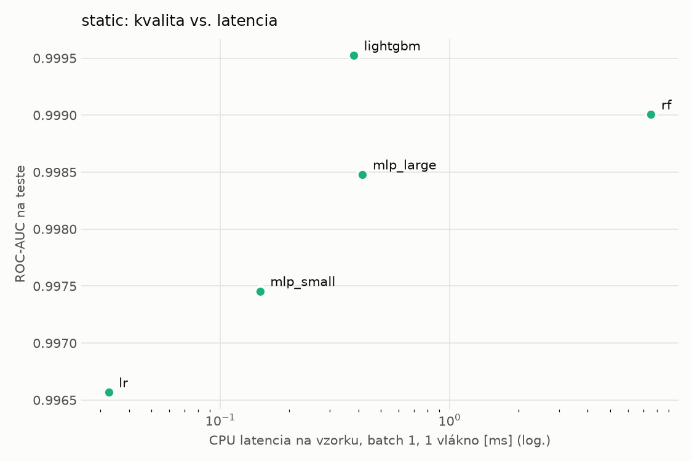
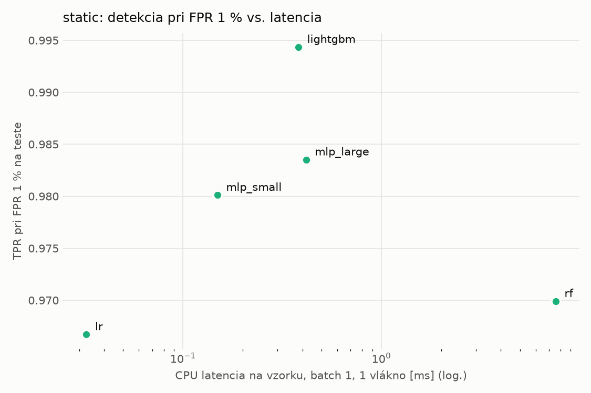
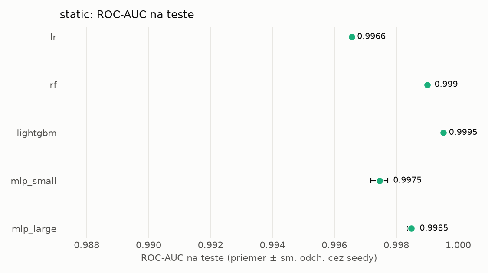
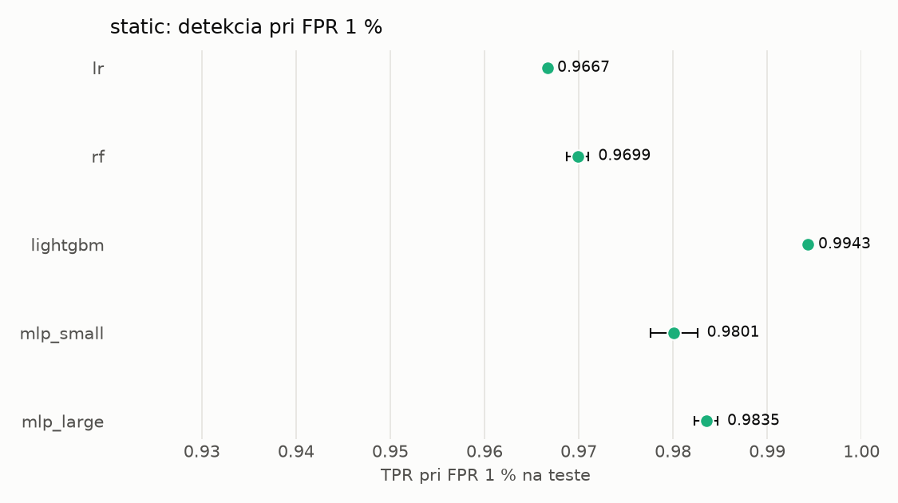

# Porovnanie modelov – static

> Generované `src/evaluation/compare.py` (2026-11-01T20:10:21+01:00); použitý je posledný beh každého modelu.
> Metriky sú priemer cez seedy. \* = pri prahu určenom na validácii (FPR ≤ 1 %).
> CPU ms/vz. = medián latencie jednej vzorky na 1 vlákne vrátane transformácie vstupu (meranie hneď po tréningu,
> orientačné). Oficiálne merania spotreby sú v časti „Spotreba zdrojov pri inferencii“.

## Detekčná kvalita a orientačné časy
| model | ROC-AUC val | ROC-AUC test | TPR@FPR 1 % test | TPR@FPR 0,1 % test | F1 test* | FPR test* | gap train−val | CPU ms/vz. | CPU vz./s | GPU ms/vz. | parametre | MB | tréning s | ladenie min |
|---|---|---|---|---|---|---|---|---|---|---|---|---|---|---|
| [lr](../../static/lr/20261101-165116/README.md) | 0.9986 | 0.9966 ± 0.0000 | 0.9667 | 0.0729 | 0.9694 | 0.0088 | 0.0010 | 0.033 | 264 788 | – | 2 320 | 0.05 | 2.3 | 1.2 |
| [rf](../../static/rf/20261101-165251/README.md) | 0.9998 | 0.9990 ± 0.0001 | 0.9699 | 0.9201 | 0.9780 | 0.0058 | 0.0002 | 7.558 | 135 849 | – | 390 428 | 31.60 | 26.2 | 14.3 |
| [lightgbm](../../static/lightgbm/20261101-170835/README.md) | 0.9998 | 0.9995 ± 0.0000 | 0.9943 | 0.9699 | 0.9900 | 0.0048 | 0.0002 | 0.382 | 31 884 | – | 648 856 | 38.04 | 372.3 | 94.2 |
| [mlp_small](../../static/mlp_small/20261101-190151/README.md) | 0.9991 | 0.9975 ± 0.0003 | 0.9801 | 0.4011 | 0.9826 | 0.0065 | 0.0008 | 0.149 | 108 900 | 0.408 | 74 881 | 0.35 | 4.0 | 2.0 |
| [mlp_large](../../static/mlp_large/20261101-190414/README.md) | 0.9994 | 0.9985 ± 0.0001 | 0.9835 | 0.8665 | 0.9861 | 0.0066 | 0.0005 | 0.417 | 39 482 | 0.638 | 3 068 673 | 12.34 | 8.7 | 3.4 |

## Nízka prevalencia malvéru (test, prah z validácie)
| model | TPR | FPR | precision @ 1 % | falošné na 1 skutočný poplach @ 1 % | precision @ 0.1 % | falošné na 1 skutočný poplach @ 0.1 % |
|---|---|---|---|---|---|---|
| lr | 0.9475 | 0.0088 | 0.521 | 0.92 | 0.097 | 9.29 |
| rf | 0.9616 | 0.0058 | 0.626 | 0.60 | 0.142 | 6.02 |
| lightgbm | 0.9843 | 0.0048 | 0.673 | 0.49 | 0.169 | 4.90 |
| mlp_small | 0.9712 | 0.0065 | 0.600 | 0.67 | 0.129 | 6.74 |
| mlp_large | 0.9781 | 0.0066 | 0.598 | 0.67 | 0.129 | 6.77 |

Prepočet: TPR a FPR nezávisia od podielu malvéru, preto sa dajú preniesť na nízku prevalenciu (v reálnej prevádzke je malvéru ~1 % alebo menej; v teste 54 %). „Falošné na 1 skutočný poplach“ = koľko neškodných súborov je označených na každý zachytený malvér.

## Spotreba zdrojov pri inferencii (benchmark, testovacia množina)
| model | CPU čas ms/vz. (dávka) | vz./s (dávka) | vyťaženie CPU % | nárast RAM MB | latencia ms (1 vz.) | p95 ms | CPU čas ms/vz. (1 vz.) | GPU vz./s | vyťaženie GPU % | GPU pamäť MB | GPU energia J/1000 vz. | |
|---|---|---|---|---|---|---|---|---|---|---|---|---|
| lr | 0.052 | 20 356 | 4.4 | 1 251 | 0.033 | 0.039 | 0.034 | – | – | – | – |  |
| rf | 0.091 | 156 515 | 59.4 | 15 | 7.237 | 7.599 | 7.234 | – | – | – | – |  |
| lightgbm | 0.675 | 32 614 | 91.8 | 1 | 0.380 | 0.537 | 0.404 | – | – | – | – |  |
| mlp_small | 0.328 | 17 578 | 24.0 | 1 240 | 0.131 | 0.148 | 0.234 | 15 889 | 4.4 | 172 | 0.15 | ⚠ |
| mlp_large | 0.506 | 14 512 | 30.6 | 1 317 | 0.374 | 0.439 | 0.608 | 17 303 | 0.9 | 249 | 0.00 |  |

- **Počítač merania:** dcatloch, 16 fyzických / 24 logických jadier, GPU NVIDIA GeForce RTX 4060 Laptop GPU.
- **CPU čas** = koľko času procesora (súčet cez jadrá) spotrebuje jedna vzorka – hlavná miera výpočtovej náročnosti.
- **vyťaženie CPU** = priemerný podiel všetkých logických jadier počítača počas dávkovej inferencie.
- **GPU energia** = energia karty nad úrovňou nečinnosti na 1000 vzoriek (iba modely na GPU).
- ⚠ = počítač bol pred meraním zaťažený; čísla môžu byť skreslené.

## Grafy

