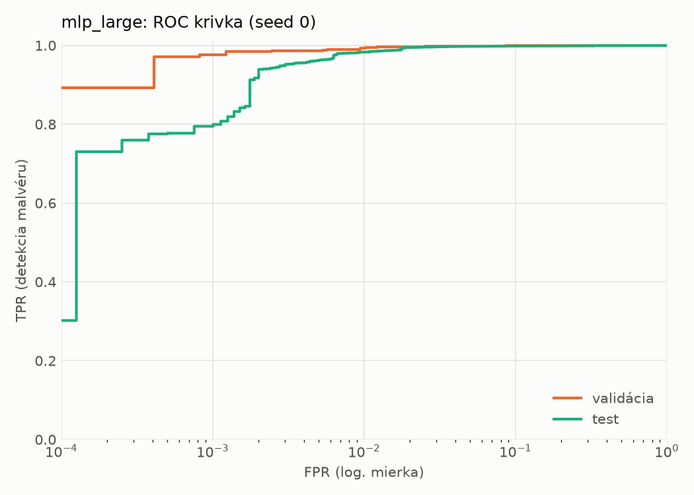
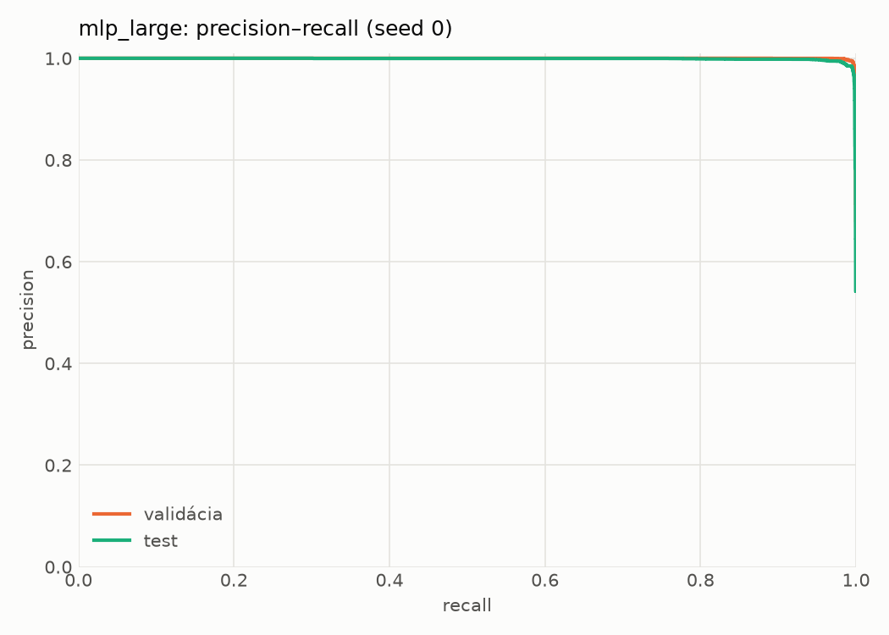
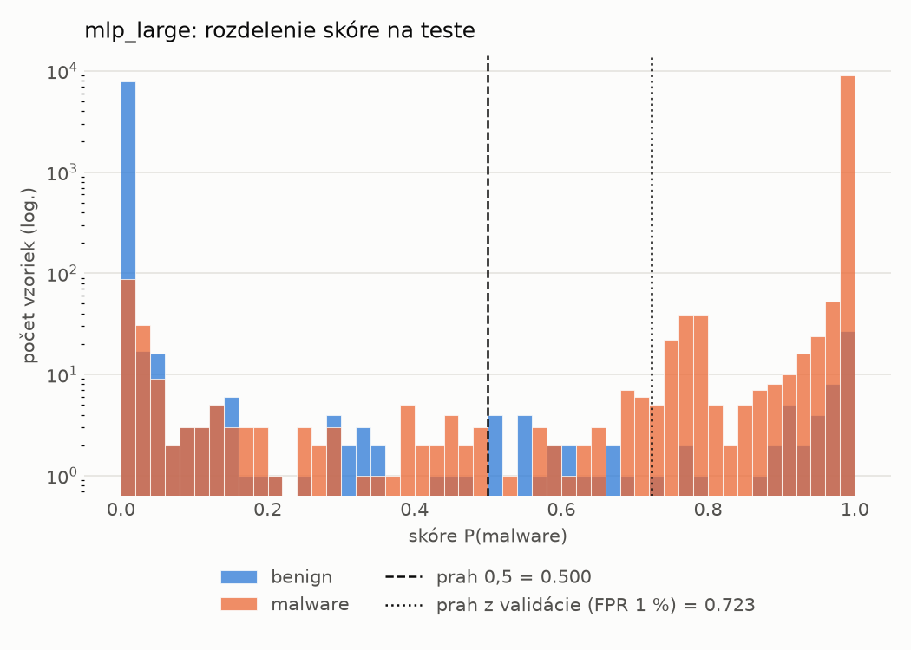
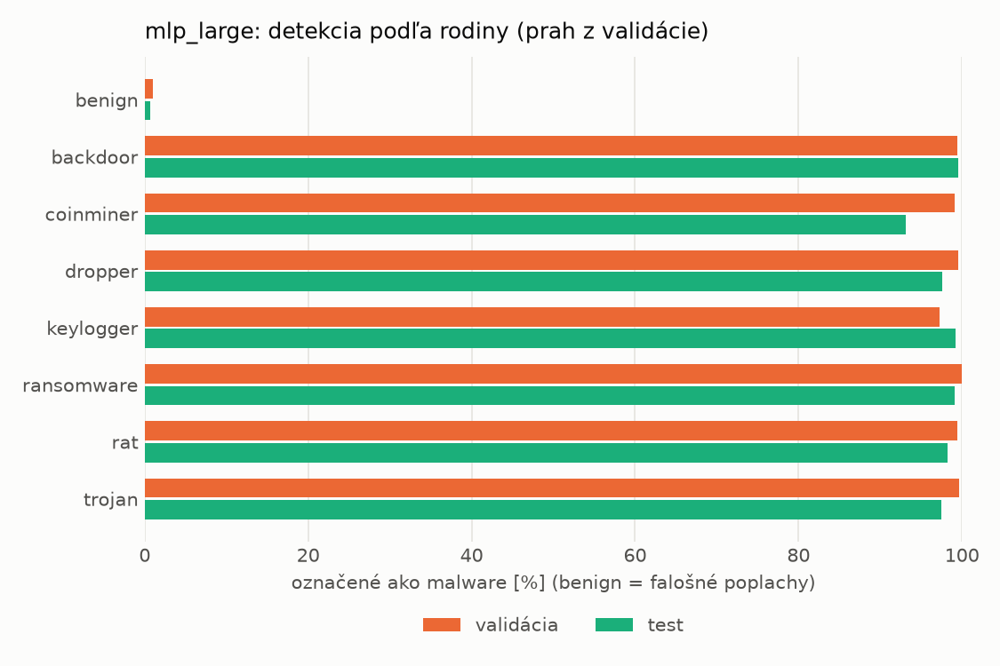
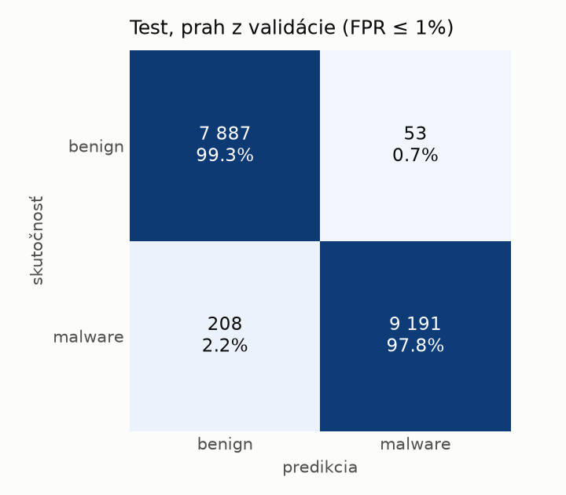
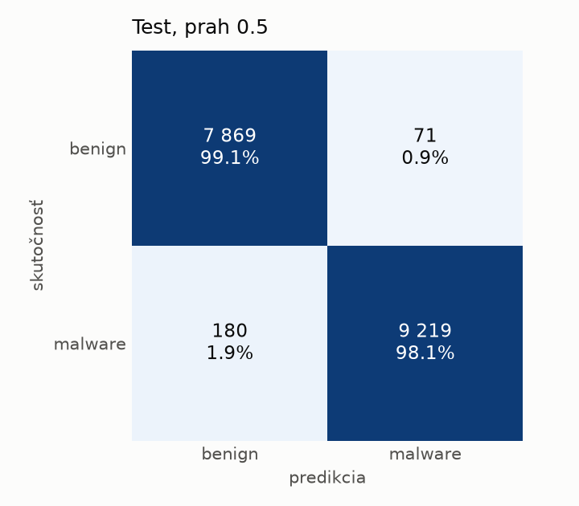
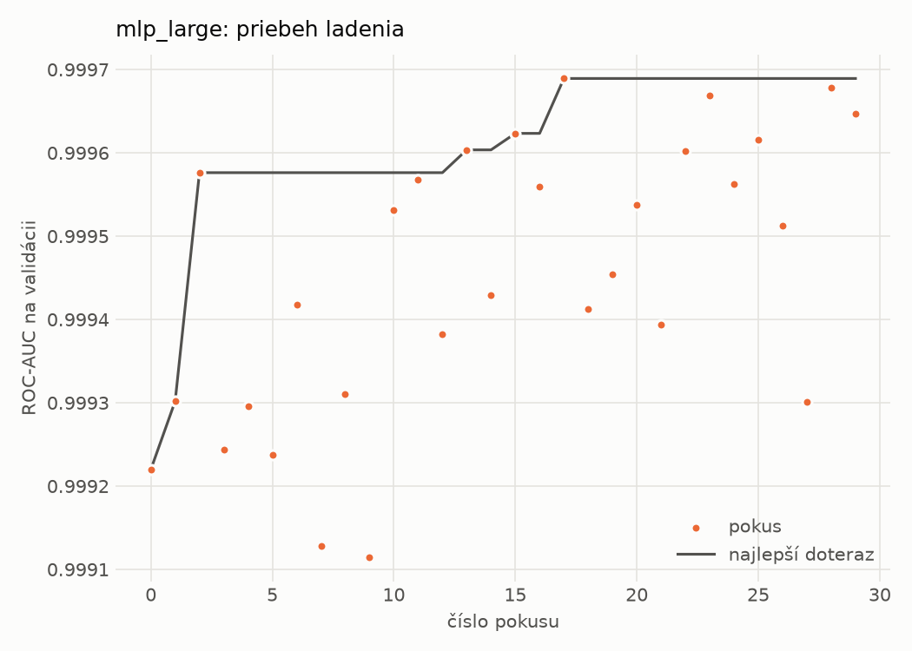
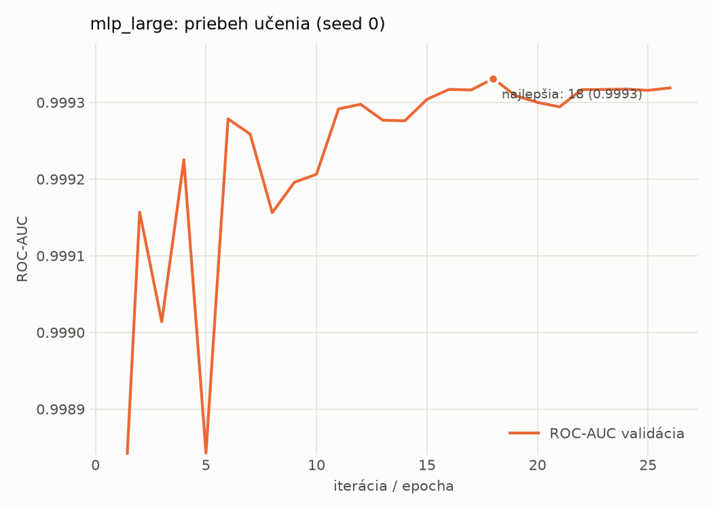

# static/mlp_large – beh `20261101-190414`

> Automaticky generované (`src/training/run_tabular.py`). Konfigurácia: `config.yaml`, protokol: `protocol.yaml`.

- **Model:** `mlp` – veľká neurónová sieť (3–5 skrytých vrstiev, 512–2048 neurónov), kandidát na učiteľa
- **Ladenie:** 30 dokončených pokusov (Optuna TPE), cieľ ROC-AUC na validácii, 3.4 min
- **Finálne modely:** seedy [0, 1, 2]; hodnoty sú priemer ± smerodajná odchýlka cez seedy
- **Najlepšie hyperparametre:** `{"max_epochs": 100, "patience": 8, "hidden_layers": 4, "hidden_width": 1024, "width_decay": 0.5, "dropout": 0.4911267053845815, "lr": 0.00017481023571283975, "weight_decay": 3.9106613009524025e-06, "batch_size": 512}`

## Detekčná kvalita (bez prahu)
| metrika | train (podvzorka) | validácia | test |
|---|---|---|---|
| ROC-AUC | 0.9999 ± 0.0000 | 0.9994 ± 0.0001 | 0.9985 ± 0.0001 |
| PR-AUC | 1.0000 ± 0.0000 | 0.9998 ± 0.0000 | 0.9989 ± 0.0001 |
| TPR pri FPR 1 % | 0.9993 ± 0.0005 | 0.9946 ± 0.0008 | 0.9835 ± 0.0012 |
| TPR pri FPR 0,1 % | 0.9872 ± 0.0013 | 0.9642 ± 0.0192 | 0.8665 ± 0.0621 |
| log loss | 0.0096 ± 0.0020 | 0.0283 ± 0.0015 | 0.0526 ± 0.0059 |
| Brier skóre | 0.0021 ± 0.0004 | 0.0061 ± 0.0002 | 0.0122 ± 0.0012 |

Rozdiel ROC-AUC train − validácia: **0.0005** (veľký rozdiel = preučenie).

## Pri prahu z validácie (FPR ≤ 1% na validácii)
| metrika | train (podvzorka) | validácia | test |
|---|---|---|---|
| accuracy | 0.9975 ± 0.0004 | 0.9934 ± 0.0007 | 0.9851 ± 0.0015 |
| balanced accuracy | 0.9973 ± 0.0004 | 0.9927 ± 0.0007 | 0.9857 ± 0.0013 |
| precision | 0.9984 ± 0.0005 | 0.9954 ± 0.0005 | 0.9943 ± 0.0010 |
| recall (TPR) | 0.9979 ± 0.0006 | 0.9946 ± 0.0008 | 0.9781 ± 0.0037 |
| FPR | 0.0032 ± 0.0011 | 0.0093 ± 0.0009 | 0.0066 ± 0.0012 |
| F1 | 0.9981 ± 0.0003 | 0.9950 ± 0.0005 | 0.9861 ± 0.0014 |
| MCC | 0.9944 ± 0.0008 | 0.9850 ± 0.0016 | 0.9702 ± 0.0029 |

## Pri pevnom prahu 0.5
| metrika | train (podvzorka) | validácia | test |
|---|---|---|---|
| accuracy | 0.9973 ± 0.0004 | 0.9931 ± 0.0001 | 0.9854 ± 0.0020 |
| balanced accuracy | 0.9966 ± 0.0005 | 0.9921 ± 0.0001 | 0.9858 ± 0.0019 |
| precision | 0.9974 ± 0.0005 | 0.9947 ± 0.0003 | 0.9927 ± 0.0003 |
| recall (TPR) | 0.9986 ± 0.0006 | 0.9951 ± 0.0005 | 0.9802 ± 0.0038 |
| FPR | 0.0053 ± 0.0010 | 0.0108 ± 0.0006 | 0.0086 ± 0.0003 |
| F1 | 0.9980 ± 0.0003 | 0.9949 ± 0.0001 | 0.9864 ± 0.0019 |
| MCC | 0.9938 ± 0.0009 | 0.9844 ± 0.0003 | 0.9707 ± 0.0040 |

## Výpočtové nároky (seed 0, testovacia množina)
| meranie | hodnota |
|---|---|
| tréning finálneho modelu | 8.7 s (priemer cez seedy) |
| ladenie spolu | 206 s |
| počet parametrov / uzlov | 3 068 673 |
| veľkosť modelu na disku | 12.34 MB |
| transformácia vstupu – latencia (1 vlákno) | 0.062 ms |
| transformácia vstupu – priepustnosť | 21 631 vzoriek/s |
| CPU latencia modelu (batch 1, 1 vlákno) | 0.355 ms (p95 0.386) |
| CPU priepustnosť (24 vlákien) | 39 482 vzoriek/s |
| GPU latencia (batch 1) | 0.638 ms (p95 1.141) |
| GPU priepustnosť | 73 208 vzoriek/s |
| GPU špičková pamäť | 1651 MB |

## Grafy
| | |
|---|---|
|  |  |
|  |  |
|  |  |
|  |  |

## Súbory
`metrics.json` (všetky metriky po seedoch vrátane rodín), `timing.json`, `hpo_trials.csv`,
`predictions/<časť>_seed<N>.parquet` (sha256, family, label, score), `model/seed_<N>/`, `log.txt`.
