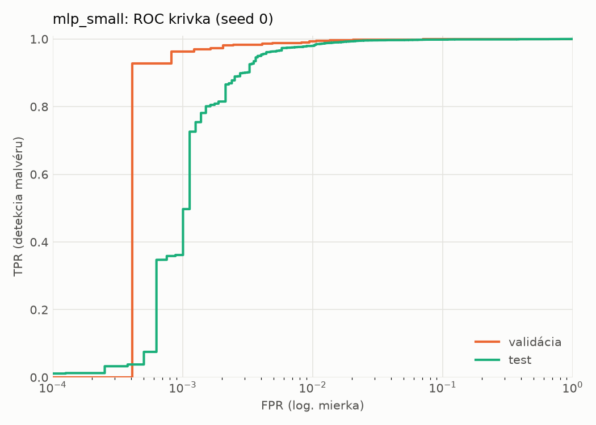
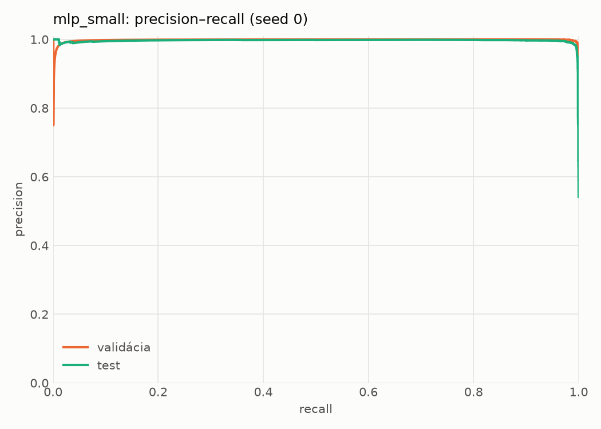
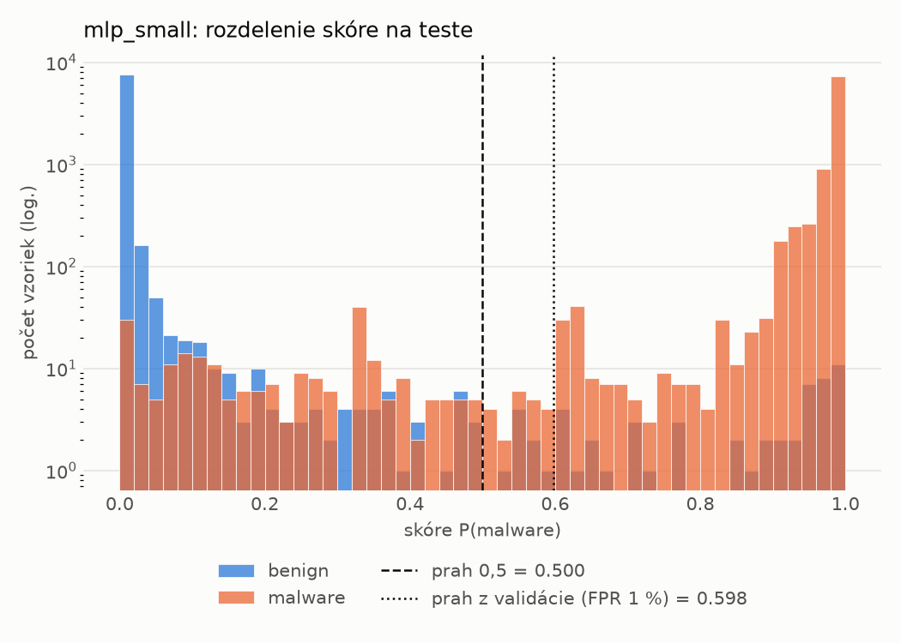
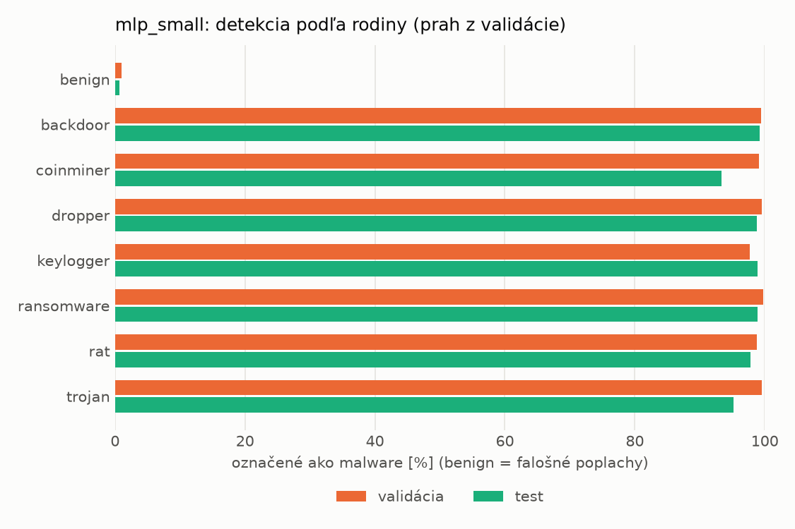
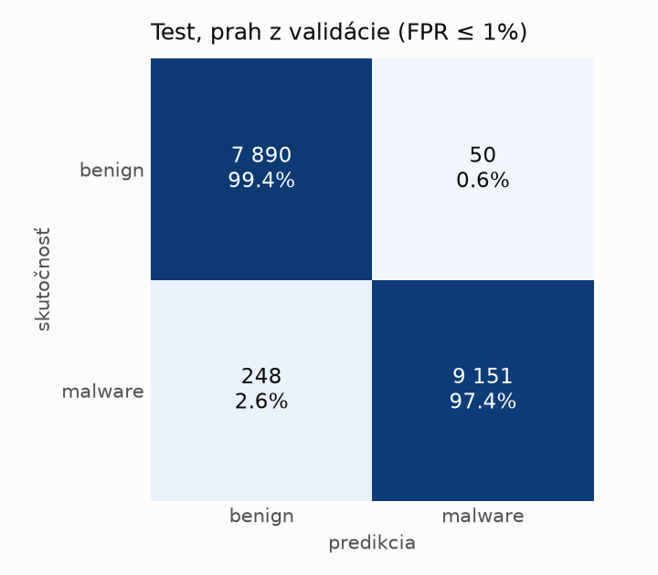
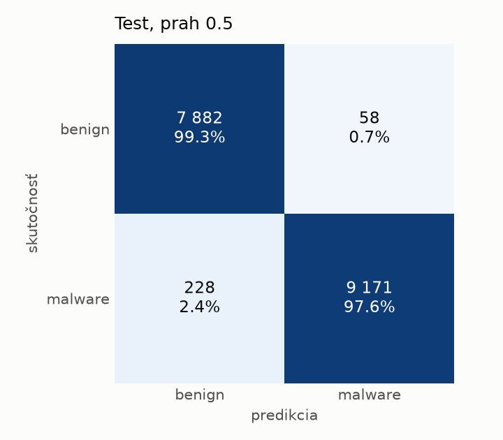
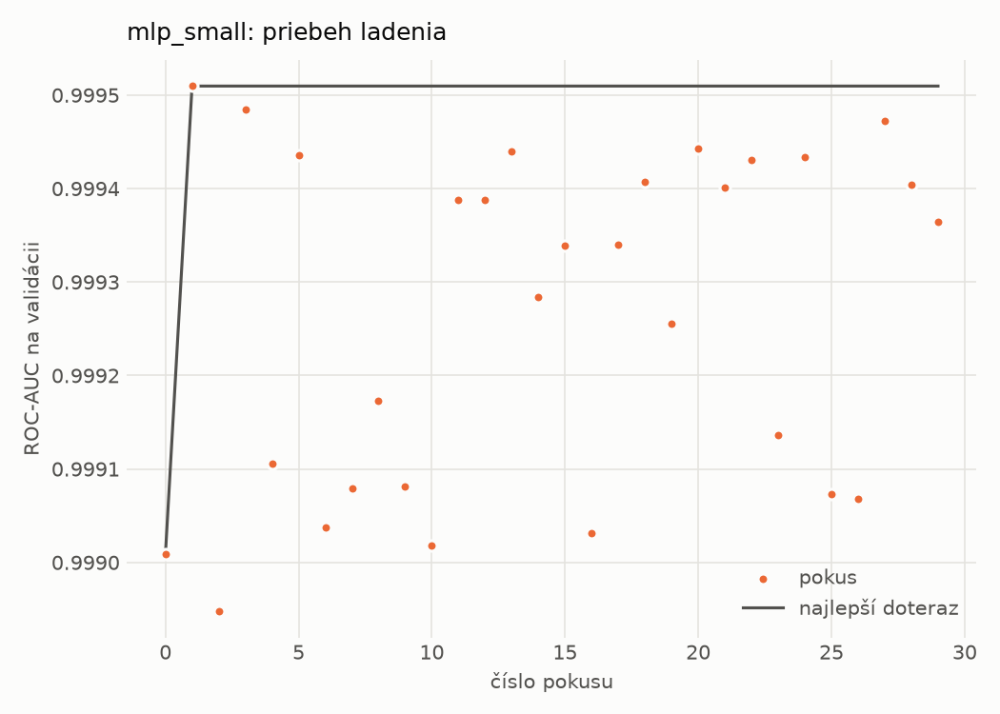
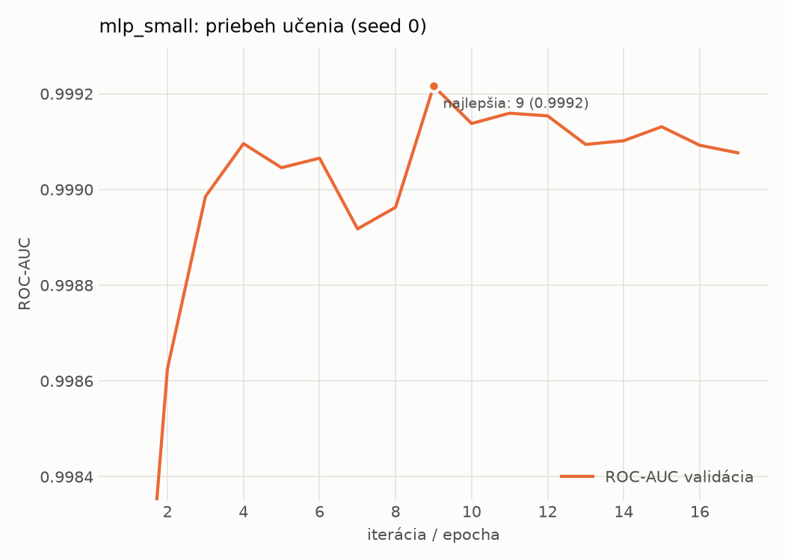

# static/mlp_small – beh `20261101-190151`

> Automaticky generované (`src/training/run_tabular.py`). Konfigurácia: `config.yaml`, protokol: `protocol.yaml`.

- **Model:** `mlp` – malá neurónová sieť (1–2 skryté vrstvy), kandidát na ľahkého študenta
- **Ladenie:** 30 dokončených pokusov (Optuna TPE), cieľ ROC-AUC na validácii, 2.0 min
- **Finálne modely:** seedy [0, 1, 2]; hodnoty sú priemer ± smerodajná odchýlka cez seedy
- **Najlepšie hyperparametre:** `{"width_decay": 0.5, "max_epochs": 100, "patience": 8, "hidden_layers": 2, "hidden_width": 32, "dropout": 0.15212112147976886, "lr": 0.0005958389350068958, "weight_decay": 5.34293726127978e-05, "batch_size": 512}`

## Detekčná kvalita (bez prahu)
| metrika | train (podvzorka) | validácia | test |
|---|---|---|---|
| ROC-AUC | 0.9999 ± 0.0001 | 0.9991 ± 0.0003 | 0.9975 ± 0.0003 |
| PR-AUC | 0.9999 ± 0.0000 | 0.9983 ± 0.0015 | 0.9954 ± 0.0022 |
| TPR pri FPR 1 % | 0.9988 ± 0.0011 | 0.9926 ± 0.0026 | 0.9801 ± 0.0025 |
| TPR pri FPR 0,1 % | 0.9876 ± 0.0066 | 0.9545 ± 0.0150 | 0.4011 ± 0.4070 |
| log loss | 0.0219 ± 0.0160 | 0.0346 ± 0.0135 | 0.0583 ± 0.0090 |
| Brier skóre | 0.0032 ± 0.0015 | 0.0066 ± 0.0010 | 0.0132 ± 0.0005 |

Rozdiel ROC-AUC train − validácia: **0.0008** (veľký rozdiel = preučenie).

## Pri prahu z validácie (FPR ≤ 1% na validácii)
| metrika | train (podvzorka) | validácia | test |
|---|---|---|---|
| accuracy | 0.9959 ± 0.0029 | 0.9918 ± 0.0017 | 0.9814 ± 0.0031 |
| balanced accuracy | 0.9960 ± 0.0021 | 0.9914 ± 0.0013 | 0.9823 ± 0.0028 |
| precision | 0.9982 ± 0.0001 | 0.9952 ± 0.0000 | 0.9943 ± 0.0009 |
| recall (TPR) | 0.9957 ± 0.0043 | 0.9926 ± 0.0026 | 0.9712 ± 0.0065 |
| FPR | 0.0036 ± 0.0003 | 0.0098 ± 0.0000 | 0.0065 ± 0.0010 |
| F1 | 0.9969 ± 0.0022 | 0.9939 ± 0.0013 | 0.9826 ± 0.0030 |
| MCC | 0.9908 ± 0.0064 | 0.9815 ± 0.0039 | 0.9629 ± 0.0060 |

## Pri pevnom prahu 0.5
| metrika | train (podvzorka) | validácia | test |
|---|---|---|---|
| accuracy | 0.9968 ± 0.0014 | 0.9924 ± 0.0008 | 0.9830 ± 0.0008 |
| balanced accuracy | 0.9963 ± 0.0015 | 0.9914 ± 0.0012 | 0.9837 ± 0.0007 |
| precision | 0.9974 ± 0.0010 | 0.9943 ± 0.0011 | 0.9930 ± 0.0013 |
| recall (TPR) | 0.9978 ± 0.0011 | 0.9944 ± 0.0002 | 0.9755 ± 0.0023 |
| FPR | 0.0052 ± 0.0020 | 0.0116 ± 0.0023 | 0.0082 ± 0.0015 |
| F1 | 0.9976 ± 0.0010 | 0.9943 ± 0.0006 | 0.9841 ± 0.0008 |
| MCC | 0.9927 ± 0.0031 | 0.9828 ± 0.0018 | 0.9659 ± 0.0015 |

## Výpočtové nároky (seed 0, testovacia množina)
| meranie | hodnota |
|---|---|
| tréning finálneho modelu | 4.0 s (priemer cez seedy) |
| ladenie spolu | 118 s |
| počet parametrov / uzlov | 74 881 |
| veľkosť modelu na disku | 0.35 MB |
| transformácia vstupu – latencia (1 vlákno) | 0.061 ms |
| transformácia vstupu – priepustnosť | 20 695 vzoriek/s |
| CPU latencia modelu (batch 1, 1 vlákno) | 0.088 ms (p95 0.125) |
| CPU priepustnosť (24 vlákien) | 108 900 vzoriek/s |
| GPU latencia (batch 1) | 0.408 ms (p95 0.454) |
| GPU priepustnosť | 59 556 vzoriek/s |
| GPU špičková pamäť | 871 MB |

## Grafy
| | |
|---|---|
|  |  |
|  |  |
|  |  |
|  |  |

## Súbory
`metrics.json` (všetky metriky po seedoch vrátane rodín), `timing.json`, `hpo_trials.csv`,
`predictions/<časť>_seed<N>.parquet` (sha256, family, label, score), `model/seed_<N>/`, `log.txt`.
