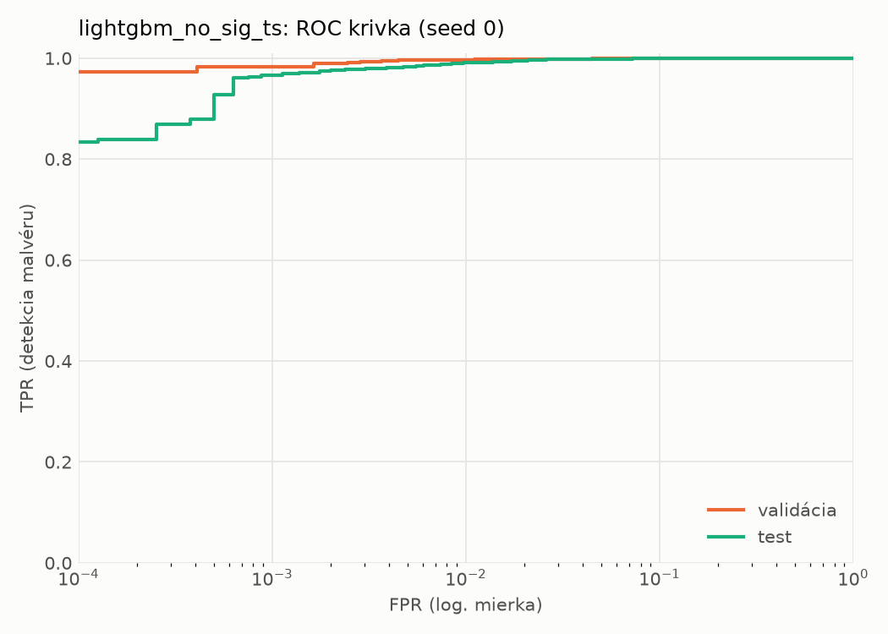
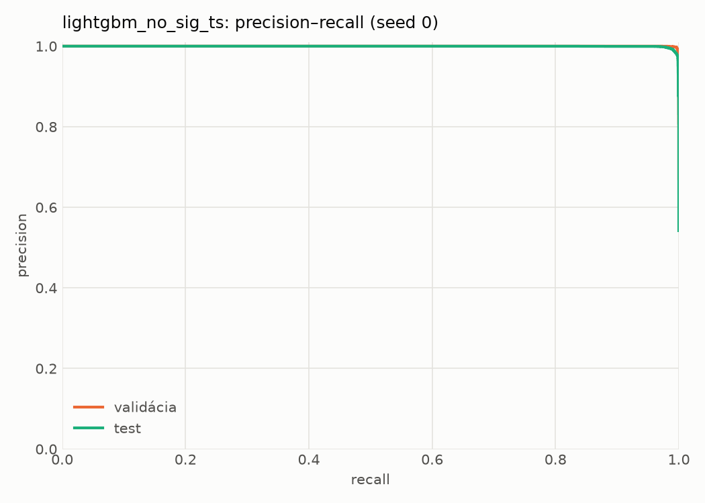
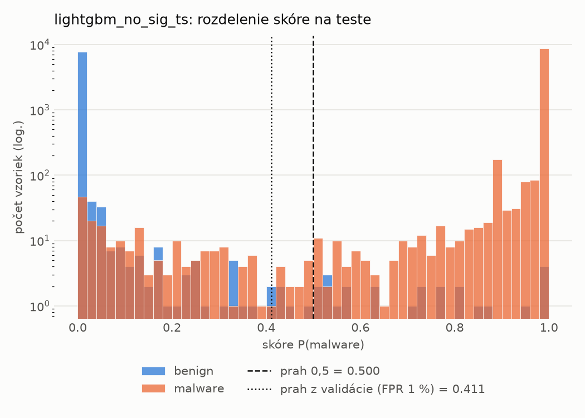
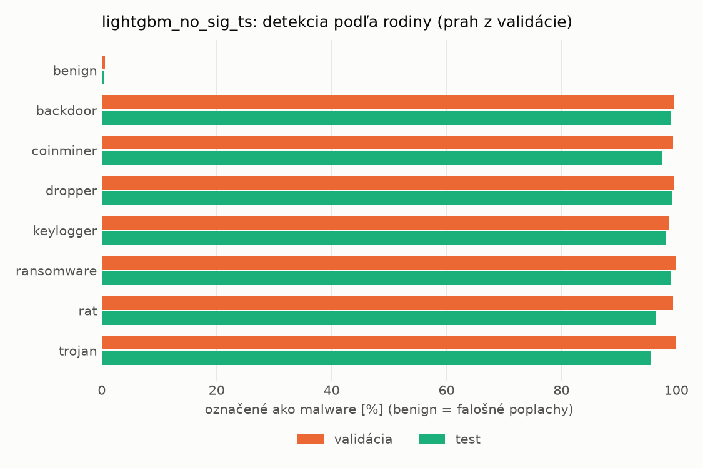
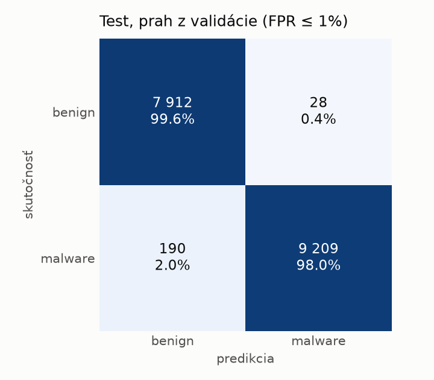
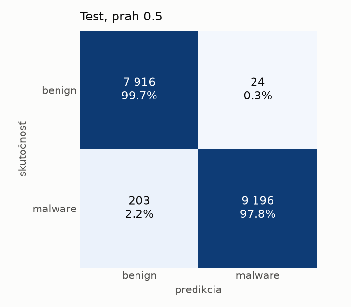
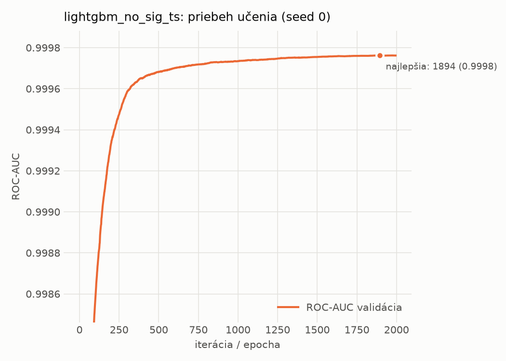

# static/lightgbm_no_sig_ts – beh `20261101-191319`

> Automaticky generované (`src/training/run_tabular.py`). Konfigurácia: `config.yaml`, protokol: `protocol.yaml`.

- **Model:** `lightgbm` – lightgbm bez príznakov podpisu a času zostavenia
- **Ladenie:** bez ladenia – hyperparametre prevzaté z `runs/static/lightgbm/20261101-170835`
- **Finálne modely:** seedy [0, 1, 2]; hodnoty sú priemer ± smerodajná odchýlka cez seedy
- **Najlepšie hyperparametre:** `{"num_boost_round": 5000, "early_stopping_rounds": 100, "learning_rate": 0.017398074711291726, "num_leaves": 461, "min_child_samples": 101, "feature_fraction": 0.9576492590949324, "bagging_fraction": 0.9474136752138245, "lambda_l1": 0.002404915432737351, "lambda_l2": 1.9809253750493907}`
- **Vynechané príznaky:** `general_has_signature`, `datadir_CERTIFICATE_TABLE_size`, `datadir_CERTIFICATE_TABLE_virtual_address`, `header_coff_timestamp`

## Detekčná kvalita (bez prahu)
| metrika | train (podvzorka) | validácia | test |
|---|---|---|---|
| ROC-AUC | 1.0000 ± 0.0000 | 0.9998 ± 0.0000 | 0.9994 ± 0.0000 |
| PR-AUC | 1.0000 ± 0.0000 | 0.9999 ± 0.0000 | 0.9996 ± 0.0000 |
| TPR pri FPR 1 % | 1.0000 ± 0.0000 | 0.9966 ± 0.0002 | 0.9907 ± 0.0002 |
| TPR pri FPR 0,1 % | 1.0000 ± 0.0000 | 0.9838 ± 0.0004 | 0.9659 ± 0.0019 |
| log loss | 0.0001 ± 0.0000 | 0.0178 ± 0.0002 | 0.0431 ± 0.0005 |
| Brier skóre | 0.0000 ± 0.0000 | 0.0039 ± 0.0000 | 0.0108 ± 0.0002 |

Rozdiel ROC-AUC train − validácia: **0.0002** (veľký rozdiel = preučenie).

## Pri prahu z validácie (FPR ≤ 1% na validácii)
| metrika | train (podvzorka) | validácia | test |
|---|---|---|---|
| accuracy | 1.0000 ± 0.0000 | 0.9949 ± 0.0007 | 0.9882 ± 0.0008 |
| balanced accuracy | 1.0000 ± 0.0000 | 0.9941 ± 0.0011 | 0.9887 ± 0.0006 |
| precision | 1.0000 ± 0.0000 | 0.9959 ± 0.0012 | 0.9958 ± 0.0010 |
| recall (TPR) | 1.0000 ± 0.0000 | 0.9966 ± 0.0002 | 0.9823 ± 0.0024 |
| FPR | 0.0000 ± 0.0000 | 0.0085 ± 0.0024 | 0.0049 ± 0.0012 |
| F1 | 1.0000 ± 0.0000 | 0.9962 ± 0.0005 | 0.9890 ± 0.0007 |
| MCC | 1.0000 ± 0.0000 | 0.9885 ± 0.0015 | 0.9763 ± 0.0015 |

## Pri pevnom prahu 0.5
| metrika | train (podvzorka) | validácia | test |
|---|---|---|---|
| accuracy | 1.0000 ± 0.0000 | 0.9956 ± 0.0002 | 0.9865 ± 0.0003 |
| balanced accuracy | 1.0000 ± 0.0000 | 0.9954 ± 0.0003 | 0.9874 ± 0.0003 |
| precision | 1.0000 ± 0.0000 | 0.9975 ± 0.0002 | 0.9975 ± 0.0002 |
| recall (TPR) | 1.0000 ± 0.0000 | 0.9959 ± 0.0003 | 0.9776 ± 0.0007 |
| FPR | 0.0000 ± 0.0000 | 0.0052 ± 0.0005 | 0.0029 ± 0.0002 |
| F1 | 1.0000 ± 0.0000 | 0.9967 ± 0.0002 | 0.9875 ± 0.0003 |
| MCC | 1.0000 ± 0.0000 | 0.9899 ± 0.0005 | 0.9732 ± 0.0006 |

## Výpočtové nároky (seed 0, testovacia množina)
| meranie | hodnota |
|---|---|
| tréning finálneho modelu | 369.8 s (priemer cez seedy) |
| ladenie spolu | 0 s |
| počet parametrov / uzlov | 611 384 |
| veľkosť modelu na disku | 35.80 MB |
| CPU latencia modelu (batch 1, 1 vlákno) | 0.347 ms (p95 0.468) |
| CPU priepustnosť (24 vlákien) | 38 447 vzoriek/s |

## Grafy
| | |
|---|---|
|  |  |
|  |  |
|  |  |
|  |  |

## Súbory
`metrics.json` (všetky metriky po seedoch vrátane rodín), `timing.json`, `hpo_trials.csv`,
`predictions/<časť>_seed<N>.parquet` (sha256, family, label, score), `model/seed_<N>/`, `log.txt`.
