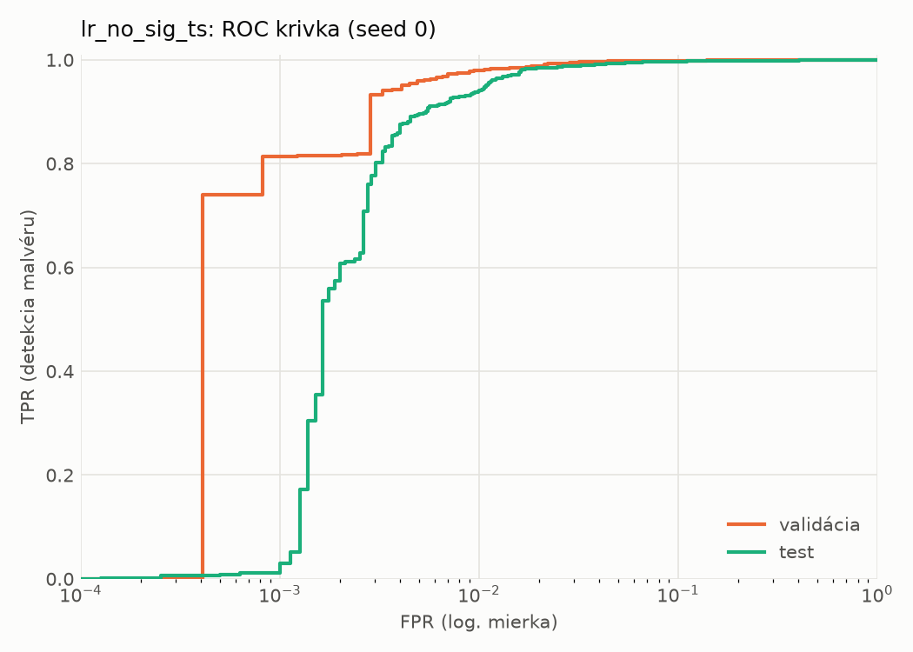
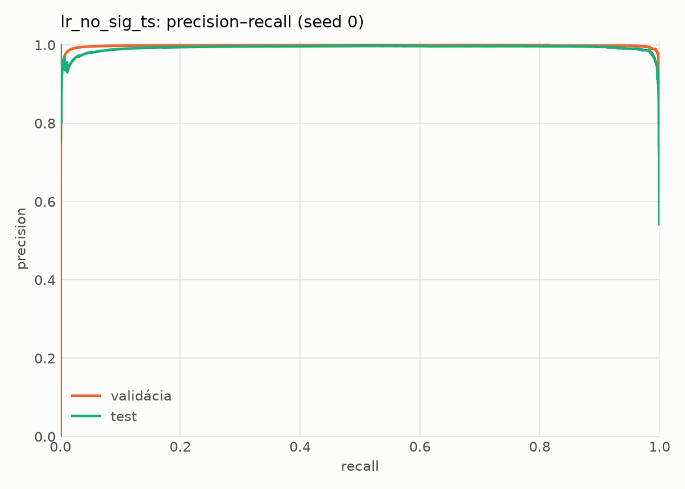
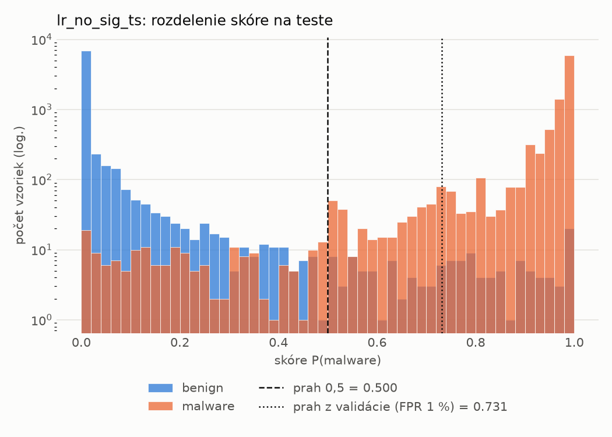
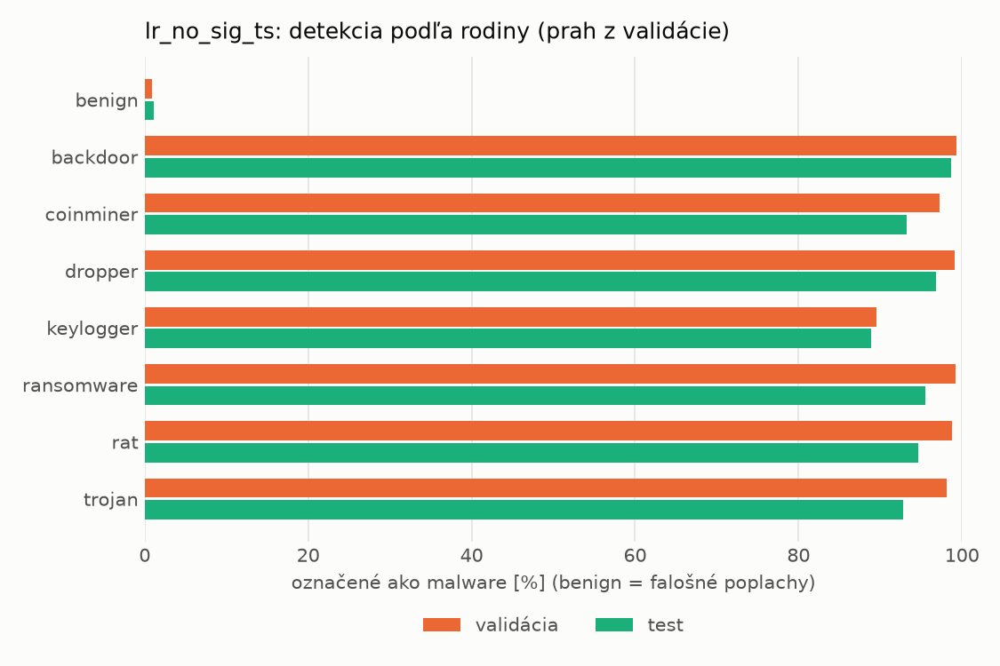
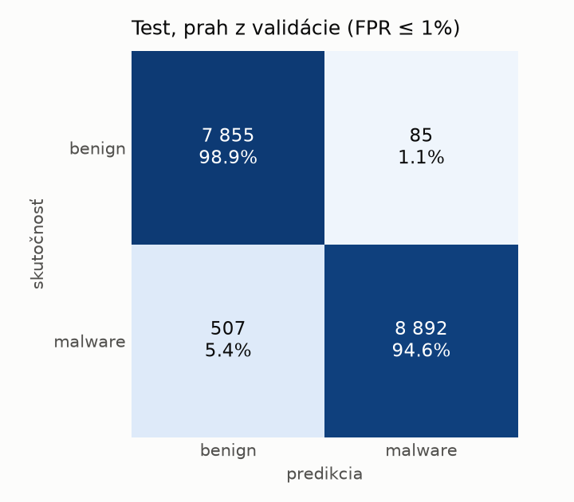
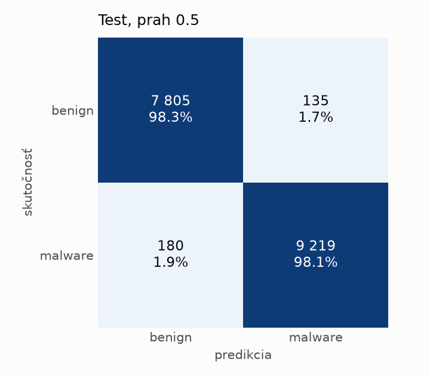

# static/lr_no_sig_ts – beh `20261101-193217`

> Automaticky generované (`src/training/run_tabular.py`). Konfigurácia: `config.yaml`, protokol: `protocol.yaml`.

- **Model:** `logreg` – lr bez príznakov podpisu a času zostavenia
- **Ladenie:** bez ladenia – hyperparametre prevzaté z `runs/static/lr/20261101-165116`
- **Finálne modely:** seedy [0, 1, 2]; hodnoty sú priemer ± smerodajná odchýlka cez seedy
- **Najlepšie hyperparametre:** `{"max_iter": 2000, "C": 0.00542318546635465}`
- **Vynechané príznaky:** `general_has_signature`, `datadir_CERTIFICATE_TABLE_size`, `datadir_CERTIFICATE_TABLE_virtual_address`, `header_coff_timestamp`

## Detekčná kvalita (bez prahu)
| metrika | train (podvzorka) | validácia | test |
|---|---|---|---|
| ROC-AUC | 0.9996 ± 0.0000 | 0.9981 ± 0.0000 | 0.9958 ± 0.0000 |
| PR-AUC | 0.9998 ± 0.0000 | 0.9978 ± 0.0000 | 0.9922 ± 0.0000 |
| TPR pri FPR 1 % | 0.9951 ± 0.0000 | 0.9799 ± 0.0000 | 0.9395 ± 0.0000 |
| TPR pri FPR 0,1 % | 0.9546 ± 0.0000 | 0.8136 ± 0.0000 | 0.0114 ± 0.0000 |
| log loss | 0.0305 ± 0.0000 | 0.0444 ± 0.0000 | 0.0736 ± 0.0000 |
| Brier skóre | 0.0070 ± 0.0000 | 0.0104 ± 0.0000 | 0.0169 ± 0.0000 |

Rozdiel ROC-AUC train − validácia: **0.0015** (veľký rozdiel = preučenie).

## Pri prahu z validácie (FPR ≤ 1% na validácii)
| metrika | train (podvzorka) | validácia | test |
|---|---|---|---|
| accuracy | 0.9856 ± 0.0000 | 0.9834 ± 0.0000 | 0.9659 ± 0.0000 |
| balanced accuracy | 0.9884 ± 0.0000 | 0.9853 ± 0.0000 | 0.9677 ± 0.0000 |
| precision | 0.9983 ± 0.0000 | 0.9953 ± 0.0000 | 0.9905 ± 0.0000 |
| recall (TPR) | 0.9801 ± 0.0000 | 0.9799 ± 0.0000 | 0.9461 ± 0.0000 |
| FPR | 0.0033 ± 0.0000 | 0.0094 ± 0.0000 | 0.0107 ± 0.0000 |
| F1 | 0.9891 ± 0.0000 | 0.9876 ± 0.0000 | 0.9678 ± 0.0000 |
| MCC | 0.9683 ± 0.0000 | 0.9630 ± 0.0000 | 0.9326 ± 0.0000 |

## Pri pevnom prahu 0.5
| metrika | train (podvzorka) | validácia | test |
|---|---|---|---|
| accuracy | 0.9929 ± 0.0000 | 0.9875 ± 0.0000 | 0.9818 ± 0.0000 |
| balanced accuracy | 0.9928 ± 0.0000 | 0.9851 ± 0.0000 | 0.9819 ± 0.0000 |
| precision | 0.9962 ± 0.0000 | 0.9894 ± 0.0000 | 0.9856 ± 0.0000 |
| recall (TPR) | 0.9931 ± 0.0000 | 0.9920 ± 0.0000 | 0.9808 ± 0.0000 |
| FPR | 0.0075 ± 0.0000 | 0.0217 ± 0.0000 | 0.0170 ± 0.0000 |
| F1 | 0.9947 ± 0.0000 | 0.9907 ± 0.0000 | 0.9832 ± 0.0000 |
| MCC | 0.9841 ± 0.0000 | 0.9716 ± 0.0000 | 0.9634 ± 0.0000 |

## Výpočtové nároky (seed 0, testovacia množina)
| meranie | hodnota |
|---|---|
| tréning finálneho modelu | 2.2 s (priemer cez seedy) |
| ladenie spolu | 0 s |
| počet parametrov / uzlov | 2 316 |
| veľkosť modelu na disku | 0.05 MB |
| transformácia vstupu – latencia (1 vlákno) | 0.026 ms |
| transformácia vstupu – priepustnosť | 22 556 vzoriek/s |
| CPU latencia modelu (batch 1, 1 vlákno) | 0.006 ms (p95 0.006) |
| CPU priepustnosť (24 vlákien) | 271 115 vzoriek/s |

## Grafy
| | |
|---|---|
|  |  |
|  |  |
|  |  |
|  |  |

## Súbory
`metrics.json` (všetky metriky po seedoch vrátane rodín), `timing.json`, `hpo_trials.csv`,
`predictions/<časť>_seed<N>.parquet` (sha256, family, label, score), `model/seed_<N>/`, `log.txt`.
