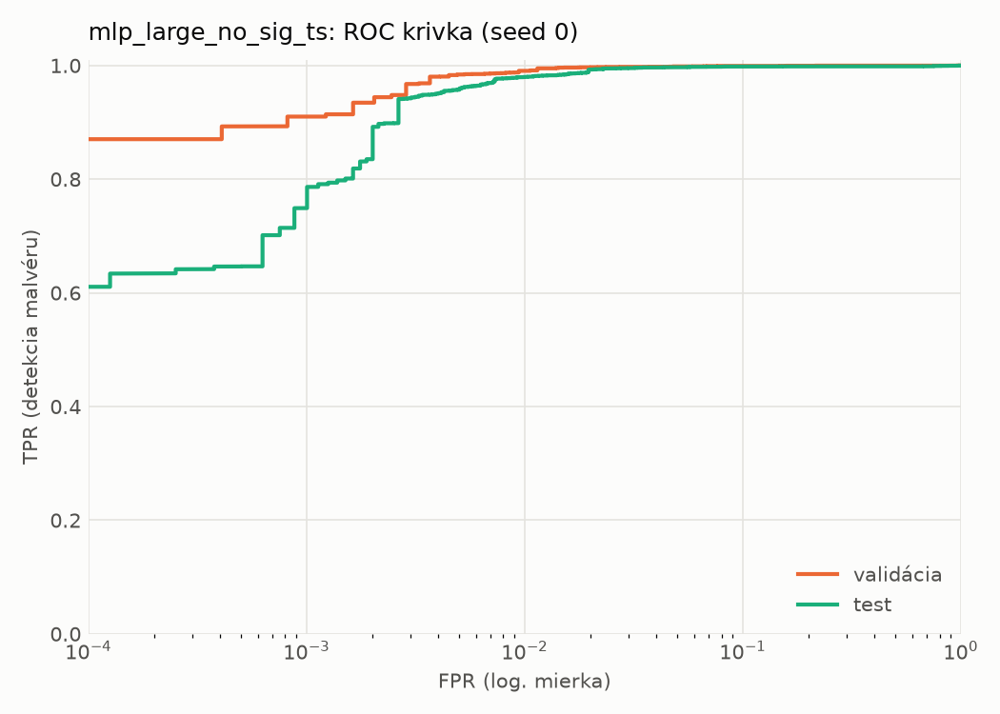
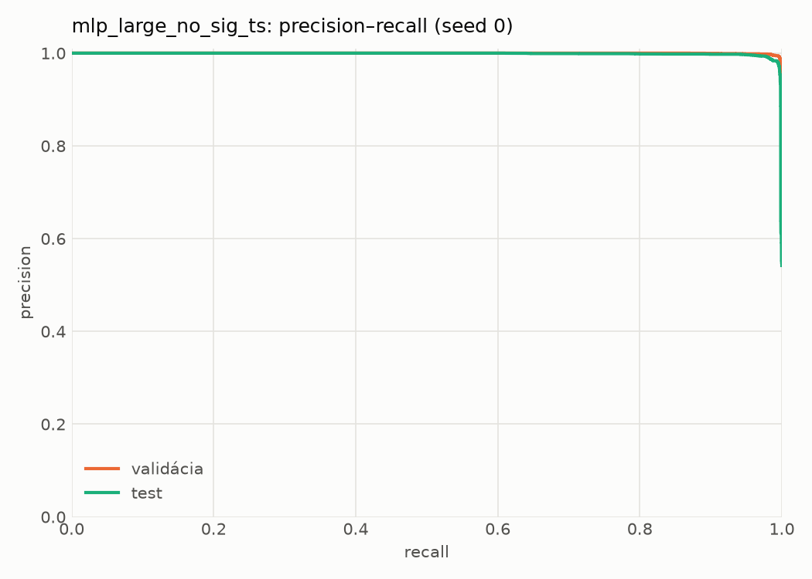
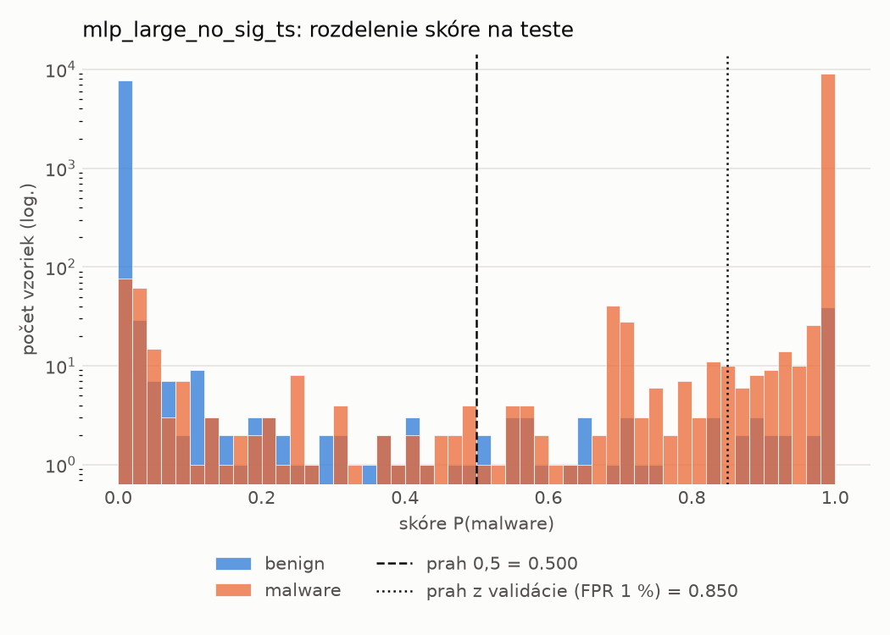
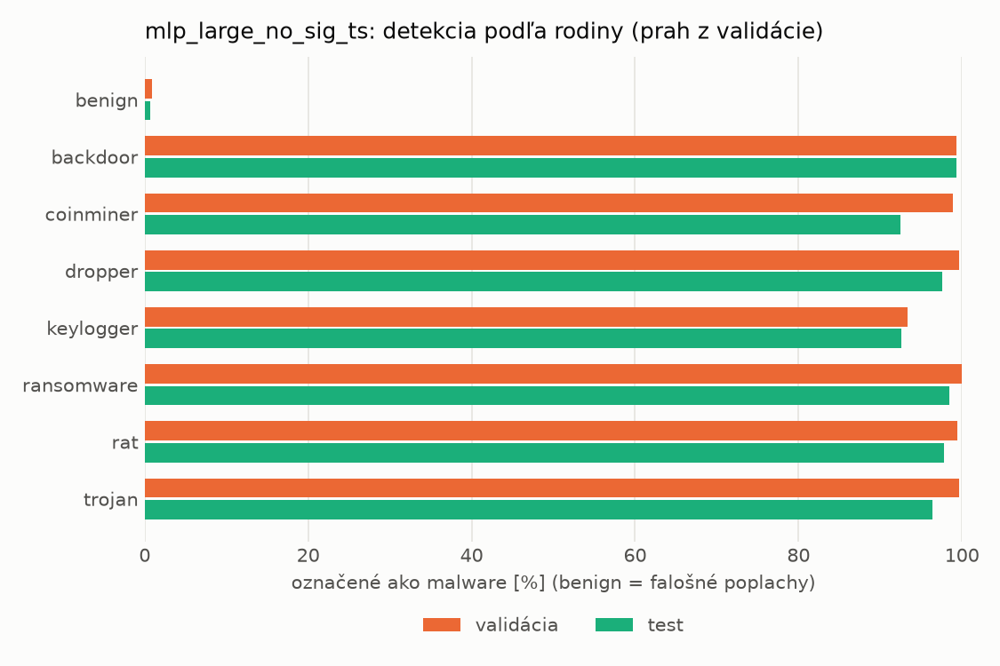
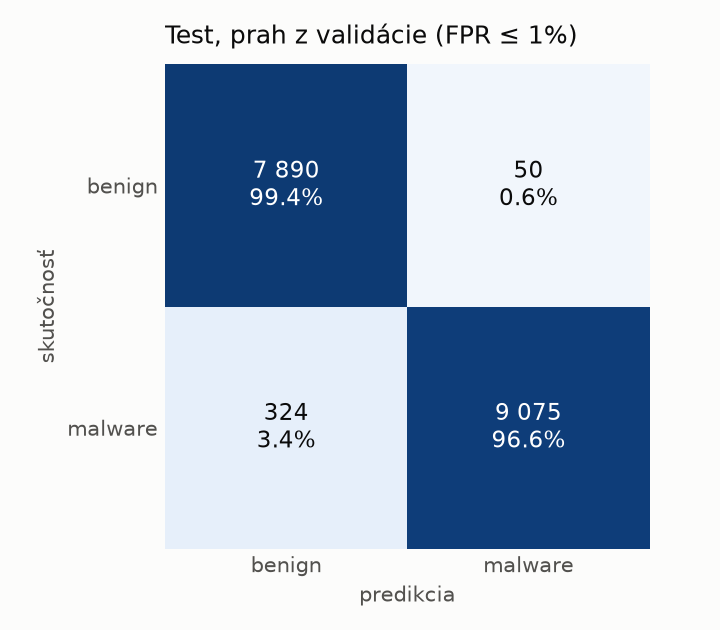
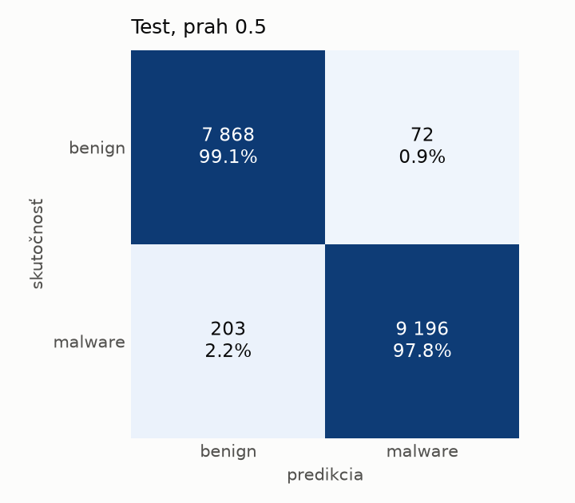
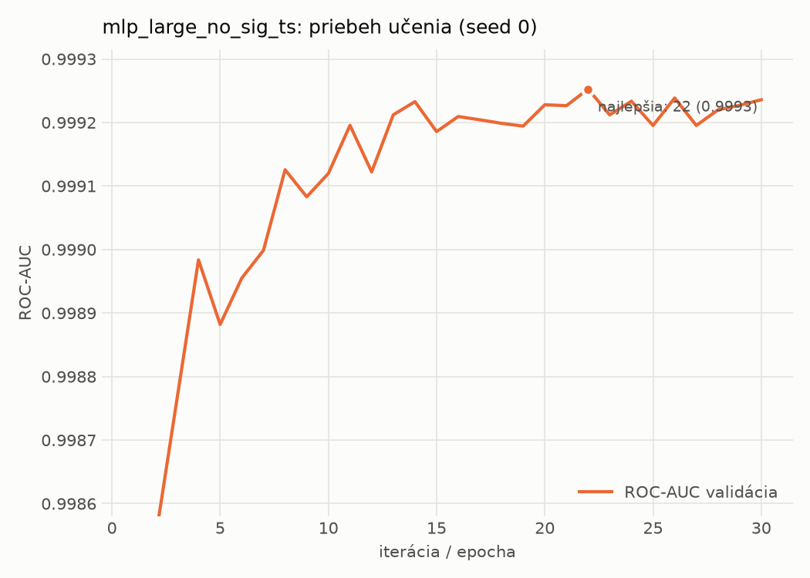

# static/mlp_large_no_sig_ts – beh `20261101-193234`

> Automaticky generované (`src/training/run_tabular.py`). Konfigurácia: `config.yaml`, protokol: `protocol.yaml`.

- **Model:** `mlp` – mlp_large bez príznakov podpisu a času zostavenia
- **Ladenie:** bez ladenia – hyperparametre prevzaté z `runs/static/mlp_large/20261101-190414`
- **Finálne modely:** seedy [0, 1, 2]; hodnoty sú priemer ± smerodajná odchýlka cez seedy
- **Najlepšie hyperparametre:** `{"max_epochs": 100, "patience": 8, "hidden_layers": 4, "hidden_width": 1024, "width_decay": 0.5, "dropout": 0.4911267053845815, "lr": 0.00017481023571283975, "weight_decay": 3.9106613009524025e-06, "batch_size": 512}`
- **Vynechané príznaky:** `general_has_signature`, `datadir_CERTIFICATE_TABLE_size`, `datadir_CERTIFICATE_TABLE_virtual_address`, `header_coff_timestamp`

## Detekčná kvalita (bez prahu)
| metrika | train (podvzorka) | validácia | test |
|---|---|---|---|
| ROC-AUC | 0.9999 ± 0.0001 | 0.9992 ± 0.0001 | 0.9977 ± 0.0001 |
| PR-AUC | 0.9999 ± 0.0000 | 0.9996 ± 0.0001 | 0.9984 ± 0.0000 |
| TPR pri FPR 1 % | 0.9986 ± 0.0013 | 0.9903 ± 0.0014 | 0.9774 ± 0.0021 |
| TPR pri FPR 0,1 % | 0.9864 ± 0.0052 | 0.9068 ± 0.0316 | 0.7915 ± 0.0440 |
| log loss | 0.0133 ± 0.0048 | 0.0330 ± 0.0023 | 0.0625 ± 0.0058 |
| Brier skóre | 0.0033 ± 0.0011 | 0.0073 ± 0.0004 | 0.0144 ± 0.0004 |

Rozdiel ROC-AUC train − validácia: **0.0007** (veľký rozdiel = preučenie).

## Pri prahu z validácie (FPR ≤ 1% na validácii)
| metrika | train (podvzorka) | validácia | test |
|---|---|---|---|
| accuracy | 0.9936 ± 0.0014 | 0.9903 ± 0.0009 | 0.9785 ± 0.0017 |
| balanced accuracy | 0.9946 ± 0.0012 | 0.9904 ± 0.0006 | 0.9796 ± 0.0016 |
| precision | 0.9989 ± 0.0004 | 0.9953 ± 0.0001 | 0.9940 ± 0.0006 |
| recall (TPR) | 0.9915 ± 0.0020 | 0.9903 ± 0.0014 | 0.9661 ± 0.0029 |
| FPR | 0.0022 ± 0.0009 | 0.0096 ± 0.0002 | 0.0069 ± 0.0007 |
| F1 | 0.9952 ± 0.0011 | 0.9928 ± 0.0007 | 0.9799 ± 0.0016 |
| MCC | 0.9856 ± 0.0032 | 0.9782 ± 0.0020 | 0.9572 ± 0.0034 |

## Pri pevnom prahu 0.5
| metrika | train (podvzorka) | validácia | test |
|---|---|---|---|
| accuracy | 0.9960 ± 0.0016 | 0.9915 ± 0.0007 | 0.9833 ± 0.0008 |
| balanced accuracy | 0.9956 ± 0.0015 | 0.9903 ± 0.0004 | 0.9838 ± 0.0008 |
| precision | 0.9973 ± 0.0007 | 0.9936 ± 0.0003 | 0.9913 ± 0.0010 |
| recall (TPR) | 0.9967 ± 0.0018 | 0.9938 ± 0.0013 | 0.9777 ± 0.0011 |
| FPR | 0.0054 ± 0.0014 | 0.0131 ± 0.0007 | 0.0102 ± 0.0012 |
| F1 | 0.9970 ± 0.0012 | 0.9937 ± 0.0005 | 0.9844 ± 0.0007 |
| MCC | 0.9910 ± 0.0035 | 0.9808 ± 0.0015 | 0.9664 ± 0.0016 |

## Výpočtové nároky (seed 0, testovacia množina)
| meranie | hodnota |
|---|---|
| tréning finálneho modelu | 9.0 s (priemer cez seedy) |
| ladenie spolu | 0 s |
| počet parametrov / uzlov | 3 064 577 |
| veľkosť modelu na disku | 12.32 MB |
| transformácia vstupu – latencia (1 vlákno) | 0.027 ms |
| transformácia vstupu – priepustnosť | 22 435 vzoriek/s |
| CPU latencia modelu (batch 1, 1 vlákno) | 0.325 ms (p95 0.371) |
| CPU priepustnosť (24 vlákien) | 41 610 vzoriek/s |
| GPU latencia (batch 1) | 0.593 ms (p95 1.100) |
| GPU priepustnosť | 74 454 vzoriek/s |
| GPU špičková pamäť | 958 MB |

## Grafy
| | |
|---|---|
|  |  |
|  |  |
|  |  |
|  |  |

## Súbory
`metrics.json` (všetky metriky po seedoch vrátane rodín), `timing.json`, `hpo_trials.csv`,
`predictions/<časť>_seed<N>.parquet` (sha256, family, label, score), `model/seed_<N>/`, `log.txt`.
