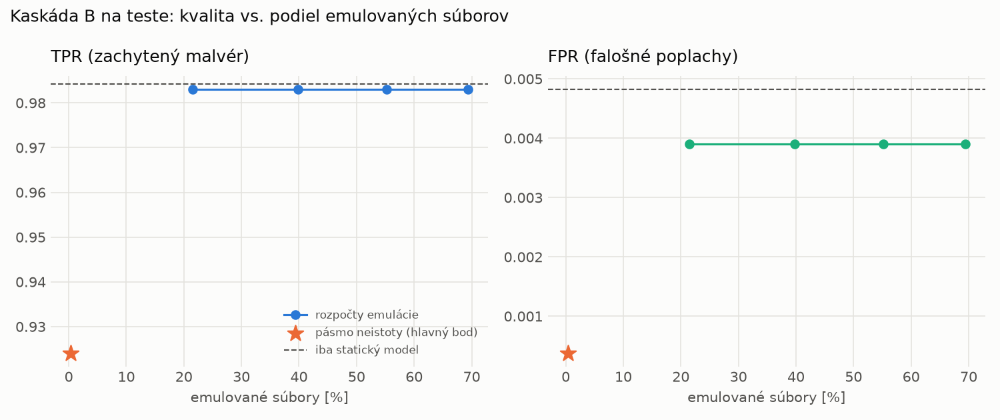

# Kaskáda B `b_baselines` – beh `20261103-211106`

> Generované `src/cascade/evaluate_b.py` (2026-11-03T21:11:06+01:00). Seedy: [0, 1, 2]; hodnoty = priemer ± sm. odchýlka.
> Všetky prahy a pásmo neistoty sú z validácie; test sa na nič nenastavuje. Postup: `docs/09_plan_v2.md`.

| rola | beh |
|---|---|
| static | `runs_final/static/lightgbm/20261101-215345` |
| dynamic | `runs_final/dynamic/lightgbm/20261102-003953` |
| hybrid | `runs_final/hybrid/lightgbm/20261102-052826` |

Druhý stupeň: **dynamic**. Pásmo neistoty statického modelu: FPR ≤ 0.1% nad `hi`,
najviac 1% malvéru validácie pod `lo` (seed 0: lo = 0.9739, hi = 0.9814, seed 1: lo = 0.9785, hi = 0.9785, seed 2: lo = 0.9764, hi = 0.9817).

## Test
| prístup | accuracy | balanced_accuracy | precision | recall_tpr | fpr | f1 | mcc |
|---|---|---|---|---|---|---|---|
| kaskáda B | 0.9587 ± 0.0013 | 0.9618 ± 0.0012 | 0.9997 ± 0.0000 | 0.9241 ± 0.0024 | 0.0004 ± 0.0000 | 0.9604 ± 0.0013 | 0.9204 ± 0.0024 |
| statický | 0.9893 ± 0.0003 | 0.9897 ± 0.0003 | 0.9959 ± 0.0002 | 0.9843 ± 0.0004 | 0.0048 ± 0.0002 | 0.9900 ± 0.0003 | 0.9785 ± 0.0006 |
| dynamický | 0.8051 ± 0.0016 | 0.8187 ± 0.0012 | 0.9752 ± 0.0055 | 0.6572 ± 0.0069 | 0.0198 ± 0.0046 | 0.7852 ± 0.0032 | 0.6595 ± 0.0004 |
| hybrid (každá vzorka) | 0.9893 ± 0.0018 | 0.9898 ± 0.0017 | 0.9960 ± 0.0001 | 0.9842 ± 0.0036 | 0.0047 ± 0.0002 | 0.9901 ± 0.0017 | 0.9785 ± 0.0037 |

- **emulované súbory: 0.35%** (ostatné rozhodne iba statický model); na hybrid ide 0.03% súborov
- chyby pri istom rozhodnutí statického modelu (seed 0): 695
- validácia: emulované 0.03%, na hybrid 0.02%

## Validácia
| prístup | accuracy | balanced_accuracy | precision | recall_tpr | fpr | f1 | mcc |
|---|---|---|---|---|---|---|---|
| kaskáda B | 0.9931 ± 0.0002 | 0.9946 ± 0.0002 | 0.9995 ± 0.0001 | 0.9903 ± 0.0002 | 0.0011 ± 0.0002 | 0.9949 ± 0.0002 | 0.9846 ± 0.0005 |
| statický | 0.9956 ± 0.0001 | 0.9945 ± 0.0001 | 0.9957 ± 0.0001 | 0.9978 ± 0.0000 | 0.0089 ± 0.0002 | 0.9967 ± 0.0001 | 0.9900 ± 0.0002 |
| dynamický | 0.9671 ± 0.0013 | 0.9729 ± 0.0010 | 0.9950 ± 0.0000 | 0.9557 ± 0.0020 | 0.0098 ± 0.0000 | 0.9750 ± 0.0010 | 0.9285 ± 0.0027 |
| hybrid (každá vzorka) | 0.9948 ± 0.0004 | 0.9938 ± 0.0004 | 0.9955 ± 0.0003 | 0.9968 ± 0.0005 | 0.0091 ± 0.0006 | 0.9962 ± 0.0003 | 0.9883 ± 0.0009 |

## Krivka rozpočtu emulácie (test, priemer cez seedy)
| budget_val | emulation_rate | hybrid_rate | recall_tpr | fpr | f1 |
|---|---|---|---|---|---|
| 0.1000 | 0.2150 | 0.0441 | 0.9831 | 0.0039 | 0.9898 |
| 0.2000 | 0.3977 | 0.0871 | 0.9831 | 0.0039 | 0.9898 |
| 0.3000 | 0.5522 | 0.1027 | 0.9831 | 0.0039 | 0.9898 |
| 0.4000 | 0.6938 | 0.1214 | 0.9831 | 0.0039 | 0.9898 |

## Výpočtové nároky
Emulácia (Speakeasy) sa nedá zmerať (dataset neobsahuje PE súbory). **Predpoklad** 60 s na súbor
(limit z `speakeasy-config.json`): kaskáda B ≈ 0.2 s na súbor v priemere, dynamický/hybridný model
a kaskáda A 60 s (emulujú každý súbor).

| meranie | statický | dynamický | hybrid na každej vzorke | kaskáda B (odhad) |
|---|---|---|---|---|
| CPU čas ms/vz. (dávka) | 0.6786 | 0.4269 | 0.0858 | 0.6801 |
| CPU čas ms/vz. (1 vz.) | 0.3978 | 0.2396 | 0.0422 | 0.3987 |

