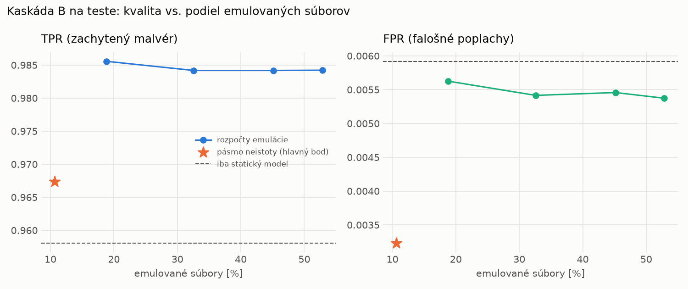

# Kaskáda B `b_direct` – beh `20261103-211102`

> Generované `src/cascade/evaluate_b.py` (2026-11-03T21:11:02+01:00). Seedy: [0, 1, 2]; hodnoty = priemer ± sm. odchýlka.
> Všetky prahy a pásmo neistoty sú z validácie; test sa na nič nenastavuje. Postup: `docs/09_plan_v2.md`.

| rola | beh |
|---|---|
| static | `runs_final/students_static/mlp_kd/20261102-211333` |
| hybrid | `runs_final/hybrid/lightgbm/20261102-052826` |

Druhý stupeň: **hybrid**. Pásmo neistoty statického modelu: FPR ≤ 0.1% nad `hi`,
najviac 1% malvéru validácie pod `lo` (seed 0: lo = 0.6267, hi = 0.9987, seed 1: lo = 0.5575, hi = 0.9979, seed 2: lo = 0.6295, hi = 0.9991).

## Test
| prístup | accuracy | balanced_accuracy | precision | recall_tpr | fpr | f1 | mcc |
|---|---|---|---|---|---|---|---|
| kaskáda B | 0.9808 ± 0.0010 | 0.9821 ± 0.0009 | 0.9972 ± 0.0002 | 0.9674 ± 0.0016 | 0.0032 ± 0.0003 | 0.9821 ± 0.0009 | 0.9620 ± 0.0019 |
| statický | 0.9746 ± 0.0052 | 0.9761 ± 0.0048 | 0.9948 ± 0.0003 | 0.9581 ± 0.0097 | 0.0059 ± 0.0003 | 0.9761 ± 0.0050 | 0.9497 ± 0.0099 |
| hybrid (každá vzorka) | 0.9893 ± 0.0018 | 0.9898 ± 0.0017 | 0.9960 ± 0.0001 | 0.9842 ± 0.0036 | 0.0047 ± 0.0002 | 0.9901 ± 0.0017 | 0.9785 ± 0.0037 |

- **emulované súbory: 10.65%** (ostatné rozhodne iba statický model); na hybrid ide 10.65% súborov
- chyby pri istom rozhodnutí statického modelu (seed 0): 268
- validácia: emulované 3.93%, na hybrid 3.93%

## Validácia
| prístup | accuracy | balanced_accuracy | precision | recall_tpr | fpr | f1 | mcc |
|---|---|---|---|---|---|---|---|
| kaskáda B | 0.9913 ± 0.0005 | 0.9923 ± 0.0006 | 0.9975 ± 0.0004 | 0.9896 ± 0.0003 | 0.0051 ± 0.0009 | 0.9935 ± 0.0004 | 0.9805 ± 0.0011 |
| statický | 0.9889 ± 0.0002 | 0.9893 ± 0.0003 | 0.9954 ± 0.0003 | 0.9881 ± 0.0002 | 0.0094 ± 0.0007 | 0.9917 ± 0.0002 | 0.9750 ± 0.0005 |
| hybrid (každá vzorka) | 0.9948 ± 0.0004 | 0.9938 ± 0.0004 | 0.9955 ± 0.0003 | 0.9968 ± 0.0005 | 0.0091 ± 0.0006 | 0.9962 ± 0.0003 | 0.9883 ± 0.0009 |

## Krivka rozpočtu emulácie (test, priemer cez seedy)
| budget_val | emulation_rate | hybrid_rate | recall_tpr | fpr | f1 |
|---|---|---|---|---|---|
| 0.1000 | 0.1881 | 0.1881 | 0.9856 | 0.0056 | 0.9904 |
| 0.2000 | 0.3259 | 0.3259 | 0.9842 | 0.0054 | 0.9897 |
| 0.3000 | 0.4514 | 0.4514 | 0.9842 | 0.0055 | 0.9897 |
| 0.4000 | 0.5285 | 0.5285 | 0.9842 | 0.0054 | 0.9898 |

## Výpočtové nároky
Emulácia (Speakeasy) sa nedá zmerať (dataset neobsahuje PE súbory). **Predpoklad** 60 s na súbor
(limit z `speakeasy-config.json`): kaskáda B ≈ 6.4 s na súbor v priemere, dynamický/hybridný model
a kaskáda A 60 s (emulujú každý súbor).

| meranie | statický | hybrid na každej vzorke | kaskáda B (odhad) |
|---|---|---|---|
| CPU čas ms/vz. (dávka) | 0.3037 | 0.0858 | 0.3128 |
| CPU čas ms/vz. (1 vz.) | 0.1800 | 0.0422 | 0.1845 |

