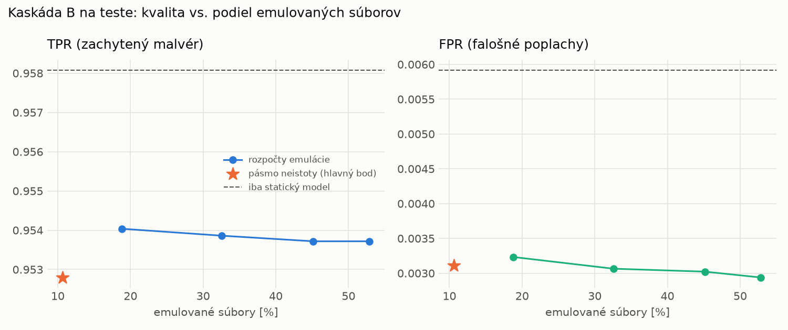

# Kaskáda B `b_heavy` – beh `20261103-211104`

> Generované `src/cascade/evaluate_b.py` (2026-11-03T21:11:04+01:00). Seedy: [0, 1, 2]; hodnoty = priemer ± sm. odchýlka.
> Všetky prahy a pásmo neistoty sú z validácie; test sa na nič nenastavuje. Postup: `docs/09_plan_v2.md`.

| rola | beh |
|---|---|
| static | `runs_final/students_static/mlp_kd/20261102-211333` |
| dynamic | `runs_final/students_dynamic/mlp_kd/20261102-212132` |
| hybrid | `runs_final/hybrid/two_branch/20261102-170657` |

Druhý stupeň: **dynamic**. Pásmo neistoty statického modelu: FPR ≤ 0.1% nad `hi`,
najviac 1% malvéru validácie pod `lo` (seed 0: lo = 0.6267, hi = 0.9987, seed 1: lo = 0.5575, hi = 0.9979, seed 2: lo = 0.6295, hi = 0.9991).

## Test
| prístup | accuracy | balanced_accuracy | precision | recall_tpr | fpr | f1 | mcc |
|---|---|---|---|---|---|---|---|
| kaskáda B | 0.9730 ± 0.0044 | 0.9748 ± 0.0040 | 0.9973 ± 0.0001 | 0.9528 ± 0.0083 | 0.0031 ± 0.0002 | 0.9745 ± 0.0043 | 0.9470 ± 0.0084 |
| statický | 0.9746 ± 0.0052 | 0.9761 ± 0.0048 | 0.9948 ± 0.0003 | 0.9581 ± 0.0097 | 0.0059 ± 0.0003 | 0.9761 ± 0.0050 | 0.9497 ± 0.0099 |
| dynamický | 0.7327 ± 0.0033 | 0.7522 ± 0.0029 | 0.9731 ± 0.0044 | 0.5214 ± 0.0082 | 0.0171 ± 0.0031 | 0.6790 ± 0.0061 | 0.5535 ± 0.0037 |
| hybrid (každá vzorka) | 0.9847 ± 0.0025 | 0.9854 ± 0.0023 | 0.9950 ± 0.0007 | 0.9767 ± 0.0051 | 0.0058 ± 0.0008 | 0.9857 ± 0.0024 | 0.9694 ± 0.0050 |

- **emulované súbory: 10.65%** (ostatné rozhodne iba statický model); na hybrid ide 6.51% súborov
- chyby pri istom rozhodnutí statického modelu (seed 0): 268
- validácia: emulované 3.93%, na hybrid 1.98%

## Validácia
| prístup | accuracy | balanced_accuracy | precision | recall_tpr | fpr | f1 | mcc |
|---|---|---|---|---|---|---|---|
| kaskáda B | 0.9904 ± 0.0003 | 0.9914 ± 0.0002 | 0.9971 ± 0.0001 | 0.9886 ± 0.0004 | 0.0059 ± 0.0002 | 0.9928 ± 0.0002 | 0.9785 ± 0.0006 |
| statický | 0.9889 ± 0.0002 | 0.9893 ± 0.0003 | 0.9954 ± 0.0003 | 0.9881 ± 0.0002 | 0.0094 ± 0.0007 | 0.9917 ± 0.0002 | 0.9750 ± 0.0005 |
| dynamický | 0.9406 ± 0.0113 | 0.9533 ± 0.0085 | 0.9949 ± 0.0002 | 0.9162 ± 0.0168 | 0.0096 ± 0.0002 | 0.9539 ± 0.0091 | 0.8769 ± 0.0215 |
| hybrid (každá vzorka) | 0.9943 ± 0.0003 | 0.9934 ± 0.0002 | 0.9955 ± 0.0001 | 0.9961 ± 0.0005 | 0.0093 ± 0.0002 | 0.9958 ± 0.0002 | 0.9871 ± 0.0006 |

## Krivka rozpočtu emulácie (test, priemer cez seedy)
| budget_val | emulation_rate | hybrid_rate | recall_tpr | fpr | f1 |
|---|---|---|---|---|---|
| 0.1000 | 0.1881 | 0.0915 | 0.9540 | 0.0032 | 0.9751 |
| 0.2000 | 0.3259 | 0.1464 | 0.9539 | 0.0031 | 0.9751 |
| 0.3000 | 0.4514 | 0.2030 | 0.9537 | 0.0030 | 0.9750 |
| 0.4000 | 0.5285 | 0.2373 | 0.9537 | 0.0029 | 0.9751 |

## Výpočtové nároky
Emulácia (Speakeasy) sa nedá zmerať (dataset neobsahuje PE súbory). **Predpoklad** 60 s na súbor
(limit z `speakeasy-config.json`): kaskáda B ≈ 6.4 s na súbor v priemere, dynamický/hybridný model
a kaskáda A 60 s (emulujú každý súbor).

| meranie | statický | dynamický | hybrid na každej vzorke | kaskáda B (odhad) |
|---|---|---|---|---|
| CPU čas ms/vz. (dávka) | 0.3037 | 0.2956 | 32.4503 | 2.4469 |
| CPU čas ms/vz. (1 vz.) | 0.1800 | 0.1692 | 5.2031 | 0.5366 |

