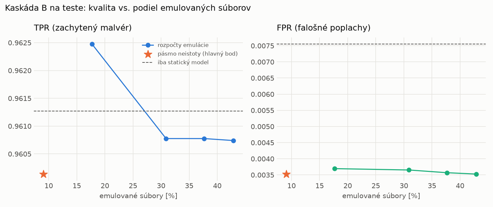

# Kaskáda B `b_nokd` – beh `20261103-211108`

> Generované `src/cascade/evaluate_b.py` (2026-11-03T21:11:08+01:00). Seedy: [0, 1, 2]; hodnoty = priemer ± sm. odchýlka.
> Všetky prahy a pásmo neistoty sú z validácie; test sa na nič nenastavuje. Postup: `docs/09_plan_v2.md`.

| rola | beh |
|---|---|
| static | `runs_final/students_static/mlp_nokd/20261102-211710` |
| dynamic | `runs_final/students_dynamic/mlp_nokd/20261102-212647` |
| hybrid | `runs_final/hybrid/lightgbm/20261102-052826` |

Druhý stupeň: **dynamic**. Pásmo neistoty statického modelu: FPR ≤ 0.1% nad `hi`,
najviac 1% malvéru validácie pod `lo` (seed 0: lo = 0.5305, hi = 0.9504, seed 1: lo = 0.5316, hi = 0.9411, seed 2: lo = 0.5394, hi = 0.9635).

## Test
| prístup | accuracy | balanced_accuracy | precision | recall_tpr | fpr | f1 | mcc |
|---|---|---|---|---|---|---|---|
| kaskáda B | 0.9768 ± 0.0021 | 0.9783 ± 0.0020 | 0.9969 ± 0.0001 | 0.9601 ± 0.0040 | 0.0035 ± 0.0001 | 0.9782 ± 0.0021 | 0.9542 ± 0.0041 |
| statický | 0.9755 ± 0.0018 | 0.9769 ± 0.0017 | 0.9934 ± 0.0006 | 0.9613 ± 0.0033 | 0.0076 ± 0.0007 | 0.9771 ± 0.0018 | 0.9515 ± 0.0035 |
| dynamický | 0.7421 ± 0.0019 | 0.7607 ± 0.0018 | 0.9731 ± 0.0034 | 0.5391 ± 0.0042 | 0.0177 ± 0.0024 | 0.6938 ± 0.0032 | 0.5668 ± 0.0031 |
| hybrid (každá vzorka) | 0.9893 ± 0.0018 | 0.9898 ± 0.0017 | 0.9960 ± 0.0001 | 0.9842 ± 0.0036 | 0.0047 ± 0.0002 | 0.9901 ± 0.0017 | 0.9785 ± 0.0037 |

- **emulované súbory: 9.06%** (ostatné rozhodne iba statický model); na hybrid ide 5.62% súborov
- chyby pri istom rozhodnutí statického modelu (seed 0): 249
- validácia: emulované 3.94%, na hybrid 1.74%

## Validácia
| prístup | accuracy | balanced_accuracy | precision | recall_tpr | fpr | f1 | mcc |
|---|---|---|---|---|---|---|---|
| kaskáda B | 0.9905 ± 0.0008 | 0.9917 ± 0.0008 | 0.9976 ± 0.0004 | 0.9882 ± 0.0008 | 0.0048 ± 0.0009 | 0.9929 ± 0.0006 | 0.9787 ± 0.0017 |
| statický | 0.9893 ± 0.0009 | 0.9897 ± 0.0008 | 0.9956 ± 0.0004 | 0.9885 ± 0.0009 | 0.0090 ± 0.0008 | 0.9920 ± 0.0006 | 0.9759 ± 0.0019 |
| dynamický | 0.9433 ± 0.0131 | 0.9553 ± 0.0098 | 0.9949 ± 0.0002 | 0.9202 ± 0.0194 | 0.0096 ± 0.0002 | 0.9560 ± 0.0105 | 0.8821 ± 0.0251 |
| hybrid (každá vzorka) | 0.9948 ± 0.0004 | 0.9938 ± 0.0004 | 0.9955 ± 0.0003 | 0.9968 ± 0.0005 | 0.0091 ± 0.0006 | 0.9962 ± 0.0003 | 0.9883 ± 0.0009 |

## Krivka rozpočtu emulácie (test, priemer cez seedy)
| budget_val | emulation_rate | hybrid_rate | recall_tpr | fpr | f1 |
|---|---|---|---|---|---|
| 0.1000 | 0.1768 | 0.0977 | 0.9625 | 0.0037 | 0.9793 |
| 0.2000 | 0.3088 | 0.1602 | 0.9608 | 0.0037 | 0.9785 |
| 0.3000 | 0.3765 | 0.1912 | 0.9608 | 0.0036 | 0.9785 |
| 0.4000 | 0.4285 | 0.2026 | 0.9607 | 0.0035 | 0.9785 |

## Výpočtové nároky
Emulácia (Speakeasy) sa nedá zmerať (dataset neobsahuje PE súbory). **Predpoklad** 60 s na súbor
(limit z `speakeasy-config.json`): kaskáda B ≈ 5.4 s na súbor v priemere, dynamický/hybridný model
a kaskáda A 60 s (emulujú každý súbor).

| meranie | statický | dynamický | hybrid na každej vzorke | kaskáda B (odhad) |
|---|---|---|---|---|
| CPU čas ms/vz. (dávka) | 0.3039 | 0.2957 | 0.0858 | 0.3355 |
| CPU čas ms/vz. (1 vz.) | 0.1526 | 0.1600 | 0.0422 | 0.1695 |

