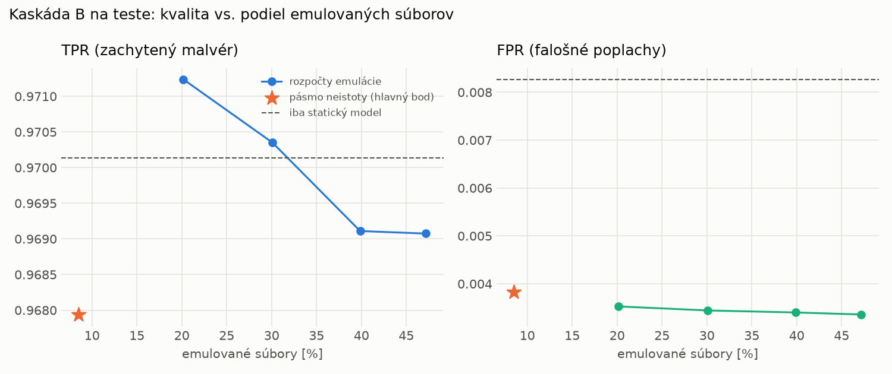

# Kaskáda B `b_twobranch` – beh `20261103-211110`

> Generované `src/cascade/evaluate_b.py` (2026-11-03T21:11:11+01:00). Seedy: [0, 1, 2]; hodnoty = priemer ± sm. odchýlka.
> Všetky prahy a pásmo neistoty sú z validácie; test sa na nič nenastavuje. Postup: `docs/09_plan_v2.md`.

| rola | beh |
|---|---|
| static | `runs_v2/full/students_static/mlp_kd_twobranch/20261103-210128` |
| dynamic | `runs_v2/full/students_dynamic/mlp_kd_twobranch/20261103-210509` |
| hybrid | `runs_final/hybrid/lightgbm/20261102-052826` |

Druhý stupeň: **dynamic**. Pásmo neistoty statického modelu: FPR ≤ 0.1% nad `hi`,
najviac 1% malvéru validácie pod `lo` (seed 0: lo = 0.5941, hi = 0.9953, seed 1: lo = 0.5744, hi = 0.9939, seed 2: lo = 0.5650, hi = 0.9865).

## Test
| prístup | accuracy | balanced_accuracy | precision | recall_tpr | fpr | f1 | mcc |
|---|---|---|---|---|---|---|---|
| kaskáda B | 0.9809 ± 0.0048 | 0.9821 ± 0.0044 | 0.9967 ± 0.0005 | 0.9679 ± 0.0092 | 0.0038 ± 0.0006 | 0.9821 ± 0.0045 | 0.9621 ± 0.0092 |
| statický | 0.9800 ± 0.0067 | 0.9809 ± 0.0061 | 0.9929 ± 0.0008 | 0.9701 ± 0.0132 | 0.0083 ± 0.0010 | 0.9813 ± 0.0064 | 0.9602 ± 0.0130 |
| dynamický | 0.7326 ± 0.0016 | 0.7523 ± 0.0016 | 0.9785 ± 0.0023 | 0.5182 ± 0.0019 | 0.0135 ± 0.0015 | 0.6775 ± 0.0021 | 0.5558 ± 0.0033 |
| hybrid (každá vzorka) | 0.9893 ± 0.0018 | 0.9898 ± 0.0017 | 0.9960 ± 0.0001 | 0.9842 ± 0.0036 | 0.0047 ± 0.0002 | 0.9901 ± 0.0017 | 0.9785 ± 0.0037 |

- **emulované súbory: 8.53%** (ostatné rozhodne iba statický model); na hybrid ide 6.20% súborov
- chyby pri istom rozhodnutí statického modelu (seed 0): 309
- validácia: emulované 3.12%, na hybrid 1.76%

## Validácia
| prístup | accuracy | balanced_accuracy | precision | recall_tpr | fpr | f1 | mcc |
|---|---|---|---|---|---|---|---|
| kaskáda B | 0.9922 ± 0.0014 | 0.9931 ± 0.0010 | 0.9978 ± 0.0002 | 0.9906 ± 0.0024 | 0.0044 ± 0.0005 | 0.9942 ± 0.0011 | 0.9825 ± 0.0032 |
| statický | 0.9914 ± 0.0014 | 0.9912 ± 0.0010 | 0.9954 ± 0.0002 | 0.9918 ± 0.0023 | 0.0094 ± 0.0004 | 0.9936 ± 0.0011 | 0.9806 ± 0.0032 |
| dynamický | 0.9447 ± 0.0111 | 0.9563 ± 0.0082 | 0.9949 ± 0.0000 | 0.9223 ± 0.0166 | 0.0097 ± 0.0002 | 0.9572 ± 0.0090 | 0.8845 ± 0.0208 |
| hybrid (každá vzorka) | 0.9948 ± 0.0004 | 0.9938 ± 0.0004 | 0.9955 ± 0.0003 | 0.9968 ± 0.0005 | 0.0091 ± 0.0006 | 0.9962 ± 0.0003 | 0.9883 ± 0.0009 |

## Krivka rozpočtu emulácie (test, priemer cez seedy)
| budget_val | emulation_rate | hybrid_rate | recall_tpr | fpr | f1 |
|---|---|---|---|---|---|
| 0.1000 | 0.2017 | 0.1168 | 0.9712 | 0.0035 | 0.9839 |
| 0.2000 | 0.3009 | 0.1406 | 0.9704 | 0.0034 | 0.9835 |
| 0.3000 | 0.3986 | 0.1761 | 0.9691 | 0.0034 | 0.9829 |
| 0.4000 | 0.4718 | 0.2044 | 0.9691 | 0.0034 | 0.9829 |

## Výpočtové nároky
Emulácia (Speakeasy) sa nedá zmerať (dataset neobsahuje PE súbory). **Predpoklad** 60 s na súbor
(limit z `speakeasy-config.json`): kaskáda B ≈ 5.1 s na súbor v priemere, dynamický/hybridný model
a kaskáda A 60 s (emulujú každý súbor).

| meranie | statický | dynamický | hybrid na každej vzorke | kaskáda B (odhad) |
|---|---|---|---|---|
| CPU čas ms/vz. (dávka) | 0.3021 | 0.2768 | 0.0858 | 0.3310 |
| CPU čas ms/vz. (1 vz.) | 0.1559 | 0.1565 | 0.0422 | 0.1719 |

