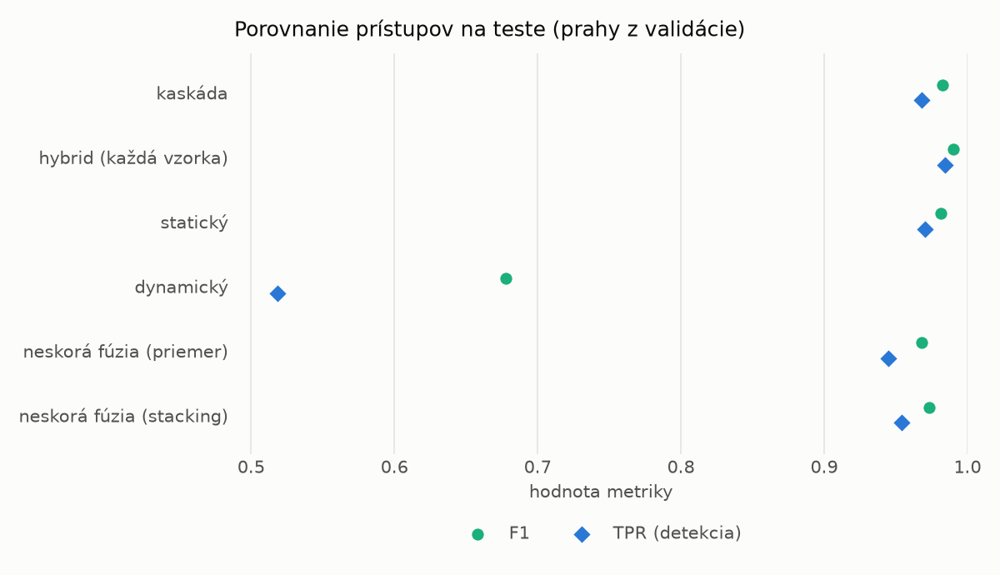
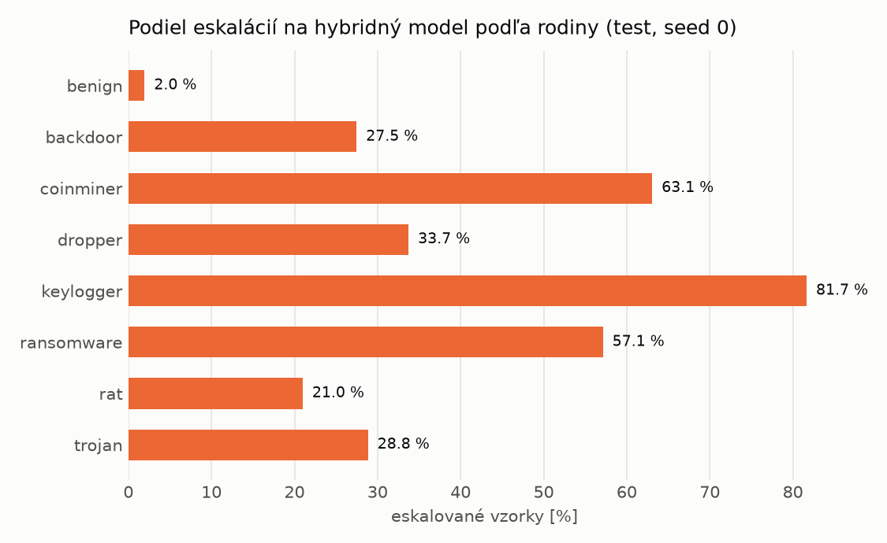

# Kaskáda `twobranch` – beh `20261103-211112`

> Generované `src/cascade/evaluate.py` (2026-11-03T21:11:12+01:00). Seedy: [0, 1, 2]; hodnoty = priemer ± sm. odchýlka.
> Všetky prahy sú určené na validácii (FPR ≤ 1 %); test sa na nič nenastavuje.

| rola | beh |
|---|---|
| static | `runs_v2/full/students_static/mlp_kd_twobranch/20261103-210128` |
| dynamic | `runs_v2/full/students_dynamic/mlp_kd_twobranch/20261103-210509` |
| hybrid | `runs_final/hybrid/lightgbm/20261102-052826` |

## Test
| prístup | accuracy | balanced_accuracy | precision | recall_tpr | fpr | f1 | mcc |
|---|---|---|---|---|---|---|---|
| kaskáda | 0.9817 ± 0.0055 | 0.9829 ± 0.0050 | 0.9978 ± 0.0004 | 0.9683 ± 0.0103 | 0.0025 ± 0.0005 | 0.9828 ± 0.0052 | 0.9637 ± 0.0106 |
| hybrid (každá vzorka) | 0.9893 ± 0.0018 | 0.9898 ± 0.0017 | 0.9960 ± 0.0001 | 0.9842 ± 0.0036 | 0.0047 ± 0.0002 | 0.9901 ± 0.0017 | 0.9785 ± 0.0037 |
| statický | 0.9800 ± 0.0067 | 0.9809 ± 0.0061 | 0.9929 ± 0.0008 | 0.9701 ± 0.0132 | 0.0083 ± 0.0010 | 0.9813 ± 0.0064 | 0.9602 ± 0.0130 |
| dynamický | 0.7326 ± 0.0016 | 0.7523 ± 0.0016 | 0.9785 ± 0.0023 | 0.5182 ± 0.0019 | 0.0135 ± 0.0015 | 0.6775 ± 0.0021 | 0.5558 ± 0.0033 |
| neskorá fúzia (priemer) | 0.9663 ± 0.0055 | 0.9683 ± 0.0049 | 0.9925 ± 0.0017 | 0.9450 ± 0.0115 | 0.0085 ± 0.0020 | 0.9681 ± 0.0054 | 0.9337 ± 0.0103 |
| neskorá fúzia (stacking) | 0.9716 ± 0.0041 | 0.9732 ± 0.0037 | 0.9930 ± 0.0011 | 0.9543 ± 0.0079 | 0.0080 ± 0.0013 | 0.9732 ± 0.0040 | 0.9438 ± 0.0078 |

## Validácia
| prístup | accuracy | balanced_accuracy | precision | recall_tpr | fpr | f1 | mcc |
|---|---|---|---|---|---|---|---|
| kaskáda | 0.9933 ± 0.0016 | 0.9937 ± 0.0011 | 0.9974 ± 0.0003 | 0.9926 ± 0.0027 | 0.0052 ± 0.0006 | 0.9950 ± 0.0012 | 0.9849 ± 0.0036 |
| hybrid (každá vzorka) | 0.9948 ± 0.0004 | 0.9938 ± 0.0004 | 0.9955 ± 0.0003 | 0.9968 ± 0.0005 | 0.0091 ± 0.0006 | 0.9962 ± 0.0003 | 0.9883 ± 0.0009 |
| statický | 0.9914 ± 0.0014 | 0.9912 ± 0.0010 | 0.9954 ± 0.0002 | 0.9918 ± 0.0023 | 0.0094 ± 0.0004 | 0.9936 ± 0.0011 | 0.9806 ± 0.0032 |
| dynamický | 0.9447 ± 0.0111 | 0.9563 ± 0.0082 | 0.9949 ± 0.0000 | 0.9223 ± 0.0166 | 0.0097 ± 0.0002 | 0.9572 ± 0.0090 | 0.8845 ± 0.0208 |
| neskorá fúzia (priemer) | 0.9925 ± 0.0008 | 0.9921 ± 0.0005 | 0.9956 ± 0.0003 | 0.9931 ± 0.0015 | 0.0089 ± 0.0006 | 0.9944 ± 0.0006 | 0.9829 ± 0.0018 |
| neskorá fúzia (stacking) | 0.9934 ± 0.0005 | 0.9928 ± 0.0008 | 0.9956 ± 0.0008 | 0.9944 ± 0.0003 | 0.0089 ± 0.0017 | 0.9950 ± 0.0004 | 0.9850 ± 0.0012 |

## Správanie kaskády (test, seed 0)
- podiel eskalácií na hybrid: **25.86%** (4484 vzoriek)
- chyby pri zhode študentov (kaskáda ich nemôže opraviť): **215**
  (1.673% zo zhôd; FP 4, FN 211)
- úspešnosť na eskalovaných vzorkách: hybrid 0.9834968777876896, statický 0.9821587867975022,
  dynamický 0.01784121320249777  → prínos hybridu pri nezhode

## Výpočtové nároky (odhad z benchmarkov komponentov)
| meranie | statický | dynamický | hybrid na každej vzorke | neskorá fúzia | kaskáda (odhad) |
|---|---|---|---|---|---|
| CPU čas ms/vz. (dávka) | 0.3021 | 0.2768 | 0.0858 | 0.5789 | 0.6011 |
| CPU čas ms/vz. (1 vz.) | 0.1559 | 0.1565 | 0.0422 | 0.3125 | 0.3234 |
| latencia ms (1 vz., postupne) | 0.0958 | 0.0895 | 0.0413 | 0.1853 | 0.1960 |

