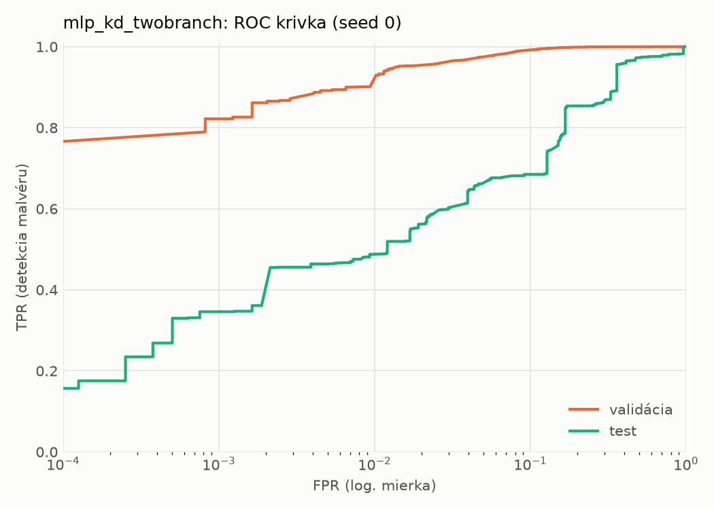
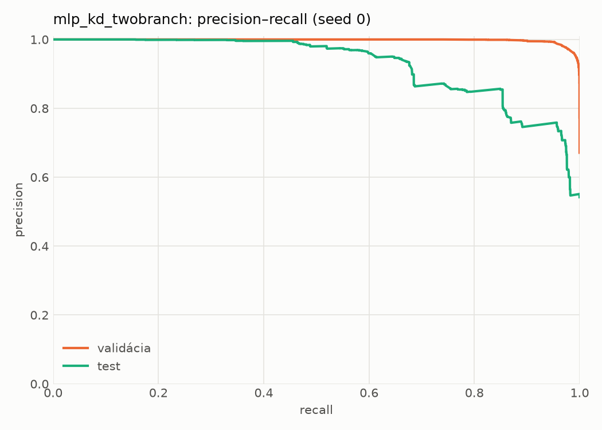
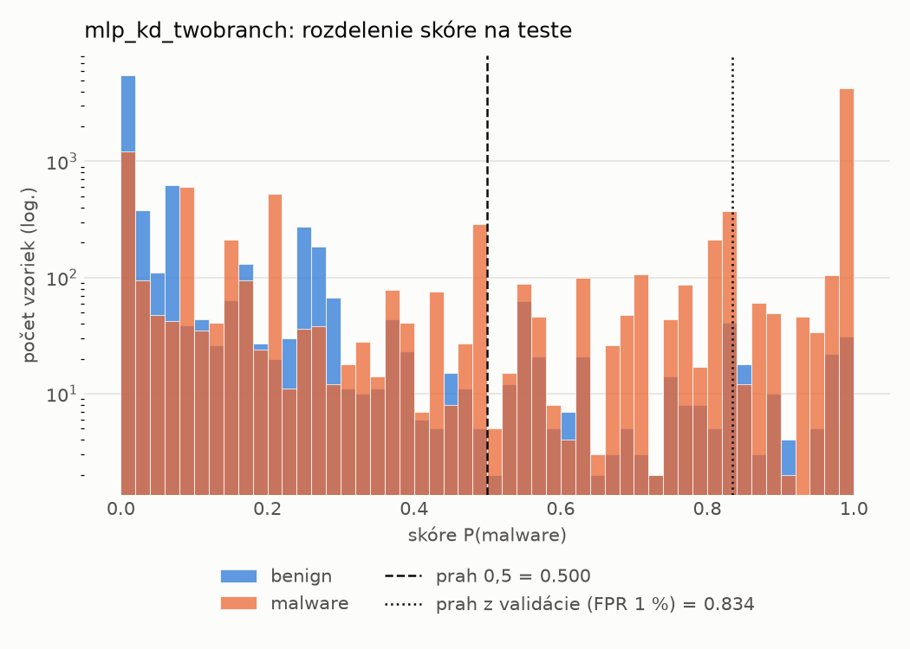
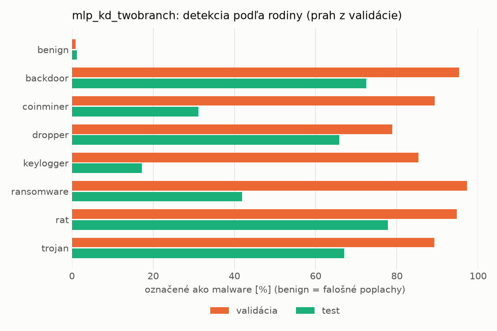
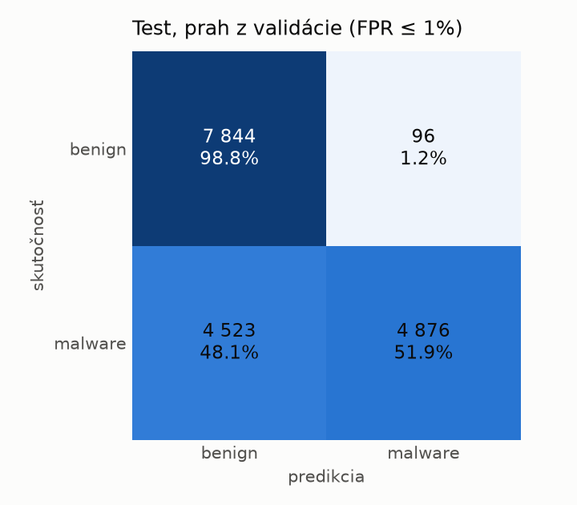
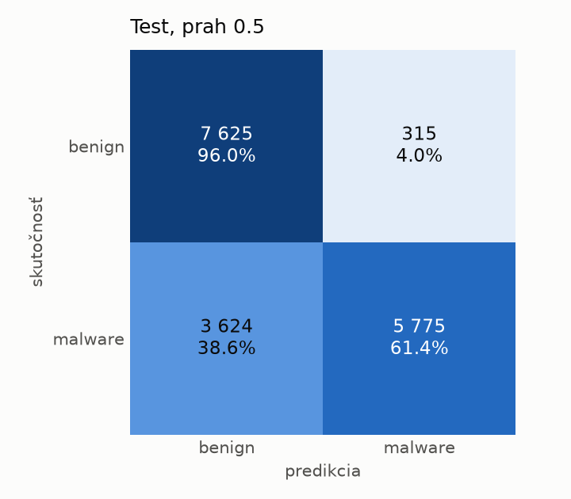
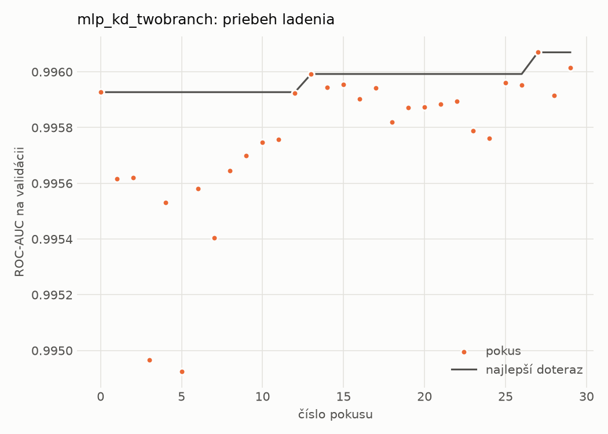
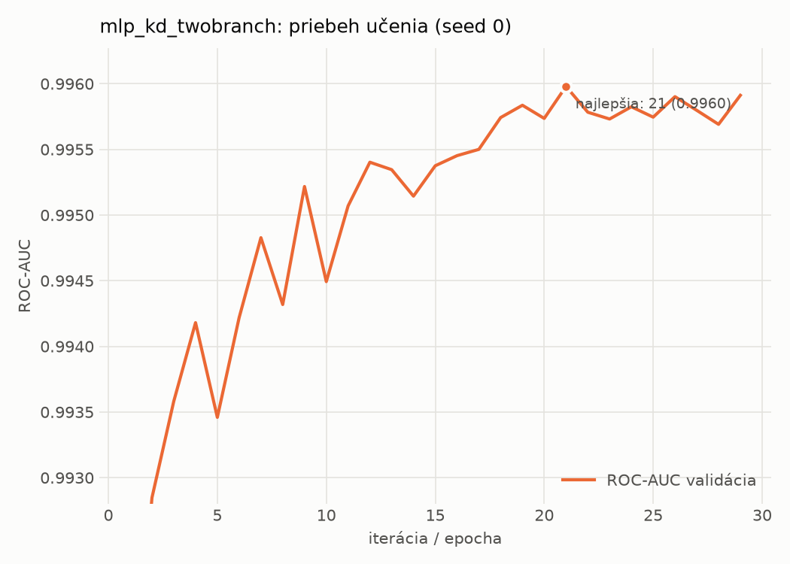

# dynamic/mlp_kd_twobranch – beh `20261103-210509`

> Automaticky generované (`src/training/run_tabular.py`). Konfigurácia: `config.yaml`, protokol: `protocol.yaml`.

- **Model:** `mlp` – študent – malé MLP učené destiláciou z dvojvetvovej siete (V2)
- **Ladenie:** 30 dokončených pokusov (Optuna TPE), cieľ ROC-AUC na validácii, 4.4 min
- **Finálne modely:** seedy [0, 1, 2]; hodnoty sú priemer ± smerodajná odchýlka cez seedy
- **Najlepšie hyperparametre:** `{"hidden_layers": 1, "max_epochs": 100, "patience": 8, "hidden_width": 32, "dropout": 0.20072105080128874, "lr": 0.0007693195243892695, "weight_decay": 5.480532660403751e-05, "batch_size": 512, "kd_alpha": 0.8408369066096718, "kd_temperature": 1.578549465607724}`

## Detekčná kvalita (bez prahu)
| metrika | train (podvzorka) | validácia | test |
|---|---|---|---|
| ROC-AUC | 0.9967 ± 0.0004 | 0.9959 ± 0.0001 | 0.9055 ± 0.0071 |
| PR-AUC | 0.9983 ± 0.0002 | 0.9979 ± 0.0001 | 0.9277 ± 0.0025 |
| TPR pri FPR 1 % | 0.9311 ± 0.0043 | 0.9223 ± 0.0166 | 0.4764 ± 0.0114 |
| TPR pri FPR 0,1 % | 0.8883 ± 0.0026 | 0.8260 ± 0.0039 | 0.3227 ± 0.0249 |
| log loss | 0.0728 ± 0.0041 | 0.0814 ± 0.0015 | 0.7629 ± 0.0823 |
| Brier skóre | 0.0231 ± 0.0012 | 0.0242 ± 0.0007 | 0.1797 ± 0.0028 |

Rozdiel ROC-AUC train − validácia: **0.0008** (veľký rozdiel = preučenie).

## Pri prahu z validácie (FPR ≤ 1% na validácii)
| metrika | train (podvzorka) | validácia | test |
|---|---|---|---|
| accuracy | 0.9437 ± 0.0094 | 0.9447 ± 0.0111 | 0.7326 ± 0.0016 |
| balanced accuracy | 0.9559 ± 0.0069 | 0.9563 ± 0.0082 | 0.7523 ± 0.0016 |
| precision | 0.9959 ± 0.0009 | 0.9949 ± 0.0000 | 0.9785 ± 0.0023 |
| recall (TPR) | 0.9193 ± 0.0145 | 0.9223 ± 0.0166 | 0.5182 ± 0.0019 |
| FPR | 0.0076 ± 0.0017 | 0.0097 ± 0.0002 | 0.0135 ± 0.0015 |
| F1 | 0.9560 ± 0.0077 | 0.9572 ± 0.0090 | 0.6775 ± 0.0021 |
| MCC | 0.8836 ± 0.0175 | 0.8845 ± 0.0208 | 0.5558 ± 0.0033 |

## Pri pevnom prahu 0.5
| metrika | train (podvzorka) | validácia | test |
|---|---|---|---|
| accuracy | 0.9673 ± 0.0016 | 0.9658 ± 0.0007 | 0.7620 ± 0.0153 |
| balanced accuracy | 0.9678 ± 0.0023 | 0.9656 ± 0.0013 | 0.7765 ± 0.0157 |
| precision | 0.9844 ± 0.0023 | 0.9825 ± 0.0014 | 0.9326 ± 0.0262 |
| recall (TPR) | 0.9662 ± 0.0009 | 0.9663 ± 0.0004 | 0.6049 ± 0.0110 |
| FPR | 0.0306 ± 0.0046 | 0.0351 ± 0.0030 | 0.0519 ± 0.0208 |
| F1 | 0.9752 ± 0.0012 | 0.9743 ± 0.0005 | 0.7338 ± 0.0160 |
| MCC | 0.9274 ± 0.0037 | 0.9236 ± 0.0018 | 0.5770 ± 0.0341 |

## Výpočtové nároky (seed 0, testovacia množina)
| meranie | hodnota |
|---|---|
| tréning finálneho modelu | 6.5 s (priemer cez seedy) |
| ladenie spolu | 266 s |
| počet parametrov / uzlov | 64 129 |
| veľkosť modelu na disku | 0.31 MB |
| transformácia vstupu – latencia (1 vlákno) | 0.035 ms |
| transformácia vstupu – priepustnosť | 51 973 vzoriek/s |
| CPU latencia modelu (batch 1, 1 vlákno) | 0.071 ms (p95 0.075) |
| CPU priepustnosť (24 vlákien) | 140 007 vzoriek/s |
| GPU latencia (batch 1) | 0.281 ms (p95 0.306) |
| GPU priepustnosť | 100 382 vzoriek/s |
| GPU špičková pamäť | 753 MB |

## Grafy
| | |
|---|---|
|  |  |
|  |  |
|  |  |
|  |  |

## Súbory
`metrics.json` (všetky metriky po seedoch vrátane rodín), `timing.json`, `hpo_trials.csv`,
`predictions/<časť>_seed<N>.parquet` (sha256, family, label, score), `model/seed_<N>/`, `log.txt`.
