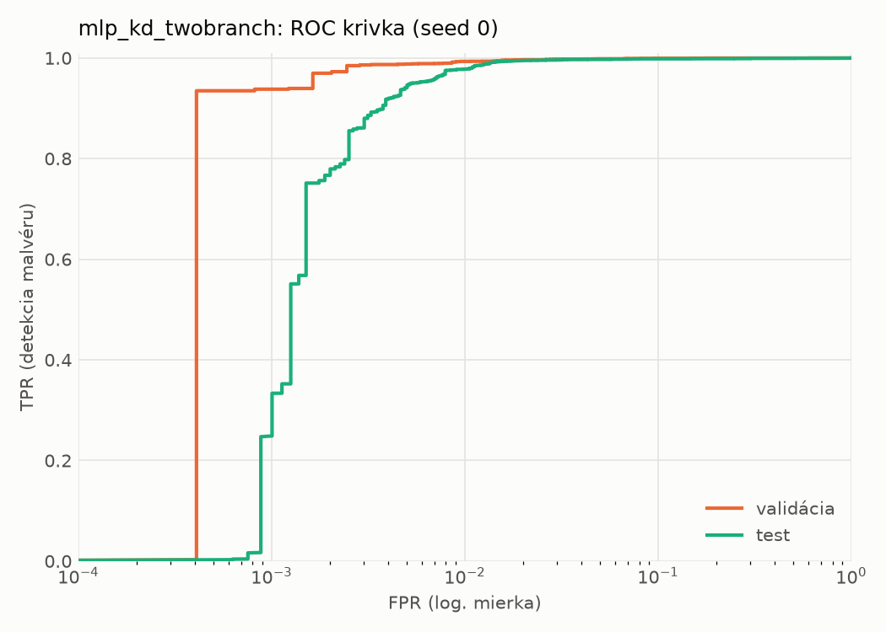
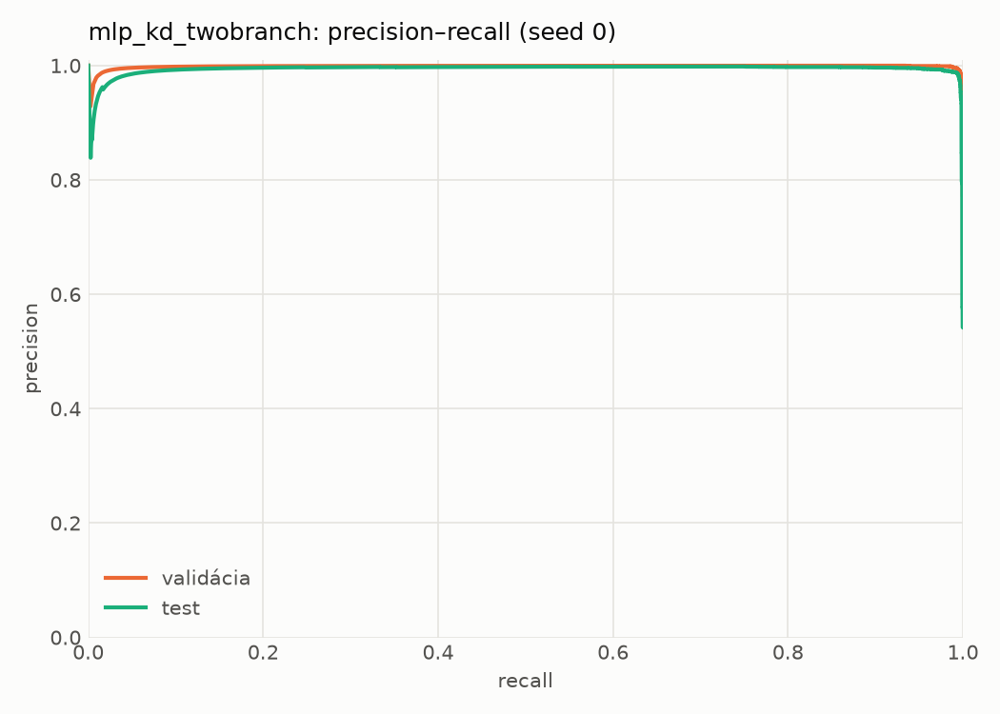
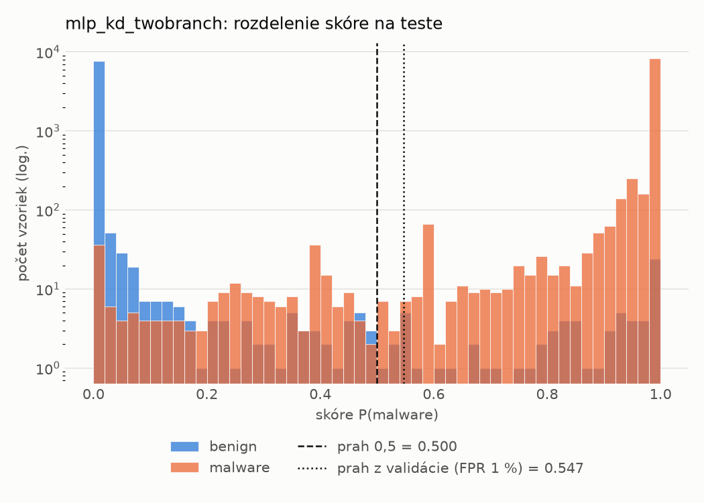
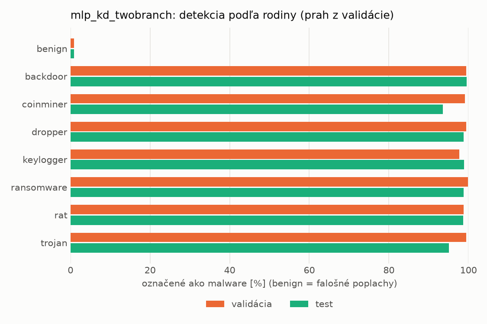
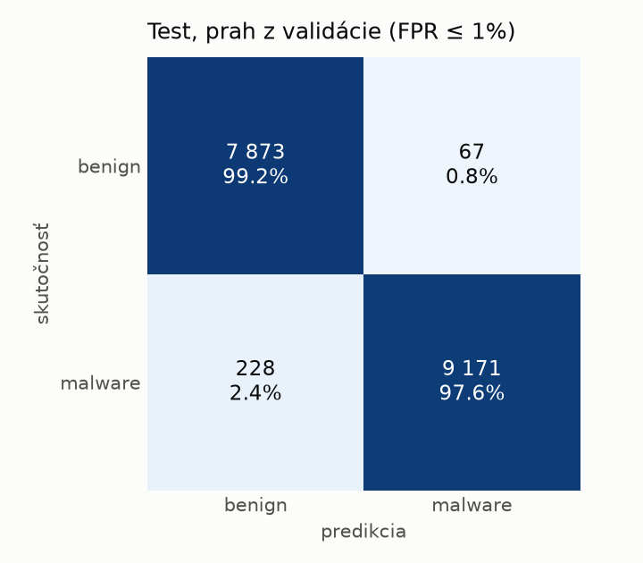
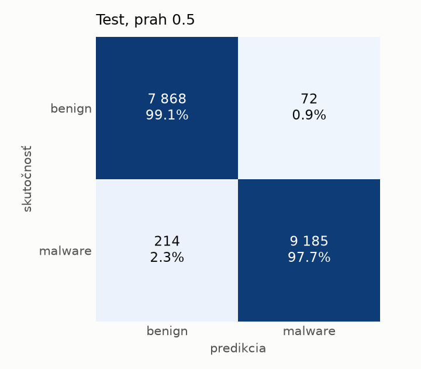
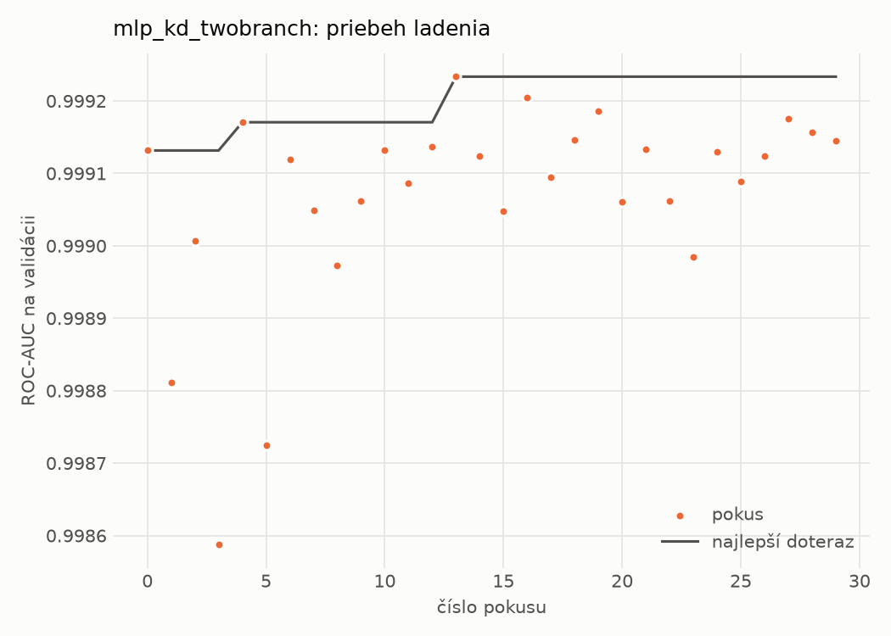
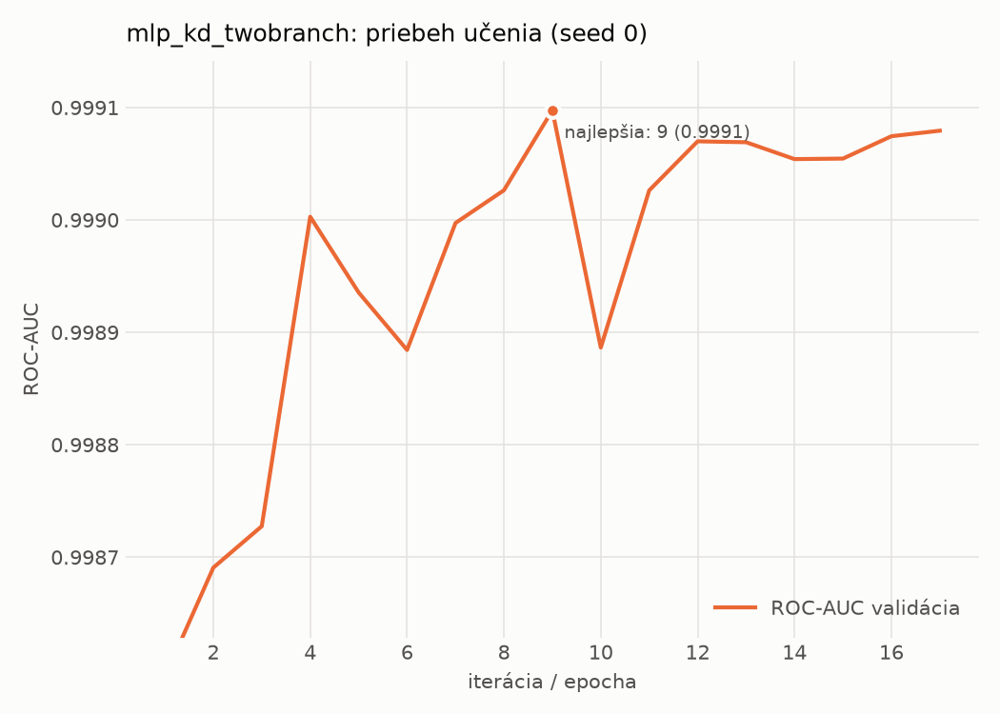

# static/mlp_kd_twobranch – beh `20261103-210128`

> Automaticky generované (`src/training/run_tabular.py`). Konfigurácia: `config.yaml`, protokol: `protocol.yaml`.

- **Model:** `mlp` – študent – malé MLP učené destiláciou z dvojvetvovej siete (V2)
- **Ladenie:** 30 dokončených pokusov (Optuna TPE), cieľ ROC-AUC na validácii, 3.2 min
- **Finálne modely:** seedy [0, 1, 2]; hodnoty sú priemer ± smerodajná odchýlka cez seedy
- **Najlepšie hyperparametre:** `{"hidden_layers": 1, "max_epochs": 100, "patience": 8, "hidden_width": 32, "dropout": 0.11907530604839062, "lr": 0.0013122016832935236, "weight_decay": 1.6321051677063922e-05, "batch_size": 256, "kd_alpha": 0.8749635763069835, "kd_temperature": 3.9893325789148495}`

## Detekčná kvalita (bez prahu)
| metrika | train (podvzorka) | validácia | test |
|---|---|---|---|
| ROC-AUC | 0.9998 ± 0.0000 | 0.9991 ± 0.0000 | 0.9973 ± 0.0002 |
| PR-AUC | 0.9999 ± 0.0000 | 0.9987 ± 0.0001 | 0.9950 ± 0.0009 |
| TPR pri FPR 1 % | 0.9981 ± 0.0011 | 0.9918 ± 0.0023 | 0.9773 ± 0.0034 |
| TPR pri FPR 0,1 % | 0.9723 ± 0.0092 | 0.9499 ± 0.0109 | 0.3884 ± 0.2827 |
| log loss | 0.0152 ± 0.0026 | 0.0281 ± 0.0010 | 0.0589 ± 0.0015 |
| Brier skóre | 0.0041 ± 0.0007 | 0.0068 ± 0.0003 | 0.0130 ± 0.0004 |

Rozdiel ROC-AUC train − validácia: **0.0007** (veľký rozdiel = preučenie).

## Pri prahu z validácie (FPR ≤ 1% na validácii)
| metrika | train (podvzorka) | validácia | test |
|---|---|---|---|
| accuracy | 0.9940 ± 0.0021 | 0.9914 ± 0.0014 | 0.9800 ± 0.0067 |
| balanced accuracy | 0.9946 ± 0.0014 | 0.9912 ± 0.0010 | 0.9809 ± 0.0061 |
| precision | 0.9981 ± 0.0006 | 0.9954 ± 0.0002 | 0.9929 ± 0.0008 |
| recall (TPR) | 0.9929 ± 0.0037 | 0.9918 ± 0.0023 | 0.9701 ± 0.0132 |
| FPR | 0.0037 ± 0.0012 | 0.0094 ± 0.0004 | 0.0083 ± 0.0010 |
| F1 | 0.9955 ± 0.0016 | 0.9936 ± 0.0011 | 0.9813 ± 0.0064 |
| MCC | 0.9867 ± 0.0047 | 0.9806 ± 0.0032 | 0.9602 ± 0.0130 |

## Pri pevnom prahu 0.5
| metrika | train (podvzorka) | validácia | test |
|---|---|---|---|
| accuracy | 0.9950 ± 0.0009 | 0.9916 ± 0.0005 | 0.9849 ± 0.0012 |
| balanced accuracy | 0.9946 ± 0.0009 | 0.9906 ± 0.0008 | 0.9852 ± 0.0010 |
| precision | 0.9967 ± 0.0008 | 0.9941 ± 0.0008 | 0.9907 ± 0.0015 |
| recall (TPR) | 0.9958 ± 0.0010 | 0.9933 ± 0.0001 | 0.9813 ± 0.0037 |
| FPR | 0.0066 ± 0.0016 | 0.0120 ± 0.0017 | 0.0109 ± 0.0018 |
| F1 | 0.9962 ± 0.0006 | 0.9937 ± 0.0003 | 0.9860 ± 0.0012 |
| MCC | 0.9887 ± 0.0019 | 0.9809 ± 0.0011 | 0.9697 ± 0.0024 |

## Výpočtové nároky (seed 0, testovacia množina)
| meranie | hodnota |
|---|---|
| tréning finálneho modelu | 5.9 s (priemer cez seedy) |
| ladenie spolu | 190 s |
| počet parametrov / uzlov | 74 337 |
| veľkosť modelu na disku | 0.36 MB |
| transformácia vstupu – latencia (1 vlákno) | 0.038 ms |
| transformácia vstupu – priepustnosť | 44 133 vzoriek/s |
| CPU latencia modelu (batch 1, 1 vlákno) | 0.069 ms (p95 0.081) |
| CPU priepustnosť (24 vlákien) | 107 461 vzoriek/s |
| GPU latencia (batch 1) | 0.273 ms (p95 0.348) |
| GPU priepustnosť | 79 047 vzoriek/s |
| GPU špičková pamäť | 871 MB |

## Grafy
| | |
|---|---|
|  |  |
|  |  |
|  |  |
|  |  |

## Súbory
`metrics.json` (všetky metriky po seedoch vrátane rodín), `timing.json`, `hpo_trials.csv`,
`predictions/<časť>_seed<N>.parquet` (sha256, family, label, score), `model/seed_<N>/`, `log.txt`.
