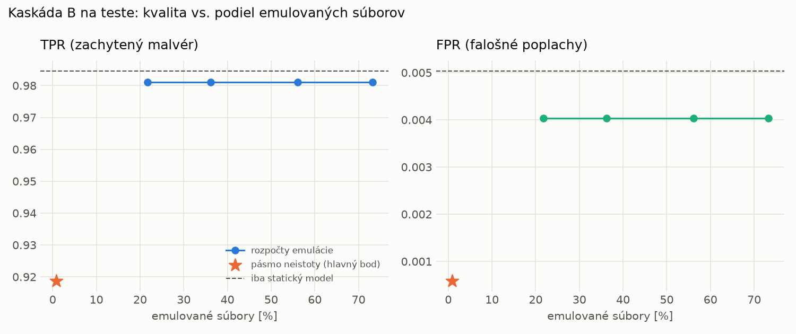

# Kaskáda B `b_baselines` – beh `20261103-232701`

> Generované `src/cascade/evaluate_b.py` (2026-11-03T23:27:01+01:00). Seedy: [0, 1, 2]; hodnoty = priemer ± sm. odchýlka.
> Všetky prahy a pásmo neistoty sú z validácie; test sa na nič nenastavuje. Postup: `docs/09_plan_v2.md`.

| rola | beh |
|---|---|
| static | `runs_v2/lofo/backdoor/static/lightgbm/20261103-211252` |
| dynamic | `runs_v2/lofo/backdoor/dynamic/lightgbm/20261103-212927` |
| hybrid | `runs_v2/lofo/backdoor/hybrid/lightgbm/20261103-220506` |

Druhý stupeň: **dynamic**. Pásmo neistoty statického modelu: FPR ≤ 0.1% nad `hi`,
najviac 1% malvéru validácie pod `lo` (seed 0: lo = 0.9491, hi = 0.9569, seed 1: lo = 0.9487, hi = 0.9604, seed 2: lo = 0.9463, hi = 0.9709).

## Test
| prístup | accuracy | balanced_accuracy | precision | recall_tpr | fpr | f1 | mcc |
|---|---|---|---|---|---|---|---|
| kaskáda B | 0.9557 ± 0.0008 | 0.9591 ± 0.0008 | 0.9995 ± 0.0001 | 0.9188 ± 0.0016 | 0.0006 ± 0.0001 | 0.9574 ± 0.0008 | 0.9149 ± 0.0015 |
| statický | 0.9893 ± 0.0001 | 0.9898 ± 0.0001 | 0.9957 ± 0.0002 | 0.9846 ± 0.0003 | 0.0050 ± 0.0002 | 0.9901 ± 0.0001 | 0.9786 ± 0.0001 |
| dynamický | 0.7810 ± 0.0014 | 0.7968 ± 0.0013 | 0.9802 ± 0.0009 | 0.6083 ± 0.0028 | 0.0146 ± 0.0007 | 0.7507 ± 0.0020 | 0.6260 ± 0.0021 |
| hybrid (každá vzorka) | 0.9893 ± 0.0014 | 0.9897 ± 0.0013 | 0.9959 ± 0.0006 | 0.9842 ± 0.0032 | 0.0047 ± 0.0008 | 0.9900 ± 0.0013 | 0.9785 ± 0.0028 |

- **emulované súbory: 0.83%** (ostatné rozhodne iba statický model); na hybrid ide 0.18% súborov
- chyby pri istom rozhodnutí statického modelu (seed 0): 755
- validácia: emulované 0.05%, na hybrid 0.03%

## Validácia
| prístup | accuracy | balanced_accuracy | precision | recall_tpr | fpr | f1 | mcc |
|---|---|---|---|---|---|---|---|
| kaskáda B | 0.9935 ± 0.0000 | 0.9945 ± 0.0000 | 0.9992 ± 0.0000 | 0.9902 ± 0.0000 | 0.0012 ± 0.0000 | 0.9947 ± 0.0000 | 0.9864 ± 0.0000 |
| statický | 0.9956 ± 0.0002 | 0.9947 ± 0.0002 | 0.9944 ± 0.0003 | 0.9985 ± 0.0000 | 0.0090 ± 0.0004 | 0.9964 ± 0.0001 | 0.9907 ± 0.0003 |
| dynamický | 0.9649 ± 0.0019 | 0.9696 ± 0.0015 | 0.9936 ± 0.0001 | 0.9489 ± 0.0033 | 0.0097 ± 0.0002 | 0.9707 ± 0.0017 | 0.9284 ± 0.0037 |
| hybrid (každá vzorka) | 0.9948 ± 0.0001 | 0.9940 ± 0.0001 | 0.9939 ± 0.0001 | 0.9977 ± 0.0000 | 0.0097 ± 0.0002 | 0.9958 ± 0.0001 | 0.9891 ± 0.0002 |

## Januárové vzorky vynechanej rodiny (iba malvér → TPR)
| prístup | TPR |
|---|---|
| kaskáda B | 0.8963 ± 0.0013 |
| statický | 0.9931 ± 0.0022 |
| dynamický | 0.4985 ± 0.0167 |
| hybrid (každá vzorka) | 0.9916 ± 0.0049 |

Podiel emulovaných: 0.85%

## Krivka rozpočtu emulácie (test, priemer cez seedy)
| budget_val | emulation_rate | hybrid_rate | recall_tpr | fpr | f1 |
|---|---|---|---|---|---|
| 0.1000 | 0.2175 | 0.0563 | 0.9811 | 0.0040 | 0.9888 |
| 0.2000 | 0.3619 | 0.0935 | 0.9811 | 0.0040 | 0.9888 |
| 0.3000 | 0.5610 | 0.1308 | 0.9811 | 0.0040 | 0.9888 |
| 0.4000 | 0.7324 | 0.1622 | 0.9811 | 0.0040 | 0.9888 |

## Výpočtové nároky
Emulácia (Speakeasy) sa nedá zmerať (dataset neobsahuje PE súbory). **Predpoklad** 60 s na súbor
(limit z `speakeasy-config.json`): kaskáda B ≈ 0.5 s na súbor v priemere, dynamický/hybridný model
a kaskáda A 60 s (emulujú každý súbor).

_Chýba benchmark niektorého komponentu (v zero-day behoch sa nemeria)._

