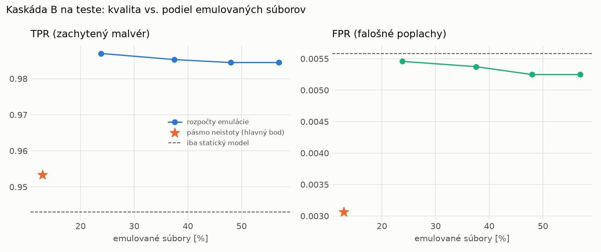

# Kaskáda B `b_direct` – beh `20261103-232657`

> Generované `src/cascade/evaluate_b.py` (2026-11-03T23:26:57+01:00). Seedy: [0, 1, 2]; hodnoty = priemer ± sm. odchýlka.
> Všetky prahy a pásmo neistoty sú z validácie; test sa na nič nenastavuje. Postup: `docs/09_plan_v2.md`.

| rola | beh |
|---|---|
| static | `runs_v2/lofo/backdoor/students_static/mlp_kd/20261103-232226` |
| hybrid | `runs_v2/lofo/backdoor/hybrid/lightgbm/20261103-220506` |

Druhý stupeň: **hybrid**. Pásmo neistoty statického modelu: FPR ≤ 0.1% nad `hi`,
najviac 1% malvéru validácie pod `lo` (seed 0: lo = 0.5265, hi = 0.9991, seed 1: lo = 0.5957, hi = 0.9987, seed 2: lo = 0.6238, hi = 0.9986).

## Test
| prístup | accuracy | balanced_accuracy | precision | recall_tpr | fpr | f1 | mcc |
|---|---|---|---|---|---|---|---|
| kaskáda B | 0.9733 ± 0.0019 | 0.9751 ± 0.0018 | 0.9973 ± 0.0003 | 0.9533 ± 0.0037 | 0.0031 ± 0.0003 | 0.9748 ± 0.0019 | 0.9475 ± 0.0037 |
| statický | 0.9666 ± 0.0018 | 0.9687 ± 0.0016 | 0.9950 ± 0.0002 | 0.9431 ± 0.0032 | 0.0056 ± 0.0003 | 0.9684 ± 0.0017 | 0.9345 ± 0.0034 |
| hybrid (každá vzorka) | 0.9893 ± 0.0014 | 0.9897 ± 0.0013 | 0.9959 ± 0.0006 | 0.9842 ± 0.0032 | 0.0047 ± 0.0008 | 0.9900 ± 0.0013 | 0.9785 ± 0.0028 |

- **emulované súbory: 12.90%** (ostatné rozhodne iba statický model); na hybrid ide 12.90% súborov
- chyby pri istom rozhodnutí statického modelu (seed 0): 424
- validácia: emulované 4.01%, na hybrid 4.01%

## Validácia
| prístup | accuracy | balanced_accuracy | precision | recall_tpr | fpr | f1 | mcc |
|---|---|---|---|---|---|---|---|
| kaskáda B | 0.9923 ± 0.0011 | 0.9927 ± 0.0011 | 0.9965 ± 0.0005 | 0.9910 ± 0.0013 | 0.0056 ± 0.0009 | 0.9937 ± 0.0009 | 0.9838 ± 0.0024 |
| statický | 0.9890 ± 0.0002 | 0.9892 ± 0.0002 | 0.9939 ± 0.0001 | 0.9881 ± 0.0005 | 0.0097 ± 0.0002 | 0.9910 ± 0.0002 | 0.9768 ± 0.0005 |
| hybrid (každá vzorka) | 0.9948 ± 0.0001 | 0.9940 ± 0.0001 | 0.9939 ± 0.0001 | 0.9977 ± 0.0000 | 0.0097 ± 0.0002 | 0.9958 ± 0.0001 | 0.9891 ± 0.0002 |

## Januárové vzorky vynechanej rodiny (iba malvér → TPR)
| prístup | TPR |
|---|---|
| kaskáda B | 0.9544 ± 0.0052 |
| statický | 0.9396 ± 0.0114 |
| hybrid (každá vzorka) | 0.9916 ± 0.0049 |

Podiel emulovaných: 35.12%

## Krivka rozpočtu emulácie (test, priemer cez seedy)
| budget_val | emulation_rate | hybrid_rate | recall_tpr | fpr | f1 |
|---|---|---|---|---|---|
| 0.1000 | 0.2380 | 0.2380 | 0.9870 | 0.0055 | 0.9911 |
| 0.2000 | 0.3751 | 0.3751 | 0.9853 | 0.0054 | 0.9903 |
| 0.3000 | 0.4801 | 0.4801 | 0.9845 | 0.0052 | 0.9900 |
| 0.4000 | 0.5694 | 0.5694 | 0.9845 | 0.0052 | 0.9900 |

## Výpočtové nároky
Emulácia (Speakeasy) sa nedá zmerať (dataset neobsahuje PE súbory). **Predpoklad** 60 s na súbor
(limit z `speakeasy-config.json`): kaskáda B ≈ 7.7 s na súbor v priemere, dynamický/hybridný model
a kaskáda A 60 s (emulujú každý súbor).

_Chýba benchmark niektorého komponentu (v zero-day behoch sa nemeria)._

